# Примечания к выпускам

## Примечания к выпуску RTX Remix 1.6 (23 октября 2026 г.)

Сегодняшнее обновление RTX Remix 1.6 приносит значительный скачок в качестве рендеринга, производительности и
кроссплатформенной гибкости как в Remix Runtime, так и в Toolkit. От нейронного рендеринга DLSS 3D-Guided Neural
Rendering и многокадровой генерации (Multi Frame Generation) до нативной поддержки ARM и рабочих процессов с помощью
агентов — версия 1.6 даёт моддерам современные ИИ-возможности для ремастеров нового поколения.

Главное в RTX Remix 1.6 — крупные обновления DLSS и конвейеры ассетов на ComfyUI 2.0. Кроме того, мы приводим в
RTX Remix крупнейшее сообщество моддеров в мире игр.

<iframe width="100%" style="aspect-ratio: 16 / 9; height: auto;" src="https://www.youtube-nocookie.com/embed/wxdpnCh_CMg" title="RTX Remix for Minecraft (Beta)" frameborder="0" allow="accelerometer; autoplay; clipboard-write; encrypted-media; gyroscope; picture-in-picture; web-share" referrerpolicy="strict-origin-when-cross-origin" allowfullscreen></iframe>

### Главная интеграция: RTX Remix для Minecraft (бета)

* **Выпуск мода для Fabric:** мод для Fabric, который рендерит Minecraft Java Edition 1.21.1 через RTX Remix с помощью нового конвейера рендеринга на основе API с улучшенной производительностью. Мы также создали пакет ресурсов с PBR-текстурами и вместе с Blockworks сделали демонстрационную карту. Исходный код размещён на GitHub.

**С новыми инструментами моддеры и их агенты для программирования могут:**

* **Попробовать нейронный рендеринг:** использовать DLSS 3D-Guided Neural Rendering и художественные настройки в реальном времени.
* **Работать с Windows on ARM:** нативно запускать проекты RTX Remix на платформах ARM64, например RTX Spark.
* **Упростить генерацию ассетов:** использовать ComfyUI 2.0 для настраиваемых ИИ-процессов создания текстур и мешей.
* **Расширить автоматизацию с агентами:** разворачивать экземпляры Toolkit без интерфейса (headless) со стандартизированными схемами инструментов MCP.

### RTX Remix Toolkit

```{important}
**Несовместимое изменение: переход сервера MCP**

Сервер MCP теперь по умолчанию использует Streamable HTTP по адресу `http://127.0.0.1:18014/mcp` (раньше — SSE по адресу `http://127.0.0.1:8000/sse`). Существующие конфигурации клиентов MCP нужно обновить, чтобы они подключались к новой конечной точке.
```

#### Рабочие процессы и ИИ-автоматизация

Toolkit теперь объединяет модульные ИИ-узлы и оркестрацию агентов, ускоряя создание ассетов.

<iframe width="100%" style="aspect-ratio: 16 / 9; height: auto;" src="https://www.youtube-nocookie.com/embed/WT3twFB0PD8" title="ComfyUI Integration Version 2.0" frameborder="0" allow="accelerometer; autoplay; clipboard-write; encrypted-media; gyroscope; picture-in-picture; web-share" referrerpolicy="strict-origin-when-cross-origin" allowfullscreen></iframe>

* **Интеграция ComfyUI версии 2.0:** устаревшие AI Tools заменены рабочим процессом на основе ComfyUI для текстур и мешей. Имена, описания и фильтры по типу упрощают поиск рабочих процессов, а выбор способа применения для каждого выхода даёт моддерам больше контроля над заменой или добавлением сгенерированных ассетов.
* **Моддинг без интерфейса и с помощью агентов:** добавлены хост Toolkit без интерфейса (headless) и упакованный навык (skill) агента для моддинга, а также документация по настройке с использованием общедоступных готовых пакетов для разработки. Самодостаточные схемы инструментов MCP также расширяют совместимость со строгими клиентами, например llama.cpp ([GH-1097](https://github.com/NVIDIAGameWorks/rtx-remix/issues/1097)).

#### Рендеринг и материалы

* **DLSS 3D-Guided Neural Rendering:** в Render Settings и Preferences добавлены глобальные настройки (Model A/B/C, настройка светов и объёмных эффектов), а также маски управления для отдельных материалов.
* **Более умные свойства материалов:** теперь учитываются диапазоны MDL и условные строки (enable-if), так что в интерфейсе отображаются только актуальные параметры.

#### Stage Manager и импорт

* **Фильтр состояния правок:** на вкладках Stage Manager легко найти изменённые примы, нетронутые примы и примы с неиспользуемыми правками, при желании отфильтровав их по исходному слою.
* **Фильтры по тегам и массовые действия:** фильтрация по пользовательским тегам и выполнение операций сразу над целыми категориями из всплывающего окна фильтров Stage Manager.
* **Выделить всё и сочетания клавиш:** добавлено общее для приложения действие «Выделить всё» для отфильтрованных результатов Stage Manager и удаление с клавиатуры из вьюпорта ([GH-340](https://github.com/NVIDIAGameWorks/rtx-remix/issues/340), [GH-359](https://github.com/NVIDIAGameWorks/rtx-remix/issues/359)).
* **Соглашения для карт нормалей:** нужное соглашение для карт нормалей можно выбрать при импорте как моделей, так и материалов.
* **Надёжный импорт текстур:** импорт больше не исчерпывает видеопамять (число рабочих потоков настраивается), устранены сбои на нескольких GPU, восстановлена поддержка расширений USD-файлов в верхнем регистре.
* **Запоминание выходных каталогов:** выходные каталоги моделей и материалов теперь запоминаются в рамках сеанса работы с проектом.

#### Улучшения интерфейса и удобства

* **Вьюпорт и навигация камеры:** добавлено непрерывное перетаскивание камеры за пределы краёв экрана и сохранение переопределений плоскостей отсечения проекта между сеансами ([GH-360](https://github.com/NVIDIAGameWorks/rtx-remix/issues/360), [GH-1008](https://github.com/NVIDIAGameWorks/rtx-remix/issues/1008)).
* **Трансформации и свойства:** добавлены связанное редактирование трансформаций, предпросмотр числовых значений в реальном времени с отменой за один шаг, более понятные подсказки сброса и упрощённое разворачивание разделов свойств.
* **Слои и источники света:** добавлены перенос правок между слоями, многократное копирование и вставка источников света, визуализация конуса прожектора и множественное выделение для анимированных свойств частиц.
* **Операции с проектом и восстановление:** добавлены Open Project with Capture, более быстрый поиск захватов, непрерывная индикация хода выполнения ([GH-1081](https://github.com/NVIDIAGameWorks/rtx-remix/issues/1081)), выбор каталога без принудительного разворачивания и предложение восстановить проект перед пересозданием сломанных папок deps (с вариантом «Reveal in Explorer»).

#### Производительность, платформа и стабильность

* **Более быстрый запуск:** сначала загружается StageCraft; IngestCraft и фоновые службы загружаются отложенно, при первом обращении.
* **Отзывчивый Stage Manager:** рендеринг во вьюпорте больше не блокируется при обновлении Stage Manager, фильтрация ускорена, а большие выделения больше не подвешивают Properties и вьюпорт.
* **Понятные ошибки запуска и отчёты о сбоях GPU:** при несовместимом драйвере NVIDIA и ошибках запуска рендерера выводятся рекомендации по исправлению. Данные о сбоях от NVIDIA Aftermath теперь автоматически собираются для отчётов о сбоях GPU.

#### Важные исправления в Toolkit

* **Старые захваты:** захваты, сделанные до переноса конфигурации Remix в пространство имён remix, загружаются с правильными масштабом сцены и осью «вверх», что устраняет проблемы с размером и ориентацией частиц.
* **Устаревшие частицы:** устаревшие свойства частиц незаметно обновляются в фоне, а устаревшие атрибуты скрываются.
* **Ассеты со скиннингом:** устранена проблема, из-за которой меши-замены со скиннингом выглядели во вьюпорте слишком большими, хотя в игре масштаб был правильным.
* **Камеры и источники света захватов:** загрузка захватов сбрасывает устаревшие переопределения игровой камеры; ортографические камеры правильно показывают меши захвата; камеры осмотра плавно панорамируют и масштабируют. Удаление источника света захвата прекращает его вклад в рантайме, а его восстановление возвращает исходную интенсивность.
* **Схемы освещения вьюпорта и Camera Light:** схемы освещения остаются активными при переключении захватов; Camera Light больше не попадает в проход объёмного освещения.
* **Текстуры и копирование свойств:** «Assign Texture Sets» сохраняет карты излучения и показывает их после включения излучения. Трансформации и ожидающие пути к текстурам надёжно копируются и вставляются ещё до завершения импорта.

### RTX Remix Runtime

#### Рендеринг нового поколения и нейронный рендеринг

Версия 1.6 приносит передовые технологии DLSS и расширенную аппаратную совместимость.

<iframe width="100%" style="aspect-ratio: 16 / 9; height: auto;" src="https://www.nvidia.com/en-us/geforce/comparisons/nvidia-dlss-5-rtx-remix-fallout-4-comparison-001/" title="NVIDIA DLSS 5 Fallout 4 RTX Remix On-Off 4K Interactive Comparison" frameborder="0" allowfullscreen></iframe>

* **Интеграция DLSS 5:** интегрирован DLSS 3D-Guided Neural Rendering, а в Toolkit добавлены художественные настройки в реальном времени. Они позволяют моддерам настраивать эффект во время работы над сценами. Кроме того, интегрирован бета-режим производительности для модели генерации кадров (Preset C для Frame Generation).
* **Разреженный рендеринг:** добавлен равномерный разреженный рендеринг (sparse rendering) с компактным G-буфером и DLSS Ray Reconstruction. Настройки частоты выборки позволяют выбирать баланс между производительностью и качеством изображения, а компактные ресурсы снижают требования к памяти.
* **Многокадровая генерация до 6×:** на поддерживаемом оборудовании добавлены варианты генерации кадров 5× и 6×. Дополнительные режимы расширяют возможности по плавности, а выделение ресурсов зависит от выбранного множителя.
* **Импорт HDR-текстур и скайбоксов:** добавлена поддержка OpenEXR для всех типов текстур и обработка HDR-скайбоксов без промежуточного преобразования в 8 бит ([GH-319](https://github.com/NVIDIAGameWorks/rtx-remix/issues/319)), что сохраняет значения расширенного динамического диапазона при обработке и сжатии скайбоксов.

#### Требования к платформе и драйверу

* **Базовая версия драйвера:** минимальная версия драйвера NVIDIA повышена до 616.92, устаревшие неподдерживаемые пресеты DLSS CNN удалены.
* **Windows on ARM:** добавлена поддержка рантайма в Windows on Arm и общедоступные сборки ARM64/ARM64EC. Поддержка с первого дня для Portal RTX, Half-Life 2 RTX Demo и RTX Remix для Minecraft (бета).

#### Исправления ошибок и стабильность

* **Исправления освещения и шейдинга:** исправлена подсветка сзади подповерхностного рассеивания для Thin Opaque (существующие материалы может понадобиться перенастроить, поскольку пропускание стало более плавным и ярким). Исправлен ряд проблем с тенями, отражениями, подповерхностным освещением, мерцанием геометрии и потоковой загрузкой текстур.
* **Устаревший интерфейс и геометрия:** исправлены рендеринг интерфейса старых игр, альфа-смешивание, трансформированные текстурные координаты и выбор адаптера и процесса ([GH-265](https://github.com/NVIDIAGameWorks/rtx-remix/issues/265), [GH-392](https://github.com/NVIDIAGameWorks/rtx-remix/issues/392), [GH-421](https://github.com/NVIDIAGameWorks/rtx-remix/issues/421), [GH-157](https://github.com/NVIDIAGameWorks/rtx-remix/issues/157), [GH-18](https://github.com/NVIDIAGameWorks/rtx-remix/issues/18)).
* **Системы частиц и объёмные эффекты:** исправлены видимость систем частиц, «зависшие» частицы и неправильное отсечение мелких частиц. Размер объёмной пыли теперь одинаков при разных разрешениях, исправлено поведение пресетов объёмного освещения.
* **Совместимость и несколько GPU:** устранены ошибки импорта текстур на нескольких GPU и отклонение USD-файлов с расширением в верхнем регистре, о которых сообщало сообщество ([GH-1074](https://github.com/NVIDIAGameWorks/rtx-remix/issues/1074), [GH-396](https://github.com/NVIDIAGameWorks/rtx-remix/issues/396)).
* **Стабильность Toolkit и упаковки:** улучшены восстановление проектов, проверка при упаковке, редактирование свойств, восстановление источников света и стабильность при удалении файлов, изменении разрешения и завершении работы.

#### Оптимизация производительности

* **Улучшения для драйверов AMD:** на драйверах AMD для Windows по умолчанию выбирается TraceRay, что по замерам сообщества повышает производительность примерно на 20% (с 53 до 63 FPS на драйвере 26.6.4, [PR-146](https://github.com/NVIDIAGameWorks/dxvk-remix/pull/146)).
* **Разреженный рендеринг:** время кадра при разреженном рендеринге сокращено примерно на 0,25 мс за счёт уплотнения ресурсов и потоков.
* **Вызовы отрисовки и память:** уменьшена повторная обработка статических вызовов отрисовки на CPU, память GPU больше не выделяется для неиспользуемых функций рендеринга.
* **Горячая перезагрузка USD:** горячая перезагрузка USD стала быстрее и больше не подвешивает приложение — обрабатываются только изменённые данные, а не пересобирается вся сцена.
* **Запуск и обработка DDS:** сокращена работа Toolkit при запуске, ускорены фильтрация и выделение в больших сценах, устранены накладные расходы экспортёра для каждой текстуры при конвертации в DDS.

### Код и вклад сообщества

В этот выпуск вошли исправления и оптимизации, присланные сообществом разработчиков открытого кода:

* [PR-136](https://github.com/NVIDIAGameWorks/dxvk-remix/pull/136): переработаны поиск пути к Visual Studio и настройка окружения в скриптах сборки. (Спасибо [@ALIENQuake](https://github.com/ALIENQuake))
* [PR-142](https://github.com/NVIDIAGameWorks/dxvk-remix/pull/142): изменено хранение связанных экземпляров BLAS для отвязки за постоянное время. (Спасибо [@BinqAdams](https://github.com/BinqAdams))
* [PR-143](https://github.com/NVIDIAGameWorks/dxvk-remix/pull/143): восстановлено «старение» сэмплов NEE-кеша, чтобы устаревшее освещение не сохранялось. (Спасибо [@BinqAdams](https://github.com/BinqAdams))
* [PR-146](https://github.com/NVIDIAGameWorks/dxvk-remix/pull/146): на драйверах AMD для Windows по умолчанию выбирается TraceRay для повышения частоты кадров. (Спасибо [@KingVulpes](https://github.com/KingVulpes))
* [PR-148](https://github.com/NVIDIAGameWorks/dxvk-remix/pull/148): для направления и ориентации удалённых источников света используется полная точность FP32. (Спасибо [@xoxor4d](https://github.com/xoxor4d))
* [PR-155](https://github.com/NVIDIAGameWorks/dxvk-remix/pull/155): доработки, связанные с сохранением путей (preserve-path). (Спасибо [@xoxor4d](https://github.com/xoxor4d))

```{seealso}
Примечания к выпускам на GitHub см. на странице [выпусков RTX Remix](https://github.com/NVIDIAGameWorks/rtx-remix/releases).
Полный список изменений Toolkit см. [здесь](remix-full-changelog.md)
```

***


## Примечания к выпуску RTX Remix 1.5 (16 июня 2026 г.)

Недавно мы представили Remix Skills — текстовые файлы контекста, превращающие ИИ-агентов в умных помощников. Снижая порог входа, эти агенты уже помогают сообществу добавлять функции и делать совместимыми с RTX Remix игры, которые раньше не поддерживались. Сегодняшнее обновление RTX Remix 1.5 значительно повышает производительность и совместимость как Remix Runtime, так и Toolkit, чтобы вы и ваши агенты для программирования могли ускорить процесс моддинга.

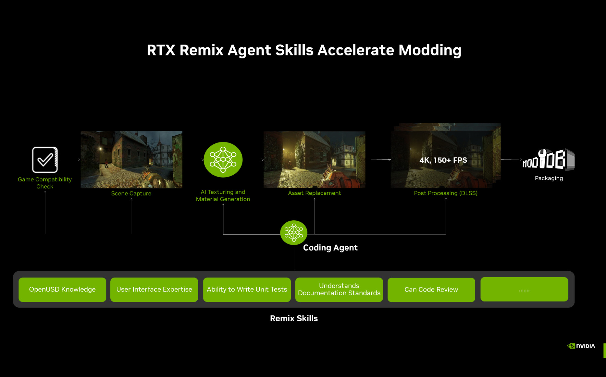

Главное в RTX Remix 1.5 — набор функций Toolkit, упрощающих упаковку, и улучшения рантайма, повышающие стабильность трассировки пути. От автоматического сглаживания геометрии до масштабной оптимизации сцен — версия 1.5 позволяет моддерам эффективнее браться за более крупные и сложные проекты.

**С новыми инструментами моддеры и их агенты для программирования могут:**

* **Уменьшить размер пакета:** использовать высокопроизводительную технологию хранения RTX IO.
* **Настраивать освещение во вьюпорте:** проще настраивать манипуляторы источников света и управлять ими.
* **Ускорить ремастеринг геометрии:** автоматически сглаживать устаревшую геометрию.
* **Работать спокойнее:** новая необязательная система автосохранения.

### RTX Remix Toolkit

#### Расширенная упаковка и автоматизация

В Toolkit улучшен процесс упаковки, рассчитанный на растущий масштаб современных ремастеров.

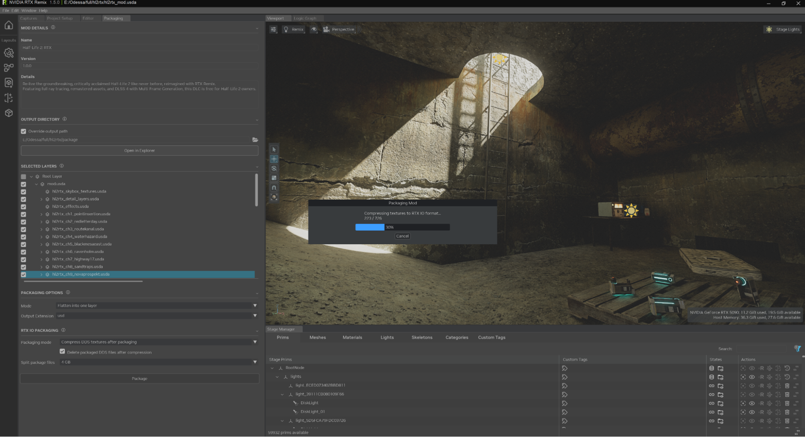

* **Сжатие RTXIO:** добавлена встроенная поддержка упаковки и извлечения текстур с помощью RTXIO, что значительно уменьшает объём ассетов высокого разрешения.
* **Сведение переопределений:** новый параметр позволяет сводить сложные многослойные переопределения в один оптимизированный результат для финального выпуска.
* **Расширение автосохранения:** чтобы не терять данные в долгих сеансах, в Toolkit появилось автосохранение с настраиваемым интервалом.

```{seealso}
Подробнее об упаковке модов см. [здесь](../howto/learning-packaging.md).
```

#### Улучшения интерфейса и рабочего процесса

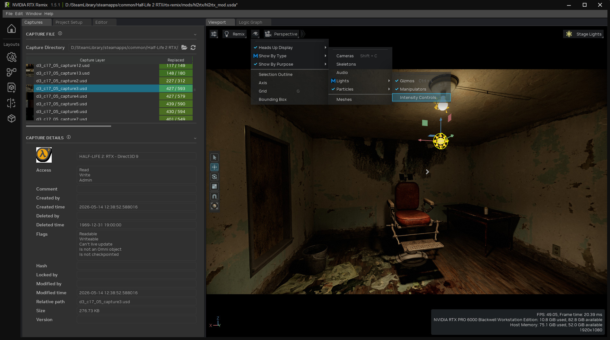

* **Единое меню источников света:** все манипуляторы источников света доступны из одного меню вьюпорта, что позволяет быстро переключать их видимость и сохранять настройки интенсивности.
* **Улучшения Stage Manager:** добавлен фильтр «Deleted Reference» и улучшено переключение видимости мешей. Подсказки полей ввода свойств теперь учитывают конкретное поле, что особенно помогает со сложными настройками частиц.
* **Отзывчивость:** уведомления USD теперь группируются, чтобы сократить лишние обновления вьюпорта, и работа с большими сценами стала гораздо отзывчивее.

#### Производительность и стабильность

* **Пакетная обработка в Stage Manager:** система фильтрации Stage Manager переписана с использованием однопоточного пакетного выполнения. Это значительно ускоряет обновление при работе с огромными сценами.
* **Ограничение частоты записи:** запись при перетаскивании в редакторе частиц теперь ограничена по частоте, чтобы FPS не падал при редактировании в реальном времени.
* **Исправления ошибок:** исправлен ряд регрессий, включая повреждение списка «Recent Projects», накопление команд отмены и повтора и проблемы с показом выделенного на панели Selection.

### RTX Remix Runtime

#### Сглаженные нормали и стабильность геометрии

Одна из ключевых задач версии 1.5 — улучшить взаимодействие устаревшей геометрии с современным освещением с трассировкой пути.

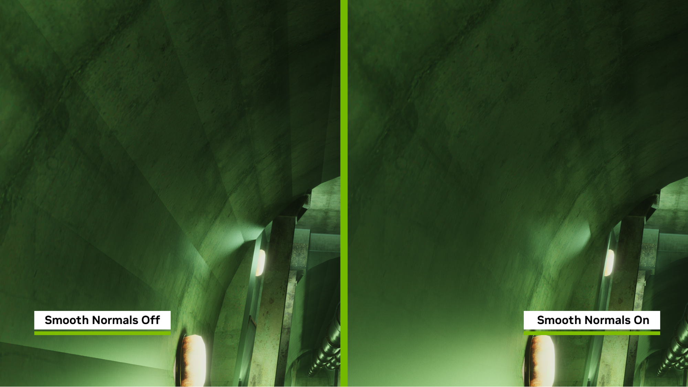

* **Сглаженные нормали на GPU/CPU:** Remix теперь умеет на лету генерировать сглаженные нормали для геометрии D3D9. Это устраняет «гранёный», угловатый вид поверхностей, у которых нет исходных нормалей вершин. Функция включается по желанию через разметку текстур.
* **32-битные индексные буферы:** при построении списков треугольников добавлена поддержка 32-битных индексных буферов, что устраняет повреждение геометрии в играх с очень большими буферами (например, *Brutal Legend*).
* **Отсечение PointInstancer:** добавлено отсечение PointInstancer на GPU с настраиваемыми расстоянием и затуханием, что обеспечивает стабильную производительность в сценах примерно до 2 млн объектов.

#### Продвинутый рендеринг и объёмные эффекты

* **Пропускание через полупрозрачные материалы:** лучи света в системе объёмных эффектов теперь проходят сквозь воду и стекло, что даёт реалистичное подводное освещение и тени от преломления.
* **NRC Boost Emissives:** эта функция, включённая по умолчанию, восстанавливает пропадающее излучающее освещение на непрямых отражениях при использовании нейронного кеширования излучения (NRC).
* **Улучшенные параллакс и IOR:** добавлены масштабирование смещения POM по направлениям и глобальный множитель IOR, дающие моддерам более тонкий контроль над видом полупрозрачных и текстурированных материалов.

#### Система частиц

Мы доработали архитектуру частиц, представленную в предыдущей версии, для большей визуальной согласованности.

* **Единая ориентация:** исправлена ошибка, из-за которой частицы отображались вверх ногами; теперь у всех типов частиц единая ориентация.
* **Инструменты миграции:** добавлена автоматическая миграция проектов с Particle 1.0 на 2.0, а также исправлена ошибка, из-за которой частицы не отображались на мешах без замены.
* **Точное появление частиц:** устранены скопления и шлейфы в системах частиц пыли при масштабе сцены, отличном от единичного.

#### Совместимость и глобальная поддержка

* **Поддержка Unity:** устранена давняя проблема, из-за которой игры на Unity отображались вверх ногами из-за отрицательной оси Y в проекции пространства отсечения.
* **Локализация:** Remix теперь сохраняет допустимые символы UTF-8 в метаданных игры, обеспечивая правильное отображение кириллицы и языков CJK (китайского, японского, корейского).
* **Оптимизация производительности:** обработка статистики DebugView в разрешении 4K ускорена с 42 мс до 1 мс.

### Код и вклад сообщества

В этот выпуск вошло множество исправлений, сделанных по сообщениям сообщества на GitHub:

* **Исправления рендеринга:** масштабирование разрешения SSS, излучающее освещение NRC и мерцание NEE-кеша при движении камеры.
* **Стабильность:** устранены сбой use-after-free при Alt-Tab и сбои, связанные с мешами со скиннингом с чрезмерным числом костей.
* **Благодарности сообществу:** отдельное спасибо участникам, которые помогли устранить сбой при захвате в *OutRun 2006* и доработать логику автоопределения неба для миров с общей камерой.

```{seealso}
Примечания к выпускам на GitHub см. на странице [выпусков RTX Remix](https://github.com/NVIDIAGameWorks/rtx-remix/releases).
Полный список изменений Toolkit см. [здесь](remix-full-changelog.md)
```

***


## Примечания к выпуску RTX Remix 1.4 (21.04.2026)

Мы рады представить официальный выпуск RTX Remix 1.4. Это обновление — важная веха в качестве графики и удобстве моддинга, главная новинка которой — дебют продвинутых эффектов частиц (Advanced Particle VFX). Эта переработка меняет подход к эффектам окружения и боевым эффектам, позволяя моддерам создавать сложное кинематографичное поведение частиц, которое раньше было невозможно.

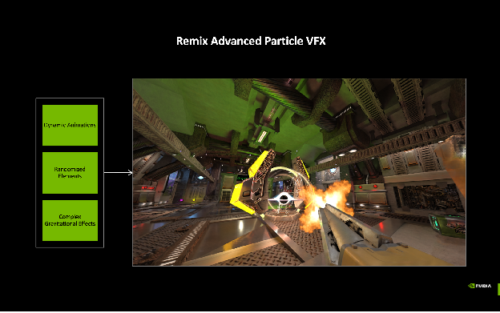

Помимо частиц, мы уделили внимание «душе» игровых персонажей: специальные шейдеры глаз дают беспрецедентный реализм цифровым людям. Вместе с ускорением RTX Skin на 55% и полностью единым оформлением интерфейса Toolkit и рантайма версия 1.4 делает путь к шедевру с трассировкой пути проще и производительнее, чем когда-либо.

### С новыми инструментами моддеры могут:

* **Развивать анимацию частиц:** с помощью нового редактора кривых менять цвет, размер и скорость частиц на протяжении всей их жизни.
* **Создавать реалистичных персонажей:** использовать параллакс-глубину и сферические нормали для глаз, оживляя NPC.
* **Оптимизировать тяжёлые сцены:** получить значительный прирост производительности в сценах с материалами кожи или воска благодаря оптимизации RTX Skin.
* **Работать быстрее:** мгновенно перезагружать текстуры без перезапуска игры.

### RTX Remix Toolkit

#### Редактор кривых частиц

Главная новинка Toolkit — новый редактор кривых. Теперь моддеры могут точно управлять свойствами частиц во времени.

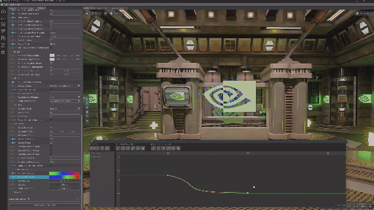

* Поддерживаются полноценные кривые Безье и Эрмита с пользовательскими типами касательных.
* Детальное управление цветовыми градиентами, скоростью вращения и масштабированием скорости.
* Визуализация данных о времени жизни для более тонкого контроля и создания VFX.

```{seealso}
Подробнее о работе с частицами см. [документацию по системе частиц](../howto/learning-particles.md).
```

#### Улучшения интерфейса и рабочего процесса

* **Псевдонимы примов:** добавлен атрибут «Nickname» для примов в дереве выделения и Stage Manager, чтобы было проще отслеживать конкретные ассеты в сложных сценах.
* **Улучшенный Stage Manager:** добавлены плагины фильтров Instance Group и Mesh Group с новыми заголовками разделов для более быстрой навигации.
* **Проверка Scan Folder:** повышена надёжность импорта моделей, исправлена обработка флажков множественного выбора в инструменте Scan Folder.

#### Исправления ошибок и небольшие изменения

* Исправлена логика обновления Stage Manager: элементы заполняются правильно до отображения интерфейса.
* Фильтр Mesh Prim Filter в Stage Manager теперь правильно исключает источники света из фильтров только для мешей.
* Устранена проблема, из-за которой выделение во вьюпорте не показывало выбранные объекты на вкладке Skeleton.

#### Для разработчиков и участников

* Добавлен `create_venv.bat`, упрощающий создание виртуального окружения для разработки.
* Кодовая база переведена на [ruff](https://docs.astral.sh/ruff/) для форматирования и линтинга, модернизирована под Python 3.10, добавлены хуки pre-commit для автоматической проверки качества кода.


```{seealso}
Полный список изменений Toolkit см. [здесь](remix-full-changelog.md)
```

---

### RTX Remix Runtime

#### Продвинутые эффекты частиц

Масштабная переработка системы частиц даёт современную основу для всех эффектов Remix с полной обратной совместимостью с существующими ассетами USD и Hydra.

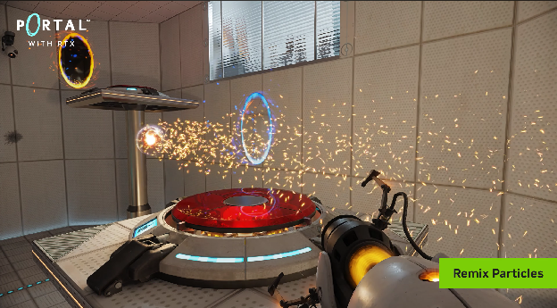

* **Физика и взаимодействие:** добавлены физические аттракторы, притягивающие или отталкивающие частицы от определённых точек, и сопротивление воздуха для имитации реалистичного трения.
* **Режимы столкновений:** при столкновении с геометрией частицы теперь могут отскакивать (Bounce), останавливаться (Stop) или уничтожаться (Kill).
* **Анимация спрайт-листов:** новые режимы «флипбука» позволяют использовать анимированные текстуры на частицах, включая случайный выбор спрайта для разнообразия.
* **Отсечение в экранном пространстве:** отсечение в мировом пространстве заменено эвристикой в экранном пространстве, поэтому частицы больше не исчезают внезапно, когда игрок приближает камеру или подходит слишком близко.
* **Двумерный размер:** у частиц теперь независимые размеры по X и Y для неквадратных эффектов, например искр или обломков.

#### Продвинутый рендеринг и визуальные эффекты

* **Специальные шейдеры глаз:** непрозрачные шейдеры теперь поддерживают параллакс-глубину радужки и гладкие сферические нормали белков (склеры), создавая объём и реалистичные отражения.
* **Оптимизация RTX Skin:** RTX Skin, или подповерхностное рассеивание (SSS), теперь работает до 55% быстрее. Этого удалось добиться маскированием экземпляров SSS, отсечением задних граней и эвристикой однократного рассеивания для пропускания.
* **Горячая перезагрузка текстур:** можно включить отслеживание изменений файловой системы, и текстуры будут обновляться в игре прямо при сохранении в графическом редакторе.

#### Переработка интерфейса и конфигурации

* **Единое оформление:** интерфейс рантайма теперь использует стиль Toolkit, включая улучшенные отступы, состояния при наведении и новый полужирный шрифт для лучшей читаемости.
* **Слои RtxOption:** переработан способ сохранения настроек. Локальные изменения пользователя теперь строго отделены в `user.conf`, а значения по умолчанию для конкретного мода хранятся в `rtx.conf`. Новый процесс миграции автоматически переносит существующие настройки в нужные слои.

---

#### Код и вклад сообщества

* **Улучшенные частицы:** огромное спасибо @runestorm за исходный запрос на улучшение и отзывы, определившие архитектуру Advanced Particle VFX.
* **Исправление стабильности:** спасибо @xoxor4d за исправление ошибки сериализации, из-за которой системы частиц не создавались через Remix API.
* **Оптимизация сборки:** в систему сборки добавлена поддержка предкомпилированных заголовков, что значительно сокращает время компиляции для участников.

#### Исправления ошибок и небольшие изменения

* Исправлена давняя ошибка ориентации, из-за которой частицы-билборды отображались вверх ногами.
* Устранено искажение «свечения» на удалённой геометрии с альфа-смешиванием: расстояния попадания масштабируются, чтобы избежать переполнения Float16.
* Устранены «скачки» размытия текстур при выходе из полноэкранных меню.
* Исправлены сбои при попытке захвата или экспорта в защищённые от записи каталоги; теперь вместо этого появляется диалог с предупреждением.
* Ввод с мыши и клавиатуры блокируется, когда окно игры не в фокусе, чтобы избежать случайного изменения настроек.


***

## Примечания к выпуску RTX Remix 1.3 (27.01.2026)

Мы рады объявить об официальном выпуске **RTX Remix 1.3**. В RTX Remix появилась система **RTX Remix Logic**, которая позволяет Remix распознавать игровую логику и делать моды более захватывающими и динамичными. Remix Logic предоставляет игровые события в реальном времени, с помощью которых моддеры могут запускать визуальные изменения в своих модах — без исходного кода и навыков программирования. Remix Logic — мощный инструмент: моддеры могут считывать многие аспекты состояния игры и поведения игрока и в ответ менять изображение с помощью всех 900+ настроек меню RTX Remix Runtime.

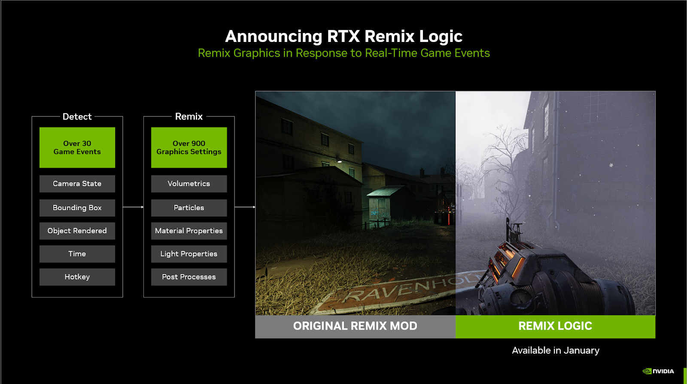

Такой контроль над причинами и следствиями открывает новые возможности. Моддеры могут:

* ограничивать визуальные эффекты моментами, когда игрок находится в определённой части уровня;
* анимировать параметры меню Remix Runtime, создавая новые визуальные эффекты;
* создавать новые игровые системы, например ночное видение или систему предупреждения о врагах;
* устраивать зрелищные визуальные сцены, выстраивая последовательность изменений во времени.

Remix Logic доступна для любого мода RTX Remix.

```{seealso}
Подробнее о том, как начать, см. в [полной документации по Remix Logic](../howto/learning-logic.md).

Полный список доступных узлов приведён в [справочнике компонентов](../components/index.md).
```

### RTX Remix Toolkit

#### Remix Logic

Добавлена поддержка системы **RTX Remix Logic**, позволяющей моддерам динамически менять настройки Remix в зависимости от обнаруженного состояния игры.

Чтобы добавить Remix Logic в мод, откройте вкладку «**Logic Graph**», выберите **прим** **источника света** или **меша** и создайте «New Graph» на панели «Logic Properties», в левом верхнем углу вкладки «Logic Graph» или в центре этой вкладки (см. изображение ниже).

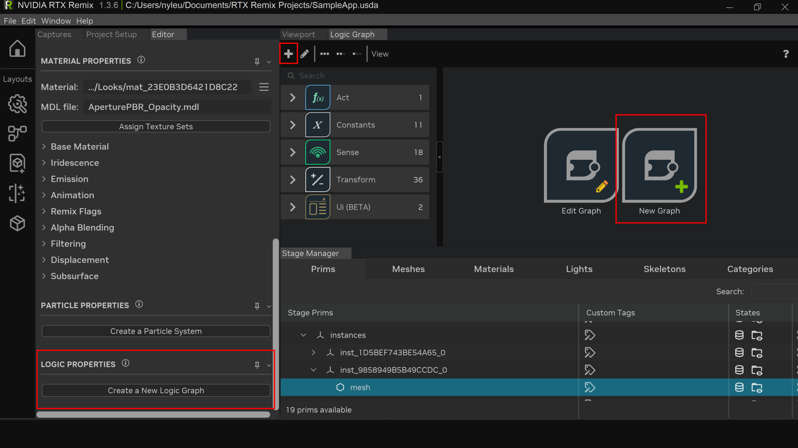

Графы логики — это работа с узлами: моддеры соединяют узлы, определяющие, какие игровые события отслеживать и как в ответ менять изображение. Для работы с графами логики не нужны ни навыки программирования, ни исходный код.

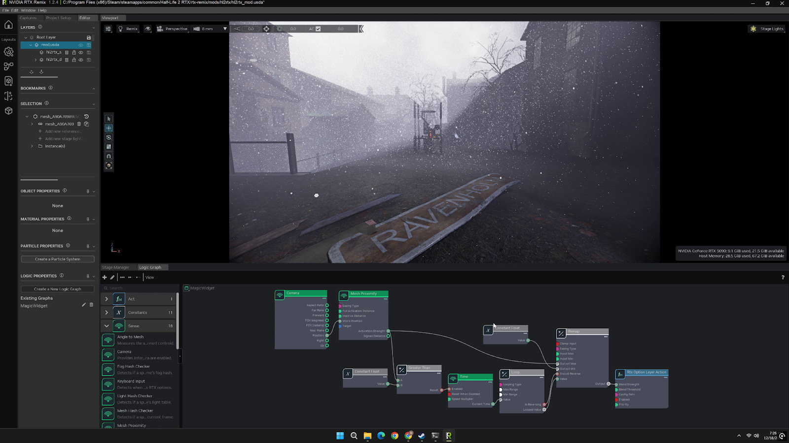

Remix Logic поддерживает четыре типа узлов:

* **Sense:** отслеживают игровое событие (например, Camera, Mesh Proximity, Time, Keyboard Input и т. д.).
* **Transform:** преобразуют входные данные в другие типы или вводят условия и правила (например, Add, Between, Bool AND, Bool OR, Greater Than и т. д.).
* **Act:** выполняют визуальное изменение. На старте поддерживается загрузка разных файлов `rtx.conf` и смешивание между ними для изменения параметров Remix Runtime. В будущем мы планируем расширить набор узлов Act.
* **Constants**: позволяют использовать одно значение в нескольких компонентах и задавать свойства гибкого типа (например, Constant String, Constant Hash, Constant Bool и т. д.).

Remix Logic построена на фреймворке [Omnigraph](https://docs.omniverse.nvidia.com/extensions/latest/ext_omnigraph.html), который задаёт типы узлов и хранит графы в USD, а редактор графов Omnigraph даёт моддерам среду без программирования.

#### Улучшения интерфейса

* Добавлены **закрепляемые и настраиваемые макеты**
    * Все панели теперь являются окнами, и их можно расположить так, как удобно для работы.
    * На левой панели есть различные макеты, заранее расставляющие окна и вкладки в удобные конфигурации и оставляющие больше места для вьюпорта.
    * В меню «Window» можно скрывать и показывать отдельные панели.
    * В меню «Window» можно сохранять и загружать собственные макеты.

* В Stage Manager появились строка поиска и настраиваемые фильтры.

#### Исправления ошибок и небольшие изменения

* Добавлена проверка: если каталог захватов не найден, используется каталог проекта.
* Исправлены проверка и восстановление символической ссылки, когда каталога deps нет.
* Исправлено: панель свойств частиц не сохраняла состояние развёрнутости при обновлении.
* Исправлена логика автопрокрутки на некоторых вкладках Stage Manager.
* Удалена поддержка путевых точек (waypoints).


#### Вклад сообщества
* Вкладки моддинга переведены на вертикальное расположение, автор — @Simon-Lajoie, [PR 7](https://github.com/NVIDIAGameWorks/toolkit-remix/pull/7)

***

### RTX Remix Runtime

#### Remix Logic и новые conf-файлы

Добавлена поддержка системы **RTX Remix Logic**, включая систему слоёв, позволяющую жонглировать несколькими файлами «.conf» и плавно переходить между ними; каждый из них содержит собственный набор параметров RTX Remix Runtime. Моддеры могут задавать относительную «силу смешивания» каждого слоя, что даёт плавную интерполяцию значений и точный контроль.

Чтобы упростить создание модов, в Remix появилось три типа файлов конфигурации.

*   **Файлы `rtx.conf`**. Они не изменились. Это основа работы моддера по приведению игры к «совместимости с Remix». Моддеры настраивают, как игра рендерится, чтобы она лучше всего работала с Remix, сохраняют это в `rtx.conf` и публикуют, например, на ModDB, чтобы другим моддерам было проще начать работу над своим модом.

*   **Файлы `user.conf`**. Это новый тип, предназначенный для хранения личных графических настроек пользователя, например графического пресета и того, включена ли генерация кадров. Они должны подстраиваться под игрока и отражать оптимальные для него графические настройки.

*   **Новые `.conf`-файлы Logic**. Для графов Remix Logic моддеры могут экспортировать из рантайма файл `new.conf`. Его предполагается переименовать и использовать как слой, который временно загружается в ответ на изменение состояния игры.

Когда моддер сохраняет настройки рантайма в «User Graphics Menu», они автоматически записываются в `user.conf`. Кроме того, в «Advanced Developer Menu» рядом с кнопкой сохранения появился новый выпадающий список:

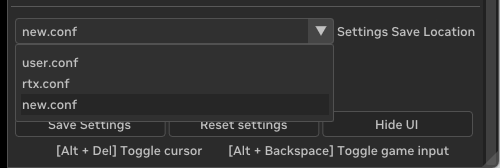


```{important}
Если вы собираетесь создавать новые conf-файлы для Remix Logic, следуйте шагам, описанным [здесь](../howto/learning-logic.md#remix-logic-и-новые-conf-файлы).
```

#### Улучшения качества жизни

* Реализована новая система ввода для интерфейса на основе оверлея, не зависящая от исходной игры, что обеспечивает единообразную и надёжную работу интерфейса Remix. Устранены проблемы, когда некоторые игры «съедали» ввод с клавиатуры или мыши и интерфейс Remix переставал реагировать. Добавлено прозрачное окно-оверлей поверх всех окон для продвинутой и бесшовной обработки ввода в интерфейсе внутри игры (включено по умолчанию, настраивается при запуске).
* Улучшен трассировщик пути RTX Remix. Исправлены математические ошибки и бесконечности в расчётах материалов, очищаются недопустимые нормали и текстурные координаты. Повышена точность векторов движения для лучей-промахов, добавлена защита от деления на ноль.
* Повышена стабильность DLSS Multi Frame Generation при изменении размера окна игры и настроек дисплея. DLSS Frame Generation теперь синхронизирует поток вычислительного шейдера при смене презентера и проверяет размеры выходного окна при запуске, при необходимости сбрасывая контекст FG.
* Улучшена совместимость: исправлены проблемы точности в играх с вершинными шейдерами, которые раньше проявлялись в виде дрожания или «взрывов» вершин.
* Система частиц дополнена режимом постоянных частиц и поддержкой нескольких режимов генерации геометрии билбордов. Расширены допустимые диапазоны некоторых значений системы частиц в интерфейсе.
* Цвет вершин как запечённое освещение реализован как свойство отдельной поверхности. Добавлена эвристика для устаревших материалов на основе состояния фиксированного конвейера. Для частиц эта функция отключена (поскольку у них цвет вершин точно не является запечённым освещением).
* Обратные вызовы при изменении параметров RTX (включая каскадные изменения) теперь применяются в том же кадре к итоговому значению, что обеспечивает единообразное поведение.

#### Вклад сообщества


* Весь интерфейс Remix Runtime переделан благодаря xoxor4d, [PR 105](https://github.com/NVIDIAGameWorks/dxvk-remix/pull/105). Добавлены выбор темы оформления из трёх тем, компактный и просторный режимы, переключатель крупного интерфейса и ползунок прозрачности фона. Внесён ряд изменений, улучшающих внешний вид и удобство меню:
  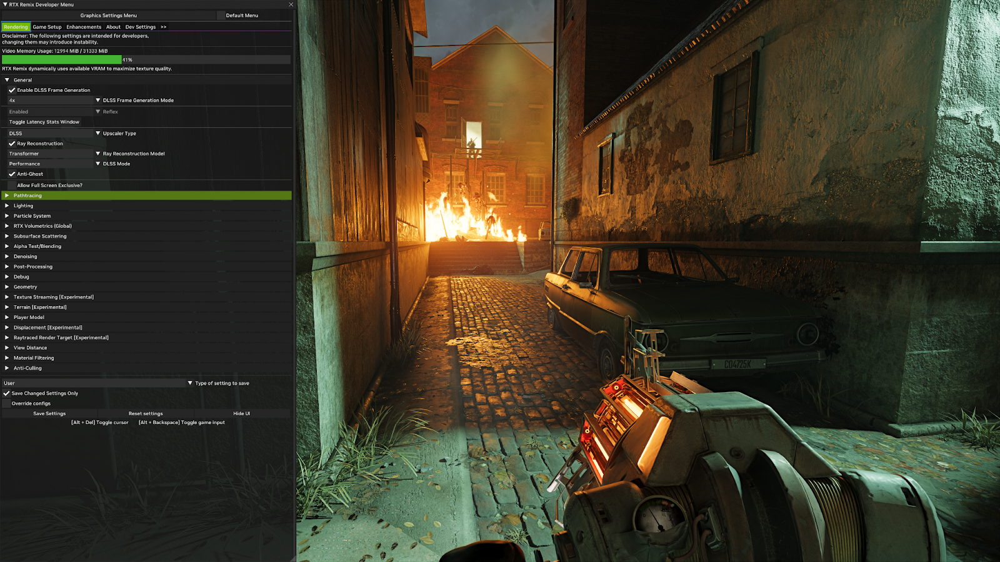
* Добавлен апскейлер XeSS 2.1 SR благодаря sambow23, [PR 100](https://github.com/NVIDIAGameWorks/dxvk-remix/pull/100)

#### Исправления ошибок и небольшие изменения

* Исправлено ограничение минимального и максимального значений параметра ev в настройках Debug View.
* Исправлен редкий искусственный оттенок во вторичных отражениях и непрямом освещении.
* Исправлена привязка виртуальных клавиш: в качестве разделителя теперь требуется ',' вместо '+'.
* Исправлен выпадающий список графических пресетов: теперь применяется правильный пресет. Из-за ошибки при смене пресет обновлялся до ранее выбранного, а не до активного.
* Исправлены ошибки при переопределении профиля DLSS на Full Resolution (DLAA) через NVIDIA App.
* Исправлено немного неверное определение входного разрешения DLSS и PerfQuality для заданного профиля DLSS (проблема GitHub #900).
* Исправлена проблема, из-за которой частицы иногда отображались без цвета текстуры из-за наследования устаревшего материала; теперь для рендеринга частиц можно явно задать устаревшую настройку.
* Резервный направленный источник света теперь обнаруживает изменение настроек и реагирует на него.
* Исправлено ограничение значений при задании evMin/evMaxValues для Debug Views с помощью обратных вызовов onChange.
* Исправлено отслеживание ресурсов структур ускорения, чтобы ресурсы не уничтожались, пока они ещё привязаны в dxvk.
* Исправлена сериализация отсутствующего параметра volumetricRadianceScale в Bridge.

#### Известные проблемы

* При сохранении мода не оставляйте флажок «Save Changed Settings Only» снятым и не включайте «Override configs». Это может приводить к проблемам с переработанной системой нескольких файлов конфигурации: в файлы rtx/user/new могут попадать нежелательные настройки. По умолчанию рекомендуем всегда держать «Save Changed Settings Only» включённым и хотя бы раз сохранить личные графические настройки в основном меню Graphics Menu, чтобы они попали в `user.conf`.

  ```{image} ../data/images/remix-config-save-settings-1.png
  :width: 400px
  ```

  ```{image} ../data/images/remix-config-save-settings-2.png
  :width: 400px
  ```

  Если этот флажок у вас был снят, включите его, удалите все файлы `user.conf` из структуры файлов и сохраните личные графические настройки в «Graphics Menu». Затем удалите все созданные для Remix Logic файлы new.conf и создайте их заново.

* Миграция разметки текстур:
    * Пользователи сборок GitHub Actions могли сохранить в `user.conf` настройки, не являющиеся пользовательскими. Это вызывает проблемы, особенно при добавлении и удалении текстур из категорий текстур.
    * Чтобы решить эту проблему, мы добавили процесс миграции, переносящий все наборы хешей текстур из `user.conf` в `rtx.conf`.

  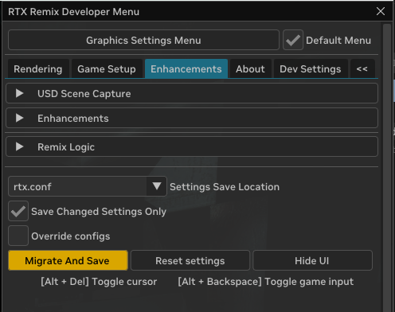

  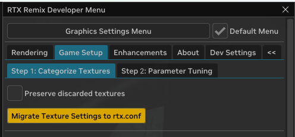

  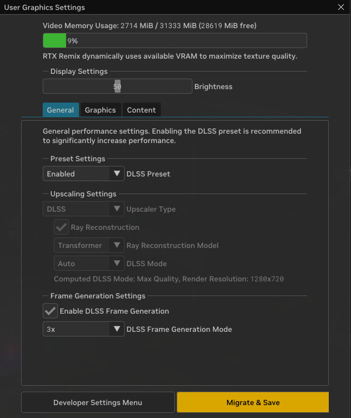

  * Если в вашем `user.conf` есть категории текстур, меню рантайма предложит кнопки «Migrate», прежде чем позволит сохранить `rtx.conf` или `user.conf`. Нажатие этих кнопок перенесёт категории текстур в `rtx.conf` (объединив их с уже имеющимися) и сохранит оба файла.
  * После миграции текстуры можно будет добавлять и удалять как обычно.
  * ПРИМЕЧАНИЕ: текстуры, добавленные в dxvk.conf, в жёстко заданный config.cpp или в `.conf`-файлы Logic, в версии 1.3 нельзя удалить через интерфейс. Такие файлы придётся редактировать вручную.

* Проверка соединений в редакторе графов
    * После удаления соединения между узлами в редакторе графов некоторые соединения ошибочно отображаются как существующие. При повторном открытии графа отображение соединений обновится.


```{seealso}
Списки изменений

- Примечания к выпуску рантайма см. [здесь](https://github.com/NVIDIAGameWorks/rtx-remix/releases/tag/remix-1.3.6)
- Полный список изменений Toolkit см. [здесь](remix-full-changelog.md)
```

***

## Примечания к выпуску RTX Remix 1.2 (09.09.2025)

Мы рады объявить об официальном выпуске RTX Remix 1.2. В RTX Remix появилась система частиц с трассировкой пути — ещё
одна важная опора платформы для творчества. Теперь с Remix можно переосмыслить *каждый* важный графический элемент в
[более чем 165 классических играх](https://www.moddb.com/rtx) и поднять их до современного уровня: освещение с
трассировкой пути, детализированные по полигонам ассеты, физически точные материалы, а теперь и частицы с трассировкой
пути.

Частицы RTX Remix обрабатываются на GPU, поэтому их можно добавлять десятками тысяч без заметного падения
производительности. Они рассчитываются с трассировкой пути, то есть отбрасывают точные тени и отражаются в окружении —
редкость для игр. А ещё у них реалистичная физическая симуляция с правильными столкновениями с окружением. Всё вместе это
даёт моддерам возможность создавать потрясающие визуальные эффекты.

```{video} ../data/videos/remix-particle-example.mp4
:alt: Remix Particles Example
:controlslist: nodownload
:class: video-player
:width: 100%
:playsinline:
:muted:
:autoplay:
:loop:
```

*Пример: враг в Half-Life 2 RTX рассыпается на 100 000 частиц с реалистичной физикой и тенями*

Мы поддерживаем два способа добавления частиц RTX Remix.

1. ***Создавайте частицы прямо во время игры:*** во время игры с помощью RTX Remix Runtime можно мгновенно пометить любую
   видимую текстуру как излучатель частиц. Это отлично подходит для прототипирования или добавления нескольких систем
   частиц в мод.
2. ***Создавайте частицы в Toolkit:*** в RTX Remix Toolkit есть богатый набор средств для добавления частиц и управления
   ими. Это лучший способ наполнить мод множеством частиц и обновить его облик великолепными визуальными эффектами.

Перейдём к подробностям —

### RTX Remix Toolkit

#### Новые возможности

* **Частицы RTX Remix с трассировкой пути:**

    * **Создание систем частиц**: добавить частицы в мод через RTX Remix Toolkit можно несколькими способами.
      Просто выберите меш или материал и превратите его в излучатель частиц одним из способов:
        * **Способ 1**: нажмите кнопку «Create a Particle System» на панели Particle Properties;
        * **Способ 2**: щёлкните правой кнопкой по мешу в Stage Manager и выберите «Particle System» \> «Add»;
        * **Способ 3**: нажмите значок частиц в Stage Manager в столбце Actions.

  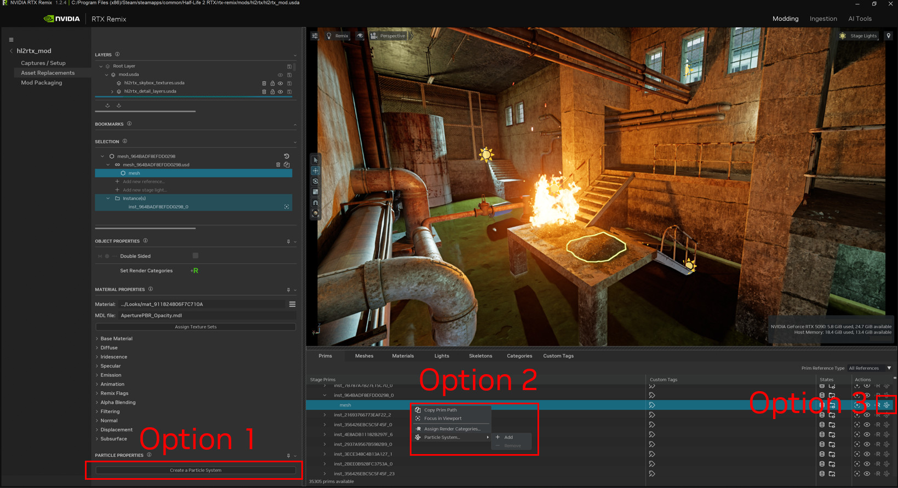

    * **Гизмо и выделение во вьюпорте**: системы частиц теперь можно выделять во вьюпорте с помощью нового гизмо.
      При выделении гизмо подсвечивает меш-излучатель.

  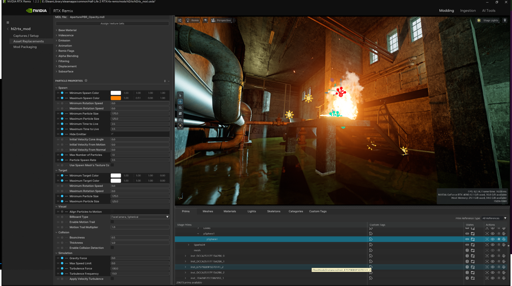

    * **Редактор свойств**: добавлена новая панель Particle Properties. Мы хотели дать моддерам такой же контроль, к
      которому привыкли профессиональные художники студий: настройку внешнего вида частиц, их физической симуляции и
      даже свойств столкновений. Можно загружать текстурные карты и менять цвет частиц во времени, настраивать их
      физику — гравитацию и турбулентность — и даже задавать, как они должны сталкиваться с окружением. Посмотрите сами:

  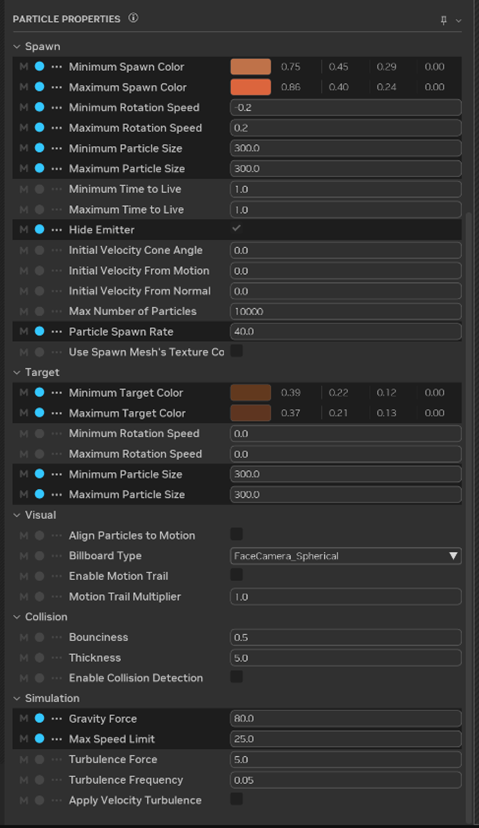

    * **Категория излучателей частиц**: в список категорий Remix добавлена категория «particle emitter», позволяющая
      помечать глобальные частицы в рантайме.
    * **Действия в Stage Manager**: в Stage Manager добавлена кнопка действия, которая показывает, какие примы являются
      системами частиц, и позволяет создавать или удалять их одним щелчком.
    * **Документация**: [добавлена новая документация по системе частиц.](../howto/learning-particles.md)

#### Оптимизация производительности и памяти

* **Оптимизация обновления дерева слоёв**: оптимизирован способ обновления дерева слоёв, что должно повысить
  производительность в больших проектах.

#### Качество изображения и совместимость

* **Отображение версии приложения**: на главном экране теперь показывается более подробный номер версии приложения.

#### Для разработчиков и участников

* **Поддержка пользовательских USD-схем**: добавлена поддержка пользовательских USD-схем, например `RemixParticleSystem`.

* **Улучшенная документация по отладке**: улучшена документация о том, как отлаживать приложение из Python.

* **Проверки PR на GitHub**: в рабочий процесс добавлены проверки пулл-реквестов на GitHub.

* **Исправление CLA Assistant**: исправлен CLA Assistant для пулл-реквестов на GitHub.

* **Шаблон очистки в Stage Manager**: в плагины контекста и слушателей Stage Manager добавлен шаблон `cleanup`, чтобы
  уменьшить возможные утечки памяти.

#### Вклад сообщества

* **REST API для закрытия проекта**: благодаря **@Night1099** добавлена конечная точка REST API для закрытия активного проекта.

#### Исправления ошибок

* **Панель свойств**: исправлена проблема, из-за которой кнопка «Reset to Default» не работала для некоторых атрибутов
  на панели свойств.

* **Вьюпорт и камера**:

    * Исправлено начальное положение камеры при загрузке захвата и при создании путевых точек для новых захватов.
    * Скорость масштабирования во вьюпорте теперь правильно учитывает настройки.

* **Stage Manager**: исправлена ошибка, из-за которой Stage Manager не обновлялся в ответ на уведомления USD.

* **Служба импорта:**

    * Исправлена ошибка, из-за которой при обновлении схемы ошибочно срабатывал обратный вызов проверки.
    * Исправлена ошибка ValidationSchema, возникавшая при указании нескольких входных файлов.
    * Исправлена небольшая ошибка в ValidationSchema при указании нескольких входных файлов.

* **Панель Layers:**

    * Исправлена проблема, из-за которой после обновления дерево слоёв неправильно восстанавливало предыдущее выделение
      или целевой слой редактирования.
    * Исправлено: панель слоёв не разворачивалась по умолчанию.

* **Сервер MCP**: исправлены отсутствующая ссылка и проблема с журналированием при запуске сервера MCP.

## RTX Remix Runtime

### Новые возможности

* **Система частиц RTX Remix**: с RTX Remix Runtime частицы теперь можно добавлять мгновенно прямо во время игры. Во
  время игры с помощью RTX Remix Runtime можно пометить любую текстуру как излучатель частиц. У такого способа создания
  частиц есть три ключевых ограничения:

    * Частицы, созданные таким способом, настраиваются глобальными ползунками, а у частиц, созданных в RTX Remix
      Toolkit, настройки сохраняются для каждого излучателя.
    * Частицы, созданные таким способом, выглядят как помеченная текстура. В RTX Remix Toolkit для внешнего вида частиц
      можно использовать собственную текстуру.
    * Сделать излучателем частиц меш можно только в RTX Remix Toolkit.
    * Из-за этих ограничений RTX Remix Runtime отлично подходит для прототипирования или добавления нескольких систем
      частиц в мод, но более сложные эффекты лучше делать в RTX Remix Toolkit.

* **Создание и изменение частиц прямо во время игры:**

    * В расширенном меню разработчика на вкладках Games Setup \> Categorize Textures теперь можно выбрать любую
      текстуру и пометить её новой категорией «Particle Emitters».

  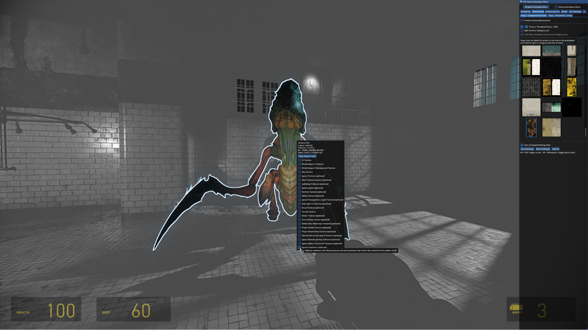

    * Внешний вид частиц настраивается глобальными ползунками на вкладке «Rendering» \> «Particle System».

  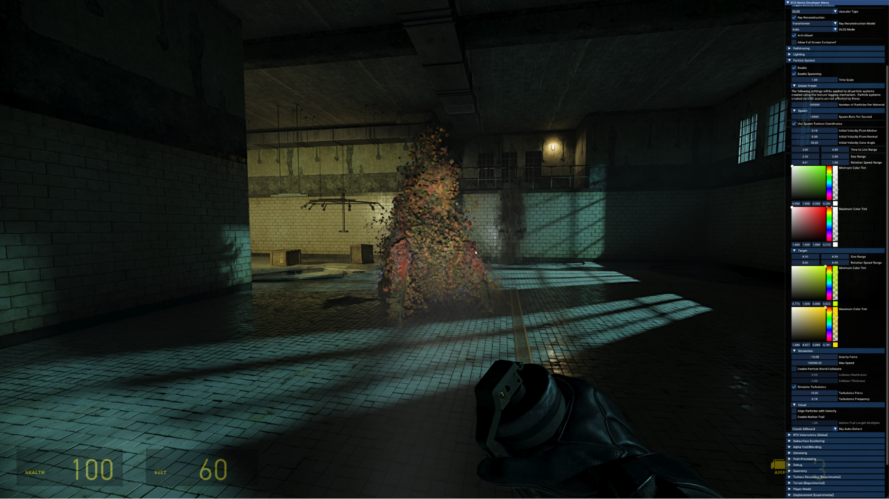

* **Ограничение значений настроек**: в RTX Options добавлена поддержка ограничения значений, то есть разработчики могут
  задавать допустимые диапазоны настроек. Это не даёт вводить недопустимые значения или значения вне диапазона, делая
  настройку безопаснее и удобнее.

* **Компиляция шейдеров в SPIR-V**: процесс компиляции шейдеров теперь генерирует SPIR-V напрямую из Slang, что
  позволяет использовать новые возможности шейдеров, например встроенные функции кооперативных векторов для нейронного
  шейдинга.

#### Оптимизация производительности и памяти

* **Повышенная стабильность и скорость сборки**: повышена стабильность сборки проекта Remix и сокращено время компиляции.
* **Более эффективный рендеринг**: расчёты в рендерере стали надёжнее, устранён ряд источников недопустимых значений во
  всём конвейере.
* **Эффективное управление ресурсами**: Remix теперь отслеживает замены для экземпляров и источников света, что
  закладывает основу для будущих функций и более эффективного управления ресурсами.

#### Качество изображения и совместимость

* **Прозрачность, не зависящая от порядка**: Remix теперь поддерживает прозрачность, не зависящую от порядка
  (order-independent transparency), что значительно улучшает обработку сцен со множеством перекрывающихся объектов с
  альфа-смешиванием, например дыма или листвы.
* **Расширенный эффект свечения (bloom)**: теперь можно управлять радиусом свечения (параметр `rtx.bloom.steps`), а
  максимальное число шагов bloom увеличено с 5 до 8, что позволяет получить более широкий эффект.
* **Улучшения цвета вершин**: улучшена поддержка цвета вершин для канала излучения.
* **Точность захвата вершин**: захват вершин улучшен за счёт более раннего перспективного деления, что значительно
  повышает точность в играх, использующих вершинные шейдеры. Благодаря этому совместимыми стали новые игры, например
  OutRun 2006: Coast 2 Coast.
* **Запись сведений о системе**: файлы журналов Remix теперь содержат сведения о системе (процессор, память, ОС и т. д.),
  что помогает, в частности, эффективнее диагностировать и классифицировать проблемы пользователей.
#### Для разработчиков и участников

* **Улучшенный вывод компиляции шейдеров**: компиляция шейдеров в рантайме теперь выводит сообщения в `stdout`/`stderr`,
  так что их можно видеть прямо в отладчике IDE.
* **Единая система глобального времени**: новая единая система глобального времени обеспечивает согласованные запросы
  времени во всём коде.

#### Вклад сообщества

* **Игнорирование запечённого освещения в цвете вершин**: благодаря **watbulb** (PR \#99) теперь можно игнорировать всё
  запечённое в цвет вершин освещение при обработке вершин через файл `rtx.conf`
  (`rtx.ignoreAllVertexColorBakedLighting`). Это упрощает работу с играми с непоследовательным запечённым освещением,
  избавляя от необходимости вручную помечать множество текстур.

#### Исправления ошибок

* **Исправления рендеринга**:

    * Исправлена проблема, из-за которой нельзя было создавать материалы с управляемыми параметрами излучения для
      объектов с альфа-смешиванием.
    * Исправлена ошибка, из-за которой излучающие материалы из USD-файлов светились в рантайме, только если в них была
      задана интенсивность, отличная от значения по умолчанию.
    * Исправлена проблема, мешавшая применению некоторых категорий текстур.
    * Исправлены мерцание и неожиданное масштабирование изображения в некоторых играх при включённом DLSS-FG.
    * Исправлена проблема, из-за которой объёмная атмосфера ошибочно центрировалась относительно начала координат, а не
      камеры.
    * Исправлена ошибка, из-за которой BLAS (структура ускорения нижнего уровня) не обновлялась и геометрия оставалась
      неподвижной.

* **Исправления стабильности и сбоев**:

    * Исправлено несколько редких сбоев, связанных с RTX Neural Radiance Cache.
    * Исправлена редкая ошибка use-after-free, связанная с объектами экземпляров замен.
    * Исправлен сбой, который мог возникать, когда источник света-замена переопределялся посторонним игровым источником.
    * Исправлен сбой в граничном случае, когда разные вызовы отрисовки использовали один и тот же объект и трансформацию.
    * Исправлено несколько ошибок проверки Vulkan для повышения стабильности.
    * Исправлены сбои в менеджере источников света: интерфейс отладчика больше не обращается к удалённым источникам.
    * Исправлен сбой при изменении числа примов-замен, прикреплённых к источнику света.

***

## Примечания к выпуску RTX Remix 1.1 (17.07.2025)

Мы рады объявить об официальном выпуске RTX Remix 1.1. В нём есть новые функции, различные оптимизации и изменения во
внутреннем устройстве, которые должны помочь сообществу Remix с открытым исходным кодом. Перейдём к подробностям.

### RTX Remix Toolkit

#### Новые возможности

**RTX Remix — поддержка ИИ-агентов:** мы создали фреймворк, с помощью которого сообщество может создавать собственных
ИИ-агентов RTX Remix, умеющих обращаться к документации и помогать выполнять действия в RTX Remix Toolkit. В качестве
демонстрации концепции мы также выпускаем шаблон для Langflow — бесплатного и популярного инструмента с открытым
исходным кодом для построения ИИ-агентов. С этим шаблоном и новыми возможностями можно создать собственного ИИ-чат-бота
RTX Remix, который с помощью обработки естественного языка будет отвечать на ваши вопросы, самостоятельно изучая
документацию RTX Remix. Он также может выполнять действия в RTX Remix Toolkit по вашим указаниям, используя постоянно
расширяющиеся возможности REST API RTX Remix!

Учтите, что от LLM, на которой работает агент, зависит качество результатов.

Для поддержки этой инициативы мы встроили в RTX Remix Toolkit поддержку сервера MCP. Model Context Protocol (MCP) —
открытый стандарт, дающий ИИ-приложениям единый способ взаимодействия с внешними инструментами и источниками данных. В
RTX Remix MCP служит мостом между ИИ-агентами и функциями Toolkit, предоставляя конечные точки REST API в формате,
который LLM могут понимать и использовать через вызов инструментов.

В ближайшее время ждите агента NVIDIA RTX Remix, который появится в Langflow как агент по умолчанию. Как его настроить,
описано на странице документации. [Подробнее](../howto/learning-mcp.md#использование-langflow)

#### Улучшения качества жизни:

- При выделении любого прима в Stage Manager он теперь выделяется и на панели Selection.
- Добавлены файлы конфигурации для PyCharm, VS Code и Cursor.
- Пользователи RTX Remix теперь могут задавать категории рендеринга в Stage Manager.

#### Улучшения процесса сборки и доступности сборок:

Мы внесли ряд изменений, чтобы улучшить процесс сборки Toolkit и сделать последние сборки доступнее.

- Повышена стабильность и решены различные проблемы процесса сборки Toolkit для моддеров и разработчиков открытого кода.
- Ночные сборки Toolkit теперь доступны через GitHub Actions, поэтому получить последнюю версию Toolkit можно без
  самостоятельной сборки. Как получить последнюю сборку, см. в разделе
  [Загрузка готового пакета для разработки](../installation/install-toolkit.md#загрузка-готового-пакета-для-разработки).
- Скачивая ночные сборки Toolkit, моддеры теперь получают и более свежие изменения рендерера, на котором работает
  вьюпорт RTX Remix.

#### Исправления ошибок (RTX Remix Toolkit)

- Устранены различные сбои, повышена стабильность.
- При удалении замены теперь автоматически выделяется исходный ассет.
- Исправлена ссылка на краткое руководство (Quick Start Guide) на главной странице Toolkit.
- Исправлена проблема, из-за которой при предпросмотре изображений в оттенках серого отображались неверные цвета
  (например, красный) (REMIX-3900) [GH-722](https://github.com/NVIDIAGameWorks/rtx-remix/issues/722)
- Исправлено взаимодействие множественного выделения и переключателей скрытия/показа: теперь при переключении скрываются
  или показываются все выделенные объекты.
- При добавлении нового слоя он теперь правильно наследует метаданные родительского слоя.
- Исправлена ошибка инициализации NRC при загрузке захватов (REMIX-4084)
  [GH-808](https://github.com/NVIDIAGameWorks/rtx-remix/issues/808)
- Исправлена проблема с необновляющимися вкладками Stage Manager.
- Исправлены подписи при закреплении выделенного объекта на панели свойств материала (REMIX-4082).
- После дублирования прим теперь правильно выделяется (REMIX-3970)
  [GH-732](https://github.com/NVIDIAGameWorks/rtx-remix/issues/732)
- Исправлена проблема с удалением мешей с несколькими экземплярами (REMIX-3559)
  [GH-610](https://github.com/NVIDIAGameWorks/rtx-remix/issues/610)
- Наведён порядок в сообщениях об ошибках в журнале и терминале Kit.
- Исправлено перетаскивание файлов в ИИ-инструменты для текстур: теперь правильно поддерживаются расширения файлов
  изображений (например, .png, .jpeg и .jpg).
- Исправлено сообщение об ошибке при импорте текстур с расширениями в верхнем регистре.
- Список «Recent Project» на главной странице теперь обновляется мгновенно при создании или открытии проекта.
- Исправлен сбой при предпросмотре карт нормалей (и любых текстур не в формате RGBA).
- Удалён избыточный вывод для повышения производительности Toolkit.

#### Исправления ошибок (REST API RTX Remix)

- Исправлена конечная точка API `get_texture_material_inputs`.
- Исправлен валидатор API `is_valid_texture_prim`.

### RTX Remix Runtime и рендеринг

#### Новые возможности

**Улучшенный тонмаппер:** повышена точность тонмаппера ACES — он лучше сохраняет света и не допускает перенасыщения.

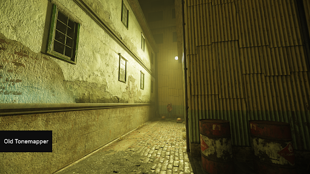
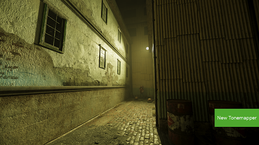

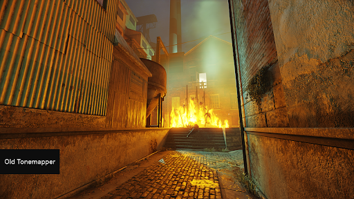
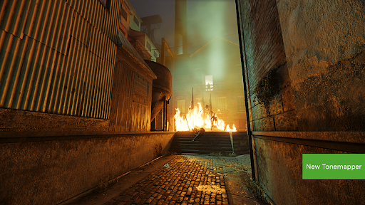

**Ползунок яркости:** в меню User Graphics Settings появился глобальный ползунок яркости, позволяющий подстроить
изображение игры под монитор.

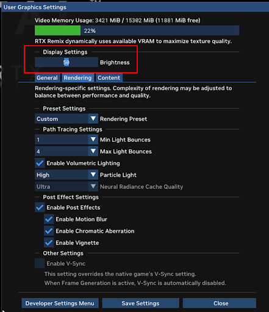

**Объёмные эффекты RTX:** объёмные эффекты теперь поддерживают неоднородный туман как глобальную настройку в рантайме.

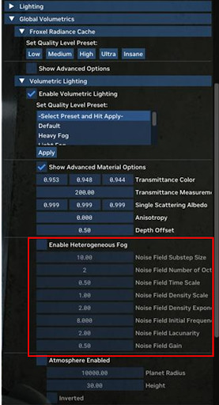

#### Оптимизация производительности и памяти:

- Оптимизированы производительность и расход памяти за счёт поддержки перестроения (refit) BVH и инстансинга.
- На видеокартах с небольшим объёмом видеопамяти Opacity Micro-Map теперь расходует меньше памяти.
- Тонко настроены параметры обучения NRC для повышения производительности и снижения расхода памяти. В режиме DLSS
  Performance при разрешении 4K и NRC Ultra расход памяти снизился на 166 МБ, при 1080p Balanced и NRC Medium — на
  92 МБ. FPS в 1080p на 3060 вырос на 2%, хотя прирост может отличаться в зависимости от GPU, нагрузки и настроек.
- Уменьшен расход памяти RTX Skin.
- Повышена производительность за счёт ограничения максимального числа костей на вершину для персонажей и ассетов со
  скиннингом. Появился новый параметр `rtx.conf` rtx.limitedBonesPerVertex со значением по умолчанию 4.
- Оптимизировано использование памяти рендерером для лучшего повторного использования памяти разными графическими
  функциями (например, экономия 25 МБ при 1080p и больше при более высоких разрешениях).

#### Качество изображения и совместимость:

- Категория текстур «animated water» теперь лучше реагирует, улучшены отражения, преломления и шлейфы при Ray
  Reconstruction. Кроме того, эта категория теперь правильно работает в большем числе игр.
- В Ray Reconstruction появился новый параметр, повышающий стабильность изображения на поверхностях без векторов
  движения (например, анимированная вода, анимированные текстуры и т. д.) ценой небольшого снижения чёткости вокруг
  таких текстур. Переключатель находится в разделе Denoising > DLSS-RR > Disocclusion Mask > «Blur».

  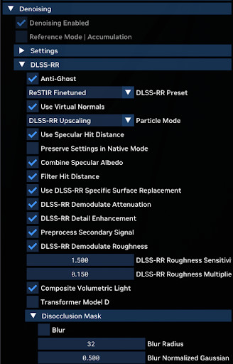

#### Для разработчиков и участников:

- Bridge перенесён в репозиторий dxvk-remix.
- MDL-файлы перенесены в репозиторий dxvk-remix.
- Переработаны и упорядочены RtxOptions для лучшей поддержки будущих функций RTX Remix. API RtxOption упрощён и
  стандартизирован.
- Снова включена возможность вручную перекомпилировать шейдеры в расширенном меню разработчика на вкладке
  «Dev Settings»:

  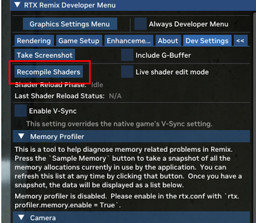

- Добавлен новый инструмент разработчика для поиска возможностей совмещения (aliasing) ресурсов. Он находится здесь:
  вкладка Dev Settings > Developer options > Resource Aliasing Query.
- Изменён порядок сортировки хешей текстур в `rtx.conf`.
- В расширенном меню разработчика появилась настройка «Composite Debug View» в разделе Rendering Tab > Debug.
  Разработчики могут одновременно просматривать несколько отладочных представлений из заданного списка.

  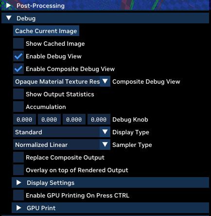

#### Вклад сообщества

- Добавлено руководство о том, как эффективно вносить вклад в открытый рантайм RTX Remix. Оно доступно в разделе
  «project documentation» внизу репозитория DXVK. Спасибо участнику сообщества «anchorlightforge» (GitHub PR #70) за
  код этого изменения.
- Отключено отслеживание Git для папки с двоичными файлами развёртывания. Спасибо участнику сообщества «xoxor4d»
  (GitHub PR #81) за код этого изменения.
- Исправлены ссылки в файле документации RTX Remix SDK. Спасибо участнику сообщества «ElitecombineSoldier» (GitHub
  PR #85) за код этого изменения.
- Исправлен разбор VirtualKeys для пользовательских сочетаний клавиш. Спасибо участнику сообщества «skurtyyskirts»
  (GitHub PR #95) за код этого изменения.

#### Исправления ошибок:

**Трассировщик пути:**

- Исправления завершения путей. Устранено использование недопустимых сэмплов направления для продолжения пути.
  «Русская рулетка» теперь учитывает пропускную способность последнего выбранного направления.
- Исправлены неверные вторичные отражения неба при замене первичной поверхности (PSR).

**RTX Skin:**

- Исправлена проблема, из-за которой при слишком низком значении пропускания RTX Skin могли появляться зелёные артефакты.

**Общее:**

- При включённой свободной камере отключается anti-culling, чтобы избежать артефактов, поскольку такое сочетание не
  поддерживается.
- Исправлен разбор атрибутов цвета и непрозрачности вершин в USD.
- Исправлены ошибки слоя проверки Vulkan.
- Исправлена ошибка совмещения ресурсов при создании скриншота через меню разработчика.

**Исправления ослабления в объёмных эффектах RTX:**

- Исправлены ошибки в расчётах ослабления.
- Исправлен масштаб времени неоднородного тумана.
- Исправлена проблема, из-за которой объёмная атмосфера центрировалась относительно начала координат, а не под камерой.
- Исправлено трансформированное мировое пространство для атмосферных объёмных эффектов.
- Исправлены визуальные проблемы с объёмными эффектами при загрузке или перезагрузке уровня игроком и при резкой смене
  ракурса камеры.
- Исправлен порядок памяти для результатов задач пула потоков в системах со слабым упорядочиванием.

```{seealso}
Списки изменений

- Примечания к выпуску рантайма см. [здесь](https://github.com/NVIDIAGameWorks/rtx-remix/releases/tag/remix-1.1.0)
- Полный список изменений Toolkit см. [здесь](remix-full-changelog.md)
```

***

## Примечания к выпуску RTX Remix 1.0 (13.03.2025)

Мы рады объявить об официальном выпуске RTX Remix 1.0.

Примечание: с этого момента версия Toolkit соответствует версии рантайма (1.0.0), и они и дальше будут выходить вместе.

RTX Remix выходит с множеством новых передовых графических возможностей, позволяющих строить в модах ещё более красивые
миры и персонажей. А рантайм получил новый нейронный рендеринг с DLSS 4 и Neural Radiance Cache, улучшающие впечатления
от игры в моды Remix. Модель DLSS 4 Transformer сохраняет больше деталей во всём, что вы создаёте, позволяя точнее
перенести ваш художественный замысел на экран. С многокадровой генерацией (Multi-Frame Generation) моды с трассировкой
пути работают до 8 раз быстрее, чем без неё. А ещё в RTX Remix дебютирует первый в мире нейронный шейдер — Neural
Radiance Cache, ИИ-подход к более точной и производительной оценке непрямого освещения, который обучается на вашем
игровом сеансе прямо во время игры.

Перейдём к подробностям:

### Улучшенный рендеринг RTX Remix

**DLSS 4 Multi-Frame Generation:**
DLSS 4 позволяет генерировать до 3 кадров на каждый отрендеренный кадр, многократно повышая производительность. В
Half-Life 2 RTX многокадровая генерация DLSS 4 увеличивает частоту кадров в 10 раз по сравнению с нативным 4K, так что
игра идёт плавно, какие бы навороты вы ни включили.

**Модель DLSS 4 Ray Reconstruction Transformer:**
У Ray Reconstruction появилась новая модель Transformer, которая гораздо точнее подавляет шум в изображениях с
трассировкой лучей и сохраняет максимум деталей. С новой моделью Transformer даже более низкие пресеты DLSS могут
выглядеть так же хорошо, как более высокие со старой «моделью CNN» (свёрточная нейросеть). Изображение становится
стабильнее во времени и в целом гораздо приятнее.

Учтите, что модель Transformer немного тяжелее модели CNN. Поэтому для пресетов «Low» и «Medium» по умолчанию
автоматически выбирается модель CNN, чтобы те, кто хочет выжать максимум производительности, могли это сделать.

**Neural Radiance Cache:**
NRC — нейронный шейдер, который точнее и производительнее оценивает непрямое освещение. Пока вы играете, сетка
крошечных нейросетей в мировом пространстве обучается на вашем игровом сеансе, подстраиваясь под то, что вы видите, в
реальном времени. Трассировщик пути Remix дополнительно трассирует небольшой набор длинных обучающих путей лучей,
записывающих излучение на каждом отражении, и на них обучается NRC. Обычные попиксельные пути лучей завершаются раньше,
как правило после 2–3 отражений, и в этот момент непрямое излучение от множества дополнительных отражений выводится
ИИ. Поскольку для подавляющего большинства путей лучей рассчитывается меньше отражений (а остальное выводится), NRC
повышает производительность в Half-Life 2 RTX на 15%.

Доступны три графические настройки с разным балансом производительности и точности непрямого освещения: Medium, High и
Ultra.

**Оптимизация производительности и памяти:**
Рантайм RTX Remix получил ряд оптимизаций производительности как в сценариях, ограниченных CPU, так и в сценариях,
ограниченных GPU. Величина прироста зависит от конкретного мода RTX Remix. Вот как выросла производительность в
Portal With RTX на 5070 Ti:

1. Portal With RTX (бета-версия рантайма): 111 FPS
2. Portal With RTX (релизная версия рантайма): 132 FPS
3. Portal With RTX (релизная версия рантайма с NRC): 155 FPS
4. Portal With RTX (релизная версия рантайма с NRC и DLSS): 260 FPS

Оптимизация производительности и памяти стала результатом множества изменений:
Оптимизированы память и производительность построения BVH за счёт инстансинга
Ограничено максимальное число костей на вершину для мешей со скиннингом
Улучшено распределение бюджета OMM для сценариев, использующих большую часть видеопамяти
Добавлено сжатие нормалей ассетов-замен в рантайме для снижения расхода памяти
Удалены лишние выделения ресурсов в зависимости от активных графических функций
Отключены проходы рендеринга, не нужные для активных графических функций
Улучшено повторное использование памяти совместимых ресурсов в разных проходах рендеринга
Снижен расход памяти структурами ускорения трассировки лучей на видеокартах с небольшим объёмом памяти
Настройки качества RTXDI скорректированы для большей производительности при включённом Ray Reconstruction
Буферы замен мешей переведены с памяти, видимой хосту, на локальную память устройства
Оптимизированы затраты CPU на CreateSurfaceMaterial за счёт кеширования и повторного использования RtSurfaceMaterial в пределах кадра
Повторно используются сопоставление экземпляров и разложение проекции для снижения затрат CPU на каждый экземпляр

**Новая потоковая загрузка текстур:**
Оптимизирует использование видеопамяти, чтобы добиться максимального качества текстур в доступном бюджете. Игроки
заметят, что ассеты подгружаются быстрее, чаще в высоком качестве, а «переполнение» (spilling) случается реже.
Примечание: общий расход видеопамяти от этого не обязательно уменьшится, поскольку RTX Remix всегда старается
эффективно использовать доступную видеопамять, чтобы показывать текстуры наивысшего качества.

**Изменения в компиляции шейдеров**
Remix теперь заранее прогревает только реально используемые шейдеры, что сокращает время компиляции шейдеров при
первом запуске. Учтите, что это может приводить к паузам на компиляцию шейдеров при изменении параметров Remix,
требующих других вариантов шейдеров.
Добавлены асинхронная компиляция шейдеров и индикатор хода выполнения, когда игра компилирует шейдеры во время игры.

### Улучшенные инструменты создания модов

#### Новые возможности

**Расширенное создание персонажей:** в играх с поддержкой скиннинга на GPU теперь можно заменять персонажей с тем же
качеством, с каким вы заменяли ассеты и материалы мира. Импортируйте в RTX Remix персонажа-замену со скелетом и в
Toolkit переназначьте его кости и суставы, чтобы он точнее соответствовал скелету, захваченному RTX Remix (и,
следовательно, ожидаемому при рендеринге). После этого персонаж будет анимироваться как положено.

Добавлен новый инструмент, помогающий заменять анимированные ассеты со скиннингом на GPU.

```{seealso}
Подробнее об инструменте переназначения скелета см. [здесь](../howto/learning-assets.md#инструмент-переназначения-скелета).
```

**Управление RTX Skin:**
RTX Skin — одна из первых реализаций подповерхностного рассеивания в играх с трассировкой лучей. Свет теперь может
проникать в кожу и проходить сквозь неё, придавая персонажам новый уровень реализма. С помощью RTX Skin можно также
создавать эффектные материалы мира, например нефрит, который может переливаться и приобретать сложные оттенки при
освещении.

В RTX Remix Toolkit к любому ассету можно добавить карты SSS для настройки уровня пропускания для каждого пикселя. А в
RTX Runtime можно настроить масштаб SSS — глобальный множитель для всех ассетов с SSS, усиливающий эффект.

```{seealso}
Подробнее о подповерхностном рассеивании см. [здесь](../howto/learning-materials.md#подповерхностное-рассеивание).
```

**Объёмные эффекты RTX:**
Мы переработали систему объёмных эффектов на основе объёмного алгоритма ReSTIR (Reservoir-based Spatiotemporal
Importance Resampling). Лучи света теперь выглядят чётче, а объёмное освещение и тени — контрастнее. Световые столбы
становятся резче и помогают создавать эпичные игровые моменты, которые мы так любим.

В меню RTX Remix можно настраивать параметры объёмной атмосферы мода. Есть пресеты, позволяющие увидеть игровую сцену с
туманом, дымом, дымкой и другими условиями, и каждый параметр можно настроить. Можно даже добавить в сцену частицы
пыли и задать их физику и свойства.

В RTX Remix Toolkit атрибут volumetric radiance scale позволяет сделать освещение (в буквальном смысле) больше, чем в
жизни, определяя, насколько свет влияет на объёмный облик сцены. Этот множитель позволяет менять вклад в объёмные
эффекты для каждого источника света отдельно и создавать более выразительные световые эффекты. Значение 1 оставляет
освещение полностью физически корректным, но его можно увеличить или уменьшить для более стилизованного вида.

#### Stage Manager

Самая востребованная функция наконец здесь, и она наверняка ускорит ваш моддинг. В этой новой панели управления можно
увидеть полный список всех настраиваемых элементов игры и переходить к ним одним щелчком. Сортируйте и находите примы,
источники света, меши, материалы, скелеты и многое другое, отделяйте обновлённые ассеты от исходных и создавайте для
любого прима собственные теги с поиском, чтобы проще находить и редактировать ассеты. Можно также просматривать примы
по категориям Remix, например частицы, декали, интерфейс, небо.

Можно также временно скрывать ассеты во вьюпорте, если изменяемую сцену загораживают стены или крупные объекты. А
множественное выделение и редактирование становятся ещё проще, когда все ассеты можно сгруппировать в списке.

**Официальный выпуск Stage Manager:** Stage Manager теперь встроен в RTX Remix Toolkit как ключевой компонент,
позволяющий выделять и редактировать любой прим мода.

**Включён по умолчанию:** Stage Manager теперь включён по умолчанию, но его по-прежнему можно отключить в разделе
«Optional Features».

**Новые вкладки Stage Manager:**
К существующим вкладкам All Prims и Lights в Stage Manager добавлены вкладки Categories, Skeleton, Meshes, Materials и
Custom Tags.

**Пользовательские теги:**
Помечайте любой прим захвата или замены собственным именем, чтобы его было легко снова найти или управлять похожими
объектами.

**Ждём ваших доработок:** функциональность Stage Manager легко расширять, внося вклад в наш проект с открытым
исходным кодом.

##### Доработанный Toolkit

Toolkit тщательно отполирован, и пользоваться им стало гораздо проще.

**Обновление до kit sdk 106.5:**
Приложение теперь построено на новой версии
[kit sdk](https://docs.omniverse.nvidia.com/dev-guide/latest/release-notes/106_5_highlights.html) Omniverse, которая
содержит множество исправлений и улучшений стабильности.

**Сняты ограничения на пути:**
Снято ограничение на пробелы в пути к проекту, что позволяет гибко выбирать имена и расположение проектов.

**Производительность:**
Повышены производительность и отзывчивость Stage Manager и других виджетов.

**Новый главный экран:**
Переработанный главный экран с упрощённым процессом создания проекта делает создание новых проектов нагляднее.
Добавлена возможность очищать список удалённых проектов.

**Улучшенная упаковка:**
Добавлен новый инструмент, помогающий автоматически исправлять пути к ресурсам при упаковке мода.

```{seealso}
Подробнее об упаковке модов см. [здесь](../howto/learning-packaging.md).
```

**Улучшения виджетов свойств:**
Продолжена работа по исправлению, улучшению внешнего вида и упрощению кода панели выделения и виджетов редактора
свойств.

**Категории рендеринга:**
Эта ключевая функция Remix обновлена в Toolkit и согласована с рантаймом. На первый план выведены подсказки, которые
помогают моддерам назначать мешам-заменам правильную категорию для рантайма.

```{seealso}
Подробнее о категориях рендеринга см.
[здесь](../gettingstarted/learning-runtimesetup.md#категории-рендеринга).
```

**Коэффициент масштаба при импорте**: параметр импорта ассетов «Meters per Unit» заменён на «Asset Scale Factor», чтобы
было интуитивнее импортировать ассеты в правильном размере.

```{seealso}
Подробнее об импорте ассетов см. [здесь](../howto/learning-ingestion.md)
```

**Улучшенная документация:** мы добавили больше подробностей и продолжим обновлять эту документацию. Будем рады вашим
доработкам в виде пулл-реквестов на GitHub в [репозиторий remix-toolkit](https://github.com/NVIDIAGameWorks/toolkit-remix).

### Исправления ошибок и небольшие изменения

#### RTX Remix Runtime:

- Повышена отзывчивость Ray Reconstruction для анимированных текстур.
- NRD обновлён до версии 4.13 для лучшей производительности и более чёткого и стабильного шумоподавления.
- AnimatedWaterTexture теперь работает для полупрозрачных материалов.
- Исправлено мерцание лучей отражения и преломления, попадающих в небо.
- Исправлены меши, ошибочно остававшиеся скрытыми после использования скрытия/показа в RTX Remix.
- Добавлена поддержка лучей, начинающихся под водой или внутри других полупрозрачных материалов, в зависимости от
  состояния тумана в игре.
- Исправлены ошибки во взаимодействии ландшафта и displace_out.
- Улучшено управление поворотом свободной камеры с клавиатуры.
- Добавлена максимальная интенсивность света для преобразования источников света.
- Исправлена проблема Bridge, из-за которой ввод иногда не передавался.
- Добавлена поддержка передачи вызовов API AddDirtyBox(), AddDirtyRect() и SetSoftwareVertexProcessing().
- Исправлена проблема, из-за которой некоторые системы обмена сообщениями моста игнорировали отключение тайм-аутов, что
  могло вызывать сбои по тайм-ауту, если значение по умолчанию было слишком мало для основного приложения.
- Исправлена проблема, из-за которой сервер или клиент моста мог зависать навсегда при отключённых тайм-аутах.

#### RTX Remix Toolkit:

- Исправлено поведение окна захвата, чтобы оно не зависало на других вкладках.
- Исправлено отображение значка раскрытия, чтобы в дереве и на панелях он означал одно и то же.
- Значок категорий рендеринга теперь отображается, только когда выбраны подходящие объекты-меши.
- Исправлены различные проблемы Stage Manager.
- Исправлена производительность панели слоёв в больших проектах.
- Исправлено поведение выделения источников света на панели выделения.
- Исправлено непоследовательное состояние отключения (mute) на панели слоёв.
- Исправлено необновление панели слоёв после выгрузки сцены, а также другие исправления.
- Исправлена ошибка импорта при перетаскивании.
- Исправлены подсказки для свойств из USD-схемы, содержащие строку документации из схемы.

```{seealso}
Списки изменений

- Примечания к выпуску рантайма см. [здесь](https://github.com/NVIDIAGameWorks/rtx-remix/releases/tag/remix-1.0.0)
- Полный список изменений Toolkit см. [здесь](remix-full-changelog.md)
```

***

## Примечания к выпуску RTX Remix 0.6 (03.12.2024)

Новый выпуск RTX Remix Toolkit и Runtime приносит мощные новые функции и улучшения, которые выведут моддинг на новый
уровень. Вот лишь часть того, что вас ждёт:

- **Экспериментальные функции:** опробуйте передовые инструменты заранее в новом меню «Experimental Features». Оно
  позволяет тестировать функции в разработке и оставлять ценные отзывы, влияющие на их развитие.

- **Stage Manager (экспериментальная функция):** первая экспериментальная функция — Stage Manager, удобный интерфейс,
  показывающий каждый прим сцены в интерактивном списке. Впервые моддеры могут легко получить доступ к примам, которые
  нельзя выделить во вьюпорте, редактировать их и упростить свою работу. Делитесь отзывами и идеями на нашем
  [GitHub](https://github.com/NVIDIAGameWorks/toolkit-remix/), чтобы помочь нам доработать Stage Manager и другие
  экспериментальные функции.

- **RTX Remix в NVIDIA App:** RTX Remix теперь доступен в новом
  [лаунчере NVIDIA App](https://www.nvidia.com/en-us/software/nvidia-app/), что даёт более быстрый запуск, меньшую
  нагрузку на CPU и бесшовную работу над модами. Настоятельно рекомендуем всем пользователям скачивать RTX Remix и
  работать с модами через NVIDIA App, чтобы в полной мере воспользоваться этими улучшениями производительности.

Читайте дальше подробный разбор.

### Выпуск RTX Remix Runtime 0.6

#### Возможности

**Отличные новости для игроков и моддеров!**
RTX Remix Runtime SDK теперь поддерживает 32-битные игры!
Поднимите любимые классические игры на новый уровень с помощью передовых технологий RTX.

**Огромный прирост производительности**
RTX Remix Runtime 0.6 — большой шаг вперёд в производительности, со значительным приростом в сценах, ограниченных GPU и
CPU. Работаете ли вы над графически требовательным окружением или сложными сценами, нагружающими процессор, это
обновление делает моддинг плавнее и быстрее.

**Улучшенная совместимость с Render Targets**
Добавлена поддержка Render Targets — техники, которая в классических играх, например Half-Life 2, используется для
проецирования сцен внутри сцен. Это расширяет круг игр, совместимых с RTX Remix, и позволяет моддерам воссоздавать и
улучшать культовые визуальные эффекты с большей точностью.

```{seealso}
Ниже приведены подробные примечания к выпуску, а полный список изменений см. [здесь](remix-full-changelog.md)
```

```{video} ../data/videos/0.6_Release/render_target.mp4
:alt: RenderTarget
:controlslist: nodownload
:class: video-player
:width: 100%
:playsinline:
:muted:
:autoplay:
:loop:
```

### Выпуск RTX Remix Toolkit 2024.5.1

#### Возможности

**Меню «Experimental Features»**
Попробуйте новейшие инструменты в разработке в новом меню «Experimental Features». Оно доступно в меню-«гамбургере» в
левом верхнем углу и позволяет включать функции, которые ещё дорабатываются. Экспериментальные функции могут содержать
ошибки, но позволяют заглянуть в будущее RTX Remix. Если вы столкнулись с проблемами или хотите оставить отзыв, помогите
нам, создав обращение на [GitHub](https://github.com/NVIDIAGameWorks/toolkit-remix/).

```{video} ../data/videos/0.6_Release/experimentalfeatures.mp4
:alt: ExperimentalFeatures
:controlslist: nodownload
:class: video-player
:width: 100%
:playsinline:
:muted:
:autoplay:
:loop:
```

**Assign Texture Sets**
Упростите текстурирование ассетов с помощью новой функции «Assign Texture Sets». Выберите одну текстуру в папке, и
RTX Remix автоматически подтянет все относящиеся к ассету текстуры, экономя время и упрощая работу.

```{video} ../data/videos/0.6_Release/assign_texture_sets.mp4
:alt: AssignTextureSets
:controlslist: nodownload
:class: video-player
:width: 100%
:playsinline:
:muted:
:autoplay:
:loop:
```

**Stage Manager (экспериментальная функция)**
Совершенно новый Stage Manager меняет подход к управлению проектом. Этот мощный инструмент наглядно показывает по
категориям каждый прим сцены — меши, текстуры, источники света и многое другое — и позволяет легко изолировать,
редактировать или заменять ассеты.

```{video} ../data/videos/0.6_Release/stagemanager_filtering.mp4
:alt: StageManagerFiltering
:controlslist: nodownload
:class: video-player
:width: 100%
:playsinline:
:muted:
:autoplay:
:loop:
```

*Примечание:* Stage Manager — экспериментальная функция, и в больших проектах (более 10 000 примов) возможны проблемы с
производительностью.

- **Расширенная фильтрация:** быстро находите незаменённые или заменённые ассеты и управляйте ими.
- **Редактирование нескольких ассетов:** вносите массовые изменения в выделенные примы прямо из Stage Manager.
- **Интеграция с вьюпортом:** центрируйте камеру на любом ассете, скрывайте и показывайте ассеты для удобства работы и
  даже редактируйте элементы, которые нельзя выделить во вьюпорте (например, частицы).
- **Пример рабочего процесса:** чтобы поработать в тесном, неудобном для навигации пространстве, например в кабине
  поезда, скройте стены, отредактируйте ассеты интерьера, а затем снова покажите стены.

В будущем мы планируем добавить в Stage Manager больше возможностей. Надеемся, вам понравится это раннее знакомство.

**Автономный установщик и лаунчер NVIDIA App**
RTX Remix теперь работает независимо через лаунчер NVApp. Более быстрый запуск, бесшовные обновления и оптимизированная
загрузка CPU делают работу плавнее и эффективнее.

**Полное руководство по REST API**
Добавлено руководство по использованию REST API для создания дополнения для Blender.

#### Улучшения качества жизни

**Множественное выделение и редактирование**
Вносите масштабные изменения с лёгкостью. Выделите несколько объектов, например источники света, и меняйте их свойства
одновременно, например интенсивность или цвет. Это упрощает работу и экономит время на однотипных правках.

```{video} ../data/videos/0.6_Release/multiselection_multiediting.mp4
:alt: Multiselection
:controlslist: nodownload
:class: video-player
:width: 100%
:playsinline:
:muted:
:autoplay:
:loop:
```

- REMIX-3600: уточнено поведение виджета Selection и исправлены проблемы.
- REMIX-3051: при выгрузке сцены с несохранёнными изменениями теперь открывается запрос на сохранение.
- REMIX-2907: добавлено предупреждение при перетаскивании для импорта файлов недопустимого типа.
- REMIX-3214, REMIX-3215: добавлены проверки типа слоя при импорте файлов проекта и мода.
- Улучшен внешний вид окна сканирования файлов.

#### Исправления ошибок

- **Стабильность горячей перезагрузки:** горячая перезагрузка исправлена за счёт повторного использования валидаторов,
  что повышает надёжность и уменьшает число ошибок при перезагрузке.
- **Подсказки материалов:** устранены проблемы с подсказками путей к файлам материалов и меню копирования.
- **Назначение наборов текстур:** устранены проблемы с назначением наборов текстур — теперь назначение единообразно и
  точно.
- **Панель освещения:** исправлено отображение значков источников света на панели выделения.
- **Производительность Stage Manager:** устранены серьёзные проблемы с производительностью Stage Manager, что повышает
  удобство работы, особенно в больших проектах.
- **Права доступа скриптов оболочки:** исправлены проблемы с правами доступа скриптов оболочки для лучшей совместимости.
- **Сбои REST API:** исправлены сбои REST API в select_prim_paths_with_data_model и append_reference_with_data_model,
  что повышает стабильность API.
- **Очистка Stage Manager:** при отключении флага функции Stage Manager теперь удаляются все слушатели, чтобы не
  оставалось побочных проблем.

#### Возможности

- REMIX-3052: добавлен новый пункт меню рабочего файла «reload last stage» (перезагрузить последнюю сцену).
- REMIX-2874: добавлен диалог сканирования папки для импорта.
- REMIX-3113: добавлено управление числом параллельных процессов импорта в выпадающем списке.
- REMIX-2518: добавлены предотвращение использования и копирование внешних ассетов.

#### Улучшения совместимости

- Добавлена документация по миграции данных.

***

## Примечания к выпуску RTX Remix 0.5.1 (13.05.2024)

### Выпуск RTX Remix Toolkit 2024.4.1

**Инструменты формирования света**
Управляйте освещением сцены: визуализируйте и настраивайте такие атрибуты, как интенсивность, радиус и направление,
прямо во вьюпорте. Доводите освещение до совершенства с помощью интуитивных инструментов, от которых сцена засияет.

```{video} ../data/videos/0.6_Release/light_shaping_1.mp4
:alt: LightShaping1
:controlslist: nodownload
:class: video-player
:width: 100%
:playsinline:
:muted:
:autoplay:
:loop:
```

```{video} ../data/videos/0.6_Release/light_shaping_2.mp4
:alt: LightShaping2
:controlslist: nodownload
:class: video-player
:width: 100%
:playsinline:
:muted:
:autoplay:
:loop:
```

#### Возможности

- REMIX-2674: добавлен поиск похожих текстур и автоматическое заполнение полей текстур.
- REMIX-2779, REMIX-2780, REMIX-2781: добавлены манипуляторы для RectLight, DistantLight и DiskLight.
- REMIX-2782: добавлен манипулятор для SphereLight.
- REMIX-2137, REMIX-2138, REMIX-2139, REMIX-2142, REMIX-2842: добавлены микросервисы для подприложений «Modding» и
  «Ingestion».
- REMIX-3096: добавлено контекстное меню копирования для элементов дерева выделения.
- Добавлено облегчённое приложение Kit для тестирования изображений HdRemix: lightspeed.hdremix.test-0.0.0.
- Привязка функции C для задания RtxOption напрямую в рендерере Remix.

#### Качество жизни

- REMIX-2722: уменьшены значения интенсивности источников света по умолчанию.
- REMIX-3112: изменены диапазон ползунка и значение по умолчанию displace_in для удобства работы.
- REMIX-3125: шаг ползунков с плавающей точкой по умолчанию вычисляется отложенно.
- Исправлен URL документации для примечаний к выпуску.
- Версия в примечаниях к выпуску приведена в соответствие с версией выпуска.

#### Улучшения совместимости

- REMIX-2876: обновление до Kit Kernel 106.
- OM-122163: манипулятор Remix обновлён с учётом переименования omni.kit.manipulator.prim.
- REMIX-2880: улучшена настройка CI для объединённых репозиториев.
- REMIX-2880: архивы PIP разделены между LSS, Flux и внутренним Flux.
- REMIX-2880: обновление до последней публичной версии Kit SDK.

#### Исправления ошибок

- REMIX-2872: сообщение о неимпортированном ассете стало информативнее.
- REMIX-2789: исправлены проблемы с полосой прокрутки очереди импорта.
- REMIX-2943: проверка расширений файлов теперь не зависит от регистра.
- REMIX-2684: создано событие для света камеры.
- Исправлены различные проблемы с микросервисами, добавлены новые конечные точки, улучшена функциональность.

### Выпуск RTX Remix Toolkit 2024.4.0-RC.1

#### Изменения

- Рантайм в составе RTX Remix Toolkit обновлён до версии 0.5.1.

### RTX Remix Runtime 0.5.1

#### Исправления ошибок

- Исправлена проблема, мешавшая запуску рантайма Remix на оборудовании AMD с последними драйверами Windows.

***

## Примечания к выпуску RTX Remix 0.5 (30.04.2024)

В последнем обновлении RTX Remix моддеры получили возможность добавлять в моды Remix DLSS 3.5 Ray Reconstruction. Ниже
приведены подробные примечания к выпуску, а полный список изменений см. [здесь](remix-full-changelog.md).

Напоминаем, что обновить RTX Remix можно через меню рядом с кнопкой «Launch» на странице приложения RTX Remix в
Omniverse Launcher.

### Выпуск RTX Remix Toolkit 2024.3.0

#### Возможности

- Добавлено новое действие «Teleport», перемещающее любой выделенный объект к курсору мыши или в центр экрана.
  Телепортация доступна на боковой панели вьюпорта или по сочетанию клавиш Ctrl + T.

  ```{video} ../data/videos/teleport.mp4
  :alt: Teleport
  :controlslist: nodownload
  :class: video-player
  :width: 100%
  :playsinline:
  :muted:
  :autoplay:
  :loop:
  ```

- Добавлена новая функция «Waypoint» (путевые точки), позволяющая сохранять положения камеры как путевые точки и
  мгновенно перемещать к ним камеру. Параметры путевых точек находятся в правом верхнем углу вьюпорта. По умолчанию при
  открытии захвата начальное положение камеры сохраняется как путевая точка.

  ```{video} ../data/videos/waypoints.mp4
  :alt: Waypoint
  :controlslist: nodownload
  :class: video-player
  :width: 100%
  :playsinline:
  :muted:
  :autoplay:
  :loop:
  ```

- В вьюпорт добавлен DLSS 3.5 Ray Reconstruction.

- Панели свойств материала и объекта теперь можно закреплять для любого выделенного ассета, чтобы они оставались на
  виду даже после снятия выделения. Это открывает интересные приёмы работы: например, выделить стену и закрепить панель
  свойств её материала, затем выделить источник света рядом и закрепить панель свойств объекта — и одновременно
  настраивать стену и свет относительно друг друга.

  ```{video} ../data/videos/panel_pinning.mp4
  :alt: Panel Pinning
  :controlslist: nodownload
  :class: video-player
  :width: 100%
  :playsinline:
  :muted:
  :autoplay:
  :loop:
  ```

- Добавлена возможность выгрузить сцену, чтобы освободить ресурсы, не закрывая приложение. Это полезно, если нужно
  освободить память для определённых действий (например, запустить игру при работающем RTX Remix или запустить
  ИИ-инструменты для текстур RTX Remix). Этот пункт находится в меню слева вверху.

  ```{video} ../data/videos/unload_stage.mp4
  :alt: Unload Stage
  :controlslist: nodownload
  :class: video-player
  :width: 100%
  :playsinline:
  :muted:
  :autoplay:
  :loop:
  ```

- Переработана архитектура ИИ-инструментов для текстур и импорта, чтобы RTX Remix Toolkit мог эффективно работать
  параллельно с ними. Теперь моддерам гораздо проще заниматься другими делами во время импорта или ИИ-улучшения ассетов.

  ```{video} ../data/videos/parallel_processing_no_lag.mp4
  :alt: Parallel Processing No Lag
  :controlslist: nodownload
  :class: video-player
  :width: 100%
  :playsinline:
  :muted:
  :autoplay:
  :loop:
  ```

#### Улучшения качества жизни

- Клавиша ESC теперь снимает выделение со всех объектов.

- Добавлены ползунки для всех свойств материалов и объектов.

  ```{video} ../data/videos/realtime_sliders.mp4
  :alt: Realtime Sliders
  :controlslist: nodownload
  :class: video-player
  :width: 100%
  :playsinline:
  :muted:
  :autoplay:
  :loop:
  ```

- При закрытии RTX Remix с несохранёнными данными теперь появляется запрос на сохранение, чтобы моддеры не теряли
  прогресс. Также упрощён переход между открытыми и сохранёнными проектами.

- В список захватов добавлена кнопка обновления, а появление миниатюр стало менее навязчивым.

- Несколько свойств материалов без родительской категории сгруппированы в отдельную категорию «Other».

- Значения интенсивности по умолчанию для всех новых источников света значительно уменьшены. Новое поведение по
  умолчанию лучше подходит для большинства игр.

- При создании проекта теперь создаются символические ссылки.

- Внесён ряд улучшений доступности, читаемости и чёткости текста.

#### Исправления ошибок

- Свойства атрибутов и материалов теперь правильно ведут себя при выделении и снятии выделения объектов.

- Исправлены неожиданные изменения панели свойств материала при использовании отмены и повтора.

- Исправлены различные проблемы с отзывчивостью ColorField (выбора цвета).

- В список захватов добавлены заголовки, поясняющие захваты и ход замены.

- Исправлены сбои ИИ-инструментов для текстур при обработке DDS-файлов.

### RTX Remix Runtime 0.5.0

Примечание для моддеров: в RTX Remix Runtime 0.5 мы удалили параметр, который вызывал сильные шлейфы (ghosting) без
какой-либо пользы. Если вашему проекту нужна более старая версия RTX Remix Runtime, рекомендуем проверить файл
`rtx.conf` и убедиться, что `rtx.enableDeveloperOptions = false`.

#### Возможности

- В RTX Remix добавлен DLSS 3.5 Ray Reconstruction, позволяющий моддерам улучшать качество изображения с помощью этого
  шумоподавителя на основе ИИ. С Ray Reconstruction источники света с трассировкой пути обновляются быстрее, отражения и
  тонкие световые детали становятся стабильнее, а детали текстур — выразительнее. Подробнее о Ray Reconstruction и её
  преимуществах для моддинга RTX Remix читайте в нашей
  [статье на GeForce](https://www.nvidia.com/en-us/geforce/news/rtx-remix-dlss-3-5-ray-reconstruction)
- В выпуск рантайма добавлена обёртка d3d8to9. Раньше моддерам приходилось вручную добавлять этот важный файл в пакет
  рантайма, чтобы обеспечить правильную совместимость с играми на DirectX 8. Теперь он входит в комплект
  автоматически — благодаря этому хорошо совместимые игры на DirectX 8 должны лучше работать «из коробки». На игры не на
  DirectX 8 это изменение не влияет.
- Существенно изменён процесс разметки текстур, необходимый для правильной настройки игры в RTX Remix. Добавлено
  несколько новых параметров, которые должны упростить работу опытных пользователей с этими меню. Скорее всего, эти
  изменения будут дорабатываться, и мы будем рады ранним отзывам о них.

  Изменена работа разметки текстур при включённом параметре «Split Texture Category List». Когда он включён, открытие
  категории текстур или наведение на неё выбирает её (она становится оранжевой). Щелчок левой кнопкой по текстуре в
  игровом мире или в списке категорий автоматически назначает её в выбранную категорию. Щелчок правой кнопкой по
  текстуре в игровом мире или в списках категорий рантайма Remix открывает знакомое выпадающее меню выбора со всеми
  доступными вариантами разметки текстур. Учтите, что в этом режиме для разметки текстур должна быть выбрана категория.

  Мы также добавили возможность показывать только категории текстур, содержащие уже размеченные вами текстуры. Для
  этого включите флажок «Only Show Assigned Textures in Category Lists». При включённом флажке неразмеченные текстуры
  отображаются в отдельной категории «Uncategorized».

  Спасибо участнику сообщества «xoxor4d» (GitHub PR #49) за код этого изменения. Мы рассчитываем и дальше улучшать
  процесс настройки игры и разметки текстур в RTX Remix.

#### Улучшения качества жизни

- Повышены стабильность и производительность в играх с шейдерами за счёт улучшения системы захвата вершин.
- Устранены визуальные артефакты тонмаппера, например полосы (banding), с помощью дизеринга на основе синего шума.
  Чтобы включить эту функцию в меню RTX Remix Runtime, перейдите в «Post-Processing» > «Tonemapping» и выберите в списке
  «Dither Mode» значение «Spatial + Temporal» (узор шума меняется во времени) или «Spatial» (статичный узор шума).
  Соответствующие параметры конфигурации — `rtx.localtonemap.ditherMode` и `rtx.tonemap.ditherMode` для локального и
  глобального тонмапперов соответственно. Им можно задать 1 для режима Spatial или 2 для режима Spatial + Temporal (или
  0, чтобы отключить дизеринг).
- Добавлены параметры конфигурации, позволяющие скрыть приветственный баннер RTX Remix
  (`rtx.hideSplashMessage = True/False`) и показывать пользователю при запуске собственное приветствие
  (`rtx.welcomeMessage = “example text”`).
- Добавлена возможность передавать кубические карты (cubemaps) исходной игры во внутреннюю часть RTX Remix. Это
  позволяет использовать текстуры кубических карт для разметки. Учтите, что кубические карты не будут отображаться
  правильно, а вызовы отрисовки, ссылающиеся только на кубические карты, в Remix использовать нельзя. Чтобы включить
  эту функцию в меню RTX Remix Runtime, перейдите на вкладку «Game Setup» > «Step 2: Parameter Tuning» > «Heuristics» и
  включите «Allow Cubemaps». Или используйте параметр конфигурации `rtx.allowCubemaps = True`.
- Добавлена возможность игнорировать запечённое освещение, связанное с определёнными текстурами. Это полезно, когда игра
  запекает освещение в цвета вершин или коэффициенты текстур (а не в карты освещения). Для этого на вкладке
  «Game Setup» меню RTX Remix Runtime в процессе разметки текстур появилась новая категория «Ignore Baked Lighting
  Texture».
- Добавлен параметр, позволяющий различным системам RTX Remix, зависящим от системы координат мирового пространства
  игры (например, запеканию ландшафта), считать систему координат левосторонней.

  При моддинге игры с левосторонней системой координат вы можете заметить, что ландшафт даже после правильной разметки
  на вкладке Game Setup выглядит неправильно. Откройте меню RTX Remix Runtime, на вкладке «Game Setup» в разделе
  настройки параметров включите флажок «Scene Left-Handed Coordinate System» — и все эти системы, например запекание
  ландшафта, должны заработать правильно. Параметр конфигурации, заставляющий эти системы рендеринга считать систему
  координат левосторонней, — `rtx.leftHandedCoordinateSystem = True`.

  Спасибо участнику сообщества «jdswebb» (GitHub PR# 65) за код этого изменения.

- Добавлен параметр, позволяющий различать экземпляры по AABB и благодаря этому лучше отслеживать их между кадрами. Для
  игроков это означает меньше шлейфов и мерцания у анимированных объектов и движущихся мешей со скиннингом. Чтобы
  включить эту функцию, откройте вкладку «Game Setup» меню RTX Remix Runtime, выберите «Step 2: Parameter Tuning» >
  «Heuristics» и включите «Always Calculate AABB (For Instance Matching)».

  Спасибо участнику сообщества «xoxor4d» (GitHub PR# 67) за код этого изменения.

- Улучшена работа модов RTX Remix у пользователей Steam Deck и Linux с AMD благодаря оптимизациям для драйверов RADV.

  Спасибо участнику сообщества «pixelcluster» (GitHub PR #63) за код этого изменения.

- Повышена согласованность удалённых источников света: теперь они правильно обновляются при изменении или
  переориентации. Это исправляет ошибки в некоторых сценариях, например когда удалённый источник света был дочерним для
  вращающегося меша.

  Спасибо участнику сообщества «mmdanggg2» (GitHub PR #66) за код этого изменения и «Kamilkampfwagen-II» за сообщение о
  проблеме на GitHub (issue #49).

- Функция журналирования вызовов в RTX Remix Bridge, доступная в сборке «Debug», теперь есть и в сборке «Debug
  Optimized».
- В RTX Remix Bridge добавлен параметр `logServerCommands`, записывающий обрабатываемые сервером команды в файл
  `NvRemixBridge.log`. Чтобы включить его, в файле `bridge.conf` рядом с NvRemixBridge.exe задайте
  `logServerCommands = True` без символа # в начале. Если файла `bridge.conf` нет, его можно взять по адресу
  https://github.com/NVIDIAGameWorks/bridge-remix/blob/main/bridge.conf
- Добавлен дополнительный режим журналирования, включающий сообщения logServerCommands и сведения о состоянии систем
  обмена сообщениями клиента и сервера RTX Remix Bridge. Это помогает выявлять возможные проблемы обмена сообщениями
  моста. Чтобы включить его, в файле `bridge.conf` рядом с `NvRemixBridge.exe` задайте `logAllCommands = True` без
  символа # в начале. Если файла `bridge.conf` нет, его можно взять по адресу
  https://github.com/NVIDIAGameWorks/bridge-remix/blob/main/bridge.conf

#### Улучшения совместимости

- В RTX Remix Bridge внесён ряд изменений, повышающих совместимость с различными играми.

- Исправлена проблема, из-за которой некоторые игры зависали. В RTX Remix Bridge возникала взаимная блокировка: клиент
  ждал чтения общего буфера, считая, что сервер отстаёт, хотя на самом деле сервер уже всё обработал и ждал новую
  команду. Клиент ошибочно сообщал серверу о переполнении общего буфера данных, потому что код отправки команд не
  различал указатель с данными для отправки (занимающий в буфере ненулевой размер) и нулевой указатель (нулевого
  размера).

- Исправлены сбои, графические ошибки и неожиданное поведение в играх с RTX Remix, возникавшие из-за остановки очереди
  данных в RTX Remix Bridge, когда запись переполняла очередь при уже установленном флаге переполнения.

- Устранён ряд несовместимостей, при которых RTX Remix неожиданно закрывался или переставал обновлять изображение (при
  этом звук продолжал играть). Чтобы исправить проблему, когда поток обработки команд мог преждевременно завершиться,
  не получая команд в течение тайм-аута моста, тайм-ауты сервера RTX Remix Bridge теперь отключены. Кроме того, клиент
  RTX Remix Bridge теперь закрывается при неожиданном закрытии сервера моста.

#### Исправления ошибок

- Исправлены проблемы с захватом текстур, подёргиваниями при захвате и повреждением захватов в некоторых играх.

- Повышена надёжность системы сборки RTX Remix Bridge.
- RTX Remix Bridge теперь быстрее сообщает игре о недопустимых вызовах `SetTransform()`. Клиент RTX Remix Bridge теперь
  проверяет аргумент `D3DTRANSFORMSTATETYPE` в вызовах `SetTransform()` и, если он недопустим, возвращает вызывающему
  `D3DERR_INVALIDCALL`, не обращаясь к серверу RTX Remix Bridge и компоненту dxvk-remix рантайма RTX Remix.

***
<sub> Хотите оставить отзыв о документации RTX Remix? [Нажмите здесь](https://github.com/NVIDIAGameWorks/rtx-remix/issues/new?assignees=nvdamien&labels=documentation%2Cfeedback%2Ctriage&projects=&template=documentation_feedback.yml&title=%5BDocumentation+feedback%5D%3A+) </sub>
