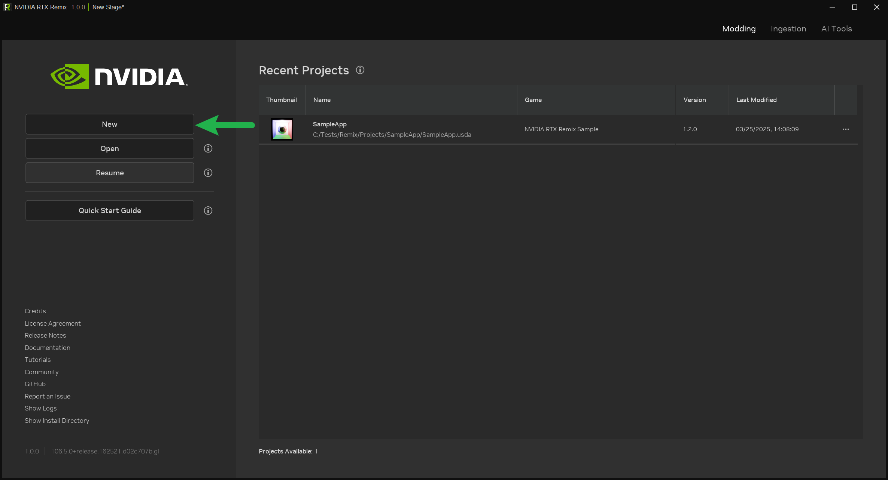
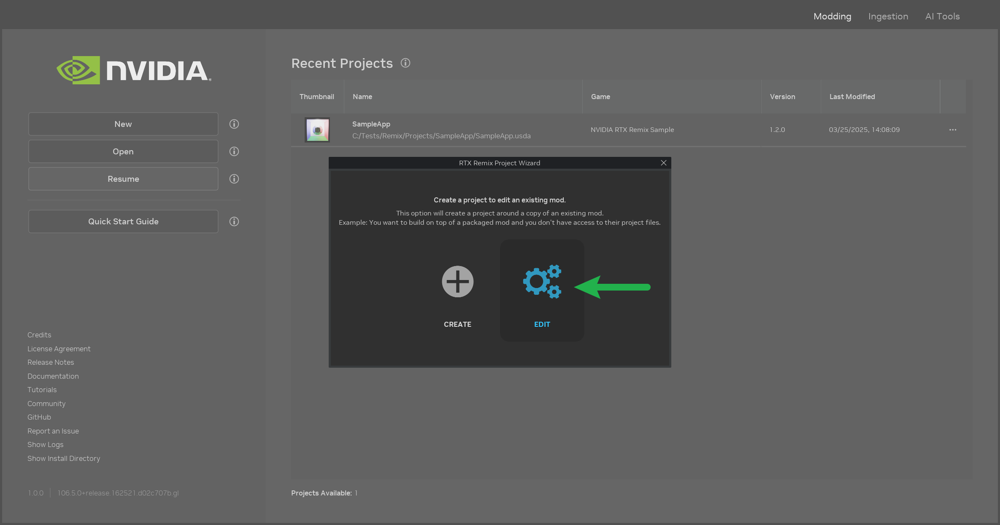
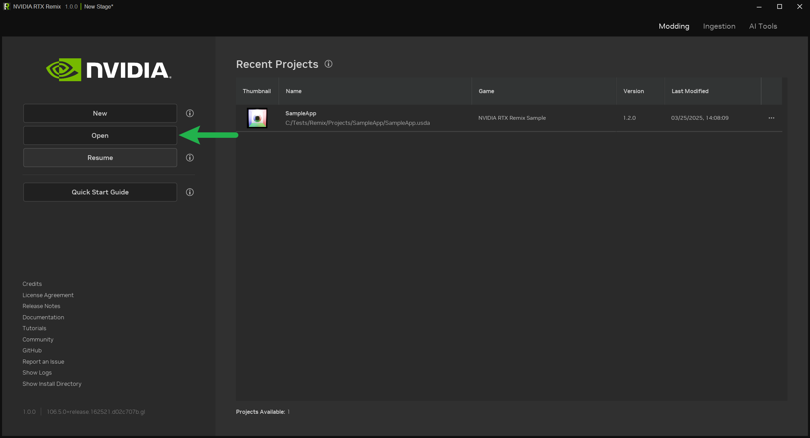

# Настройка проекта в RTX Remix Toolkit

```{warning}
**Прежде чем настраивать проект, убедитесь, что RTX Remix Runtime и RTX Remix Toolkit установлены и настроены.**

Инструкции по установке и настройке RTX Remix Runtime приведены в разделах
[Установка RTX Remix Runtime](../installation/install-runtime.md),
[Установка RTX Remix Toolkit](../installation/install-toolkit.md) и
[Настройка RTX Remix Runtime для вашей игры](learning-runtimesetup.md).
```

## Основы проектов RTX Remix

Перед созданием нового проекта полезно разобраться в нескольких базовых понятиях:

* «**Проект**» (Project): основной USD-файл, который связывает слой мода и слой захвата. В нём также хранятся
  различные метаданные проекта.
* «**Слой мода**» (Mod Layer): в этом слое хранятся все изменения, которые вы вносите в игру: новые ассеты,
  настройки освещения и другие модификации. Это подслой проекта, и у него могут быть собственные подслои для более
  удобной организации.
* «**Слой захвата**» (Capture Layer): когда вы захватываете элементы игры с помощью RTX Remix, захваченные ассеты
  сохраняются в этом слое. Его создаёт рантайм. Подробнее о процессе захвата см. в разделе
  [Захват сцены](learning-runtimesetup.md#захват-сцены).
* «**Каталог _rtx-remix_**»: эта папка находится в каталоге установки игры. В ней хранятся захваченные данные и
  активные в данный момент моды. Формально она не входит в файл проекта, но она важна, потому что именно здесь рантайм
  ищет активный слой мода. При создании нового проекта из каталога `rtx-remix/mods` на ваш проект создаётся
  [символическая ссылка](https://learn.microsoft.com/en-us/windows/win32/fileio/symbolic-links).

***

## Создание нового проекта

Чтобы создать новый проект RTX Remix:

1. Откройте RTX Remix Toolkit.
2. Нажмите кнопку `New`.



Откроется мастер проектов (Project Wizard). Выберите `Create`, чтобы создать пустой проект. Мастер проведёт вас через
все необходимые шаги.

Папку проекта можно создать практически в любом месте на компьютере: мастер проектов автоматически создаст специальную
ссылку между папкой проекта и каталогом _rtx-remix_.

```{seealso}
Подробнее об организации проекта и рекомендуемых практиках см. в разделе
[Рекомендуемые практики](../howto/learning-bestpractices.md).
```

### Работа с существующими модами

Если вы хотите отредактировать уже существующий мод:

1. Откройте RTX Remix Toolkit.
2. Нажмите кнопку «New» (откроется мастер проектов).
3. Выберите вариант «Edit».



Вы сможете выбрать существующий мод, и для него будет создан новый проект.

```{note}
Содержимое редактируемого мода копируется в каталог нового проекта, чтобы избежать потери данных в каталоге установки
игры.
```

## Открытие существующего проекта

Чтобы открыть существующий проект RTX Remix:

1. Откройте RTX Remix Toolkit.
2. Нажмите кнопку «Open».



Появится диалог выбора файла, в котором нужно указать файл проекта. Toolkit также проверит, на месте ли необходимые
ссылки. Если вы открываете проект впервые, вас могут попросить указать каталог _rtx-remix_, чтобы Toolkit смог создать
нужные ссылки.

***

## Подробнее о проектах RTX Remix

### Структура папок

RTX Remix автоматически раскладывает захваченные данные по папке _rtx-remix_ в каталоге игры. Эта папка также доступна
из каталога проекта через символическую ссылку _deps_.

```text
rtx-remix
├ captures -> Содержит захваты, сделанные в рантайме
│ ├ capture_(год)_(месяц)_(день)_(час)_(минуты)_(секунды).usd
│ ├ gameicon.exe_icon
│ ├ lights
│ ├ materials
│ ├ meshes
│ ├ textures
│ └ thumbs
└ mods ← Создаётся автоматически после создания проекта
  └ YOUR_PROJECT ← (Автоматически создаваемая символическая ссылка на каталог `YOUR_PROJECT`, чтобы изменения проекта применялись в игре на лету)

=================================================================

Projects ← (РЕКОМЕНДАЦИЯ) Может находиться где угодно, содержит список проектов Remix
└ YOUR_PROJECT ← Создаётся при создании проекта, содержит файлы вашего проекта
  ├ assets ← (РЕКОМЕНДАЦИЯ) Создаётся вручную
  | └ ingested ← (РЕКОМЕНДАЦИЯ) Создаётся вручную -> Это же значение по умолчанию задано в мастере импорта.
  |   ├ models ← (РЕКОМЕНДАЦИЯ) Создаётся вручную -> Содержит импортированные модели
  |   └ materials ← (РЕКОМЕНДАЦИЯ) Создаётся вручную -> Содержит импортированные материалы
  └ deps ← (Автоматически создаваемая символическая ссылка на каталог `rtx-remix`, чтобы нужные файлы были доступны)
```

### Правила именования проектов

Если вы создаёте несколько модов для одной игры, у каждого проекта должно быть уникальное имя каталога. Мастер
проектов помогает соблюдать это правило: если попытаться создать проект с **таким же именем родительского каталога**,
как у существующего мода, создание завершится ошибкой.

### Требование к файловой системе диска

И диск, на котором находится проект RTX Remix, и диск, на котором установлена игра, должны быть отформатированы в NTFS.
exFAT не поддерживает символические ссылки, без которых RTX Remix не может корректно работать.

***

## Дальнейшие шаги

Проект настроен, и можно приступать к созданию мода.

Чтобы узнать, как пользоваться RTX Remix Toolkit на разных этапах моддинга, откройте любую страницу раздела
«Практические руководства» (How To).

Если вы впервые создаёте мод с помощью RTX Remix, рекомендуем начать с раздела
[Знакомство с Toolkit](../howto/learning-toolkit.md#знакомство-с-toolkit) и затем переходить к следующим разделам
по порядку.

***
<sub> Хотите оставить отзыв о документации RTX Remix? [Нажмите здесь](https://github.com/NVIDIAGameWorks/rtx-remix/issues/new?assignees=nvdamien&labels=documentation%2Cfeedback%2Ctriage&projects=&template=documentation_feedback.yml&title=%5BDocumentation+feedback%5D%3A+) </sub>
