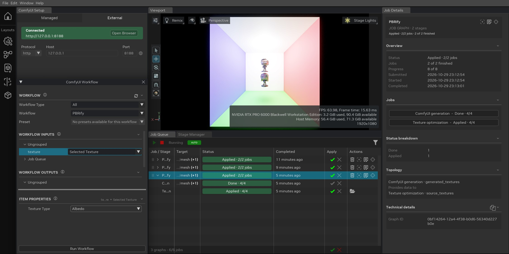
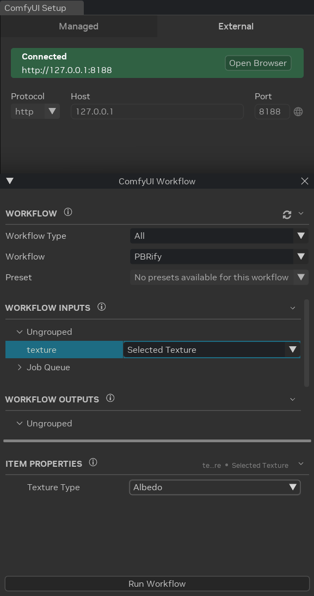
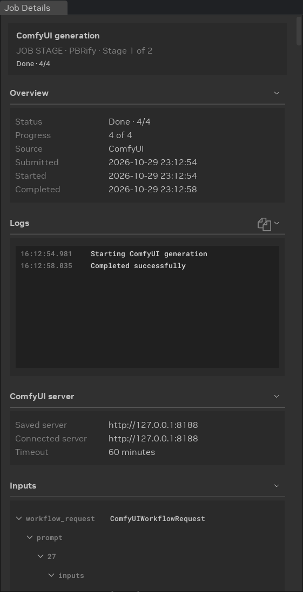
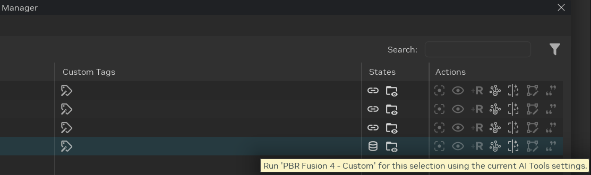
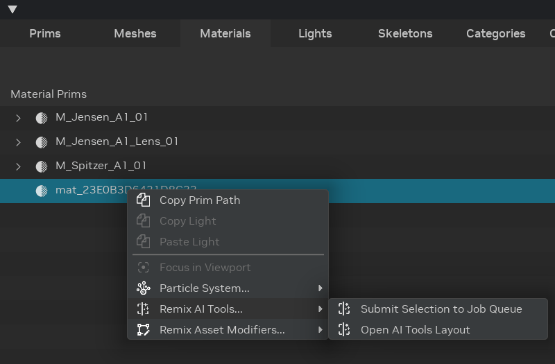

# Использование ИИ-инструментов

ИИ-инструменты (AI Tools) RTX Remix Toolkit интегрированы с [ComfyUI](https://github.com/comfyanonymous/ComfyUI) —
движком рабочих процессов с открытым исходным кодом, построенным на узлах. ИИ-процессы выполняет ComfyUI, а Toolkit
позволяет настраивать и отправлять эти процессы, следить за их ходом и применять результаты к USD-сцене.

Совместимые рабочие процессы (workflows) ComfyUI можно использовать для генерации PBR-текстур, апскейла, переноса стиля,
обработки мешей и других задач. Поля, которые отображаются в Toolkit, определяются входами и выходами, которые автор
рабочего процесса пометил для RTX Remix.

AI Tools пригодятся моддерам, небольшим командам и для быстрого прототипирования. Например, сгенерированные ИИ
PBR-карты помогают людям без художественных навыков создавать пригодные текстуры, а опытные художники могут
сосредоточиться на ключевых ассетах.

## Начало работы

### Предварительные требования

- **GPU:** видеокарта NVIDIA с не менее чем 8 ГБ видеопамяти (рекомендуется 12 ГБ и больше).
- **[ComfyUI](#установка-comfyui):** работающая установка ComfyUI.
- **[ComfyUI Manager](#установка-comfyui-manager):** используется для установки узлов и моделей.
- **[RTX Remix Node Pack](#установка-rtx-remix-node-pack):** необходим для рабочих процессов, которые передают
  входы и выходы в Toolkit.
- **[Подготовка шаблонных рабочих процессов](#подготовка-шаблонных-рабочих-процессов):** прежде чем использовать входящий в
  комплект шаблонный рабочий процесс, нужно установить недостающие пользовательские узлы.

### Установка ComfyUI

ComfyUI можно установить несколькими способами:

- **Настольное приложение (рекомендуется):** скачайте [ComfyUI Desktop App](https://www.comfy.org/download) —
  управляемую установку с автоматическими обновлениями.

  ```{note}
  Настольное приложение содержит собственное окружение Python. При экспорте рабочих процессов используйте пункт
  контекстного меню «Export Workflow for RTX Remix», а не экспорт в формате API: формат экспорта в настольном приложении
  может отличаться.
  ```

- **Портативная версия (Windows):** скачайте портативный выпуск со
  [страницы релизов ComfyUI](https://github.com/comfyanonymous/ComfyUI/releases). Распакуйте его и запустите
  `run_nvidia_gpu.bat`.

- **Ручная установка:** клонируйте [репозиторий ComfyUI](https://github.com/comfyanonymous/ComfyUI) и следуйте
  инструкции по ручной установке.

  ```{warning}
  Не используйте пути установки с пробелами. Некоторые узлы ComfyUI могут неправильно обрабатывать такие пути.
  ```

### Установка ComfyUI Manager

[ComfyUI Manager](https://github.com/Comfy-Org/ComfyUI-Manager) — самый простой способ устанавливать пользовательские
узлы и модели, в том числе RTX Remix Node Pack и все зависимости, необходимые вашим рабочим процессам.

ComfyUI Manager **предустановлен в настольном приложении**. Для портативной и ручной установки его нужно установить
вручную:

1. Перейдите в папку `ComfyUI/custom_nodes/` в каталоге установки ComfyUI.
2. Клонируйте репозиторий:

   ```bat
   git clone https://github.com/Comfy-Org/ComfyUI-Manager.git
   ```

3. Перезапустите ComfyUI.

### Установка RTX Remix Node Pack

[RTX Remix Node Pack](https://github.com/NVIDIAGameWorks/ComfyUI-RTX-Remix) содержит узлы для пометки входов и выходов
рабочего процесса, сохранения текстур с метаданными типа и экспорта рабочих процессов для Toolkit. Установите его через
ComfyUI Manager:

1. Откройте ComfyUI в браузере.
2. Откройте ComfyUI Manager (кнопка **Manager** в верхней строке меню).
3. Введите **RTX Remix** в поле поиска ComfyUI Manager.
4. Найдите в результатах **NVIDIA RTX Remix Nodes** и нажмите кнопку **Install**.
5. Когда ComfyUI предложит перезапустить серверную часть, согласитесь.
6. После перезапуска нажмите кнопку **Templates** на левой боковой панели.
7. Прокрутите левую панель до конца и нажмите **ComfyUI-RTX-Remix**. Появятся шаблонные рабочие процессы набора узлов.
8. Если шаблоны не появились, проверьте статус установки в ComfyUI Manager и поищите ошибки импорта в журнале запуска
   серверной части ComfyUI.

```{note}
Требуется ComfyUI v0.3.72 или новее (с поддержкой API схем V3).
```

### Подготовка шаблонных рабочих процессов

RTX Remix Node Pack поставляется с готовыми шаблонными рабочими процессами. Эти шаблоны могут зависеть от
дополнительных пользовательских узлов, которые не установлены по умолчанию. Перед первым использованием шаблона
установите его зависимости:

1. Откройте ComfyUI в браузере.
2. Нажмите **Templates** на левой боковой панели.
3. Прокрутите левую панель до конца и нажмите **ComfyUI-RTX-Remix**.
4. Щёлкните по нужному шаблонному рабочему процессу. Он загрузится на холст.
5. Если появится диалог **This workflow has missing nodes**, нажмите **Skip for Now**. Перечисленные узлы вы
   установите через ComfyUI Manager на следующем шаге.
6. Откройте **ComfyUI Manager** (кнопка **Manager** в правой верхней части строки меню).
7. Нажмите **Install Missing Custom Nodes**.
8. Выберите все перечисленные узлы и нажмите **Install**.
9. По завершении установки нажмите **Restart**, чтобы перезапустить сервер ComfyUI.

После перезапуска сервера снова откройте шаблонный рабочий процесс. Все узлы должны загрузиться без ошибок.

```{note}
При повторном открытии шаблона ComfyUI может предложить скачать недостающие ИИ-модели. Это предложение можно спокойно
**закрыть**: шаблоны RTX Remix содержат узлы загрузки, которые автоматически скачивают нужные модели при первом запуске
рабочего процесса. Первая загрузка может занять время в зависимости от скорости соединения и размера моделей. При
последующих запусках используются кешированные модели, и запуск происходит гораздо быстрее.
```

```{tip}
Это нужно сделать только один раз для каждого шаблона. После установки нужных пользовательских узлов шаблон будет
загружаться без ошибок и в следующих сеансах.
```

### Запуск ComfyUI

Чтобы Toolkit мог подключиться, ComfyUI должен быть запущен и доступен по HTTP. Способ запуска зависит от способа
установки:

- **Настольное приложение:** запустите приложение. ComfyUI запустится автоматически. Используйте локальный URL,
  который показывает настольное приложение; приложение может само управлять портом для выбранной установки.
- **Портативная версия:** запустите `run_nvidia_gpu.bat` из каталога ComfyUI. По умолчанию сервер запускается на порту
  `8188`.
- **Ручная установка:** выполните `python main.py` из каталога ComfyUI. По умолчанию сервер запускается на порту
  `8188`. Другой порт можно указать параметром `--port`.

```{important}
Порт ComfyUI по умолчанию — **8188**, но настольное приложение или собственные параметры запуска могут использовать
другой порт. Вставьте полный URL работающего экземпляра ComfyUI в поле **Host** в Toolkit — Toolkit автоматически
заполнит поля **Protocol**, **Host** и **Port**.
```

````{tip}
Некоторые шаблонные рабочие процессы при первом запуске скачивают большие ИИ-модели с
[HuggingFace](https://huggingface.co/). Анонимные загрузки ограничены по скорости и могут быть медленными. Чтобы
ускорить загрузку, задайте переменную окружения `HF_TOKEN`.

1. Создайте бесплатный токен только для чтения в [настройках HuggingFace](https://huggingface.co/settings/tokens).
2. Задайте его **до запуска ComfyUI**:

   ```bat
   REM Set the environment variable in the Windows console
   set HF_TOKEN=hf_xxxxxxxxxxxxxxxxxxxx
   ```

   или

   ```powershell
   # Set the environment variable in PowerShell
   $env:HF_TOKEN = "hf_xxxxxxxxxxxxxxxxxxxx"
   ```

   Первую команду используйте в командной строке Windows, вторую — в Windows PowerShell.

3. Запустите ComfyUI из этой же оболочки.

В настольном приложении (или если вы предпочитаете настраивать каждый рабочий процесс отдельно) можно вместо этого
вставить токен в поле `hf_token` каждого узла `RTX Remix Download Model`, но переменная окружения действует сразу на все
узлы.
````

### Подключение Toolkit к ComfyUI

1. Нажмите кнопку **AI Tools** на левой боковой панели (в группе **Layouts**), чтобы открыть макет AI Tools.

   

   Макет состоит из следующих окон:

   - **ComfyUI Setup** подключает Toolkit к ComfyUI.
   - **ComfyUI Workflow** позволяет выбрать рабочий процесс, задать его входы и выходы; здесь же находится кнопка
     **Run Workflow**.
   - **Job Queue** (очередь заданий) под вьюпортом показывает отправленные задания. См.
     [Очередь заданий](../toolkitinterface/remix-toolkitinterface-jobqueue.md).
   - **Job Details** справа показывает выбранное задание.

2. В **ComfyUI Setup** откройте вкладку **External**. Вкладка **Managed** пока недоступна.
3. Вставьте полный URL в поле **Host**. Toolkit автоматически заполнит поля **Protocol**, **Host** и **Port**:
   - если ComfyUI использует порт по умолчанию: `http://127.0.0.1:8188`;
   - если настольное приложение показывает другой локальный URL, вставьте его.
4. Нажмите **Connect** в нижней части **ComfyUI Setup**.
5. Когда Toolkit проверит соединение, на баннере подключения появится **Connected**. После этого в выпадающем списке
   **Workflow** появятся доступные рабочие процессы.



```{note}
Разобранные значения Protocol, Host и Port сохраняются между сеансами. Вставлять URL заново нужно только при изменении
конфигурации ComfyUI.
```

Баннер подключения показывает текущее состояние соединения. Кнопка в нижней части **ComfyUI Setup** меняется вместе с
ним:

| Баннер | Кнопка | Значение |
|--------|--------|---------|
| **Disconnected** | **Connect** | Вставьте полный URL в **Host** и нажмите **Connect**. |
| **Connecting** | **Connecting...** | Toolkit проверяет указанный сервер. |
| **Connected** | **Disconnect** | Баннер показывает проверенный URL ComfyUI. Нажмите **Open Browser** на баннере, чтобы открыть ComfyUI в браузере. |
| **Connection Failed** | **Retry** | При необходимости вставьте исправленный URL в **Host** и нажмите **Retry**. Нажмите **Show Logs** на баннере, чтобы увидеть адрес и ошибку подключения. |
| **Connection Unavailable** | **Disconnect** | Toolkit потерял проверенный адрес ComfyUI. Нажмите **Disconnect**, а затем снова **Connect**. |

Поля **Protocol**, **Host** и **Port** заблокированы, пока Toolkit подключается и пока он подключён. Прежде чем
вставить другой URL, нажмите **Disconnect**. Значок глобуса рядом с **Port** устанавливает стандартный порт протокола
(80 для HTTP, 443 для HTTPS).

**Show Logs** открывает окно с адресом и ошибкой подключения, которые зафиксировал Toolkit; их можно скопировать.
Консоль и журналы сервера ComfyUI там не отображаются.

## Основы: запуск первого рабочего процесса

### Как обрабатывается задание

Каждое отправленное задание — это **граф задания** (job graph) в [очереди заданий](../toolkitinterface/remix-toolkitinterface-jobqueue.md).
В строке графа показано отображаемое имя рабочего процесса, а в столбце **Target** — примы, которые изменяет задание.
Этапы графа зависят от помеченных выходов рабочего процесса.

- Рабочий процесс для текстур выполняет **ComfyUI generation**, затем **Texture optimization**; последний этап
  конвертирует текстуры и содержит результат для применения (Apply).
- Рабочий процесс для мешей выполняет **ComfyUI generation**, **Optimization preparation**, **Texture optimization** и
  **Mesh optimization**. Результат для применения содержит последний этап.

Граф изменяет проект только на шаге Apply. Если этап завершается с ошибкой, проект остаётся без изменений.

Нажмите стрелку в начале строки графа, чтобы увидеть его этапы. В строке этапа **Texture optimization** есть пункт
**Reveal in File Explorer**, открывающий папку с обработанными текстурами.

### Выбор рабочего процесса

Выпадающий список **Workflow** показывает отображаемые имена всех совместимых с RTX Remix рабочих процессов, доступных
в подключённом экземпляре ComfyUI. Список разделён на два раздела: **Built-in** — процессы, поставляемые с набором
узлов, и **User** — процессы, которые экспортировали вы. Наведите курсор на рабочий процесс, чтобы увидеть его
описание. Выберите процесс, чтобы загрузить его настраиваемые поля.

Список **Workflow Type** позволяет показывать только рабочие процессы одного типа. Тип выбирает автор процесса при
экспорте. Типы сгруппированы по категориям:

| Категория | Типы рабочих процессов |
|----------|----------------|
| **Generation** | **Asset Generation**, **Material Generation** |
| **Upscaling** | **Asset Upscaling**, **Mesh Upscaling**, **Texture Upscaling** |
| **Miscellaneous** | **Asset Tagging** |
| **Other** | **Other** |

Наведите курсор на тип, чтобы увидеть его описание из набора узлов. Рабочий процесс неизвестного Toolkit типа
отображается только в разделе **All**.

Нажмите значок **Refresh**, чтобы перезагрузить список рабочих процессов. Refresh также перезагружает выбранный процесс,
так что появятся входы и выходы заново экспортированного процесса.

### Использование пресетов

Если в рабочем процессе определены пресеты, становится доступен список **Preset**. Пресет задаёт набор значений полей
для конкретного сценария, например для определённого типа материала.

При выборе пресета все поля сначала сбрасываются к значениям по умолчанию, а затем применяются значения пресета. Если
после этого изменить поле вручную, пресет перестаёт быть выбранным, но ваши значения полей сохраняются.

```{tip}
Пресеты определяют авторы рабочих процессов в ComfyUI. Набор доступных пресетов полностью зависит от выбранного
процесса: у разных процессов могут быть разные пресеты или не быть их вовсе. Подробнее о создании пресетов и
управлении ими см. в разделе
[Managing Presets](https://github.com/NVIDIAGameWorks/ComfyUI-RTX-Remix?tab=readme-ov-file#managing-presets)
документации RTX Remix Node Pack.
```

### Настройка элементов рабочего процесса

Список **Workflow Inputs** показывает каждый помеченный вход рабочего процесса. Список **Workflow Outputs** показывает
каждый помеченный выход под его экспортным именем. Наведите курсор на строку выхода, чтобы увидеть его вид. Оба списка
группируют и упорядочивают строки по группам, заданным при экспорте процесса. Выберите элемент в любом списке, чтобы
увидеть его настройки в **Item Properties**. Поля входов могут быть текстовым полем, числовым элементом управления,
флажком, выпадающим списком или путём к файлу.

Группа **Job Queue** в **Workflow Inputs** содержит [тайм-аут задания](#тайм-аут-задания). Чтобы вернуть значения
пресета, выберите пресет ещё раз.

### Передача данных сцены в ComfyUI

Некоторые входы рабочего процесса могут брать данные из сцены Remix вместо фиксированного значения:

1. В **Workflow Inputs** найдите вход, который нужно настроить.
2. Откройте выпадающий список рядом со входом и выберите, откуда он будет получать значение.
3. Выберите строку входа и настройте параметры выбранного варианта в **Item Properties**.

| Вариант | Тип входа | Что передаётся в ComfyUI | Параметры |
|--------|------------|-----------------------|---------|
| **Constant** | Любой | Одно фиксированное значение или файл. Сцена не читается. В списке вариант называется по типу значения: **Text Constant**, **Integer Constant**, **Number Constant**, **Boolean Constant** или **File Path Constant**. | Значение |
| **Selected Texture** | Текстура | Текстура каждого выбранного материала | **Texture Type** |
| **All Textures** | Текстура | Текстура каждого материала в сцене | **Texture Type**, **Introducing Layer** |
| **Selected Mesh** | Меш | Модель каждого выбранного меша | **Reference Selection** (по умолчанию **Selected**) |
| **All Meshes** | Меш | Модель каждого меша в сцене | **Reference Selection** (по умолчанию **All**) |
| **Selected Prim** | Текст | Путь к приму, который обрабатывает каждое задание. Процесс с выходом-мешем или со входом **Selected Mesh** или **All Meshes** передаёт прим меша. Остальные процессы передают материал, даже если выбран меш. | Нет |
| **Current Layer** | Текст | Идентификатор корневого слоя сцены | Нет |

- **Texture Type** задаёт, какую текстуру материала считывать, например **Albedo** или **Roughness**.
- **Introducing Layer** определяет, какие текстуры обрабатывает **All Textures**. **Capture** — только текстуры из
  захвата игры. **Mod** — только текстуры, добавленные вашим модом. **Any** — все текстуры.
- **Reference Selection** определяет, какие ссылки меша использует рабочий процесс. **Selected** — только ссылку,
  из которой составлен выбранный вами прим. **All** — все ссылки меша.

Доступные варианты зависят от типа входа. Значения определяются в момент отправки задания.

От входов зависит, сколько заданий создаёт одна отправка:

- Если все входы — **Constant** или **Current Layer**, создаётся одно задание. Выделение ни на что не влияет. Toolkit
  обрабатывает результат, но не применяет его, потому что ни один вход не указывает на прим сцены.
- Если какой-либо вход — **Selected Texture**, **Selected Mesh** или **Selected Prim**, создаётся по одному заданию на
  каждый выбранный элемент.
- Если какой-либо вход — **All Textures** или **All Meshes**, создаётся по одному заданию на каждый подходящий элемент
  сцены.

Элементы, отправляющие в ComfyUI одинаковый запрос, используют одно общее задание. Например, два меша, привязанные к
одному материалу, используют одно задание для текстуры. Два меша, ссылающиеся на одну модель с одинаковыми входами,
используют одно задание для модели. Toolkit применяет общий результат к каждому элементу.

Если у рабочего процесса есть вход-меш, его текстурные входы должны использовать ту же область действия. Меш
**Constant** требует текстур **Constant**. **Selected Mesh** требует **Selected Texture**. **All Meshes** требует
**All Textures**. Другие сочетания при отправке отклоняются.

Рабочий процесс со входом **Selected Mesh** или **All Meshes** и текстурными выходами считывает модель из каждой ссылки
меша. Его текстуры заменяют текстуры материалов под этим мешем.

### Настройка выходов рабочего процесса

Выберите помеченный выход в **Workflow Outputs**. Настройте следующие свойства:

- У каждого выхода есть **Apply Behavior**. Выберите **Do Nothing**, чтобы публиковать обработанные файлы, не изменяя
  сцену.
- Текстурный выход поддерживает **Replace** и **Do Nothing**. **Texture Type** управляет обработкой и заменой текстуры.
- Выход-меш поддерживает **Replace** (по умолчанию при наличии входа-меша), **Append** (по умолчанию при его
  отсутствии) и **Do Nothing**.

Replace удаляет исходные ссылки, выбранные параметром **Reference Selection** входа-меша, и добавляет на их место
сгенерированную модель. При **All** каждая ссылка выбранного прима получает собственное задание, и каждое задание
заменяет ту ссылку, с которой начиналось. Append добавляет сгенерированную модель рядом с каждой целевой ссылкой.
Для Replace нужен вход-меш со значением **Selected Mesh** или **All Meshes**. Если вход-меш — **Constant**, Replace при
отправке отклоняется, поскольку в сцене нет ссылки, которую можно было бы заменить.

### Тайм-аут задания

В группе **Job Queue** раздела **Workflow Inputs** есть поле **Timeout**. Оно задаёт максимальное время в минутах,
которое задание ждёт ComfyUI. По умолчанию — 60 минут. Введите `0`, чтобы снять ограничение по времени. Каждое задание
сохраняет тайм-аут, заданный на момент отправки.

Когда время задания истекает, Toolkit отменяет его запрос (prompt) на сервере ComfyUI. Следующее задание ComfyUI
запускается только после того, как сервер подтвердит отмену, поэтому запрос с истёкшим временем не может замедлить
последующие задания. После этого в очереди заданий отображается **Timed Out**.

### Отправка задания

1. Если у рабочего процесса есть вход **Selected**, выделите один или несколько примов во вьюпорте или Stage Manager.
   Входы **All**, **Constant** и **Current Layer** выделение не используют.
2. Настройте поля рабочего процесса.
3. Нажмите **Run Workflow**. Если кнопка недоступна, наведите на неё курсор, чтобы узнать причину: например, ComfyUI
   не подключён, рабочий процесс не выбран или проект не открыт.
4. Пока Toolkit читает сцену, окно **Preparing ComfyUI Jobs** показывает ход работы. Нажмите **Cancel**, чтобы
   остановиться, не добавляя задания.
5. Если некоторые элементы не предоставляют входы, необходимые рабочему процессу, Toolkit не создаёт для них задания.
   Остальные задания попадают в очередь. Если подходящих элементов нет вообще, диалог **No ComfyUI Jobs Created**
   сообщит, что задания не добавлены.

Задания начинают выполняться, как только запускается планировщик [очереди заданий](../toolkitinterface/remix-toolkitinterface-jobqueue.md),
что по умолчанию и происходит. Если на панели инструментов отображается **Stopped**, нажмите **Start** (▶️).

### Применение результатов

**Apply** выполняет действия, настроенные для помеченных выходов. Replace для текстуры обновляет входы шейдера. Append
или Replace для меша обновляют ссылки на модели. **Revert** восстанавливает прежние значения, не удаляя обработанные
файлы.

По умолчанию очередь заданий работает в режиме **AUTO** и применяет каждый результат, как только он готов. Нажмите
значок **AUTO** на панели инструментов очереди заданий, чтобы переключиться в режим **MANUAL**, и затем сами
просматривайте каждый результат и выбирайте **Apply** (✔️) или **Decline** (✖️). Кнопки и их состояния описаны в
разделе [Применение результатов](../toolkitinterface/remix-toolkitinterface-jobqueue.md#применение-результатов).

```{tip}
Режим **AUTO** удобен для больших пакетных запусков, когда нужно, чтобы результаты попадали в сцену сразу по
готовности. Для более вдумчивой работы переключитесь в **MANUAL** и применяйте задания по одному после проверки.
```

### Управление заданиями AI Tools

На странице [Очередь заданий](../toolkitinterface/remix-toolkitinterface-jobqueue.md) описаны столбцы, статусы,
фильтры и действия для любых заданий. Задания AI Tools добавляют в строку графа следующие действия:

- **Focus in Viewport** выделяет примы задания и показывает их во вьюпорте. Нажмите ещё раз, чтобы перейти к следующему
  приму.
- **Open Workflow** загружает сохранённый рабочий процесс и входные значения задания в **ComfyUI Workflow**. Процесс
  отображается в разделе **Saved Job** списка **Workflow**. Измените значения и запустите процесс снова.
- **Retarget** отправляет задание из очереди на сервер ComfyUI, подключённый сейчас, если он отличается от сохранённого
  сервера. Подтвердите действие кнопкой **Change Server**. Доступно, только пока этап **ComfyUI generation** ждёт в
  очереди.

Этап **ComfyUI generation** показывает **Waiting**, пока сервер ComfyUI, на который было отправлено задание, не
подключён. Наведите курсор на статус, чтобы увидеть адрес сервера.

Пока задание выполняется, в строке графа вместо **Delete** отображается **Stop**. Эта кнопка отменяет запрос на сервере
ComfyUI. Задание получает статус **Stopped** только после того, как сервер подтвердит остановку запроса. После этого
запускается следующее задание ComfyUI из очереди. Пока задание ждёт подтверждения, **Stop** недоступна. Этап
оптимизации показывает **Running**, пока не завершится текущий шаг, а затем — **Stopped**.

У этапа со статусом **Timed Out** или **Stopped** в строке есть **Retry**. Retry запускает задание заново с теми же
входами и тем же тайм-аутом.

Этап может иметь статус **Skipped**. Наведите курсор на статус, чтобы увидеть причину. Например, этапы оптимизации
пропускают уже оптимизированный ассет, и задание всё равно может применить результат.

### Сведения о задании

Выберите граф или этап, чтобы показать его в окне **Job Details**. Все его разделы перечислены в разделе
[Job Details](../toolkitinterface/remix-toolkitinterface-jobqueue.md#сведения-о-задании) страницы об очереди заданий.



Этап **ComfyUI generation** добавляет раздел **ComfyUI server**:

- **Saved server:** сервер, на который было отправлено задание.
- **Connected server:** сервер, к которому Toolkit подключён сейчас, или **Not connected**.
- **Timeout:** тайм-аут задания или **No timeout**.

Этап **Texture optimization** добавляет раздел **Processed textures** со сконвертированными текстурами.

## Масштабная обработка

### Обработка всей сцены

Чтобы обработать все текстуры или меши мода за одну отправку, используйте варианты **All**:

1. Установите для текстурного входа **All Textures** или для входа-меша **All Meshes**. Если у процесса есть оба входа,
   для обоих нужно выбрать **All**.
2. Для **All Textures** задайте **Introducing Layer**. Выберите **Capture**, чтобы переработать исходные текстуры игры.
   Выберите **Mod**, чтобы обработать только текстуры, добавленные вашим модом.
3. Нажмите **Run Workflow**. Выделять примы не нужно.

Отправка создаёт по одному заданию на каждый подходящий элемент сцены. Чтобы сначала опробовать рабочий процесс на
нескольких элементах, используйте **Selected Texture** или **Selected Mesh**.

```{tip}
Включите **Auto** на панели инструментов очереди заданий, чтобы каждый результат применялся по готовности. Увеличьте
**Timeout**, если на вашем оборудовании одна генерация может занимать больше 60 минут.
```

### Сохранение заданий

Очередь заданий хранится в базе данных SQLite и сохраняется между перезапусками приложения. Если закрыть Toolkit, пока
в очереди есть работа, задания останутся доступны. Переподключитесь к ComfyUI и запустите планировщик, чтобы продолжить
их обработку.

### Интеграция со Stage Manager

Отправлять задания можно прямо из Stage Manager, не переключаясь на макет AI Tools. В столбце **Actions** на вкладках
**Prims**, **Meshes**, **Materials**, **Categories** и **Custom Tags** есть значок **AI Tools**. Нажмите его, чтобы
отправить выделенные примы с текущим рабочим процессом и значениями полей.



Значок активен, когда ComfyUI подключён, рабочий процесс выбран и у него есть хотя бы один вход **Selected Texture**
или **Selected Mesh**. Подсказка значка называет рабочий процесс. В противном случае значок неактивен, а подсказка
объясняет причину: входы **Constant**, **All Meshes** и **All Textures** не используют выделение. Щелчок по неактивному
значку открывает макет AI Tools.

Можно также щёлкнуть правой кнопкой по приму и выбрать **Remix AI Tools...**:

- **Submit Selection to Job Queue** отправляет выделенные примы, как и значок.
- **Open AI Tools Layout** открывает макет AI Tools.



После отправки уведомление подтверждает, что выделение добавлено в очередь заданий. Выберите **Open AI Tools layout** в
уведомлении, чтобы увидеть задания. Выделенные примы, не предоставляющие нужных входов, заданий не создают. Если ни один
выделенный прим их не предоставляет, Toolkit показывает диалог и не добавляет заданий.

```{tip}
Отправляйте задания с вкладки **Materials** в Stage Manager, чтобы применять результаты на уровне прима Material.
Тогда создаётся переопределение (override) для материала, которое унаследуют все меши с этим материалом, и обрабатывать
каждый материал нужно будет только один раз, а не для каждого меша.
```

## Создание собственных рабочих процессов

Весь процесс создания рабочих процессов описан в документации
[RTX Remix Node Pack](https://github.com/NVIDIAGameWorks/ComfyUI-RTX-Remix):

1. **Соберите рабочий процесс** в ComfyUI из стандартных узлов.
2. **Пометьте входы и выходы** для RTX Remix: щёлкните правой кнопкой по узлу и выберите «Tag for RTX Remix».
   Помеченные входы появляются в интерфейсе Toolkit как настраиваемые поля. Помеченные выходы сообщают Toolkit, что
   делать с результатами. У узла-выхода должен быть выход STRING с путём к файлу, например `RTX Remix Save Texture`
   или `USD Save Stage`. При экспорте добавляется узел `RTX Remix Output File`, публикующий этот путь. Каждый помеченный
   выход даёт один итоговый файл.
3. **Экспортируйте** процесс: щёлкните правой кнопкой по холсту и выберите «Export Workflow for RTX Remix». В диалоге
   экспорта:
   - Введите **Display Name** и выберите **Workflow Type**. Оба поля обязательны. **Description** необязательно и
     становится подсказкой рабочего процесса в Toolkit.
   - Выберите **Texture Type** для каждого выхода `texture_file_path`, даже если он в процессе один.
   - При желании перетащите строки и задайте **Group**, чтобы упорядочить входы и выходы. У входов и выходов отдельные
     списки групп.

   Кнопка **Export** остаётся неактивной, пока не заполнены все обязательные поля.

Для рабочего процесса с мешами пометьте узел `USD Open Asset` как вход-меш, а узел `RTX Remix Export Mesh` или
`USD Save Stage` — как выход-меш. При пометке эти узлы получают тип `mesh_file_path`. Не используйте встроенные узлы
`Load 3D` и `Save 3D Model`: они не читают и не записывают USD. У рабочего процесса может быть только один выход-меш.

```{warning}
Стандартный экспорт «Save (API Format)» не включает метаданные RTX Remix. Всегда используйте вариант экспорта для
RTX Remix.
```

Пошаговые инструкции по пометке, экспорту и тестированию рабочих процессов см. в
[Integration Workflow Guide](https://github.com/NVIDIAGameWorks/ComfyUI-RTX-Remix?tab=readme-ov-file#integration-workflow-guide).

## Конфигурации запуска

### Один компьютер

Самая простая конфигурация: ComfyUI и RTX Remix Toolkit работают на одном компьютере. На вкладке **External**
вставьте в **Host** локальный URL работающего экземпляра ComfyUI (для стандартного значения по умолчанию —
`http://127.0.0.1:8188`). Toolkit автоматически заполнит отдельные поля подключения. Это идеальный вариант для
моддеров-одиночек и небольших проектов.

```{note}
На одном компьютере ComfyUI и Toolkit делят ресурсы GPU. Если вывод (inference) идёт медленно или не хватает
видеопамяти, попробуйте закрыть проект перед отправкой больших пакетов или используйте удалённую конфигурацию.
```

### Удалённый компьютер

Запустите ComfyUI на отдельном компьютере (например, на выделенном GPU-сервере), чтобы освободить локальный GPU для
рендеринга во вьюпорте:

1. На удалённом компьютере запустите ComfyUI с флагом `--listen`, чтобы он принимал внешние подключения:

   ```bat
   python main.py --listen
   ```

2. На вкладке **External** в Toolkit вставьте в **Host** полный удалённый URL (например,
   `http://192.168.1.100:8188`). Toolkit автоматически заполнит отдельные поля подключения.
3. Нажмите **Connect**.

```{tip}
Если у вас несколько GPU, можно запустить отдельные экземпляры ComfyUI на разных GPU, назначив каждому свой GPU и порт
параметрами `--cuda-device` и `--port`.
```

## Устранение неполадок

| Симптом | Решение |
|---------|----------|
| Баннер **Connection Failed** | Убедитесь, что ComfyUI запущен. Вставьте правильный полный URL в **Host** и нажмите **Retry**. Нажмите **Show Logs**, чтобы увидеть адрес и ошибку подключения. |
| Поле **Host** нельзя редактировать | Toolkit подключён или подключается. Сначала нажмите **Disconnect**. |
| После подключения не появляются рабочие процессы | Убедитесь, что RTX Remix Node Pack установлен и ComfyUI перезапущен после установки. |
| Диалог сообщает, что задания не созданы | Ни один выделенный прим не предоставляет входы, необходимые рабочему процессу, например текстуру. Примы без этих входов никогда не создают заданий. Назначьте нужные данные и снова запустите процесс. |
| Результаты не появляются на приме | Убедитесь, что в иерархии прима есть шейдер, который Toolkit может найти. |
| Задание показывает **Timed Out** | ComfyUI не выполнил запрос за время **Timeout** задания. Нажмите **Retry**, чтобы запустить задание снова с тем же тайм-аутом. Чтобы увеличить тайм-аут, увеличьте **Timeout** в группе **Job Queue** раздела **Workflow Inputs** и снова запустите процесс. |
| Отправка отклоняет текстурные входы и вход-меш | Текстурные входы должны использовать ту же область действия, что и вход-меш. Используйте **Selected Texture** с **Selected Mesh**, **All Textures** с **All Meshes** или **File Path Constant** с **File Path Constant**. |
| Задание остаётся в статусе **Queued** | Планировщик остановлен. Нажмите **Start** (▶️) на панели инструментов очереди заданий. |
| Задание остаётся в статусе **Waiting** | Сервер ComfyUI этого задания не подключён. Наведите курсор на статус, чтобы увидеть его адрес. Подключитесь к этому серверу или нажмите **Retarget**, чтобы отправить задание на подключённый сервер. |
| Значок **AI Tools** в Stage Manager неактивен | У рабочего процесса нет входа **Selected Texture** или **Selected Mesh**. Щёлкните по значку, чтобы открыть макет AI Tools, и запустите процесс оттуда. |

При общих проблемах ComfyUI (загрузка моделей, нехватка памяти, ошибки узлов) смотрите консоль или журналы процесса
внешнего ComfyUI и [документацию ComfyUI](https://docs.comfy.org/). Эти журналы не совпадают со сведениями об ошибке
подключения, которые показывает **Show Logs**.

```{seealso}
[ComfyUI RTX Remix Node Pack](https://github.com/NVIDIAGameWorks/ComfyUI-RTX-Remix): исходный код и документация
набора узлов
```

***
<sub> Хотите оставить отзыв о документации RTX Remix? [Нажмите здесь](https://github.com/NVIDIAGameWorks/rtx-remix/issues/new?assignees=sambvfx&labels=documentation%2Cfeedback%2Ctriage&projects=&template=documentation_feedback.yml&title=%5BDocumentation+feedback%5D%3A+) </sub>
