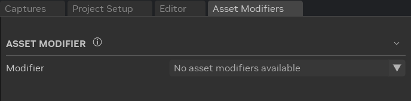
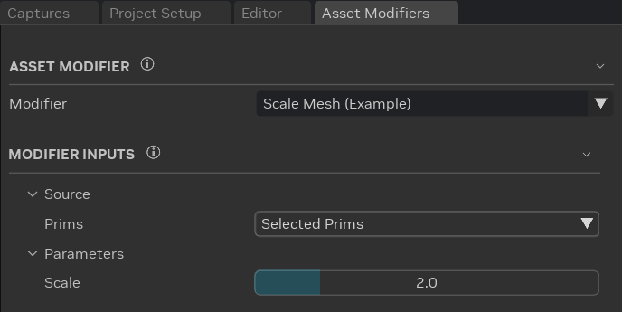
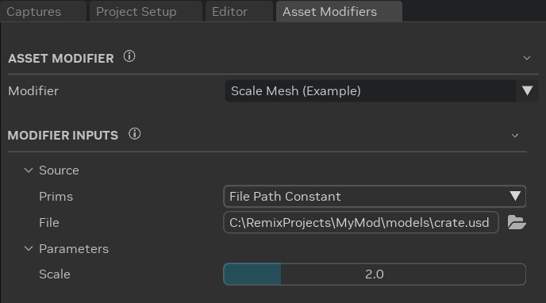
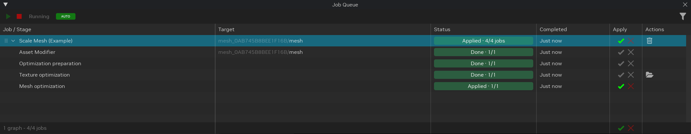
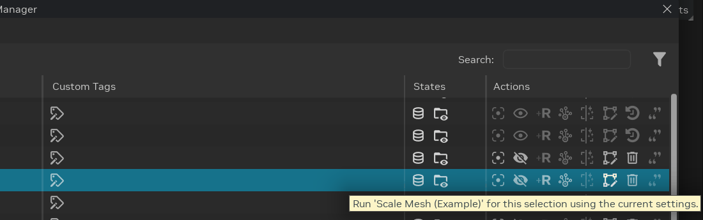
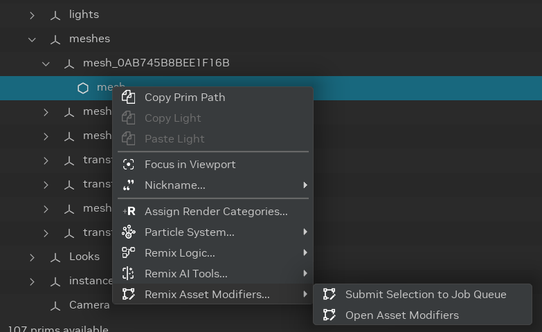

# Использование модификаторов ассетов

**Модификатор ассета** (asset modifier) преобразует модель на вашем компьютере, например масштабирует меш или
перестраивает его по текстурам. Ему не нужны ни ИИ, ни ComfyUI. Toolkit запускает модификатор в
[очереди заданий](../toolkitinterface/remix-toolkitinterface-jobqueue.md), обрабатывает его результат как любой
импортированный ассет и заменяет модель в вашем проекте. Изменение можно отменить в любой момент.

```{note}
В Toolkit нет встроенных модификаторов. Модификаторы поставляются в расширениях, которые вы устанавливаете. Пока ни одно
расширение не предоставляет модификатор, окно **Asset Modifiers** показывает **No asset modifiers available**.
```



## Открытие Asset Modifiers

- **Макет Modding:** вкладка **Asset Modifiers** находится рядом с вкладкой **Editor**.
- **Stage Manager:** щёлкните правой кнопкой по приму и выберите **Remix Asset Modifiers...** > **Open Asset Modifiers**.
- **Любой макет:** выберите **Window** > **Modifiers** > **Asset Modifiers**.

## Выбор модификатора и его входов



1. В разделе **Asset Modifier** выберите модификатор в списке **Modifier**. Наведите курсор на модификатор, чтобы
   увидеть, что он делает. Модификатор с пометкой **(Experimental)** может измениться в будущих версиях. Проверяйте его
   результат, прежде чем сохранять.
2. В разделе **Modifier Inputs** задайте **Prims** в группе **Source**, чтобы выбрать модели для изменения:

   | Prims | Какие модели меняет модификатор | Результат |
   |-------|----------------------------------|--------|
   | **Selected Prims** | Модели примов, выделенных во вьюпорте или Stage Manager. | Заменяет ссылку на модель у каждого прима. |
   | **All Compatible Prims** | Модели всех примов проекта, которые принимает модификатор. | Заменяет ссылку на модель у каждого прима. |
   | **File Path Constant** | Файл модели, указанный в строке **File**. | Публикует изменённую модель. Проект не меняется. Работает без открытого проекта. |

3. Задайте остальные входы модификатора. Наведите курсор на вход, чтобы увидеть, что он делает.

Toolkit запоминает выбранный модификатор и значения всех входов, в том числе после перезапуска.

Каждый модификатор сам решает, какие примы он принимает, например меши или материалы. Кроме того, прим должен
происходить из внешней модели, например быть захваченным мешем или заменой, ссылающейся на файл модели. Примы внутри
модели, на которую ведёт ссылка, пропускаются.



## Запуск модификатора

1. Если **Prims** имеет значение **Selected Prims**, выделите один или несколько примов во вьюпорте или Stage Manager.
2. Нажмите **Run Modifier**. Если кнопка недоступна, наведите на неё курсор, чтобы узнать причину: например, проект не
   открыт или файл **File** не существует.
3. Пока Toolkit читает проект, окно **Preparing Asset Modifier Jobs** показывает ход работы. Нажмите **Cancel**, чтобы
   остановиться, не добавляя задания.
4. Уведомление сообщит, сколько заданий добавлено в очередь. Если какие-то примы были пропущены, в нём будет указана
   причина, например **Not supported by** (не поддерживается) модификатором. Выберите **Open Job Queue** в уведомлении,
   чтобы увидеть задания.

   

Примы, использующие одну и ту же модель, делят одно задание, поэтому каждая модель изменяется один раз.

## Отслеживание заданий в очереди

Каждая модель становится одним графом заданий в [очереди заданий](../toolkitinterface/remix-toolkitinterface-jobqueue.md).
Граф называется по имени модификатора, а столбец **Target** показывает примы, которые он изменяет, или файл модели для
источника **File Path Constant**.



Первый этап, **Asset Modifier**, запускает модификатор. Следующие этапы выбирает сам модификатор. Модификатор,
изменяющий меш, обычно добавляет **Optimization preparation**, **Texture optimization** и **Mesh optimization**, как при
импорте модели. Последний этап содержит результат.

- **Apply** заменяет ссылку на модель у каждого прима изменённой моделью. В режиме **AUTO** очередь применяет результат
  сразу по готовности, в режиме **MANUAL** — когда вы нажмёте **Apply**.
- **Revert** восстанавливает исходную ссылку на модель. Применение (Apply) также отменяется командой **Undo**
  (Ctrl + Z).

Каждое задание сохраняет файлы в собственную папку `assets/ingested/modifiers/<modifier>/<job ID>/` рядом с проектом,
поэтому новый запуск никогда не перезаписывает предыдущий.

Статусы, кнопки Apply, фильтры и **Job Details** описаны на странице
[Очередь заданий](../toolkitinterface/remix-toolkitinterface-jobqueue.md).

## Запуск модификатора из Stage Manager

В столбце **Actions** на вкладках **Prims**, **Meshes**, **Materials**, **Categories** и **Custom Tags** есть значок
**Asset Modifiers**. Нажмите его, чтобы запустить выбранный модификатор для выделенных примов с текущими входами.



Значок активен, когда **Prims** имеет значение **Selected Prims** и модификатор принимает этот прим. В противном случае
значок неактивен, а его подсказка объясняет причину. Щелчок по неактивному значку открывает окно **Asset Modifiers**.

Можно также щёлкнуть правой кнопкой по приму и выбрать **Remix Asset Modifiers...**:

- **Submit Selection to Job Queue** запускает модификатор для выделенных примов, как и значок.
- **Open Asset Modifiers** открывает окно **Asset Modifiers**.



## Устранение неполадок

| Симптом | Решение |
|---------|----------|
| Окно показывает **No asset modifiers available** | Ни одно установленное расширение не предоставляет модификатор. Установите и включите расширение с модификатором. |
| **Run Modifier** недоступна | Наведите на кнопку курсор, чтобы узнать причину. Откройте проект или выберите существующий файл модели для источника **File Path Constant**. |
| Значок в Stage Manager неактивен | Установите **Prims** в **Selected Prims** или выделите прим, который принимает модификатор. Наведите курсор на значок, чтобы узнать причину. |
| Прим пропущен с сообщением **No external model reference composes this prim** | Прим не происходит из файла модели: например, это источник света или прим внутри модели, на которую ведёт ссылка. Выделите вместо него его меш или прим замены. |
| Задание остаётся в статусе **Queued** | Планировщик очереди заданий остановлен. Нажмите **Start** (▶️) на панели инструментов очереди заданий. |

```{seealso}
Как написать модификатор, см. в разделе [Add a modifier](https://github.com/NVIDIAGameWorks/toolkit-remix/blob/main/source/extensions/lightspeed.trex.asset_modifiers.core/docs/README.md#add-a-modifier)
документации для разработчиков Asset Modifiers.
```

***
<sub> Хотите оставить отзыв о документации RTX Remix? [Нажмите здесь](https://github.com/NVIDIAGameWorks/rtx-remix/issues/new?assignees=sambvfx&labels=documentation%2Cfeedback%2Ctriage&projects=&template=documentation_feedback.yml&title=%5BDocumentation+feedback%5D%3A+) </sub>
