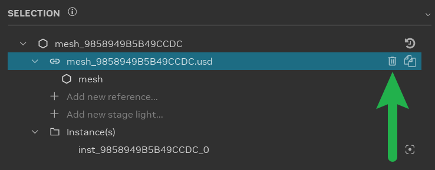
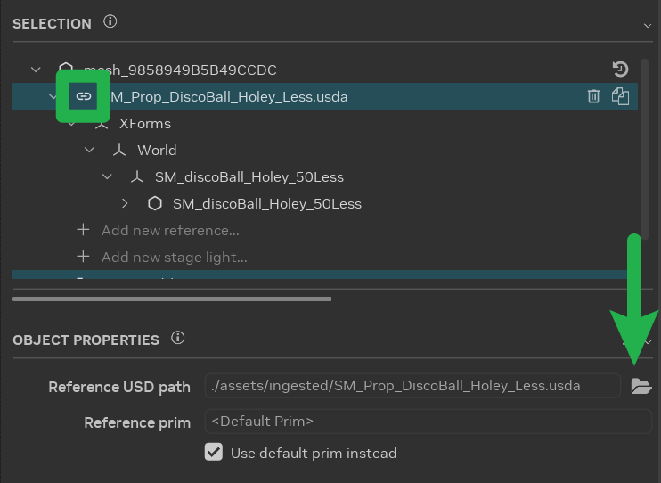
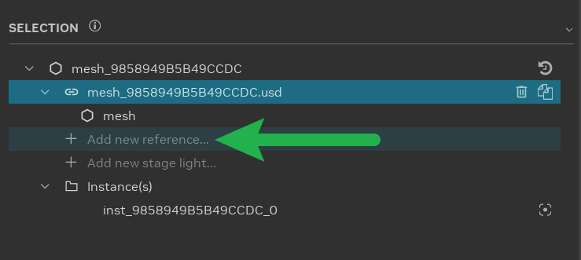
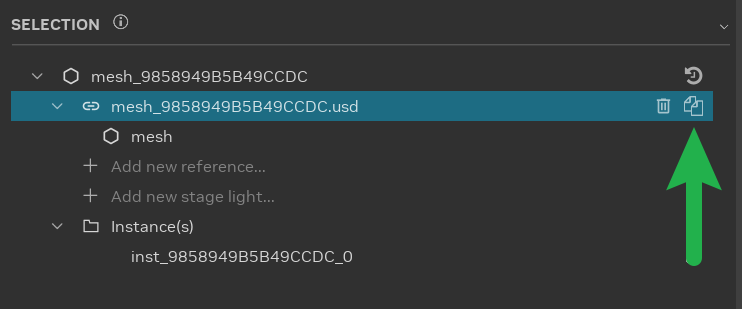
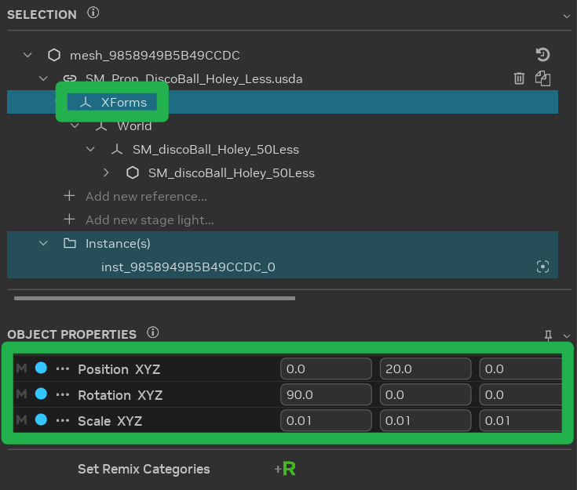
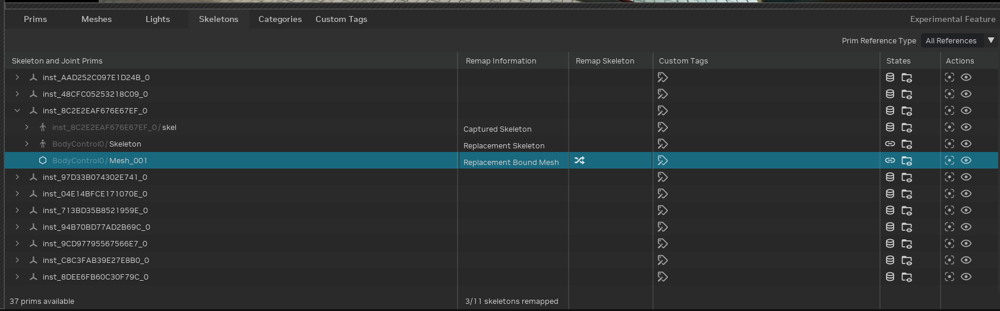
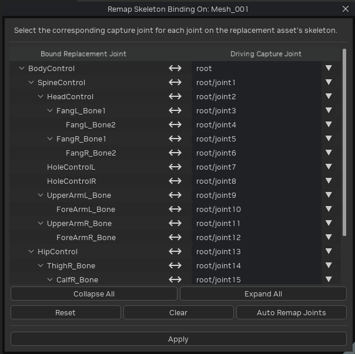

# Настройка замены ассетов

Замена исходной графики игры современными высококачественными ассетами — ключевая часть ремастеринга игры с помощью
RTX Remix. В старых играх модели обычно простые и малодетализированные. RTX Remix позволяет моддерам улучшить графику,
заменив исходные ассеты более детализированными и современными. Именно этот процесс лежит в основе визуально
обновлённой игры.

```{warning}
**Прежде чем использовать ассеты в моде, все они должны быть импортированы в каталог проекта.**

Сведения об импорте ассетов см. в разделе [Импорт ассетов](learning-ingestion.md).
```

## Стабильность хешей

Для замены ассета нужен стабильный хеш. Стабильность гарантирует, что RTX Remix Runtime сможет точно опознать ассет и
соответствующие ему замены.

Хеш — уникальный идентификатор, вычисляемый по данным ассета. По нему RTX Remix Runtime узнаёт ассет и управляет им во
время игры.

В старых играх хеши геометрии игрового мира часто нестабильны, в том числе из-за механизмов отсечения (culling).

Чтобы проверить стабильность хешей:

1. **Отладка в игре:** в игре нажмите «Alt+X», перейдите на вкладку «Debug» в разделе «Rendering» и включите
   «Debug View».
2. **Проверка хешей геометрии:** переключите режим отладочного просмотра на «Geometry Hash». Если цвета в игровом мире
   меняются, хеши нестабильны. Возможно, понадобятся обходные пути, или замена окажется невозможной.

Если хеши выглядят стабильными, переходите к замене ассетов. Если есть признаки нестабильности, попробуйте заменять
ассеты другим способом — с помощью якорных ассетов.

### Якорные ассеты

Если хеши нестабильны, прямая замена ассетов может вызвать трудности. В таком случае можно использовать «якорные
ассеты» (Anchor Assets) — стабильные, не отсекаемые ассеты-заместители на игровом уровне. Они служат надёжными опорными
точками для размещения ассетов-замен и обеспечивают точное позиционирование, даже если хеши исходной геометрии игры
нестабильны.

Рекомендуемый порядок работы:

1. **Выберите подходящий якорный ассет:** найдите в игре ассет, у которого точно стабильный хеш и который не подвержен
   отсечению. В идеале это уникальный предмет или элемент, который легко найти и с которым легко работать.
2. **Удалите исходный ассет:** удалите исходный ассет с нестабильным хешем, как описано в разделе
   [Управление ссылками на ассеты](#управление-ссылками-на-ассеты).
3. **Добавьте якорный ассет:** добавьте в сцену ссылку на выбранный якорный ассет, как описано в том же разделе
   [Управление ссылками на ассеты](#управление-ссылками-на-ассеты).
4. **Трансформируйте якорный ассет:** переместите, поверните и отмасштабируйте добавленный якорный ассет так, чтобы он
   точно совпадал по положению и ориентации с удалённым исходным ассетом, как описано в разделе
   [Настройка заменённых ассетов](#настройка-заменённых-ассетов). Так ассет-замена займёт правильное место в игровом мире.

Используя якорные ассеты и этот порядок работы, можно успешно справиться с проблемами нестабильных хешей и точно
расставить ассеты в проектах RTX Remix.

## Управление ссылками на ассеты

RTX Remix Toolkit поддерживает удаление, замену, добавление и дублирование ассетов. Порядок действий во всех этих
операциях одинаков, а выбор операции зависит от нужного результата.

```{warning}
Удаление, добавление или перемещение ассетов в RTX Remix Toolkit влияет только на рендеринг. Игровые события, например
столкновения, по-прежнему рассчитываются по исходному ассету.
```

1. **Удаление ассета:** чтобы удалить ассет из сцены без замены, нажмите кнопку «Delete» на панели Selection.

   

2. **Замена ассета:** выделите ассет в сцене и выберите ассет-замену. Измените ссылку на панели Object Properties,
   нажав кнопку «Browse». **Это самое распространённое изменение ассетов.**

   

3. **Добавление ассета:** выделите ассет в сцене и добавьте к нему новый ассет. Выберите элемент-ссылку на панели
   Selection, нажмите «Add new reference...» и выберите нужный ассет.

   

4. **Дублирование ассета:** выделите ассет в сцене и создайте его дубликат. Выберите элемент-ссылку на панели Selection
   и нажмите кнопку «Duplicate».

   

5. **Сброс ссылки на ассет:** чтобы вернуть ссылку на ассет в исходное состояние, нажмите значок **Restore all Properties**  у самого верхнего элемента на [панели Selection](learning-toolkit.md#панель-selection).

   ```{warning}
   Функция «Restore all properties» сбрасывает все свойства выделенного ассета к исходным значениям, включая
   трансформацию объекта, добавленные ссылки и прочие изменения.
   ```

## Настройка заменённых ассетов

После замены, добавления или дублирования настройте положение, поворот и масштаб ассета в свойствах «Transform» на
панели «Object Properties».



Чтобы задать всем трём осям одинаковое значение, нажмите любой из значков связи между полями X, Y и Z для **Position**,
**Rotation** или **Scale**. При включении связи значение X объекта сразу копируется в Y и Z. Если выделено несколько
объектов, каждый использует собственное значение X. Оба значка связи, строка и её подпись подсвечиваются, показывая,
что включено групповое редактирование. Первая ось получает фокус ввода прямо в строке, и её значение выделяется, чтобы
можно было сразу начать вводить число, при этом ни одно поле не покидает строку. Ввод значения или перетаскивание любого
поля применяет это значение ко всем трём осям одинаково. Пока групповое редактирование включено, двойной щелчок по полю
любой оси позволяет отредактировать именно это поле. Чтобы вернуться к редактированию осей по отдельности без изменения
текущих значений, снова нажмите любой из значков связи или включите связь в другой строке трансформации.

```{tip}
Применяйте трансформации к приму «Xforms», который есть у всех импортированных ассетов. У захваченных ассетов
трансформации следует применять к приму «mesh».
```

## Анимированные ассеты

Замена анимированных ассетов зависит от того, какой тип скелетной анимации использует игра.

### Типы скелетной анимации

**Скелетная анимация на GPU:** замените существующие 3D-ассеты новыми с тем же скелетом. Новые ассеты перенимают
анимацию из трансформаций костей исходного ассета.

**Скелетная анимация не на GPU:** замена происходит на стороне движка. После замены заново захватите анимации, а затем
назначьте в Remix PBR-текстуры. Подробнее о замене текстур см. в разделе
[Настройка замены материалов](learning-materials.md).

### Скелеты в Remix

Замена мешей со скиннингом требует опыта.

**Данные скелета в USD-захвате:** заменяйте 3D-ассеты ассетами с тем же скелетом.

Что нужно учитывать:

1. **Индексы и веса костей:** рантайм считывает индексы и веса костей для каждой вершины из ассетов-замен.
2. **Изменения скелета:** программы моделирования могут менять скелет при импорте и экспорте, нарушая соответствие.
   Переназначение на исходные вершины поддерживается, но его нужно задавать вручную.
3. **Ограниченная информация о скелете:** GPU получает данные о переходе от позы привязки (bind pose) к текущей позе,
   поэтому восстановить позу привязки или иерархию сложно.
4. **Разное количество суставов:** в игровых скелетах часто меньше суставов (joints), чем у замен. Требуется
   переназначение суставов.

### Переназначение скелетов

При добавлении меша-замены со скиннингом, у которого обнаружен USD-скелет, RTX Remix Toolkit пытается переназначить
суставы автоматически. Автоматическое переназначение срабатывает, если суставы называются одинаково или идут в том же
порядке.

Кроме того, можно добавить к привязанному мешу атрибут `skel:remix_joints`, задающий соответствие суставов:
`uniform token[] skel:remix_joints = ["root", "root/joint1", "root/joint2", "root/joint3" ...]`.

### Инструмент переназначения скелета

В RTX Remix Toolkit есть инструмент для ручного переназначения суставов.

1. Откройте [Stage Manager](../toolkitinterface/remix-toolkitinterface-layouttab.md#stage-manager) и перейдите на
   вкладку «Skeletons».

   

2. Найдите привязанный меш-замену.

3. Нажмите «Remap Joint Indices», чтобы открыть инструмент переназначения.

   

4. Для каждого сустава ассета-замены выберите сустав захваченного скелета, который будет им управлять. «Auto Remap
   Joints» сопоставляет суставы по имени или порядку, «Reset» позволяет начать заново, а «Clear» отменяет изменения.

5. Нажмите «Apply», чтобы заново записать влияния суставов на меш-замену в соответствии с индексами захваченных
   суставов.

***
<sub> Хотите оставить отзыв о документации RTX Remix? [Нажмите здесь](https://github.com/NVIDIAGameWorks/rtx-remix/issues/new?assignees=nvdamien&labels=documentation%2Cfeedback%2Ctriage&projects=&template=documentation_feedback.yml&title=%5BDocumentation+feedback%5D%3A+) </sub>
