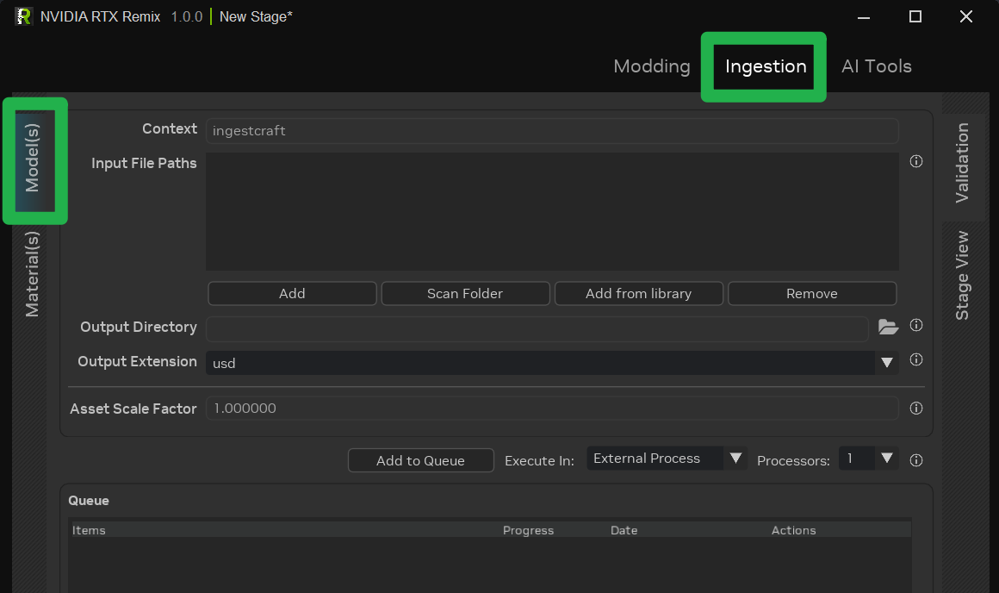
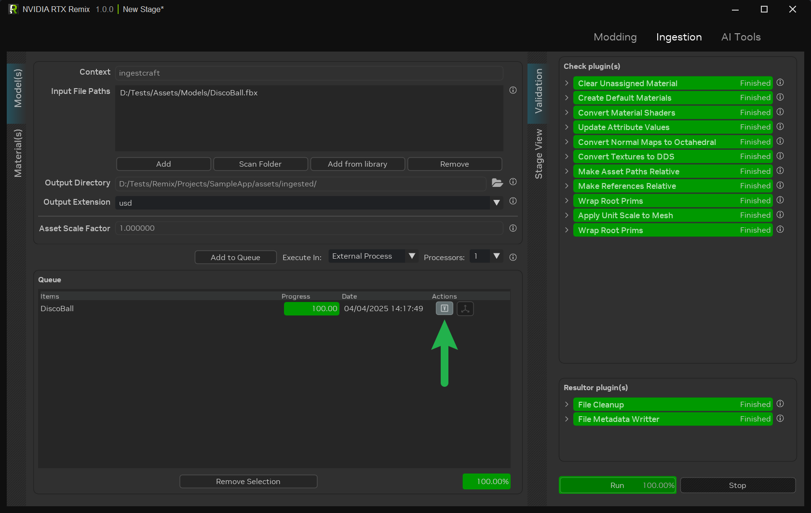

# Импорт ассетов

Импорт (ingestion) — основной этап подготовки ассетов к использованию в RTX Remix. На этом этапе меши и текстуры
конвертируются и оптимизируются, чтобы они были совместимы с RTX Remix Runtime.

Ассеты импортируются на вкладке Ingest в RTX Remix. Порядок действий одинаков и для моделей, и для текстур.

Для опытных пользователей есть инструмент командной строки (CLI), позволяющий пакетно обрабатывать ассеты с более
гибкой настройкой и полным контролем над процессом импорта.

```{note}
Все импортированные файлы, как исходные, так и обработанные, сопровождаются файлами метаданных, в которых отслеживается
состояние импорта. Поэтому после любого изменения исходного ассета его нужно импортировать заново, чтобы обновить
обработанный ассет.
```

***

## Импорт ассета через интерфейс

1. **Проверка формата файла:** прежде чем загружать ассет в Remix, убедитесь, что он в допустимом формате (подробнее см.
   раздел [Совместимость форматов файлов](learning-ingestion.md#совместимость-форматов-файлов)).

2. **Переход на вкладку Ingest:** откройте окно Remix и перейдите на вкладку **Ingestion** в правом верхнем углу.
   Выберите _вкладку **Model(s)**_[*](#примечания) среди вертикальных вкладок в левом верхнем углу.

   

3. **Загрузка исходного ассета:** нажмите кнопку **Add** на панели **Input File Path**, чтобы загрузить файл исходного
   ассета. Также можно перетащить файлы на панель.

   ```{tip}
   Чтобы список Input File Paths считался допустимым при импорте ассетов, в нём должен быть хотя бы один файл.
   ```

4. **Выбор выходного каталога:** по умолчанию автоматически назначается выходной каталог
   (`<PROJECT DIRECTORY>/assets/ingested`). Его можно изменить в соответствующем поле.

5. **Выбор формата ассета:** выберите нужный формат: USD, USDA или USDC.

   ```{tip}
   В большинстве случаев рекомендуется формат по умолчанию, USD: он даёт оптимальный баланс совместимости и
   производительности.

   USDA рекомендуется для отладки и разработки: это человекочитаемый формат, который легко редактировать.
   ```

6. **_[НЕОБЯЗАТЕЛЬНО]_** Настройте дополнительные параметры, например _Asset Scale Factor_[**](#примечания) (коэффициент
   масштаба ассета) для моделей.

7. **Постановка в очередь:** нажмите кнопку «Add to Queue», чтобы запустить импорт.

```{tip}
После завершения импорта перейдите на вкладку проверки (validation), чтобы посмотреть подробный отчёт об импорте
ассета. Все проблемы, возникшие при импорте, выделены красным и сопровождаются соответствующими сообщениями об ошибках.


```

### Примечания:

* `*` **Вкладка Asset(s):** текстуры импортируются так же, как модели, но через вертикальную вкладку **Material(s)**.
  Главное отличие в том, что каждой импортируемой текстуре для правильной обработки нужно назначить тип текстуры.
* `**` **Asset Scale Factor**: дополнительные сведения о коэффициенте масштаба ассета см. в
  [документации Omniverse по USD](https://docs.omniverse.nvidia.com/usd/latest/learn-openusd/independent/units.html).

***

## Использование CLI инструмента импорта (для опытных пользователей)

Опытные пользователи могут применять инструмент командной строки для пакетного импорта ассетов.

### Поиск каталога установки

Чтобы запустить CLI-инструмент, нужно знать каталог установки RTX Remix.

Как его найти, описано в разделе
[Как найти папку установки RTX Remix Toolkit?](../remix-faq.md#как-найти-папку-установки-rtx-remix-toolkit)

### Запуск CLI-инструмента импорта ассетов

Чтобы запустить CLI-инструмент импорта ассетов с собственными настройками, выполните следующие шаги:

1. **Найдите файл схемы:**
    * Файл схемы для импорта моделей:
       <code>
       [<INSTALL_DIRECTORY>](../remix-faq.md#как-найти-папку-установки-rtx-remix-toolkit)\exts\lightspeed.trex.app.resources\data\validation_schema\model_ingestion.json
       </code>
    * Для импорта текстур:
       <code>
       [<INSTALL_DIRECTORY>](../remix-faq.md#как-найти-папку-установки-rtx-remix-toolkit)\exts\lightspeed.trex.app.resources\data\validation_schema\material_ingestion.json
       </code>
    * Запомните путь к этому файлу как `SCHEMA_PATH`, он понадобится дальше.

2. **Отредактируйте файл схемы:**
    * Откройте файл в текстовом редакторе.
    * Обновите список импортируемых файлов в `context_plugin -> data -> input_files` (для удобства этот шаг
      рекомендуется автоматизировать скриптом).
    * Измените выходной каталог в `context_plugin -> data -> output_directory`.
    * Сохраните файл схемы.

3. **Выполните команду:**
    * Откройте окно командной строки.
    * Перейдите в каталог установки приложения.
    * Выполните следующую команду:
        ```bat
        lightspeed.app.trex.ingestcraft.cli.bat -s <SCHEMA_PATH> -ex 1
        ```

4. **Описание аргументов:**
    * `-s`: путь к изменённому файлу схемы.
    * `-e`: включает указанные расширения.
    * `-x--/renderer/mdl/searchPaths/templates`: позволяет переопределить, где CLI будет искать MDL-файлы.
    * `-ex`: 0 — последовательный импорт (асинхронный), 1 — многопоточный импорт.
    * `-t`: тайм-аут импорта (по умолчанию 600 секунд).

***

## Совместимость форматов файлов

Прежде чем использовать ассеты в модах, их нужно пропустить через процесс «импорта» (ingestion), который оптимизирует
их для рендерера RTX Remix. Важно знать, какие входные и выходные форматы поддерживает этот процесс.

### Входные форматы

Эти форматы файлов можно использовать в качестве исходного материала для импорта.

#### Форматы моделей

| Расширение | Формат                        | Описание                                         |
|:-----------|:------------------------------|:-------------------------------------------------|
| `.fbx`     | Autodesk FBX Interchange File | Распространённый формат 3D-моделей.              |
| `.obj`     | Object File Format            | Ещё один распространённый формат 3D-моделей.     |
| `.gltf`    | GL Transmission Format File   | Формат описания 3D-сцен.                         |
| `.lxo`     | Foundry MODO 3D Image Format  | Формат 3D-контента программы Foundry MODO.       |

#### Форматы текстур

Новый конвейер оптимизации текстур также принимает OpenEXR для любого типа текстуры. Он распознаёт OpenEXR по заголовку
файла и использует линейные рабочие файлы с плавающей точкой.

| Расширение | Формат                            | Описание                                                  |
|:-----------|:----------------------------------|:----------------------------------------------------------|
| `.bmp`     | Bitmap Image File                 | Распространённый формат изображений.                      |
| `.dds`     | DirectDraw Surface                | Формат текстур и карт окружения.                          |
| `.gif`     | Graphical Interchange Format File | Веб-формат изображений.                                   |
| `.hdr`     | High Dynamic Range Image File     | Формат изображений с расширенным динамическим диапазоном. |
| `.pgm`     | Portable Gray Map                 | Формат изображений в оттенках серого.                     |
| `.jpg`     | Joint Photographic Experts Group  | Распространённый формат сжатых изображений.               |
| `.pic`     | PICtor raster image format        | Формат изображений, исторически использовавшийся в DOS.   |
| `.png`     | Portable Network Graphics File    | Распространённый формат изображений без потерь.           |
| `.ppm`     | Adobe Photoshop Document          | Собственный формат документов Photoshop.                  |

### Выходные форматы

В эти форматы ассеты конвертируются после импорта, после чего они готовы к использованию в моде.

#### Форматы моделей

| Расширение | Формат                               | Описание                                                                                              |
|:-----------|:-------------------------------------|:------------------------------------------------------------------------------------------------------|
| `.usd`     | Universal Scene Description (Binary) | Стандартный формат 3D-сцен и ассетов, эффективный для хранения и обработки.                           |
| `.usda`    | Universal Scene Description (ASCII)  | Текстовый формат USD: удобен для отладки, но менее эффективен.                                        |
| `.usdc`    | Universal Scene Description (Crate)  | Оптимизированный двоичный формат USD, предпочтительный для производительности при хранении ассетов.   |

#### Форматы текстур

| Расширение | Формат             | Описание                                                                                  |
|:-----------|:-------------------|:------------------------------------------------------------------------------------------|
| `.dds`     | DirectDraw Surface | Формат Microsoft DirectX для текстур и карт окружения, оптимизированный для GPU.          |

#### Текстуры скайбокса

Текстура скайбокса (Skybox) конвертируется в линейный файл BC6H `.s.rtex.dds` с полной цепочкой MIP-уровней. Источником
может быть OpenEXR (`.exr`), Radiance HDR (`.hdr`) или SDR-изображение. SDR-источники конвертируются из sRGB в линейное
пространство. BC6H не хранит альфа-канал и отрицательные значения, поэтому в результате альфа-канал и отрицательные
значения источника теряются.

```{warning}
Перед использованием скайбокса задайте `rtx.skyForceHDR`. При значении по умолчанию рантайм рисует небо в SDR-формате
игры: он обрезает значения выше 1 и читает линейные значения как sRGB, поэтому небо получается слишком тёмным.
```

Чтобы использовать скайбокс в игре:

1. Добавьте эту настройку в `rtx.conf` мода:

   ```ini
   rtx.skyForceHDR = True
   ```

2. Назначьте скайбокс альбедо-текстурой (albedo) в замене материала неба.

***
<sub> Хотите оставить отзыв о документации RTX Remix? [Нажмите здесь](https://github.com/NVIDIAGameWorks/rtx-remix/issues/new?assignees=nvdamien&labels=documentation%2Cfeedback%2Ctriage&projects=&template=documentation_feedback.yml&title=%5BDocumentation+feedback%5D%3A+) </sub>
