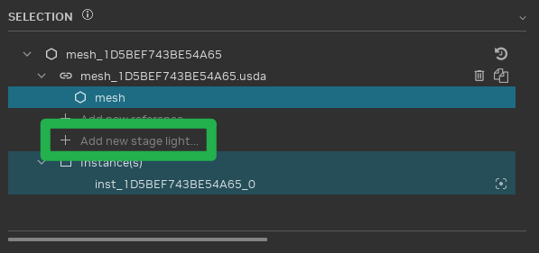
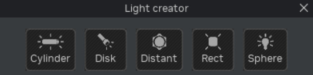

# Переосвещение игры

Чтобы добиться оптимального освещения в RTX Remix, может понадобиться иной подход, чем в обычных игровых движках:
RTX Remix моделирует освещение гораздо реалистичнее многих игр. Поэтому для наилучшего результата исходную схему
освещения игры часто приходится менять.

Remix поддерживает два основных типа источников света: **примитивные источники света** (primitive lights) и
**излучающие меши** (emissive meshes).

**Примитивные источники света** — это световые объекты на основе простых геометрических фигур. Они излучают свет, но
сами не видны как объекты.

**Излучающие меши** — обычные текстурированные меши с наложенной маской излучения, из-за которой вся их поверхность или
её часть излучает свет. Цвет излучаемого света может задаваться текстурной картой.

***

## Выбор подходящего типа источника света

Выбирая между примитивными источниками и излучающими мешами, руководствуйтесь следующим.

Примитивные источники света обычно лучше подходят для освещения сцены, а излучающие меши хорошо делают объекты
«яркими».

Как правило, общее освещение сцены должно создаваться в основном примитивными источниками, а не излучающими мешами. Оба
типа освещают сцену физически корректно и ведут себя похоже, но рендерер Remix сэмплирует примитивные источники гораздо
эффективнее. Это даёт более высокую производительность и меньше шума, чем излучающие меши. Поэтому, если примитивные
источники могут обеспечить нужное освещение, предпочтение следует отдавать им.

Излучающие меши лучше всего подходят для детального освещения, например для свечения компьютерных мониторов.

Для светильников бывает полезно сочетать оба типа. Например, светильник с люминесцентной лампой можно представить
прямоугольным примитивным источником, который покрывает площадь светильника и излучает свет в нужном направлении, а саму
лампу смоделировать цилиндрическим излучающим мешем. Такое сочетание точно передаёт облик реального светильника — яркость
лампы, отражения света внутри светильника, ореол (bloom), — и при этом позволяет рендереру эффективно сэмплировать
примитивный источник для освещения сцены, сводя шум к минимуму и обеспечивая максимальную производительность.

***

## Примитивные источники света

1. **Выбор меша:** на панели «Selection» выберите меш, к которому будет добавлен источник света.

2. **Добавление источника света:** нажмите пункт «Add new stage light...», чтобы открыть диалог создания источника
   света.

   

   В RTX Remix есть пять типов примитивных источников света: цилиндрический (cylinder), дисковый (disc), прямоугольный
   (rectangular), сферический (sphere) и удалённый (distant).

   

### Копирование источника света на другой меш

1. Щёлкните правой кнопкой по добавленному источнику света в **Property Panel** или **Stage Manager** и выберите
   **Copy Light**.
2. Щёлкните правой кнопкой по другому мешу-получателю и выберите **Paste Light**.

Скопированный источник сохраняет заданные настройки и локальную трансформацию исходного. Чтобы удалить вставленный
источник, используйте **Undo**. Сообщения об успешном копировании и вставке или об ошибках выводятся в консоль.

```{note}
Захваченные источники света копировать нельзя. Получатель должен принадлежать другому ассету-мешу в той же открытой
сцене.
```

### Типы примитивных источников света

1. **Цилиндрические, дисковые, прямоугольные и сферические источники:**
    * Основаны на простых геометрических фигурах.
    * Задают фигуру, излучающую свет равномерно или в определённом направлении.
    * Идеально подходят для точных световых эффектов на поверхностях.
2. **Удалённые источники (Distant Lights):**
    * Представляют направленный свет, приходящий из бесконечно удалённой точки.
    * Обычно используются для имитации таких источников, как Солнце.

### Формирование света в Remix

RTX Remix поддерживает формирование света (light shaping), то есть управление направлением света, излучаемого
некоторыми типами примитивных источников: сферическими, дисковыми и прямоугольными. Это позволяет создавать
выразительные эффекты, например луч фонарика, с помощью всего одного сферического источника.

### Интенсивность света

Интенсивность света в Remix измеряется в **энергетической яркости** (radiance) — физической величине, которая
показывает количество света, излучаемого с единицы площади. Более крупный источник с тем же значением radiance излучает
больше света в сумме, чем маленький. У удалённых источников radiance обозначает количество света, приходящего на
поверхность, а не излучаемого источником.

Для наилучшей точности рендеринга рекомендуется использовать значения radiance около 1,0. Итоговое освещение зависит и
от значений radiance источников, и от настроек экспозиции тонмаппера. Поэтому диапазоны radiance следует подбирать
одновременно с экспозицией тонмаппера. Учтите, что настройки тонмаппера применяются глобально ко всей игре и одинаково
влияют на захваченные и заменённые источники света во всех сценах.

При захвате источников света из исходной игры Remix определяет radiance каждого источника по внутренним значениям игры.
Поэтому у захваченных источников radiance может быть довольно высоким. При замене освещения в игре может понадобиться
использовать для новых источников похожие диапазоны radiance, чтобы они согласовывались с оставшимися исходными
источниками. На практике значения radiance примерно до 1000 обычно дают надёжный результат, а значения выше 10000 могут
вызывать артефакты освещения.

Как правило, самый эффективный тип примитивного источника — сферический, за ним идут прямоугольный, дисковый и
цилиндрический. Часто тип источника диктуется формой излучателя, но если подходят несколько вариантов, выбирайте
наиболее эффективный.

***

## Излучающие меши

Remix поддерживает излучающие меши — обычные геометрические меши, вся поверхность или часть поверхности которых
излучает свет в соответствии с картой излучения (emissive map). Такие меши излучают свет в соответствии с цветом
поверхности, который может быть однородным или задаваться текстурой.

Излучающие меши и примитивные источники освещают сцену похожим образом и дают сопоставимое прямое и непрямое освещение.
Однако излучающие меши не участвуют в объёмном освещении. Поэтому эффекты, зависящие от объёмного освещения, например
освещение частиц, могут вести себя иначе.

Рендерер сэмплирует излучающие меши иначе, чем примитивные источники: сэмплы распределяются по их поверхности случайно.
Значит, полностью излучающий меш будет сэмплироваться эффективнее, чем меш с маленькой излучающей областью, потому что
во втором случае случайные сэмплы могут попадать на неизлучающие участки. В таких случаях лучше выделить излучающую
часть в отдельный меш.

```{warning}
Излучающие меши обычно требуют больше вычислений на GPU и могут вносить в сцену больше шума, чем примитивные источники
света.
```

Излучающие меши лучше всего подходят для «ярких» объектов, которые освещают в основном ближайшее окружение. Например,
компьютерный монитор создаёт свечение на столе, но почти не влияет на общее освещение комнаты. Если излучающий объект
должен освещать большую область, лучше дополнить его примитивным источником света.

Излучающими могут быть и полупрозрачные материалы. Например, лампу накаливания можно смоделировать, сделав излучающими
и нить накаливания, и стеклянную колбу. Так лампа будет эффективно освещать внутреннюю часть светильника (а для
освещения самой сцены её можно дополнить сферическим примитивным источником).

В Remix Runtime есть настройка `rtx.emissiveIntensity`, которая служит множителем для света, излучаемого излучающими
мешами. Моддеры часто используют её, чтобы регулировать общий уровень освещения в сцене. Помните о ней, работая с
существующими модами или совместно редактируя файлы конфигурации: она может значительно изменить освещение в игре.

***

## Преобразование захваченных источников света

При захвате сцены всё исходное освещение игры преобразуется в источники света для трассировки пути. При этом
происходят следующие преобразования:

* точечные источники (point lights) становятся сферическими;
* прожекторы (spotlights) превращаются в сферические источники с формированием света;
* направленные источники (directional lights) преобразуются в удалённые источники Remix.

***
<sub> Хотите оставить отзыв о документации RTX Remix? [Нажмите здесь](https://github.com/NVIDIAGameWorks/rtx-remix/issues/new?assignees=nvdamien&labels=documentation%2Cfeedback%2Ctriage&projects=&template=documentation_feedback.yml&title=%5BDocumentation+feedback%5D%3A+) </sub>
