# Использование Remix Logic

## Обзор

Remix Logic вводит мощную парадигму: графику модов Remix можно менять в зависимости от обнаруженных игровых событий.

После того как игра получила ремастер, моддерам часто хочется, чтобы новый контент реагировал на состояние игры. Система Remix Logic даёт гибкий способ отслеживать происходящее в игре, принимать решения на основе этой информации и соответствующим образом менять изображение. Это открывает совершенно новый уровень динамической графики. На старте функция поддерживает применение файлов конфигурации RtxOption («conf-файлов») и плавное смешивание между ними в зависимости от обнаруженных игровых событий.

```{seealso}
- [Справочник компонентов](../components/index.md) — полная документация по всем компонентам Logic
- [Документация Remix Logic для рантайма](https://github.com/NVIDIAGameWorks/dxvk-remix/blob/main/documentation/RemixLogic.md) — подробности реализации в рантайме, репозиторий DXVK Remix
```

### Примеры

Вот лишь некоторые вещи, которых можно добиться с помощью системы:

*   Когда игрок целится из оружия, уменьшающего поле зрения (FOV), включается режим ночного видения.

*   Когда игрок выходит на улицу, меняется глобальная плотность тумана, имитируя смену погоды или атмосферы.

*   Когда игрок включает устройство, враги начинают испускать частицы.

*   Когда игрок нажимает горячую клавишу, включается фонарик.

### Текущие ограничения

Первый выпуск Logic сосредоточен на действиях со слоями RtxOption. Некоторые возможности запланированы, но пока
недоступны:

*   **Изменение отдельных источников света и мешей**: Logic пока не может менять свойства отдельных источников света или материалов во время работы. Изменять можно только глобальные RtxOption.

*   **Отслеживание за пределами иерархии**: узлы Sense могут работать только с мешами из той же иерархии mesh_HASH, что и якорь графа. Чтобы отслеживать другой меш, прикрепите к нему отдельный граф.

***

# Быстрый старт

## Ключевые понятия

Прежде чем начать, познакомьтесь с основными терминами:

**Компоненты** (Components, также называются **узлами**, Nodes): строительные блоки Logic. Каждый компонент — это самостоятельная функция, которая принимает входные данные, обрабатывает их и выдаёт результат. Представьте их как отдельные детали LEGO. Компоненты делятся на четыре категории:

*   **Sense** (восприятие): считывают информацию из игры (положение камеры, ввод с клавиатуры, близость к мешу, время).
*   **Transform** (преобразование): обрабатывают и изменяют данные (математические операции, сравнения, переназначение значений).
*   **Act** (действие): вносят изменения в рендеринг (сейчас это только RtxOptionLayerAction для смешивания файлов `.conf`).
*   **Constant** (константа): передают фиксированные значения другим компонентам.

**Графы** (Graphs): соединяют несколько компонентов так, что выход одного подаётся на вход другого — как детали LEGO, собранные по базовой схеме **Sense → Transform → Act**.

**Привязка графа** (Graph Attachment): графы логики не существуют сами по себе — их нужно прикрепить к мешу или
источнику света, как и другие замены в Remix. Граф выполняется, только когда его якорь присутствует в вызовах отрисовки
игры. Если якорный меш не виден или отсутствует в текущей сцене, граф бездействует.

Чтобы показать, как эти компоненты работают вместе, разберём несколько примеров, созданных в демонстрационном
приложении (Sample App), которое поставляется с RTX Remix.

## Графы в действии

Чтобы помочь вам освоить Remix Logic, мы подготовили несколько примеров графов, которые можно запускать и изучать. Они
поставляются в составе демонстрационного приложения.

Сначала нужно подключить Remix Runtime к демонстрационному приложению. Напомним, как добавить Remix Runtime в
демонстрационное приложение, описано в нашей документации: [Руководство по демонстрационному приложению](../tutorials/tutorial-remixtool.md)

В демонстрационном приложении графы по умолчанию отключены, поэтому, чтобы их увидеть, их нужно включить.

### Включение графов логики в Remix Runtime

В меню Developer Settings перейдите на вкладку **Enhancements**, найдите раздел **«Remix Logic»** и включите
**«Enable»**.

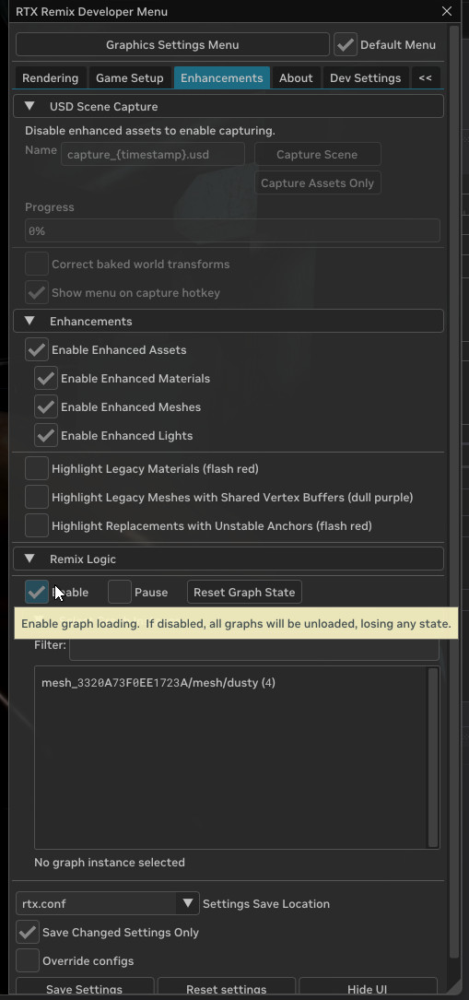

Это изменит настройку в conf-файле на: `rtx.graph.enable = True`

### Просмотр графов логики в Remix Runtime

После включения на той же вкладке можно просматривать активные графы логики: видно, какие параметры настраиваются, и
каково текущее состояние игры.

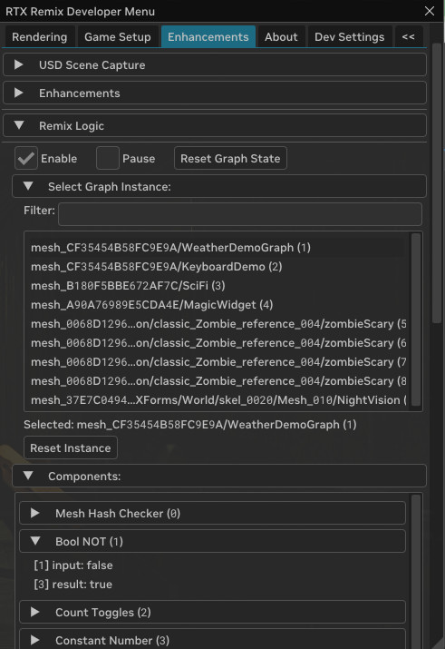

### Включение свободной камеры в Remix Runtime

Стоит также включить свободную камеру, чтобы перемещаться по сцене: три примера из четырёх управляются положением
камеры.

В меню Developer Settings перейдите на вкладку Dev Settings, в разделе «Camera» > «Free Camera» включите «Enable Free
Camera». Управление камерой описано в разделе «Show Camera Controls».

### Играйте!

Теперь можно увидеть четыре примера графов в действии. Как работает каждый из них, описано ниже.

Если хотите развивать их дальше, понадобится собственный проект — займёмся им в следующем разделе.

## Начальная настройка проекта

Как и другие замены, графы логики создаются и редактируются в Remix Toolkit.

Сначала сделайте захват демонстрационного приложения и создайте проект по инструкции из
[руководства по демонстрационному приложению](../tutorials/tutorial-remixtool.md#4-создание-проекта-для-мода-демонстрационного-приложения),
но со следующими изменениями:

1. Нажмите **«New»**, а в мастере выберите **«Edit»**, а не **«Create»**.

1.  Выберите расположение проекта, создав пустой каталог (например, MyRemixLogicSampleProject), и задайте имя проекта, отличное от `mod.usda` (например, logic-sample.usda).

    ```{tip}
    Чтобы ваш мод загружался поверх входящего в комплект мода с примерами логики, его имя должно идти по алфавиту раньше `RemixLogicExamples`.
    ```

1.  Выберите каталог `sample\rtx-remix` демонстрационного приложения, в котором находится мод с примерами графов.

1. Перетащите мод-пример `RemixLogicExamples\mod.usda` из доступных модов (available mods) в выбранные (selected mods).

    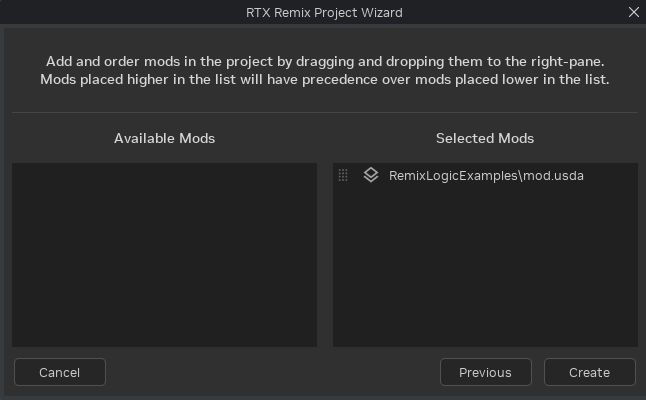

1. Затем нажмите **«Create»**.


## Создание и редактирование графа логики:

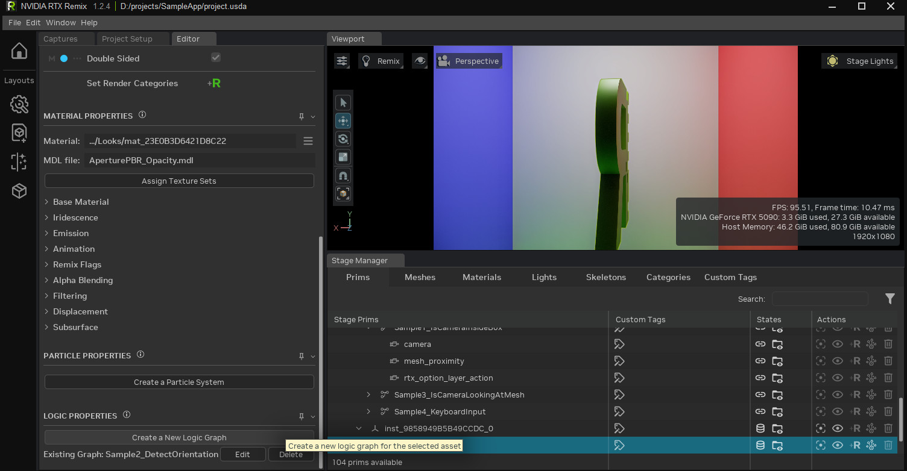

1.  Сначала убедитесь, что целевым слоем редактирования (edit target) выбран слой, в котором вы хотите создавать графы. В демонстрационном приложении это просто mod.usda, но в более сложном проекте может понадобиться отдельный слой для графов компонентов.

2.  Выберите меш (или источник света), к которому нужно прикрепить граф, и нажмите «Create a New Logic Graph» в нижней части вкладки «Editor». Если к мешу уже прикреплён граф, здесь же его можно отредактировать или удалить.

    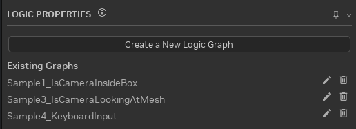

3.  При создании нового графа или редактировании существующего открывается редактор графов Remix Logic (Remix Logic Graph Editor).

    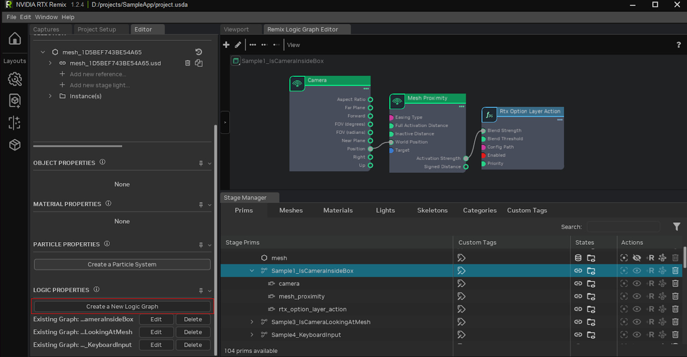

4.  Теперь можно перетаскивать узлы из каталога слева и соединять их, составляя граф. Свойства выделенного узла редактируются в редакторе свойств.

5.  Информацию нужно передавать от узлов Sense к узлам Act, при необходимости — через узлы Transform.

6.  Под целевым примом появится набор новых примов. После сохранения слоя в USD граф загрузится в игре.

### Подсказки и документация узлов

У каждого свойства на панели «Logic Properties», у портов узлов и у самих узлов есть всплывающие подсказки, объясняющие,
как они работают.

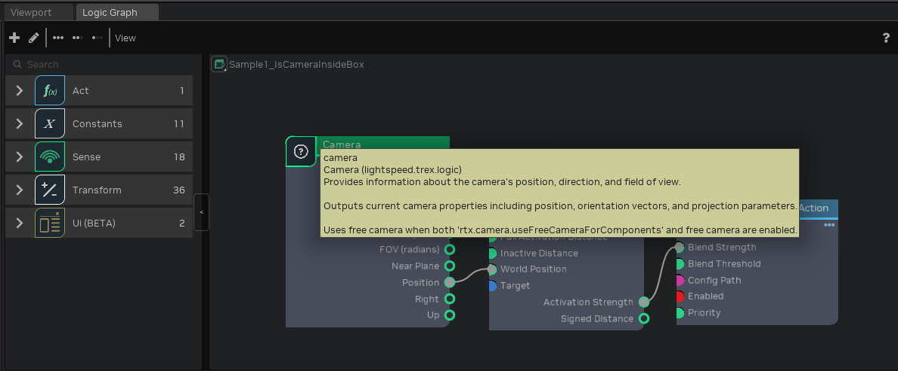

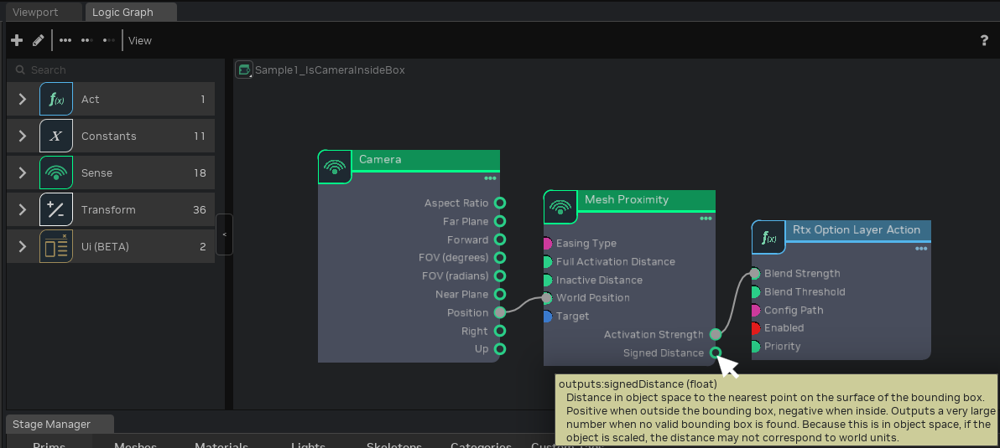

```{seealso}
- [Справочник компонентов](../components/index.md) — полная документация по всем компонентам Logic
```

***

# Примеры графов из Remix Sample

Следующие примеры поставляются с демонстрационным приложением Remix. Ниже описано, как устроен каждый из них.

## **Пример 1:** граф «Находится ли камера внутри куба»

Когда камера игрока приближается к кубу, графика переключается в белый режим (максимальное смещение альбедо, albedo bias).

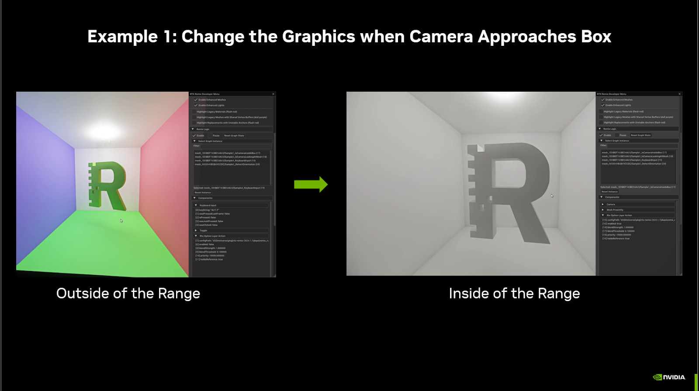

Вот как выглядит граф, управляющий этим примером:

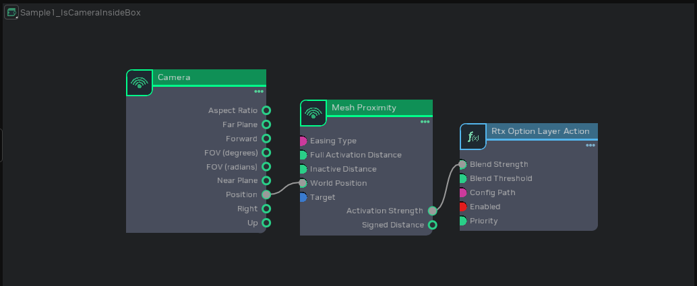

Здесь узел Sense («Camera») соединён с другим узлом Sense («Mesh Proximity») через точки ввода-вывода position и world position. Если щёлкнуть по узлу «Mesh Proximity», можно увидеть все его свойства и разобраться, как он работает.

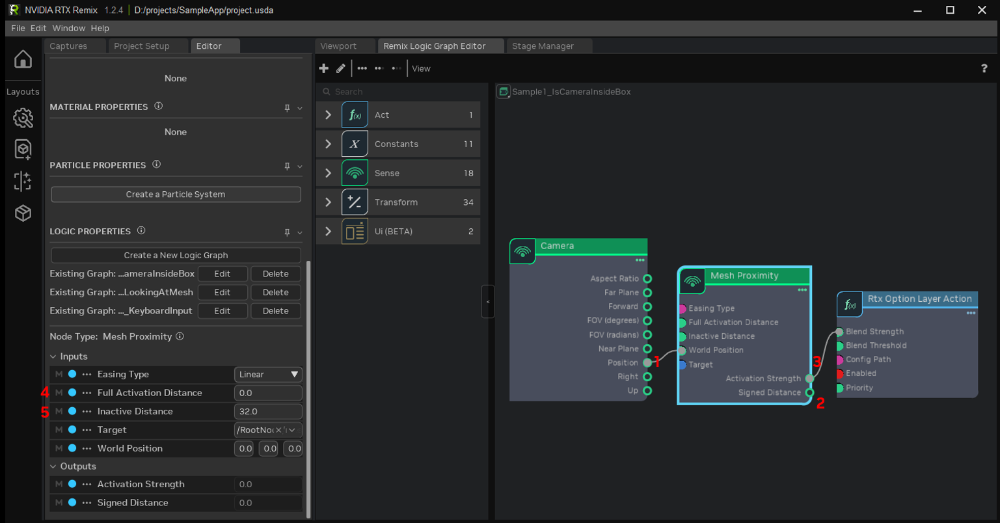

Положение камеры — это точка в 3D-пространстве. Она передаётся в узел «Mesh Proximity», который определяет, насколько близко точка находится к ограничивающему параллелепипеду (bounding box) меша (1). Расстояние можно вывести как «Signed Distance» (2), но здесь оно не нужно. Можно просто использовать выход «Activation Strength», который выдаёт сигнал от 0 до 1 в зависимости от того, насколько далеко точка находится от ограничивающего параллелепипеда (или насколько глубоко внутри него) (3).

Если задать «Full Activation Distance» (4) и «Inactive Distance» (5) равными 32 и 0, «Activation Strength» начнёт расти, когда камера окажется в 32 единицах от куба, и достигнет 1, когда расстояние станет равным 0, то есть камера окажется на поверхности ограничивающего параллелепипеда.

Последний узел графа — узел действия «Rtx Option Layer Action». Он загружает и применяет файл `white_mode.conf`.
* Если «Enabled» равно true, а «Blend Strength» равно 1, файл конфигурации применяется в полную силу.
* Если «Blend Strength» находится между 0 и 1, параметры из слоя смешиваются с текущими параметрами.
* Когда «Blend Strength» достигает 0, параметры больше не применяются.

Если соединить выход «Activation Strength» узла Mesh Proximity со входом «Blend Strength» узла Rtx Option Layer Action, `white_mode.conf` будет включаться постепенно по мере приближения камеры к кубу и применится полностью, только когда камера окажется внутри.

## **Пример 2:** граф «Определение ориентации»
Когда буква R повёрнута задом наперёд, включается эффект частиц. Каждый раз, когда R оказывается развёрнутой, эффект частиц переключается между состояниями: выключен, частицы летят вверх, частицы падают вниз.

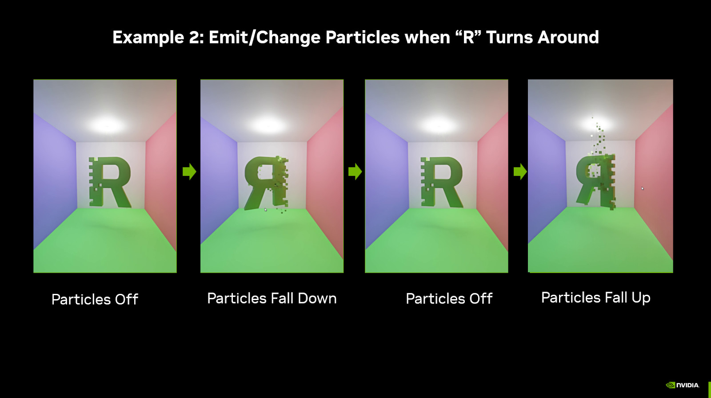

Раздел графа **«Detect\_mesh\_rotation»** считывает трансформацию меша с помощью узла «Read Transform», извлекает компоненту y поворота и проверяет, находится ли она между двумя значениями.

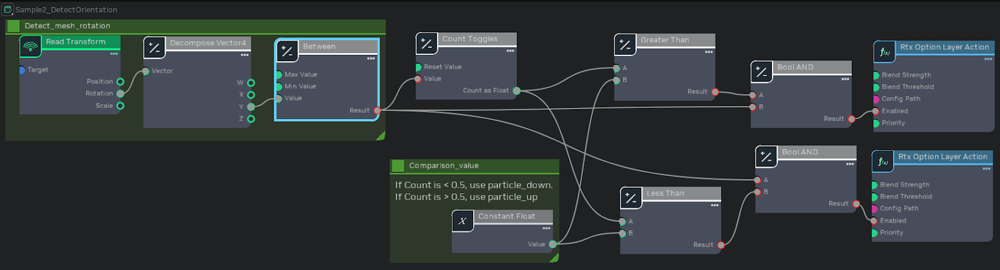

Остальная часть графа — комбинация узлов Transform, которая переключается между двумя файлами конфигурации: в одном частицы летят вверх, в другом падают вниз. Какой conf-файл будет активен, зависит от того, сколько раз раздел **Detect\_mesh\_rotation** переключался с false на true.

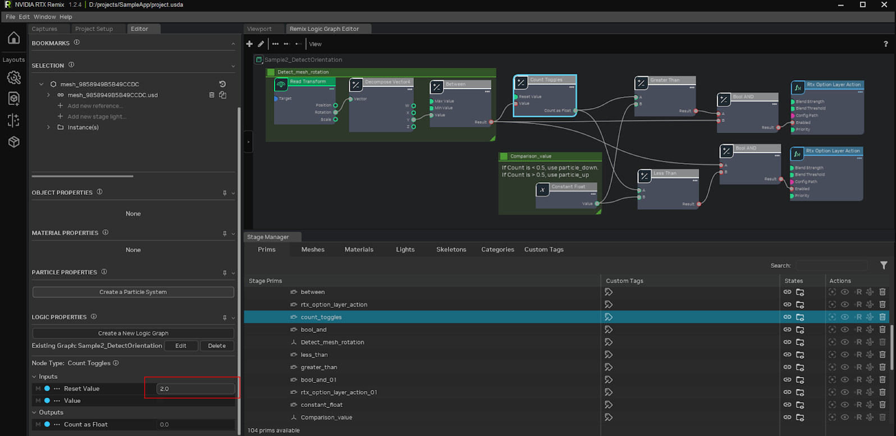

Разберём подробнее: узел «Count Toggles» выдаёт либо 0, либо 1, поскольку настроен на сброс при достижении счёта 2.

Узлы Less Than и Greater Than сравнивают счёт с 0,5, поэтому одновременно активен только один файл конфигурации.

Если Count Toggles выдаёт 0, узел Less Than проверяет «0 < 0.5» и выдаёт True. Этот сигнал True объединяется с сигналом True от **Detect\_mesh\_rotation** через логическое И (Boolean AND), которое выдаёт True, только если оба входа равны True. В результате particle\_down.conf включается, когда оба сигнала равны True. Аналогично, когда «Count Toggles» выдаёт 1, узел «Greater Than» видит, что «1 > 0.5», и выдаёт true. Этот сигнал также объединяется с выходом **Detect\_mesh\_rotation** в узле Boolean AND: если **Detect\_mesh\_rotation** выдаёт True, а Count Toggles выдаёт 1, включается particle\_up.conf.

Когда выход **Detect\_mesh\_rotation** равен false, оба файла конфигурации отключаются, и испускание частиц прекращается.

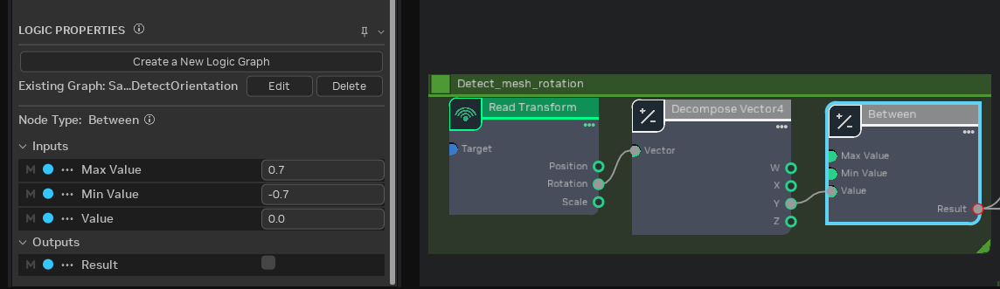

Самое сложное при создании этого графа — понять, какие значения задать узлу «Between».

Угадать нужные для узла «Between» значения невозможно: их нужно получить, наблюдая за игрой во время работы. Порядок действий описан в подразделе [Сбор значений для настройки](#сбор-значений-для-настройки) раздела об отладке. В данном случае нужно смотреть, как меняется значение поворота при вращении R, а затем использовать эти значения в узле «Between».

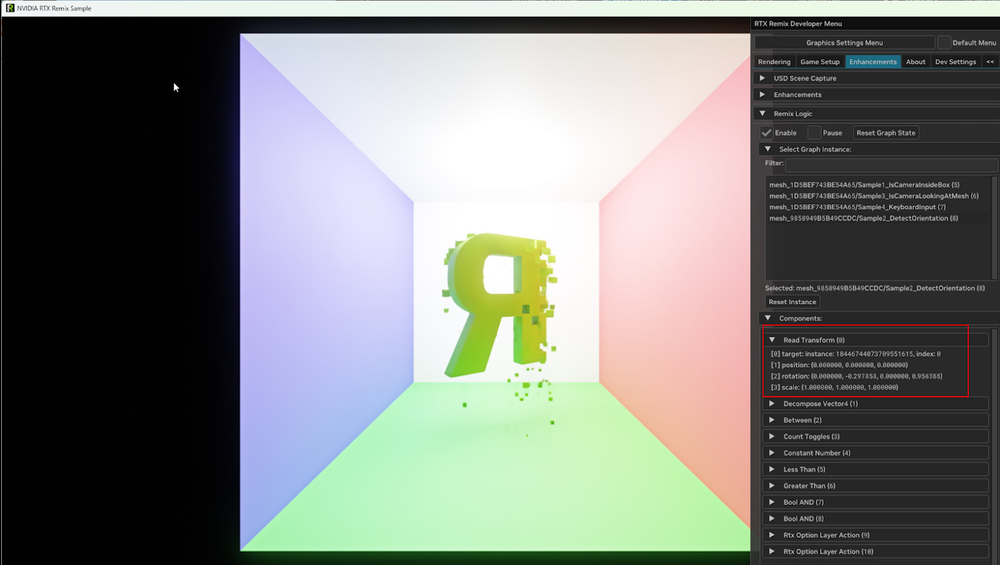

## **Пример 3:** граф «Смотрит ли камера на меш»
Когда игрок отворачивается от R, файл paranoia.conf анимированно включается и выключается.

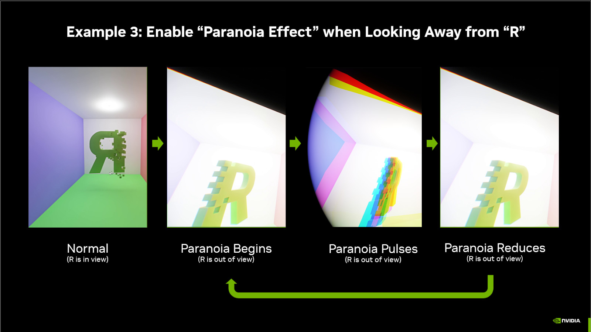

Этот пример демонстрирует игровую механику на основе Remix Logic. Она напоминает «паучье чутьё»: когда рядом находится объект (или враг), а игрок стоит к нему спиной, у игрока начинается «паранойя», предупреждающая об опасности. Эффект паранойи создаётся пульсацией интенсивности эффектов «виньетирование» (vignette) и «хроматическая аберрация» (chromatic aberration) в Remix.

Граф состоит из двух частей. Нижняя проверяет, смотрит ли камера на R, а верхняя создаёт зацикленную анимацию. Обе части выдают сигналы от 0 до 1, которые перемножаются в единый сигнал от 0 до 1, управляющий «Blend Strength» узла Rtx Option Layer Action.

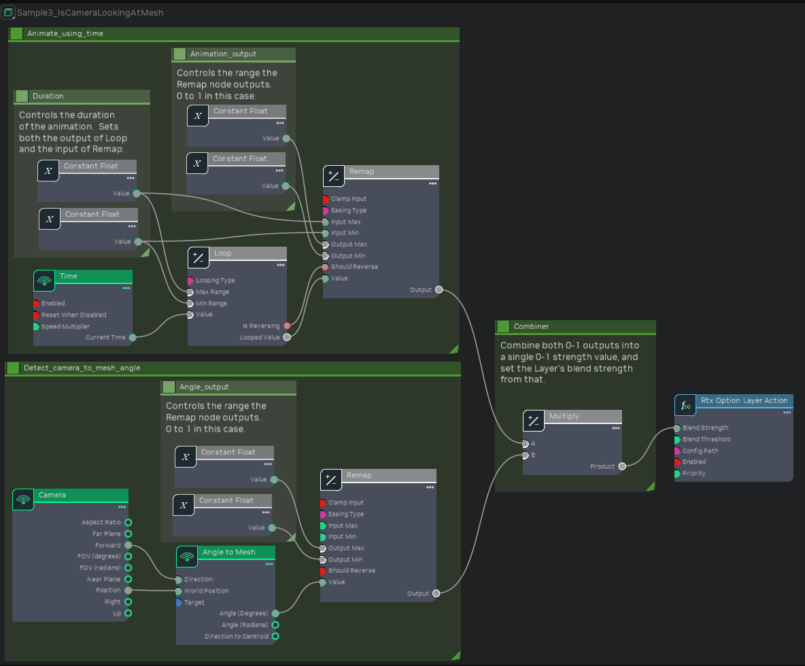

Часть с анимацией начинается с датчика Time. Узел Loop с «Looping Type», равным «PingPong», делает так, что когда Time превышает 0,8, значение Looped Value идёт обратно и снижается до 0 к моменту, когда Time достигнет 1,6, а затем снова начинает расти. Наконец, Remap принимает значение от 0 до 0,8 и преобразует его в значение от 0 до 1. Поскольку Easing Type узла Remap установлен в «Sine», выходное значение меняется быстрее в середине диапазона и медленнее в начале и конце, образуя плавную синусоиду вместо резкой «пилы» VVV.

Раздел **Detect\_camera\_to\_mesh\_angle** вычисляет два вектора: вектор от камеры к мешу и вектор направления камеры вперёд. Угол между этими векторами показывает, насколько взгляд камеры отклонён от меша. Обратите внимание, что в расчёте используется центр ограничивающего параллелепипеда меша, а не положение из его трансформации.

Здесь снова используется узел «Remap», на этот раз чтобы ограничить угол (значение 0–180) диапазоном от 15 до 45 градусов и затем преобразовать его в значение от 0 до 1 (так что «Remap» выдаёт 0, если угол меньше 15, и 1, если больше 45).

## **Пример 4:** граф «Ввод с клавиатуры»
Когда игрок нажимает Alt+F, включается фонарик.

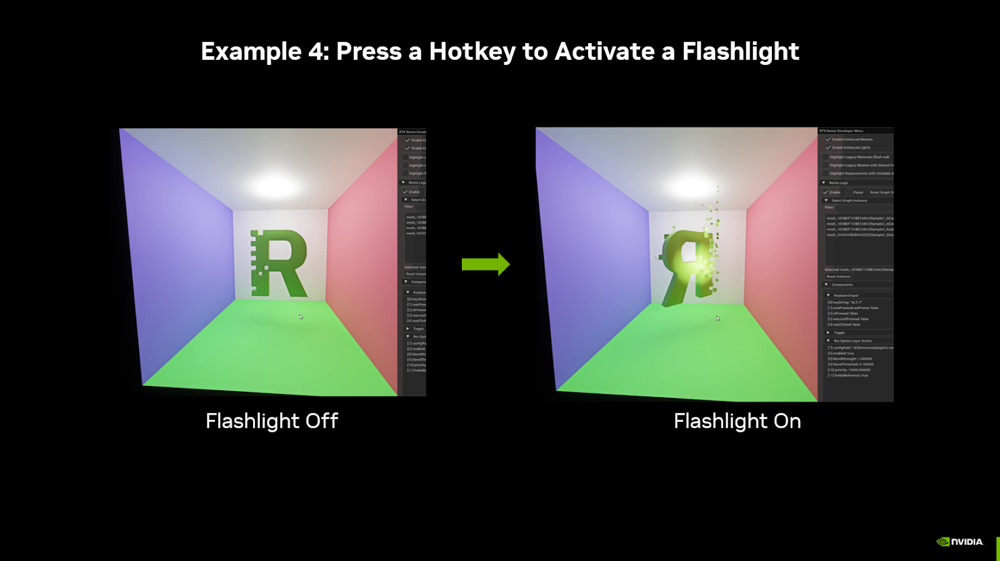

Этот простой граф с помощью горячей клавиши включает резервный фонарик (fallback flashlight) Remix. Когда клавиша отпускается, «Was Clicked» на один кадр становится true. Это переключает «Is On» узла Toggle с False на True (или наоборот), включая или выключая фонарик.

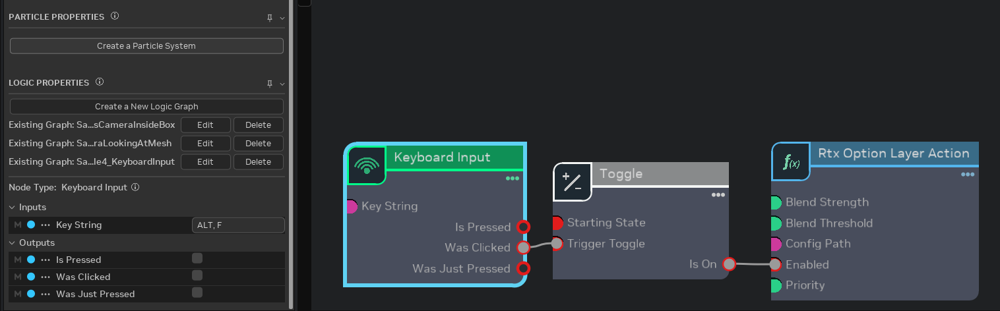

Для этого эффекта узел «Keyboard Input» соединяется с узлом «Toggle». Когда переключатель включён, активируется файл flashlight.conf, который включает резервный фонарик.

***

# Типовые схемы

Эти схемы часто встречаются в графах логики. Разобравшись в них, вы сможете создавать новое поведение, выходящее за
рамки примеров.

## Обнаружение камеры внутри объёма

Чтобы запускать эффекты при входе камеры в определённую область:

1.  **Camera** → выдаёт положение.
2.  **Mesh Proximity** → принимает положение, выдаёт силу активации (activation strength).
3.  **RtxOptionLayerAction** → используйте силу активации в качестве Blend Strength.

Чтобы обнаруживать нахождение внутри, задайте «Full Activation Distance» узла Mesh Proximity отрицательным (внутри ограничивающего параллелепипеда), а «Inactive Distance» — нулевым или положительным (снаружи).

## Переключение горячей клавишей

Чтобы игроки могли включать и выключать эффект:

1.  **Keyboard Input** → настройте нужное сочетание клавиш, используйте выход «Was Clicked».
2.  **Toggle** → меняет состояние каждый раз, когда получает сигнал true.
3.  **RtxOptionLayerAction** → соедините «Is On» узла Toggle со входом «Enabled».

```{tip}
Если нужно поведение «удерживайте, чтобы включить», а не переключение, используйте «Is Pressed» вместо «Was Clicked». Соедините «Is Pressed» напрямую со входом «Enabled» действия, минуя узел Toggle.
```

## Плавные переходы с помощью Remap

Чтобы создавать нелинейные переходы:

1.  Получите исходное значение (расстояние, угол, время).
2.  **Remap** → задайте входной и выходной диапазоны, выберите тип сглаживания (easing).
3.  Используйте преобразованное значение в качестве Blend Strength.

Типы сглаживания вроде «Sine» дают плавное ускорение и замедление вместо линейного изменения.

## Зацикленная анимация

Чтобы создавать повторяющиеся эффекты:

1.  **Time** → выдаёт число секунд с момента создания.
2.  **Loop** → задайте период и тип зацикливания (сброс или «пинг-понг»).
3.  **Remap** → преобразуйте в нужный выходной диапазон.
4.  Используйте результат для управления Blend Strength или другими свойствами.

Цикл «пинг-понг» с синусоидальным сглаживанием создаёт мягкий эффект «дыхания» или пульсации.

## Объединение нескольких условий

Чтобы требовать одновременного выполнения нескольких условий:

1.  Создайте каждое условие (близость, клавиатура, наличие меша и т. д.).
2.  Объедините их с помощью **Boolean AND**.
3.  Соедините результат AND со входом «Enabled» вашего действия.

Для условия «хотя бы одно из» используйте **Boolean OR**.

## Подсчёт событий

Чтобы циклически переключать состояния:

1.  **Counter** → считает входные сигналы true, настройте сброс по достижении порога.
2.  Используйте **Less Than**, **Greater Than** или **Between**, чтобы проверить значение счётчика.
3.  Разные значения счётчика включают разные слои.

На этой схеме основаны эффекты, циклически переключающие несколько состояний, как в примере с направлением частиц выше.

## Использование компонентов-констант

Такие компоненты, как Add, Multiply, Clamp и т. д., умеют работать с входами разных типов (Number, Vector2, Vector3 и т. д.). В такие гибкие поля ввода нельзя вписать значение прямо на компоненте — вместо этого нужно создать ConstNumber или ConstVector2, задать значение в нём, а затем соединить этот Const-компонент с гибким входом нужного компонента.

Ещё один распространённый сценарий для Const-компонентов — общий фрагмент данных, используемый несколькими компонентами, например общая длительность анимации. Если у вас многоэтапная анимация, смешивающая разные слои в разные моменты, и каждый момент задан прямо в отдельном компоненте, менять общую длительность будет утомительно. Лучше создать один ConstNumber с общей длительностью анимации и в каждом компоненте выполнять вычисления на его основе (например, умножать на 0,5, чтобы получить половину общей длительности). Тогда длительность всей анимации можно будет менять в одном поле.

```{tip}
Если вы замечаете, что вводите одно и то же значение в нескольких местах, подумайте об использовании Const-компонента. Так граф будет проще поддерживать и настраивать.
```

***

# Remix Logic подробно

## Структура графа логики

Все графы логики являются DAG (направленными ациклическими графами) и проходят три базовые фазы: восприятие
отрисовываемого состояния игры, преобразование входных данных или принятие решений и воздействие на рендеринг Remix.

Этим фазам соответствуют типы узлов: **Sense**, **Transform**, **Act**.

```{important}
Компоненты нужно соединять так, чтобы у графа была чёткая начальная точка и не возникало циклов; каждый компонент может использовать информацию только от компонентов, стоящих перед ним в цепочке.
```

## Remix Logic и новые conf-файлы

Для системы **RTX Remix Logic** понадобилось разработать систему слоёв, позволяющую жонглировать несколькими файлами
«.conf» и плавно переходить между ними; каждый из них содержит собственный набор параметров RTX Remix Runtime. Моддеры
могут задавать относительную «силу смешивания» (blend strength) каждого слоя, что даёт плавную интерполяцию значений и
точный контроль.

Чтобы упростить создание модов, в Remix появилось три типа файлов конфигурации.

*   **Файлы `rtx.conf`**. Они не изменились. Это основа работы моддера по приведению игры к «совместимости с Remix». Моддеры настраивают, как игра рендерится, чтобы она лучше всего работала с Remix, сохраняют это в `rtx.conf` и публикуют, например, на ModDB, чтобы другим моддерам было проще начать работу над своим модом.

*   **Файлы `user.conf`**. Это новый тип, предназначенный для хранения личных графических настроек пользователя, например графического пресета и того, включена ли генерация кадров (Frame Generation). Они должны подстраиваться под игрока и отражать оптимальные для него графические настройки.

*   **Новые `.conf`-файлы Logic**. Для графов Remix Logic моддеры могут экспортировать из рантайма файл `new.conf`. Этот файл предполагается переименовать и использовать как слой, который временно загружается в ответ на изменение состояния игры.

Когда моддер сохраняет настройки рантайма в «User Graphics Menu», они автоматически записываются в `user.conf`. Кроме
того, в «Advanced Developer Menu» рядом с кнопкой сохранения появился новый выпадающий список:

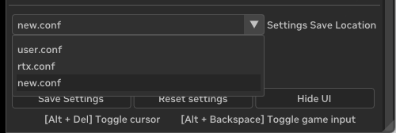

## Создание conf-файлов для Remix Logic

```{warning}
Если вы собираетесь создавать новые `.conf`-файлы для Remix Logic, убедитесь, что ваш `user.conf` содержит только личные графические настройки, включая производные настройки, зависящие от графического пресета или возможностей оборудования. Тогда эти настройки не попадут в экспортируемые `.conf`-файлы и не изменят случайно графические настройки другого игрока.
```

* **Во-первых**, удалите все существующие файлы `user.conf` из структуры файлов.

* **Во-вторых**, в игре откройте меню графических настроек рантайма и нажмите «сохранить» (не заходя в расширенное меню разработчика).

* **В-третьих**, перезапустите игру.

 Теперь все ваши личные графические настройки записаны в `user.conf` и не будут дублироваться в `.conf`-файлы, которые вы экспортируете для Remix Logic.

Как уже говорилось, Remix Logic позволяет смешивать несколько `.conf`-файлов в ответ на изменение состояния игры.
Обычно процесс выглядит так.

Измените настройки Remix Runtime так, чтобы они отражали визуальное состояние, к которому нужно перейти.

Сохраните настройки в файл `new.conf`. Настройки сохранения при этом должны выглядеть так:

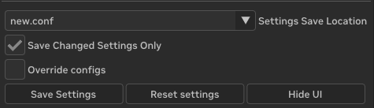

Файл `new.conf` появится в структуре файлов рядом с `rtx.conf`.

Моддеру следует переименовать `new.conf`, сохранив расширение `.conf`, а затем вручную переместить его в папку мода (в
корень или любую подпапку).

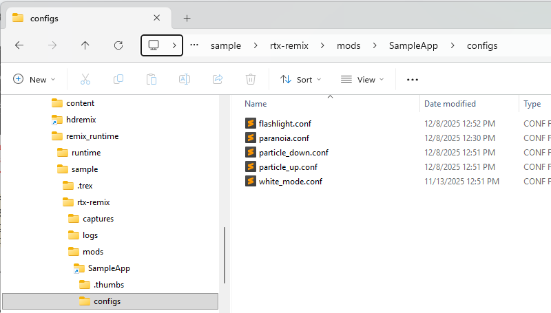

В Remix Toolkit моддер создаёт граф с узлом «RTX Option Layer Action». На панели Logic Properties этот узел нужно
направить на `.conf`-файл с визуальным состоянием, к которому нужно перейти. Когда будет обнаружено определённое
игровое событие, `.conf`-файл применится поверх текущей конфигурации и изменит изображение с той силой смешивания,
которую задал моддер.

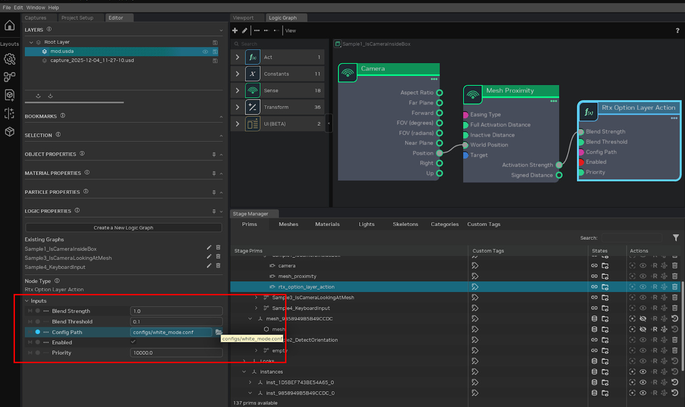

## Приоритет `user.conf`

```{important}
**Приоритет конфигураций (от высшего к низшему):** `user.conf` > слои `.conf` Logic > `rtx.conf`
```

`user.conf` хранит локальные графические настройки и предназначен для пользовательских настроек, которые игрок выбирает
под своё оборудование и личные предпочтения. Он **не** предназначен для настроек мода, которыми делятся с другими.

Поскольку у `user.conf` наивысший приоритет, **Logic не может переопределить значения, заданные в `user.conf`**. Если
при тестировании ваш слой Logic никак не влияет на некоторые значения, проверьте, нет ли их в `user.conf`.

**Рекомендация**: держите `user.conf` в среде разработки минимальным. Перед выпуском мода проверьте его с чистым `user.conf`, чтобы убедиться, что эффекты Logic работают у конечных пользователей так, как задумано.

```{warning}
Logic не может переопределять значения из `user.conf`. Храните настройки мода в `.conf`-файлах слоёв или в `rtx.conf`, а не в `user.conf`.
```

***

# Отладка и устранение неполадок

## Просмотр состояния графа в рантайме

Самый мощный инструмент отладки — вкладка **Enhancements** в рантайме. Загрузив мод:

1.  Откройте меню рантайма (`Alt+X`).
2.  Перейдите на вкладку **Enhancements**.
3.  Разверните **Remix Logic**.
4.  Выберите свой граф в списке.

Панель в реальном времени показывает текущие входные значения, состояние и выходные значения каждого компонента. Можно
наблюдать, как меняются значения во время игры, и видеть, что именно делает каждый компонент.

## Сбор значений для настройки

Для некоторых свойств узлов нужны значения, которые невозможно угадать, — например, диапазон поворота для узла Between
или Remap, отслеживающего движущийся объект.

1.  Создайте узел Read Transform и сохраните мод.
2.  Запустите игру с рантаймом.
3.  Откройте Enhancements → Remix Logic → ваш граф.
4.  Наблюдайте за значениями, вызывая условие, которое хотите отслеживать.
5.  Запишите диапазон значений.
6.  Вернитесь в Toolkit, удалите узел Read Transform и настройте узел Between/Remap на эти значения.

## Распространённые проблемы

**Граф вообще не срабатывает?**
*   Убедитесь, что якорный меш отрисовывается в текущей сцене.
*   Проверьте, что граф сохранён в правильный слой.
*   Поищите граф на вкладке Enhancements в рантайме: если его там нет, якорь неактивен.

**Значения не меняются?**
*   Проверьте соединения в редакторе графов.
*   Убедитесь, что узлы Sense выдают в рантайме ожидаемые значения.
*   Проверьте настройки узлов Transform (диапазоны, пороги).

**Слой не применяется?**
*   Убедитесь, что `.conf`-файл существует по указанному пути.
*   Проверьте, не заблокированы ли значения в `user.conf` (см. раздел «Приоритет `user.conf`» выше).
*   Посмотрите на панель Option Layers в Dev Settings: отображается ли там слой и с какой силой.

**Тонмаппинг или другие значения неправильно сбрасываются?**
*   Когда слой Logic перестаёт задавать значение, рантайм берёт значение из следующего слоя с более низким приоритетом.
*   Если ни один слой его не задаёт, используется встроенное значение RtxOption по умолчанию — а оно может оказаться не таким, как вы ожидаете.
*   Задайте нужные базовые значения в `rtx.conf`, чтобы рантайм знал, к чему возвращаться.

## Известные проблемы

Список известных проблем текущего выпуска 1.3 см. в разделе
[Известные проблемы в примечаниях к выпуску.](../changelog/remix-releasenotes.md#известные-проблемы)

***

# Для опытных: собственные компоненты Logic в Toolkit

Интерфейс компонентов в Toolkit строится на основе файлов схем, которые автоматически генерируются из классов
компонентов на C++. Чтобы новые компоненты появились в Toolkit, нужно заново сгенерировать эти файлы схем и сообщить о
них Toolkit.

Создав собственные компоненты Logic по инструкциям из
[документации Remix Logic](https://github.com/NVIDIAGameWorks/dxvk-remix/blob/main/documentation/RemixLogic.md#creating-components)
для рантайма, вы можете использовать их в Toolkit.

## Требования

*   Локальная сборка рантайма с собственными компонентами ИЛИ собственные компоненты от другого пользователя.

*   Локальная сборка Remix Toolkit ИЛИ релизная сборка, которую вы готовы изменить.


Поскольку Toolkit копирует сгенерированные файлы .ogn и .py при сборке, сначала его нужно собрать, а затем скопировать
новые узлы (файлы .ogn и .py) в нужную папку. Более простой и официальный способ появится в ближайшее время.

`.\Remix 1.3.6.2\exts\lightspeed.trex.logic.ogn\lightspeed\trex\logic\ogn\ogn\python\nodes\*`

После этого собственные компоненты Logic появятся в редакторе графов.

```{tip}
Если вы создали полезные собственные компоненты Logic, поделитесь ими с сообществом, отправив PR в [репозиторий RTX Remix Runtime на GitHub](https://github.com/NVIDIAGameWorks/dxvk-remix).
```

***
<sub> Хотите оставить отзыв о документации RTX Remix? [Нажмите здесь](https://github.com/NVIDIAGameWorks/rtx-remix/issues/new?assignees=nvdamien&labels=documentation%2Cfeedback%2Ctriage&projects=&template=documentation_feedback.yml&title=%5BDocumentation+feedback%5D%3A+) </sub>
