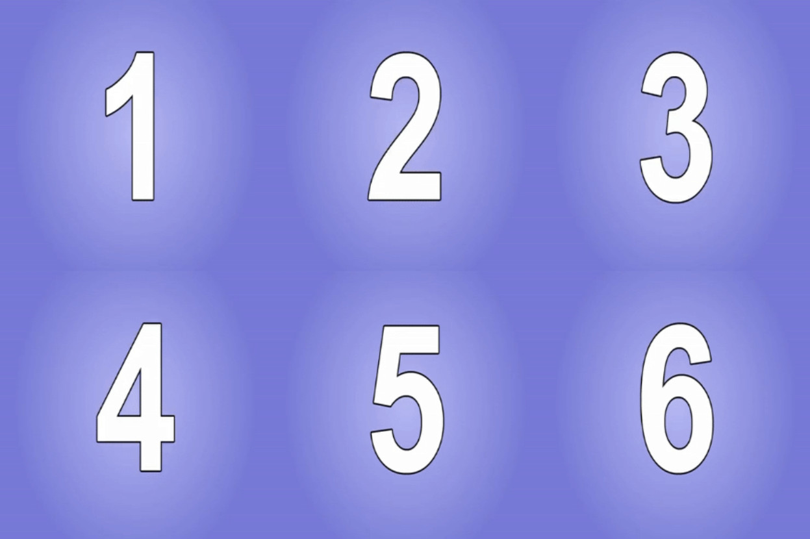

# Настройка замены материалов

Как и ассеты, материалы можно заменять, чтобы повысить качество графики игры. В старых играх часто использовалось
запечённое освещение и текстуры низкого разрешения, которые в RTX Remix могут выглядеть не лучшим образом. Чтобы
улучшить внешний вид игры и в полной мере задействовать трассировку пути в RTX Remix Runtime, материалы можно заменить
текстурами более высокого разрешения и физически корректными материалами.

```{warning}
**Прежде чем использовать текстуры в моде, все они должны быть импортированы в каталог проекта.**

Сведения об импорте ассетов см. в разделе [Импорт ассетов](learning-ingestion.md).
```

## Замена текстуры ассета

1. **Переход к панели:** откройте вкладку «Asset Replacements» и найдите панель «Material Properties».
2. **Выбор меша:** выделите меш, текстуру которого нужно заменить. Для этого щёлкните по мешу во вьюпорте или выберите
   его в Stage Manager.

   ```{tip}
   Если свойства материала не отображаются:

    1. Убедитесь, что на панели Selection выбран именно **меш**. Возможно, вместо него выбрана ссылка или XForm.
    2. У захваченных мешей может не быть назначенного материала. В этом случае замените исходную ссылку новой.
   ```

3. **Изменение свойств текстуры:** на панели Material Properties разверните раздел «Base Color». Замените текстуру,
   нажав кнопку «Browse» рядом с полем «Diffuse Texture». Так же заменяются «Normal Map Texture» и другие текстурные
   свойства.
4. **Назначение набора текстур:** чтобы назначить набор текстур (albedo, normal, roughness и т. д.), нажмите кнопку
   «Assign Texture Set» в верхней части панели Material Properties или перетащите текстуры на панель. Появится диалог,
   который попытается автоматически распознать текстуры и сопоставить их с входами материала.

## Обновление определений материалов в захвате

Захваты могут содержать собственные определения материалов AperturePBR, которые имеют приоритет над определениями
Toolkit. Поэтому после обновления Toolkit новые свойства материалов в существующем проекте могут не появиться. Если
ожидаемых свойств или групп нет, проверьте, какое определение материала использует проект:

1. Щёлкните правой кнопкой по имени материала на панели Material Properties и выберите **Copy Material MDL Path**.
   Проверьте, находится ли найденный файл в папке проекта `deps/captures/materials`.
2. Закройте Toolkit и, прежде чем заменять файлы `AperturePBR_*.mdl` захвата, сделайте их резервную копию. Отдельно
   сохраните все собственные изменения материалов.
3. Найдите расширение Toolkit `lightspeed.trex.app.resources` и его папку `deps/omni_core_materials/Base`. Скопируйте
   полный набор файлов `AperturePBR_*.mdl` из неё в папку материалов захвата, заменив старые модули все вместе, чтобы
   их импорты оставались согласованными. Текстуры и USD-файлы захвата не трогайте.
4. Снова откройте проект и выберите материал, чтобы убедиться, что нужные свойства доступны.

Для новых свойств материалов может также понадобиться совместимая сборка RTX Remix Runtime в игре. Обновление
определений материалов не обновляет рантайм, установленный в игре.

## Анимированные материалы

Работа с анимированными текстурами требует нескольких дополнительных шагов:

1. **Захват кадров:** уменьшите частоту кадров игры, чтобы захватить каждый кадр анимированной текстуры.
2. **Якорные текстуры:**
    * Создайте набор якорных текстур (текстур-заместителей) для каждого кадра анимации.
    * Отрендерите эти текстуры на тестовом уровне, чтобы захватить их хеши.
3. **Меню разработчика Alt+X:**
    * Откройте вкладку настройки материалов в меню разработчика Alt+X.
    * Включите «preserve discarded textures», чтобы в меню материалов сохранялись хеши всех кадров.
4. **Составление списка хешей:** составьте список всех хешей, полученных из сохранённых кадров в меню материалов.
5. **Ручная замена в USDA:** замените эти хеши, вручную отредактировав USDA-файл слоя.

### Анимированные материалы на основе спрайт-листа

Чтобы использовать анимацию из спрайт-листа (sprite sheet), нужно указать следующие параметры:

1. количество строк;
2. количество столбцов;
3. нужное число кадров в секунду.

Задав эти значения, убедитесь, что все материалы настроены на использование материалов со спрайт-листом.

Кадры в спрайт-листе должны идти слева направо и сверху вниз, как в этом примере:



## Свойства материалов

### Трансформация текстуры

Выделите меш с непрозрачным или полупрозрачным материалом AperturePBR и разверните **Texture Transform** на панели
Material Properties. Эти параметры меняют UV-координаты, используемые всеми текстурами материала:

| Параметр | По умолчанию | Действие |
| --- | --- | --- |
| **Texture Scroll Rate** | `0` | Скорость смещения UV в единицах UV в секунду. Ноль отключает прокрутку; отрицательные значения меняют её направление. При режиме повтора Repeat значение `0.5` зацикливает горизонтальную или вертикальную прокрутку каждые две секунды. |
| **Texture Scroll Angle** | `0` | Направление прокрутки в градусах: `0` — положительное направление U, `90` — положительное направление V. Положительное V направлено вниз по изображению; видимые детали движутся в сторону, противоположную смещению UV. |
| **Texture Scale** | `(1, 1)` | Масштаб по U и V до поворота. Положительные значения меньше `1` увеличивают текстуру, больше `1` — уменьшают, отрицательные значения отражают её. Ноль схлопывает соответствующую ось. |
| **Texture Offset** | `(0, 0)` | Постоянное смещение UV, применяемое после масштабирования и поворота. |
| **Texture Rotation** | `0` | Поворот в градусах вокруг начала координат UV в левом верхнем углу изображения. Положительные углы поворачивают положительное направление U к положительному направлению V. |

Чтобы увидеть результат в игре, используйте сборку RTX Remix Runtime, поддерживающую эти атрибуты. Обновление
определений материалов в Toolkit не обновляет рантайм, установленный в игре. UV-координаты за пределами диапазона
`0`–`1` обрабатываются в соответствии с режимами заворачивания (wrap) U/V материала.

Если этой группы нет, см. раздел
[Обновление определений материалов в захвате](#обновление-определений-материалов-в-захвате).

### Parallax Occlusion Mapping

Parallax Occlusion Mapping (POM) — техника, которая используется в RTX Remix, чтобы усилить ощущение глубины и
реалистичность поверхностей. Она имитирует смещение пикселей по карте высот, создавая иллюзию сложного рельефа
поверхности.

#### Parallax Occlusion Mapping для смещения

Смещение (displacement) объединяет техники, благодаря которым простая геометрия выглядит сложнее. В RTX Remix этот
эффект достигается с помощью Parallax Occlusion Mapping.

#### Расчёт глубины пикселя

В Remix видимая глубина смещения определяется пятью факторами и вычисляется так:

`(height_map_pixel * (displace_in + displace_out) - displace_in) * displacementFactor * UV_to_world`

* `Height_map_pixel`: чёрный пиксель смещается на max_depth, белый — на max_height.
* `displace_in`: свойство материала, задающее максимальное смещение внутрь, ниже исходной поверхности.
* `displace_out`: свойство материала, задающее максимальное смещение наружу, выше исходной поверхности.
* `rtx.displacement.displacementFactor`: глобальный параметр RtxOption, предназначенный в основном для отладки
  (рекомендуемое значение: 1.0).
* `UV_to_world`: UV-плотность поверхности (количество мировых единиц на одну UV-плитку).

Например, для стеновой панели, повторяющейся каждые 1,5 метра, чёрный пиксель окажется на 1,5 \* `displace_in` метра
позади стены, а белый — на 1,5 \* `displace_out` метра перед ней.

Полезные формулы:

`total_height = displace_out + displace_in`: полный диапазон смещения (без учёта displacementFactor и масштаба UV).

`neutral_height = displace_in / total_height`: значение карты высот, при котором смещения нет.

#### Сравнение с Substance Designer

В Substance Designer чёрный пиксель на карте высот имеет глубину 1 единица \* `height_scale`, а меш предпросмотра по
умолчанию имеет размер 100x100 единиц.

#### Подбор displace_in для согласованности

* Чтобы глубина смещения в Remix совпадала с предпросмотром Substance Designer, задайте `displace_in` так:
  `displace_in = height_scale / 100`.
* Это обеспечит одинаковый масштаб смещения в Remix и на стандартном меше предпросмотра Substance Designer.
* Если нужно и смещение наружу, сумма `displace_in + displace_out` должна быть равна `height_scale / 100`.

**Собственные меши**

Для собственных мешей в Substance Designer коэффициент для `displace_in` и `displace_out` может потребовать точной
подстройки с учётом UV-плотности конкретного меша. Substance Designer не учитывает UV-плотность при расчёте глубины,
поэтому делите не на 100, а на UV-плотность вашего меша.

### Полупрозрачность

Полупрозрачность настраивается при импорте. Материалы, в названии которых есть «translucent», «glass» или «trans»,
автоматически преобразуются в полупрозрачные.

#### Автоматическое преобразование при импорте

* Материалы, в названии которых есть «translucent», «glass» или «trans», при импорте автоматически становятся
  полупрозрачными.
* Выделив ассет во вьюпорте, откройте панель «Material Properties».
* С помощью меню с тремя полосками в правом верхнем углу панели переключите материал в полупрозрачный или непрозрачный.

#### Ручное преобразование (если при импорте не сработало)

* Выделите меш, который нужно сделать полупрозрачным или непрозрачным.
* На вкладке Asset Replacements найдите «Material Properties».
* Откройте меню-«гамбургер» в разделе «Material» и выберите «Create Material Override (Translucent)».

### Излучающие элементы

**Излучающие текстуры:** чтобы части ассета излучали свет, перейдите на вкладку «emissive», включите «Enable Emission»
и назначьте текстуру Emissive Mask. При необходимости настройте Emissive Intensity (интенсивность излучения).

### Подповерхностное рассеивание

Подповерхностное рассеивание (Subsurface Scattering, SSS) имитирует проникновение света внутрь твёрдых объектов. Оно
описывается моделью BSSRDF — расширением модели BRDF, которая предполагает, что свет входит в поверхность и выходит из
неё в одной и той же точке. SSS используется для реалистичного рендеринга полупрозрачных объектов, например кожи, воска
и мрамора, где рассеивание света выражено сильнее, чем у непрозрачных объектов.

Чтобы настроить SSS, задайте в разделе Subsurface следующие параметры:

* `Transmittance Color`: базовый цвет поверхности с SSS, аналог диффузного цвета альбедо у диффузных материалов.
  Можно также использовать текстурную карту.
* `Subsurface Scattering Radius`: расстояние (средняя длина свободного пробега), которое свет проходит внутри объекта с
  SSS для каждого цветового канала. Чем больше значение, тем сильнее рассеивание и заметнее эффект «шлейфа». Можно
  также использовать текстурную карту.
* `Subsurface Scattering Scale`: коэффициент, управляющий общей интенсивностью SSS.
* `Subsurface Scattering Max Scale`: максимальное расстояние рассеивания. Сэмплы, превышающие это значение,
  ограничиваются.

***
<sub> Хотите оставить отзыв о документации RTX Remix? [Нажмите здесь](https://github.com/NVIDIAGameWorks/rtx-remix/issues/new?assignees=nvdamien&labels=documentation%2Cfeedback%2Ctriage&projects=&template=documentation_feedback.yml&title=%5BDocumentation+feedback%5D%3A+) </sub>
