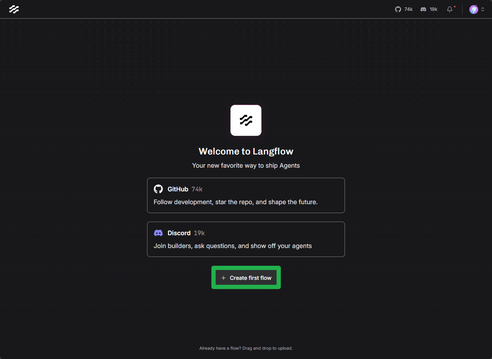
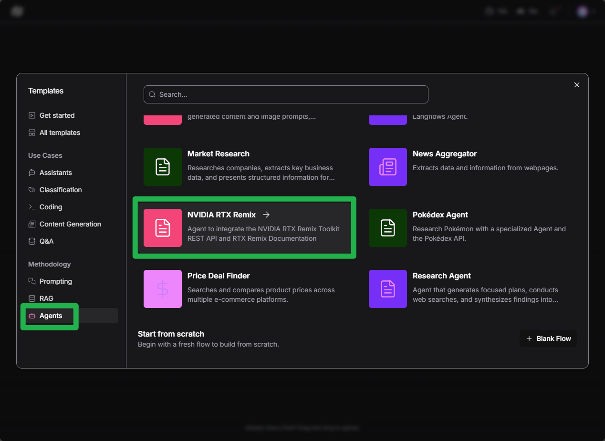
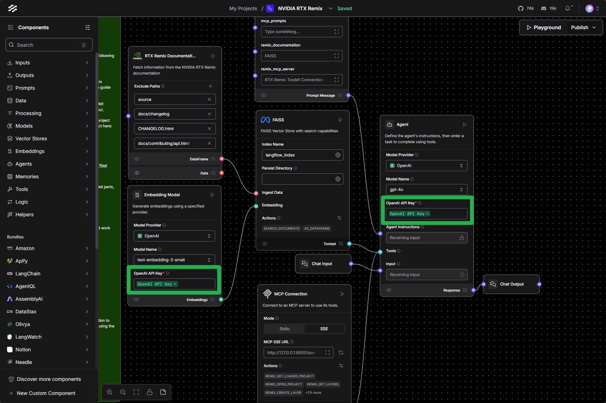
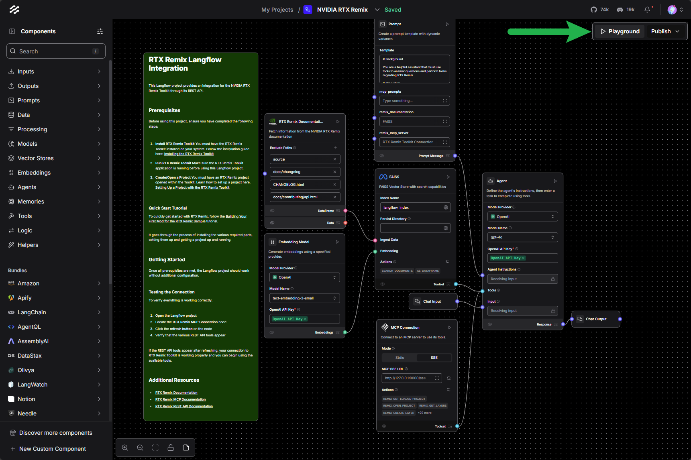
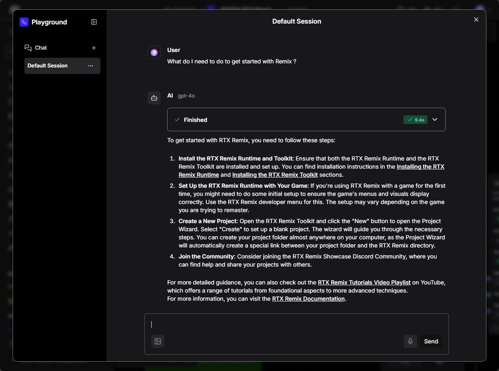
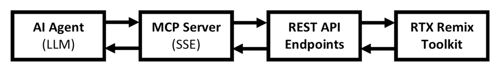

# Использование ИИ-агентов через MCP

Сервер Model Context Protocol (MCP) RTX Remix позволяет ИИ-агентам и большим языковым моделям (LLM) взаимодействовать
с Toolkit. Это даёт возможность автоматизировать рабочие процессы, интегрировать функции на основе ИИ и управлять
Toolkit с помощью команд на естественном языке.

***

```{seealso}
Чтобы сразу перейти к настройке ИИ-ассистента для Remix, см. раздел [Подключение ИИ-агентов через MCP](#подключение-ии-агентов-через-mcp).
```

## Общие сведения

### Что такое MCP?

Model Context Protocol (MCP) — открытый стандарт, дающий ИИ-приложениям единый способ взаимодействия с внешними
инструментами и источниками данных. В RTX Remix MCP служит мостом между ИИ-агентами и функциями Toolkit: он
предоставляет конечные точки REST API в формате, который LLM могут понимать и использовать через вызов инструментов
(tool calling).

#### Основные преимущества

- **Управление на естественном языке**: взаимодействие с Toolkit с помощью разговорных команд.
- **Автоматизация**: создание ИИ-процессов для автоматизации повторяющихся задач.
- **Интеграция**: подключение Toolkit к ИИ-платформам и собственным агентам.
- **Стандартизация**: использование широко распространённого протокола, который поддерживают многие ИИ-фреймворки.

***

## Сведения о сервере MCP

При запуске RTX Remix Toolkit сервер MCP запускается автоматически со следующей конфигурацией по умолчанию:

- **Протокол**: Streamable HTTP
- **Хост**: `127.0.0.1` или `localhost`
- **Предпочтительный порт**: `18014`
- **Конечная точка**: `http://127.0.0.1:18014/mcp/`

В Windows адрес работающего сервера, включая резервные порты, можно прочитать из поля `mcp_endpoint` файла
`%LOCALAPPDATA%\NVIDIA\RTX Remix\mcp.json`. Перед подключением проверьте, что процесс с указанным `pid` всё ещё
работает, и убедитесь в готовности сервера: после сбоя может остаться устаревший файл. См.
[подробности о файле обнаружения](https://github.com/NVIDIAGameWorks/toolkit-remix/blob/main/source/extensions/lightspeed.trex.mcp.core/docs/README.md#discovery-manifest).

Если порт занят, Toolkit по порядку пробует остальные порты до `18019` включительно. Если все шесть портов недоступны,
при запуске MCP в журнал записывается ошибка, и запуск прекращается. Найдите в журнале Toolkit запись
`MCP_PORT_FALLBACK` и используйте её URL из `endpoint=` в конфигурации клиента. Прежде чем подключаться, дождитесь
записи `SERVICE_READY service=mcp` с совпадающими хостом и портом. При смене порта настройки клиента автоматически не
обновляются.

Клиенты, которые пока не умеют подключаться через Streamable HTTP, могут использовать устаревший транспорт SSE этого
протокола: задайте `/exts/lightspeed.trex.mcp.core/transport` равным `sse`, и сервер будет доступен по адресу
`http://127.0.0.1:18014/sse`.

***

## Подключение ИИ-агентов через MCP

Подключать ИИ-агентов к серверу MCP RTX Remix позволяют многие фреймворки. В этом руководстве описано подключение
ИИ-агента к серверу MCP через Langflow, а также приведены общие шаги для любого MCP-совместимого клиента.

### Использование Langflow

[Langflow](https://www.langflow.org/) — визуальный фреймворк для создания ИИ-агентов с поддержкой MCP:

```{important}
Чтобы использовать шаблон NVIDIA RTX Remix для Langflow в исходном виде, нужен ключ API OpenAI, однако шаблон можно
изменить для работы с другими поставщиками LLM. Подробнее о компоненте Agent см. в
[его документации](https://docs.langflow.org/components-agents).
```

1) Установите Langflow по [руководству по установке](https://docs.langflow.org/get-started-installation).

```{tip}
- Минимальная версия настольного приложения Langflow — `1.5.13`.
- Минимальная версия пакета Langflow для PIP — `1.5.0.post2`.
```

2) Запустите RTX Remix Toolkit.

3) Запустите Langflow и создайте в нём новый поток (flow).

   

4) Выберите шаблон `NVIDIA RTX Remix` в разделе «Agents».

   

5) Укажите необходимые ключи API. Упростить это помогают переменные окружения Langflow:

   

6) Протестируйте поток, открыв «Playground».

   

7) Взаимодействуйте с потоком: введите сообщение в поле «Input» и нажмите кнопку «Send».

   

```{tip}
При проблемах с потоком обратитесь к узлу README в проекте Langflow: там подробно описано использование шаблона и
решение типичных проблем.
```

### Использование MCP-совместимых клиентов

К Toolkit может подключиться любой MCP-совместимый клиент. Для этого:

1) Настройте клиент на Streamable HTTP по адресу `http://127.0.0.1:18014/mcp/` или на резервную конечную точку из
   журнала Toolkit.
2) Убедитесь, что RTX Remix Toolkit запущен.
3) Клиент автоматически обнаружит доступные инструменты через протокол MCP.

Например, чтобы зарегистрировать сервер в Claude Code для текущей папки:

```bash
claude mcp add --transport http remix http://127.0.0.1:18014/mcp/
```

После этого, пока Toolkit запущен, `claude mcp list` будет показывать `remix` как подключённый.

***

## Навык для моддинга

Навык (skill) `rtx-remix-modding` учит агентов пользоваться инструментами MCP Toolkit. Для него нужен Toolkit версии
`1.6.0` или новее, включая
[готовые пакеты для разработки](../installation/install-toolkit.md#загрузка-готового-пакета-для-разработки).
Чтобы установить опубликованную версию из [репозитория навыков NVIDIA](https://github.com/nvidia/skills), выполните
следующую команду с [Node.js](https://nodejs.org/en/download) 22.20 или новее в папке, из которой запускаете агента:

```bash
npx skills add https://github.com/nvidia/skills --skill rtx-remix-modding
```

При запросе убедитесь, что выбран ваш агент.

Навык и его справочные файлы также входят в комплект Toolkit. Запустите агента для программирования из каталога
установки Toolkit или откройте этот каталог как его рабочее пространство, чтобы использовать входящие в комплект файлы
обнаружения навыков. Инструкции навыка находятся в `skills/rtx-remix-modding/SKILL.md`.

[Подключите агента к MCP](#подключение-ии-агентов-через-mcp) отдельно: загрузка навыка не устанавливает соединение с
Toolkit.

***

## Как MCP работает с RTX Remix

Сервер MCP RTX Remix работает так:

1. **Автоматический запуск**: сервер MCP запускается автоматически вместе с RTX Remix Toolkit.
2. **Трансляция REST API**: конечные точки REST API Toolkit преобразуются в MCP-совместимые инструменты.
3. **Streamable HTTP**: передаёт запросы и ответы MCP между клиентами и Toolkit.
4. **Описания инструментов**: предоставляет структурированные описания доступных действий, понятные LLM.

```{seealso}
Подробнее о REST API RTX Remix Toolkit см. в разделе [Использование REST API](./learning-restapi.md).
```

### Техническая архитектура



На схеме подписан устаревший транспорт SSE; транспорт по умолчанию — Streamable HTTP.

***

## Устранение неполадок

### Тестирование сервера MCP

Для тестирования рекомендуется использовать [MCP Inspector](https://github.com/modelcontextprotocol/inspector):

1) Убедитесь, что установлен `Node.js` 22.19 или новее. Если нет, следуйте
   [этим инструкциям](https://nodejs.org/en/download). В более старых версиях Inspector не запускается с ошибкой об
   отсутствии `styleText` в `node:util`.
2) Запустите RTX Remix Toolkit (так вы убедитесь, что сервер MCP работает).
3) Запустите MCP Inspector:
   ```bash
   npx @modelcontextprotocol/inspector
   ```
   Он выведет URL `http://127.0.0.1:6274` с уже подставленным токеном авторизации. Откройте этот адрес.
4) Добавьте сервер MCP RTX Remix:
    - Выберите «Add Servers», затем «Add manually».
    - Server ID: любое имя, например `rtx-remix`.
    - Transport: `streamable-http`.
    - URL: `http://127.0.0.1:18014/mcp/` (если предпочтительный порт занят, используйте адрес из журнала).
    - Нажмите «Add».
5) Включите переключатель Connect у нового сервера. После подключения на карточке появится согласованная версия
   протокола.
6) На вкладке Tools можно изучать и вызывать операции Toolkit, а на панели Messages — просматривать запросы и ответы.

***
<sub> Хотите оставить отзыв о документации RTX Remix? [Нажмите здесь](https://github.com/NVIDIAGameWorks/rtx-remix/issues/new?assignees=nvdamien&labels=documentation%2Cfeedback%2Ctriage&projects=&template=documentation_feedback.yml&title=%5BDocumentation+feedback%5D%3A+) </sub>
