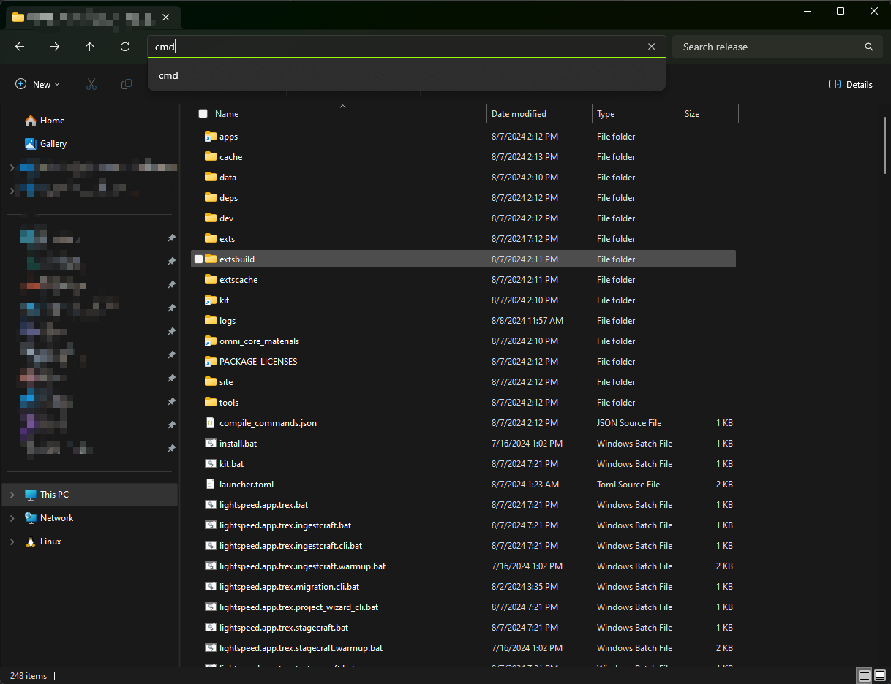

# Миграции данных

RTX Remix Toolkit включает инструмент миграции данных, обеспечивающий совместимость старых проектов с последними
версиями рантайма и Toolkit. Это пакетный скрипт, позволяющий запускать все доступные миграции единообразно.

***

## Где найти инструмент миграции

1) Откройте в Проводнике
   [каталог установки Toolkit](../remix-faq.md#как-найти-папку-установки-rtx-remix-toolkit).
2) Найдите файл скрипта `lightspeed.app.trex.migration.cli.bat`.

## Запуск инструмента миграции

1) Находясь в каталоге установки, щёлкните по адресной строке вверху и введите:
    ```bat
    cmd
    ```
   
2) Откроется окно командной строки, в котором текущим рабочим каталогом будет каталог установки.
3) В окне командной строки запустите скрипт `lightspeed.app.trex.migration.cli.bat` командой:
    ```bat
    lightspeed.app.trex.migration.cli.bat -h
    ```
4) Появится список доступных миграций. Чтобы выполнить нужные миграции, следуйте указаниям инструмента.

## Выполнение миграции

Чтобы выполнить миграцию, следуйте указаниям, которые инструмент выдал на предыдущем шаге.

Например, команда:

```bat
lightspeed.app.trex.migration.cli.bat distant-lights-z-direction -h
```

выведет инструкции по миграции удалённых источников света (distant lights) в существующем проекте.

***

## Доступные миграции

Инструмент миграции — единая точка, где собраны все доступные миграции.

### Направление Z удалённых источников света

Если мод был создан до следующего коммита:
[Fix orientation of exported (USD captures) distant lights. Comply with the USD standard: -Z axis must point from the sun to the earth.](https://github.com/NVIDIAGameWorks/dxvk-remix/commit/cfa5273ef5d8dd4f7e98b1ef9e5d9cb2552042f4)

то удалённые источники света в моде были направлены неправильно. Чтобы исправить проблему, эту миграцию нужно
выполнить один раз: она развернёт направление удалённых источников света.

#### Имя миграции

`distant-lights-z-direction`

#### Назначение

Перевести удалённые источники света, направленные неправильно (ось Z к солнцу), в правильное направление (ось Z от
солнца).

#### Аргументы

| Аргумент                                   | Описание                                                                                                   |
| ------------------------------------------ | ---------------------------------------------------------------------------------------------------------- |
| `--file FILE`<br/>`-f FILE`                | Путь к USD-файлу, который нужно привести к обновлённому стандарту                                          |
| `--directory DIRECTORY`<br/>`-d DIRECTORY` | Путь к каталогу с USD-файлами, которые нужно привести к обновлённому стандарту                             |
| `--force`<br/>`-F`                         | Принудительно выполнить миграцию независимо от того, выполнялась ли она раньше.                            |
| `--recursive`<br/>`-r`                     | Рекурсивно искать USD-файлы в указанном каталоге.<br/>Игнорируется, если указан `--file`.                  |

#### Пример команды

```bat
lightspeed.app.trex.migration.cli.bat distant-lights-z-direction -d "PROJECT_DIRECTORY_HERE" -r
```

где вместо `PROJECT_DIRECTORY_HERE` нужно подставить каталог проекта, к которому применяется миграция.

### Входы источников света UsdLux

В проектах, созданных в старых версиях USD, свойства источников света UsdLux, например `intensity`, `color` или
`shaping:cone:angle`, могут храниться прямо на примах источников. USD 25.11 ожидает, что эти свойства находятся в
пространстве имён `inputs:`, например `inputs:intensity`, `inputs:color` и `inputs:shaping:cone:angle`.

Запустите эту миграцию для старых проектов, в которых после обновления до Toolkit на основе USD 25.11 пропало
освещение или оно стало чёрным. Миграция изменяет на месте текстовые USD-файлы (`.usda` и текстовые `.usd`). Двоичные
файлы USD crate (`.usdc` или двоичные `.usd`) пропускаются, и инструмент сообщает о них.

#### Имя миграции

`usdlux-light-inputs`

#### Назначение

Перевести устаревшие атрибуты источников света UsdLux на имена атрибутов `inputs:` из USD 25.11.

#### Аргументы

| Аргумент                                   | Описание                                                                                                   |
| ------------------------------------------ | ---------------------------------------------------------------------------------------------------------- |
| `--file FILE`<br/>`-f FILE`                | Путь к USD-файлу, который нужно привести к обновлённому стандарту UsdLux                                   |
| `--directory DIRECTORY`<br/>`-d DIRECTORY` | Путь к каталогу с USD-файлами, которые нужно привести к обновлённому стандарту UsdLux                      |
| `--recursive`<br/>`-r`                     | Рекурсивно искать USD-файлы в указанном каталоге.<br/>Игнорируется, если указан `--file`.                  |

#### Пример команды

```bat
lightspeed.app.trex.migration.cli.bat usdlux-light-inputs -d "PROJECT_DIRECTORY_HERE" -r
```

где вместо `PROJECT_DIRECTORY_HERE` нужно подставить каталог проекта, к которому применяется миграция.

***
<sub> Хотите оставить отзыв о документации RTX Remix? [Нажмите здесь](https://github.com/NVIDIAGameWorks/rtx-remix/issues/new?assignees=nvdamien&labels=documentation%2Cfeedback%2Ctriage&projects=&template=documentation_feedback.yml&title=%5BDocumentation+feedback%5D%3A+) </sub>
