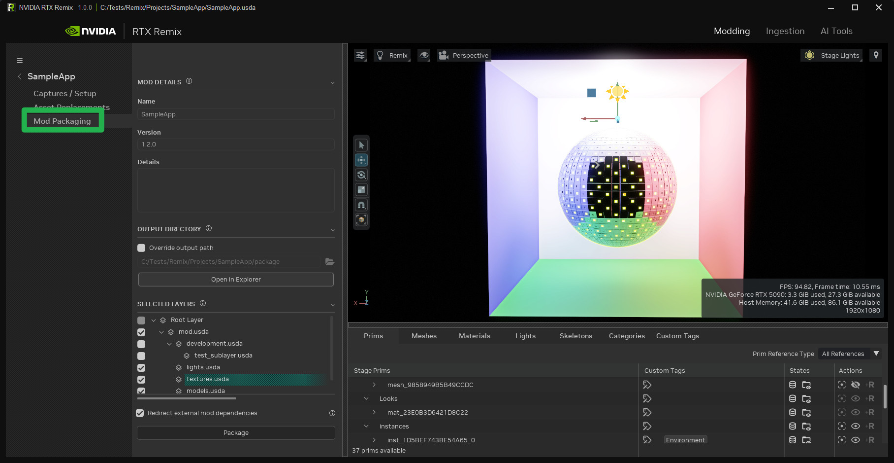
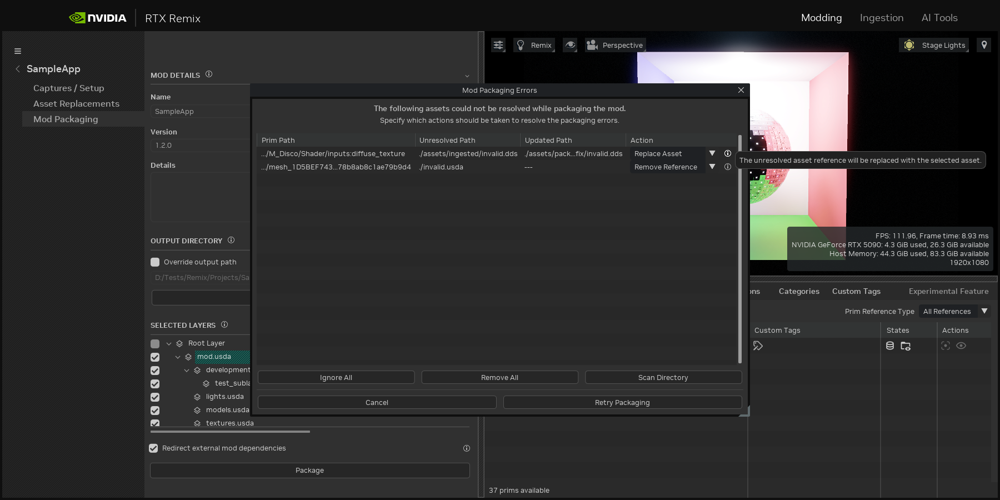

# Упаковка мода

Когда мод готов к распространению, его нужно упаковать. Это гарантирует, что все необходимые элементы — ассеты,
текстуры и подслои — находятся в каталоге проекта, а все ссылки относительные и замкнуты внутри него.

Упаковка выполняется за несколько простых шагов.

***

## Вкладка упаковки

Вкладка упаковки находится на странице «Modding» интерфейса Toolkit, сразу под вкладкой «Asset Replacement».



### Панель Mod Details

* **Name:** идентификатор упаковываемого мода.
* **Version:** версия мода. Полезна для отслеживания изменений и обновлений мода со временем. Вместе с полем Details её
  можно использовать для ведения списка изменений.
* **Details:** место для подробной информации об упаковываемом моде. В это поле можно написать что угодно.

### Панель Output Directory

По умолчанию выходным каталогом служит подкаталог `package` в каталоге текущего проекта. Это значение можно изменить.

После завершения упаковки выходной каталог можно открыть в Проводнике, нажав кнопку «Open in Explorer».

```{note}
Если заархивировать этот каталог в ZIP, мод будет проще распространять: его можно загрузить на
[ModDB](https://www.moddb.com/rtx/) или в любое другое удобное место.
```

### Панель Selected Layers

На этой панели собраны зависимости выбранных слоёв. Слои без галочки исключаются из упаковки. Это полезно, например,
чтобы исключить рабочие слои разработки.

### Режим упаковки

Этот выпадающий список определяет, как при упаковке обрабатываются внешние зависимости мода.

* **Redirect dependencies:** ссылки продолжают указывать на установленные моды-зависимости: пути
  «./deps/mods/\<Name>» заменяются на «../mods/\<Name>». Так получается самый компактный пакет, но моды-зависимости
  также должны быть установлены в каталог `rtx-remix/mods`.
* **Import dependencies:** внешние ссылки копируются в пакет, а многослойная структура USD сохраняется. Получается
  самостоятельный пакет мода.
* **Flatten into one layer:** сначала импортируются зависимости, затем упакованный результат сводится в один корневой
  USD-слой. При этом из пакета удаляется всё лишнее, и остаются только ассеты, на которые по-прежнему ссылается
  сведённый результат.

Упаковка не разрушает исходные данные. Она записывает только во временные слои упаковки и в выходной каталог пакета.
Исходный проект и его подслои при упаковке не изменяются. Единственное исключение — когда исправления неразрешённых
ассетов явно применяются через диалог исправлений.

### Упаковка RTX IO

Параметры RTX IO Packaging позволяют после обычной упаковки дополнительно сжать упакованные DDS-текстуры в файлы
RTX IO `.pkg`. Используйте их, если хотите, чтобы упакованный мод передавал текстурные данные в RTX Remix Runtime
потоково через RTX IO.

В этом разделе есть следующие параметры:

* **Packaging mode:** включает сжатие RTX IO для DDS-текстур в упакованном результате. Исходный проект не изменяется.
* **Delete packaged DDS files after compression:** удаляет DDS-файлы из упакованного результата, но только после
  успешного сжатия RTX IO. Оставьте выключенным, если хотите сохранить несжатые DDS-файлы для проверки или
  тестирования резервного варианта.
* **Split package files:** разбивает создаваемые файлы пакетов RTX IO на части выбранного размера. Используйте, если в
  моде много текстур и вы хотите, чтобы размер файлов пакета не превышал предсказуемого значения. Доступные пресеты:
  `1 GB`, `2 GB`, `4 GB`, `8 GB` и `16 GB`.

После упаковки со сжатием RTX IO добавьте в `rtx.conf` мода следующую настройку, чтобы рантайм загружал созданные
файлы `.pkg`:

```ini
rtx.io.enabled = True
```

Если упакованные DDS-файлы удалены, а RTX IO в `rtx.conf` не включён, у рантайма не будет DDS-файлов в качестве
резервного варианта. Включите RTX IO, прежде чем распространять пакет, который зависит от созданных файлов `.pkg`.

***

## Исправление неразрешённых ассетов

Если при упаковке обнаружатся неразрешённые ассеты (ссылки на отсутствующие файлы), Toolkit предложит их исправить.



Неразрешённые ассеты можно исправить тремя способами:

1. **Ignore:** продолжить упаковку, не обращая внимания на неразрешённые ассеты. Не рекомендуется, так как в моде могут
   оказаться отсутствующие ассеты.
2. **Replace Asset:** заменить неразрешённый ассет допустимым. Функция «Scan Directory» помогает найти ассеты с
   совпадающими именами в другом каталоге. Это удобно, если ассеты были перемещены и ссылки сломались, но сами ассеты
   по-прежнему доступны.
3. **Remove Reference:** удалить из проекта ссылку на неразрешённый ассет. Полезно, если ассет больше не нужен в моде.

***
<sub> Хотите оставить отзыв о документации RTX Remix? [Нажмите здесь](https://github.com/NVIDIAGameWorks/rtx-remix/issues/new?assignees=nvdamien&labels=documentation%2Cfeedback%2Ctriage&projects=&template=documentation_feedback.yml&title=%5BDocumentation+feedback%5D%3A+) </sub>
