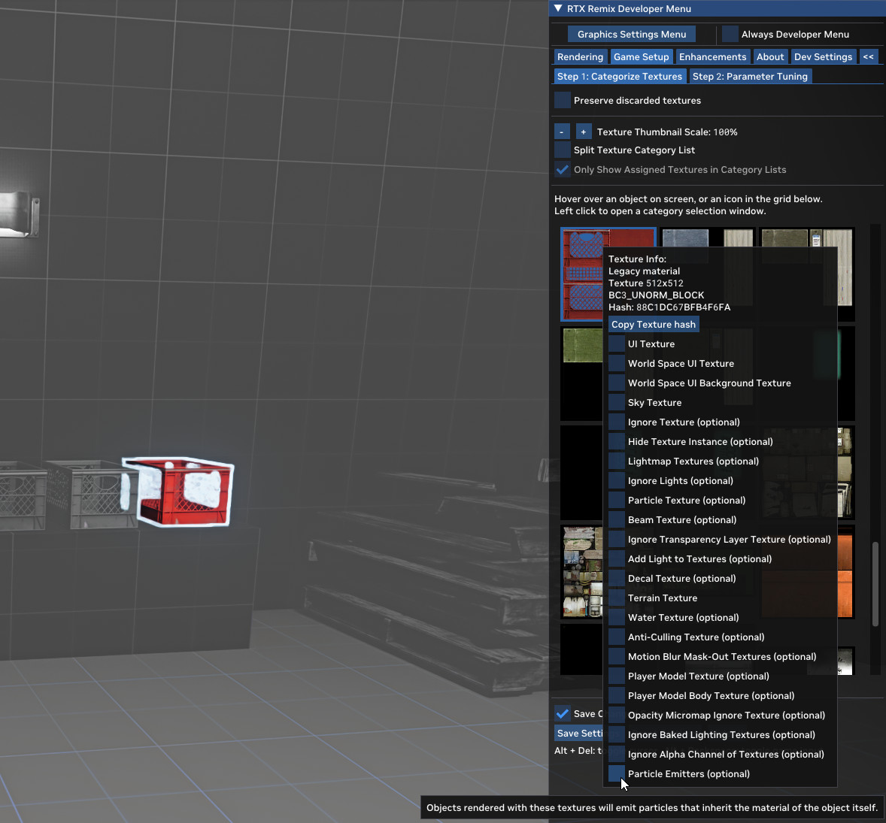
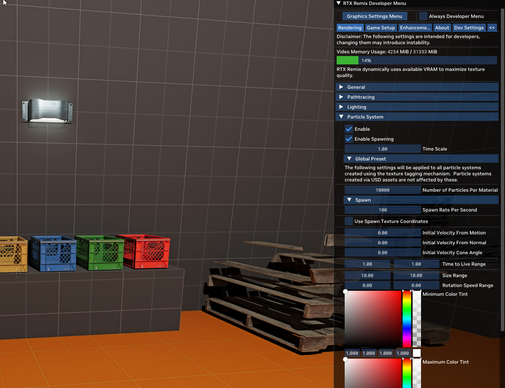
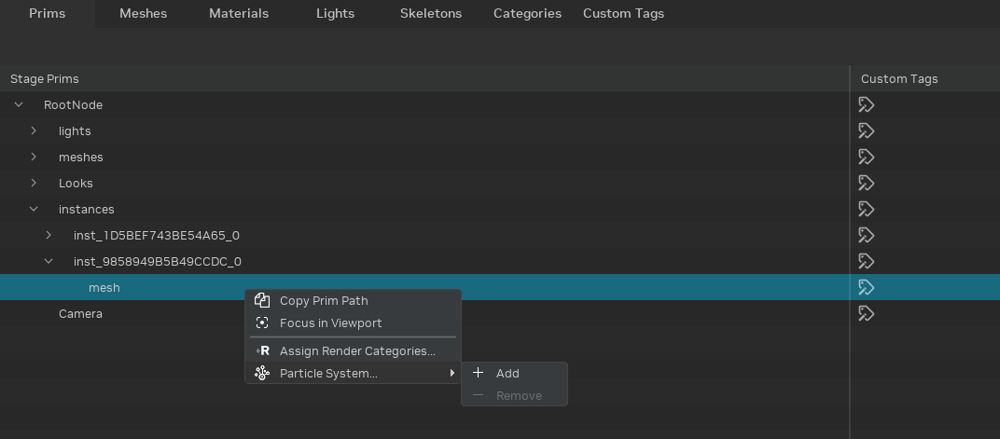
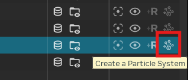
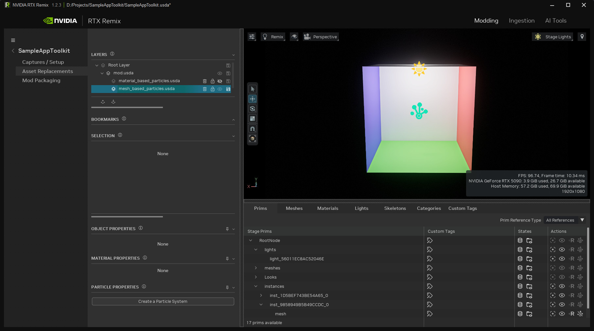
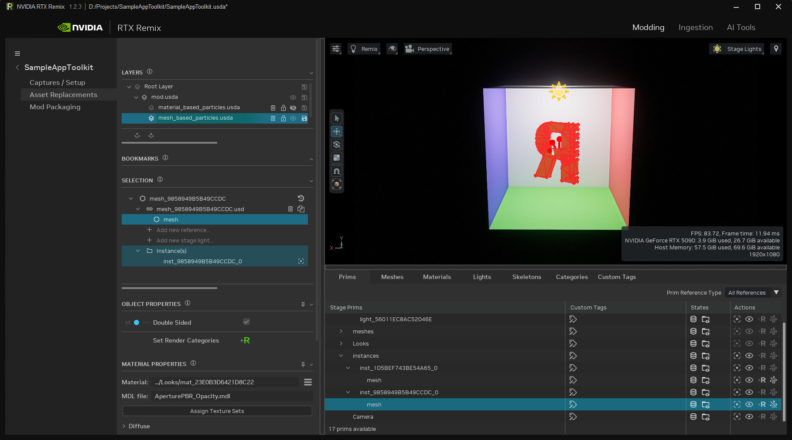
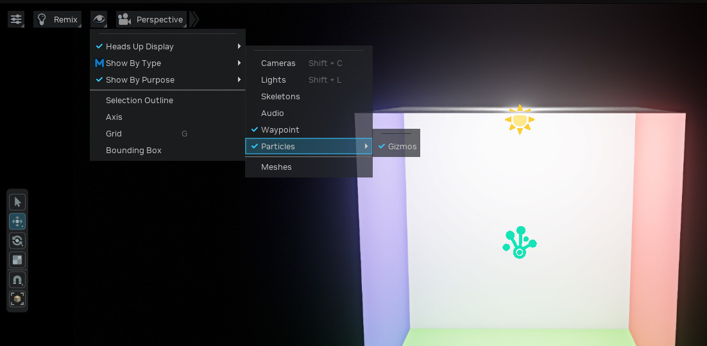
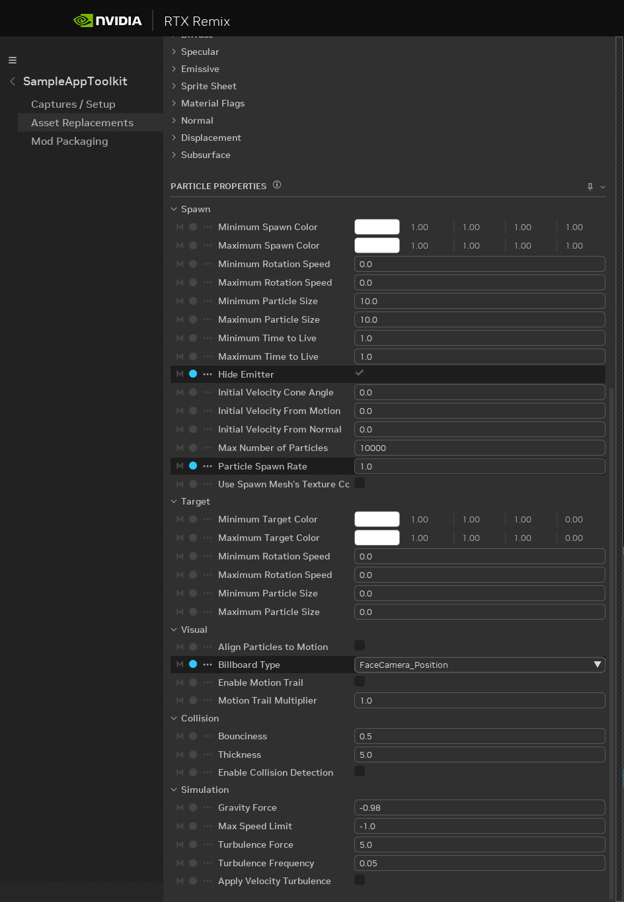
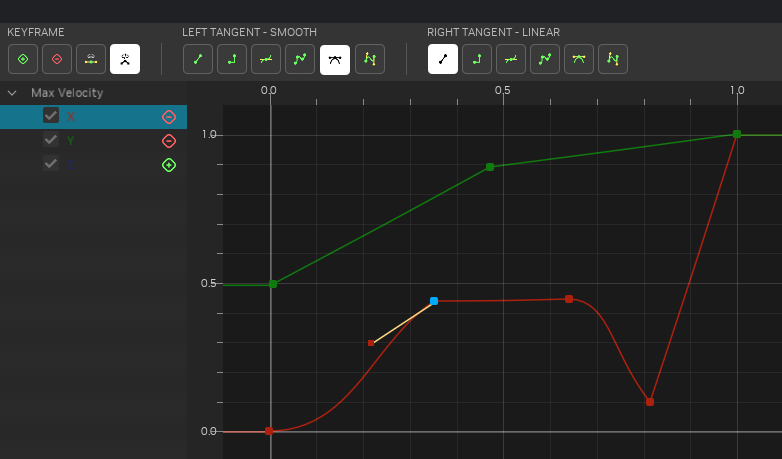

# Добавление систем частиц

RTX Remix позволяет добавлять в моды эффекты частиц на GPU с трассировкой лучей. Частицы задаются для каждого
излучателя (эмиттера) отдельно с помощью USD-схемы **ParticleSystemAPI**, поэтому у каждого излучателя свой независимый
набор параметров. Система частиц поддерживает:

- анимацию по ключевым кадрам в редакторе кривых (Curve Editor);
- физическое поведение, включая аттракторы, режимы столкновений и сопротивление среды;
- визуальные настройки размера, ориентации и воспроизведения спрайт-листов.

***

## Редактирование в Remix Runtime

Рантайм — самый быстрый способ добавить частицы в игровую сцену. Текстура помечается как излучатель частиц прямо в
Developer Settings, и все частицы используют один общий глобальный пресет. Такой подход идеален для быстрого
прототипирования, но для управления каждым излучателем отдельно и сложной анимации лучше использовать Toolkit.

### Превращение любой текстуры в излучатель частиц

Если в рантайме назначить любой текстуре
[категорию рендеринга](../gettingstarted/learning-runtimesetup.md#категории-рендеринга) «Particle Emitter»,
будет создана система частиц.

Это быстрый и простой способ увидеть эффекты частиц в игре. Однако есть пара ограничений:

1. Все частицы используют один набор глобальных настроек.
2. Добавлять частицы можно только к текстурам.

**Чтобы пометить текстуру:**



1. Откройте **Developer Settings**.
2. Перейдите на вкладку **Game Setup**.
3. Щёлкните по текстуре или щёлкните правой кнопкой по объекту в игре.
4. Добавьте категорию **Particle Emitters (optional)**.

### Настройка глобальных параметров частиц



1. Откройте **Developer Settings**.
2. Перейдите на вкладку **Rendering**.
3. Измените настройки в разделе **Particle System > Global Preset**.

Для анимируемых параметров, например цвета, размера и скорости вращения, рантайм предоставляет значения **Spawn**
(при появлении) и **Target** (целевое). За время жизни частицы значение линейно интерполируется между ними. Это
рантайм-аналог редактора кривых Toolkit — он проще, но для многих эффектов его достаточно.

```{tip}
Если вы используете вместе с частицами систему Remix Logic, сохраняйте `rtx.conf`, когда эффекты графов логики
неактивны, чтобы переопределения Logic не попали в конфигурацию частиц.
```

Для более сложных эффектов с отдельной настройкой каждого излучателя и анимацией по ключевым кадрам используйте Remix
Toolkit.

***

## Редактирование в Remix Toolkit

Toolkit даёт полный контроль над системами частиц: у каждого излучателя свой набор параметров, который настраивается на
панели Properties. Каждый излучатель частиц хранится в виде USD-данных в файлах слоёв мода, поэтому при сохранении мода
эффекты автоматически переносятся в рантайм.

### Создание системы частиц

Щёлкните правой кнопкой по любому приму меша или материала в **Stage Manager**, чтобы добавить систему частиц прямо к
этому приму:

**Правая кнопка мыши -> Particle System... -> Add**

```{note}
**ParticleSystemAPI** можно применять к примам мешей и материалов.
```



Создавать и удалять системы частиц на приме можно также кнопками действий в **Stage Manager**. Кнопки активны только у
примов, поддерживающих системы частиц.



Наконец, можно воспользоваться действием **Create Particle System** на панели **Properties**.

Чтобы увидеть эффект, задайте атрибуту **Spawn Rate Per Second** ненулевое значение. После этого можно настраивать
внешний вид.

### Гизмо системы частиц

1. Чтобы выделить систему частиц во вьюпорте, щёлкните по синему значку-шипу. Если по значку сложно попасть, можно
   выделить её рамкой.
   
2. После выделения скрытые излучатели отображаются в виде голограммы, а видимые обводятся каркасом.
   

Включать и выключать гизмо частиц можно в меню вьюпорта.



## Настройка системы частиц

Если выделен прим с применённой схемой `ParticleSystemAPI`, его свойства отображаются на панели **Properties**.




***

## Параметры системы частиц

```{seealso}
[Схема Remix Particle System](https://github.com/NVIDIAGameWorks/dxvk-remix/blob/main/src/usd-plugins/RemixParticleSystem/schema.usda) — полный список параметров с описаниями, значениями по умолчанию и допустимыми диапазонами.
```

### Визуальные параметры

```{versionadded} 1.4
```

**Двумерный размер частиц**

Теперь у размера частиц есть независимые ширина и высота (`minSize`/`maxSize` типа Float2), что позволяет создавать
прямоугольные частицы. Оба измерения можно анимировать в редакторе кривых. Это полезно для капель дождя (высоких и
узких), листьев (широких и низких) и любых эффектов, где квадратные билборды выглядят неестественно.

```{versionadded} 1.4
```

**Шлейф движения**

Переключатель **Enable Motion Trail** (`enableMotionTrail`) вытягивает частицы вдоль вектора скорости, создавая эффект
полосы для быстро движущихся частиц: искр, метеоров, трассирующих пуль. **Motion Trail Multiplier**
(`motionTrailMultiplier`, по умолчанию `1.0`) масштабирует длину шлейфа: значения больше `1.0` удлиняют шлейф, меньше —
укорачивают.

```{note}
Шлейф движения растягивает центр квада частицы, а края сохраняют границу текстуры. Для наилучшего результата
используйте простые или однородные текстуры, а не детализированные спрайт-листы.
```

```{versionadded} 1.4
```

**Случайное отражение по осям**

Настройка **Random Axis Flipping** (`randomFlipAxis`) отражает текстуры частиц при появлении, чтобы разбить
повторяющиеся узоры в плотных эффектах:

* **None** (по умолчанию) — без отражения;
* **Horizontal** — случайное отражение по горизонтали при появлении;
* **Vertical** — случайное отражение по вертикали при появлении;
* **Both** — случайное отражение в обоих направлениях при появлении.

```{versionadded} 1.4
```

**Начальное отклонение поворота**

**Initial Rotation Deviation** (`initialRotationDeviationDegrees`) задаёт каждой частице случайный начальный угол при
появлении. Значение (0–180 градусов) определяет диапазон случайности. Вместе со случайным отражением по осям это
позволяет даже простым текстурам выглядеть разнообразно по всему полю частиц.

### Физические параметры

```{versionadded} 1.4
```

**Аттрактор**

Аттрактор добавляет систему силового поля. Вы задаёте точку в мировом пространстве с настраиваемым радиусом и силой.
Частицы в пределах радиуса притягиваются к этой точке (положительная сила) или отталкиваются от неё (отрицательная
сила). Этим управляют три параметра:

* `attractorPosition` — координаты точки приложения силы в мировом пространстве;
* `attractorForce` — сила в см/с²; положительная притягивает, отрицательная отталкивает;
* `attractorRadius` — радиус затухания; частицы за пределами этого радиуса не затрагиваются.

```{versionadded} 1.4
```

**Режимы столкновений** — Stop и Kill

Параметр **Collision Mode** (`collisionMode`) теперь поддерживает три варианта поведения. Сначала включите обнаружение
столкновений переключателем `enableCollisionDetection`, затем выберите режим:

* **Bounce** (по умолчанию) — частицы отскакивают от поверхностей. **Bounciness** (`collisionRestitution`) определяет,
  какая доля скорости сохраняется при ударе: `1.0` — абсолютно упругий удар, `0.0` — абсолютно неупругий.
* **Stop** — частицы мгновенно останавливаются при контакте и остаются в точке столкновения до конца жизни. Подходит
  для снежинок, оседающих на поверхность, или обломков, которые падают и замирают.
* **Kill** — частицы уничтожаются при контакте. Подходит для капель дождя, исчезающих при ударе, или искр, гаснущих при
  касании земли.

```{versionadded} 1.4
```

**Длительность всплеска**

Параметр **Burst Duration** (`spawnBurstDuration`) включает периодическое испускание всплесками вместо непрерывного.
Значение `0` (по умолчанию) означает непрерывное появление частиц. При значениях больше `0` частицы появляются
всплесками, разделёнными указанным числом секунд. Подходит для взрывов, дульных вспышек и искр.

```{versionadded} 1.4
```

**Сопротивление воздуха**

**Drag Coefficient** (`dragCoefficient`) постепенно замедляет частицы, имитируя сопротивление воздуха. Значение `0`
(по умолчанию) означает отсутствие сопротивления. Чем выше значение, тем быстрее частицы замедляются после появления.

```{versionadded} 1.4
```

**Ограничение по осям**

Три переключателя ограничивают движение частиц определёнными осями или плоскостями:

* `restrictVelocityX` — запрещает движение по оси X;
* `restrictVelocityY` — запрещает движение по оси Y;
* `restrictVelocityZ` — запрещает движение по оси Z.

Включите **Restrict Y**, чтобы частицы двигались только горизонтально (пыль или туман у земли). Включите **Restrict X**
и **Restrict Z**, чтобы частицы двигались только вертикально (поднимающийся дым или падающий дождь).

### Редактор кривых

```{versionadded} 1.4
```

Редактор кривых (Curve Editor) заменяет простую систему начального и конечного значений полноценным редактором анимации
по ключевым кадрам. Вместо того чтобы задавать только начальное и конечное значение параметра, можно добавить несколько
ключевых кадров с интерполяцией, управляемой касательными, на протяжении всей жизни частицы (от 0 до 1).



Анимацию по кривым поддерживают следующие параметры:

* **Color** (min/max) — градиент RGBA на протяжении жизни частицы. Виджет **Color Gradient** позволяет расставлять
  цветовые точки на шкале жизни частицы от 0 до 1 и создавать плавный анимированный переход цвета от появления до
  исчезновения. Альфа-канал каждой точки управляет непрозрачностью, поэтому это основной инструмент для эффектов
  появления и затухания. В виджете также есть встроенные пресеты распространённых градиентов.
* **Size X / Size Y** (min/max) — независимые ширина и высота, каждую можно анимировать отдельно.
* **Rotation Speed** (min/max) — скорость вращения в оборотах в секунду на протяжении жизни частицы.
* **Max Velocity X / Y / Z** — ограничение скорости по каждой оси, каждое анимируется независимо.

**Типы касательных** определяют форму интерполяции между ключевыми кадрами:

* **Linear** — прямолинейная интерполяция между ключевыми кадрами.
* **Auto** — автоматически вычисляет плавные наклоны через ключевые кадры.
* **Smooth** — скруглённая непрерывная кривая. Хорошо подходит для естественных переходов, например плавного появления.
* **Flat** — горизонтальный подход и выход; полезно для удержания значений и плато.
* **Step** — удерживает предыдущее значение до ключевого кадра, а затем мгновенно перескакивает. Полезно для резких
  изменений.
* **Custom** — ручное управление наклоном касательных для точной настройки формы кривой.

Касательные можно также **разорвать** (broken): тогда входящая и исходящая касательные одного ключевого кадра могут
быть разных типов. Это позволяет создавать, например, медленное появление, которое заканчивается резким обрывом.

***

## Создание сложных систем частиц

Для сложных эффектов, например огня, можно наложить друг на друга несколько систем частиц на разных мешах-заменах:
одну для пламени, одну для искр и одну для дыма — каждую со своим мешем-излучателем и свойствами.

### Управление внешним видом частиц через свойства материала

Частицы наследуют свойства материала своего излучателя, поэтому изменение свойств материала (интенсивности излучения,
базового цвета, непрозрачности) — эффективный способ управлять общим видом эффекта частиц без изменения параметров
симуляции.

### Анимированные частицы на основе спрайт-листа

Создайте последовательность спрайтов и настройте её согласно
[инструкции по спрайт-листам](learning-materials.md#анимированные-материалы-на-основе-спрайт-листа).

```{versionadded} 1.4
```

**Режимы спрайт-листа** — режимы переопределения

**Sprite Sheet Mode** (`spriteSheetMode`) определяет, как частицы воспроизводят анимацию спрайт-листа:

* **Use Material Sprite Sheet** (по умолчанию) — используются параметры спрайт-листа из привязанного материала. Все
  частицы воспроизводят анимацию синхронно.
* **Override Material - Lifetime** — каждая частица независимо от остальных проигрывает весь спрайт-лист от появления
  до исчезновения. Идеально для эффектов, где каждая частица проходит собственный цикл анимации (расширяющиеся кольца,
  мерцающее пламя).
* **Override Material - Random** — каждая частица при появлении случайно выбирает один кадр спрайт-листа и сохраняет
  его на всё время жизни. Подходит для обломков, листьев или искр, где разнообразие важнее анимации.

***

## Схема ParticleSystemAPI

`ParticleSystemAPI` — это применяемая USD-схема (applied schema), которая добавляет параметры симуляции частиц к любому
приму меша или материала. Когда вы добавляете систему частиц в Toolkit, эта схема записывается в USD-слой мода:

```usda
over "mesh_9858949B5B49CCDC"
{
    over "mesh" (
        active = true
        prepend apiSchemas = ["ParticleSystemAPI"]
    )
    {
        float primvars:particle:initialVelocityFromNormal = 1
        float primvars:particle:spawnRatePerSecond = 100
        token visibility = "inherited"
    }
}
```

Все атрибуты частиц используют префикс `primvars:particle:`. Схема общая для Toolkit и рантайма, поэтому любая система
частиц, созданная в Toolkit, корректно отображается в рантайме без дополнительного преобразования. Полный список
параметров со значениями по умолчанию и допустимыми диапазонами приведён в
[схеме Remix Particle System](https://github.com/NVIDIAGameWorks/dxvk-remix/blob/main/src/usd-plugins/RemixParticleSystem/schema.usda).

***
<sub> Хотите оставить отзыв о документации RTX Remix? [Нажмите здесь](https://github.com/NVIDIAGameWorks/rtx-remix/issues/new?assignees=nvdamien&labels=documentation%2Cfeedback%2Ctriage&projects=&template=documentation_feedback.yml&title=%5BDocumentation+feedback%5D%3A+) </sub>
