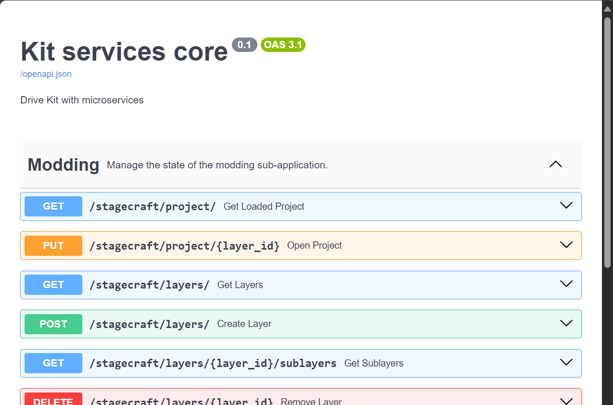
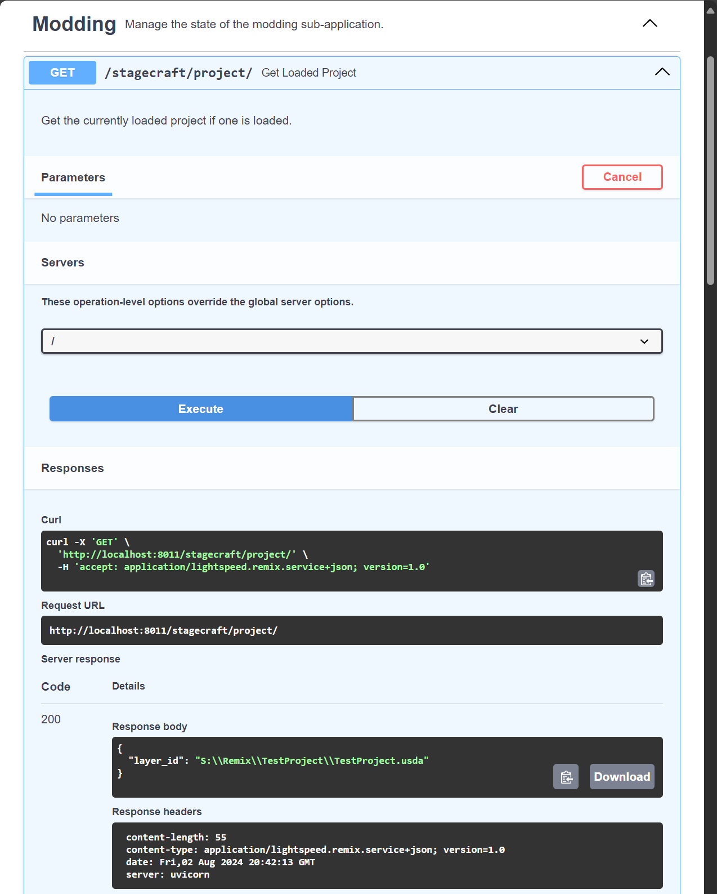

# Использование REST API

REST API RTX Remix позволяет отправлять информацию в Toolkit и получать её оттуда, а также запускать действия в Toolkit
(например, импорт заданного файла и т. п.) с помощью HTTP-запросов.

## Где найти документацию

Документацию по REST API Remix Toolkit можно открыть двумя способами: **динамическую** (Live) и **статическую**
(Static).

Чтобы посмотреть список конечных точек (endpoints), предоставляемых REST API RTX Remix Toolkit, выполните следующие
действия:

### Динамическая документация:

Динамическая документация создаётся при запуске Remix Toolkit и позволяет тестировать конечные точки прямо из самой
документации.

1) Запустите Remix Toolkit.
2) Откройте в браузере адрес [`http://127.0.0.1:8011/docs#/`](http://127.0.0.1:8011/docs#/) или
   [`http://localhost:8011/docs#/`](http://localhost:8011/docs#/).

   **_ПРИМЕЧАНИЕ: оба адреса равнозначны и взаимозаменяемы_**

   В приведённых адресах используется базовый URL REST API по умолчанию: хост `127.0.0.1` и порт `8011`. Базовый URL
   задаётся настройками Kit `/exts/omni.services.transport.server.http/host` и
   `/exts/omni.services.transport.server.http/port`. Если какая-либо из них была изменена перед запуском, измените
   адрес документации в соответствии с заданными хостом/IP и портом.

   Например, чтобы оставить хост по умолчанию и перенести REST API на порт `9000`, запустите Toolkit так:

   ```bash
   ./lightspeed.app.trex.bat --/exts/omni.services.transport.server.http/port=9000
   ```

### Статическая документация:

Для статической документации не нужно устанавливать и запускать Remix Toolkit.

1) Откройте [`страницу документации API`](https://docs.omniverse.nvidia.com/kit/docs/rtx_remix/latest/docs/howto/learning-restapi-docs.html).

## Как читать документацию

Открыв сайт документации, вы увидите список доступных конечных точек. Каждая строка — это уникальная конечная точка
(HTTP-метод + URL) с определённым назначением.

Если щёлкнуть по строке, появится подробная информация о конечной точке: ожидаемые параметры пути, параметры запроса,
тело запроса и т. д.



### Версионирование конечных точек

REST API Remix Toolkit использует заголовок версии, чтобы версионировать каждую конечную точку отдельно. Выпадающий
список доступных заголовков версий находится в подробностях конечной точки, в подразделе `Successful Response` раздела
`Responses`. Заголовок должен иметь следующий формат:

```text
application/lightspeed.remix.service+json; version=1.0
```

## Тестирование конечных точек

Конечные точки легко тестировать прямо в документации. Для этого:

1) Разверните конечную точку, которую хотите протестировать.
2) Нажмите кнопку `Try it now`.
3) Заполните обязательные параметры и тело запроса.
4) Нажмите кнопку `Execute`.
5) В разделе `Responses` найдите подраздел `Server response`.
6) Там будут код ответа (`Code`) и подробности (`Details`) для отправленного запроса.



***
<sub> Хотите оставить отзыв о документации RTX Remix? [Нажмите здесь](https://github.com/NVIDIAGameWorks/rtx-remix/issues/new?assignees=nvdamien&labels=documentation%2Cfeedback%2Ctriage&projects=&template=documentation_feedback.yml&title=%5BDocumentation+feedback%5D%3A+) </sub>
