# Знакомство с Toolkit

Работа над проектом RTX Remix обычно проходит три ключевых этапа: [настройка проекта](#настройка-проекта),
[создание мода](#создание-мода) и [упаковка мода](#упаковка-мода). На странице «Modding» в приложении для каждого из
этих этапов есть отдельная вкладка.

***

## Настройка проекта

Вкладка `Project Setup` в основном используется для управления загруженным в данный момент слоем захвата: остальные
этапы настройки берёт на себя мастер проектов.

```{seealso}
Подробные сведения о мастере проектов и процессе создания проекта см. в разделе
[Создание нового проекта](../gettingstarted/learning-toolkitsetup.md#создание-нового-проекта).
```

***

## Создание мода

Вкладка `Asset Replacements` — основное рабочее пространство для создания мода. На ней расположены различные панели,
позволяющие просматривать и редактировать всевозможные данные мода. В следующих разделах эти панели описаны подробно.

### Панель Layers

Панель Layers (слои) — мощный инструмент для управления слоями проекта. Слои помогают упорядочить и разделить разные
аспекты мода, упрощают совместную работу и позволяют редактировать отдельные элементы, не затрагивая остальные.

Для эффективной работы со слоями рекомендуется придерживаться правил из раздела
[Организация проекта с помощью слоёв](learning-bestpractices.md#организация-проекта-с-помощью-слоёв).

```{seealso}
Поначалу слои USD могут показаться нелогичными, особенно тем, кто не знаком с их поведением. В отличие от
традиционных иерархий, где дочерние слои обычно переопределяют свойства родительских, слои USD работают по принципу
агрегации: родительские слои имеют более сильное влияние (более сильное «мнение», opinion strength), чем дочерние, и
именно они в итоге определяют, какое значение получит свойство.

Чтобы глубже разобраться в слоях и композиционных дугах (composition arcs), см. документацию
[OpenUSD Layer Stack](https://openusd.org/release/glossary.html#usdglossary-layerstack).
```

Панель Layers предоставляет следующие возможности:

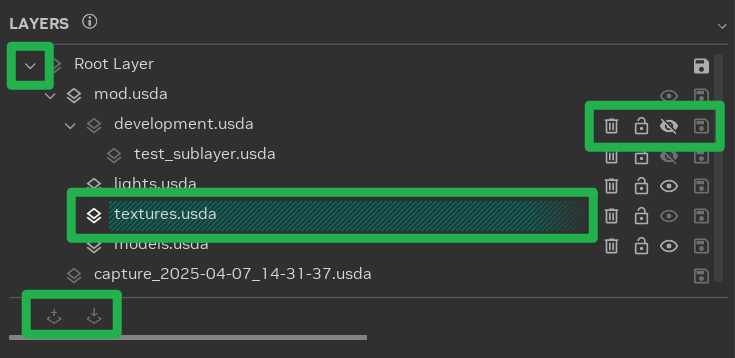

* **Разворачивание слоёв**: слои могут рекурсивно состоять из подслоёв, образуя иерархическое дерево. Если развернуть
  элемент слоя, будут видны его подслои.
* **Действия со слоями**: со слоями можно выполнять ряд действий. Для некоторых слоёв часть действий может быть
  недоступна; при наведении на значок появится подсказка с объяснением ограничения.
* **Выбор целевого слоя редактирования (Edit Target)**: целевой слой редактирования, отмеченный бирюзовым штрихованным
  фоном, — это слой, в который записываются изменения сцены. Чтобы назначить его, нажмите значок **Edit Target**  у нужного слоя.
* **Создание и импорт подслоёв**: чтобы создать или импортировать подслой, сначала выберите подходящий слой, а затем
  нажмите значок **Create Layer**  или **Import Layer**  в нижней части панели. Эти кнопки активны, только когда выбран слой, для которого действие допустимо.
* **Контекстное меню**: контекстное меню панели Layers (открывается правой кнопкой мыши) содержит дополнительные
  действия со слоями, например перенос содержимого слоя.

```{tip}
Полоса прокрутки внизу каждой панели позволяет прокручивать её по горизонтали и менять высоту панели, чтобы видеть
больше её содержимого.
```

***

### Панель Bookmarks

Закладки (Bookmarks) — мощный механизм быстрого перехода к определённым местам сцены. С их помощью можно отмечать важные
объекты или группировать составные части крупных объектов.

Если использовать закладки вместе с тегами Stage Manager, навигация по сцене станет удобнее, а важные ассеты будет
легко отслеживать.

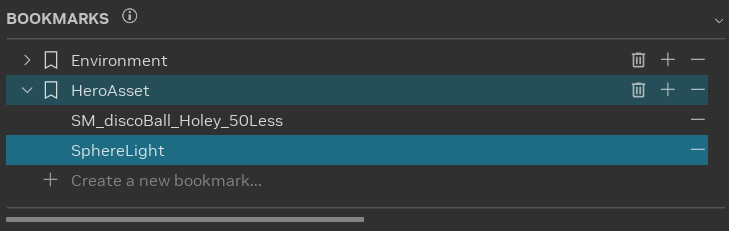

Чтобы создать закладку, выберите пункт «Create a new bookmark...» и добавьте в неё элементы. По умолчанию в новую
закладку добавляются все выделенные в данный момент элементы. Чтобы добавить другие элементы, выделите нужные объекты и нажмите значок **Add Item** .

Удалить элементы из закладки просто: выберите закладку и нажмите значок **Remove Item** .

Чтобы полностью удалить закладку, нажмите значок **Delete Bookmark** .

Закладки можно вкладывать друг в друга. Для этого просто перетащите закладку в целевую закладку.

```{tip}
На панели Bookmarks используется понятие «вторичного» выделения. Если закладка выбрана, а в сцене выделена только
часть её элементов, закладка подсвечивается бледным цветом. Если же в сцене выделены все элементы закладки, она
подсвечивается более ярким цветом.

Щелчок по закладке выделяет все входящие в неё элементы.
```

***

### Панель Selection

Чтобы эффективно пользоваться панелями свойств, важно понимать панель Selection (выделение): содержимое панелей
свойств динамически меняется в зависимости от текущего выделения.

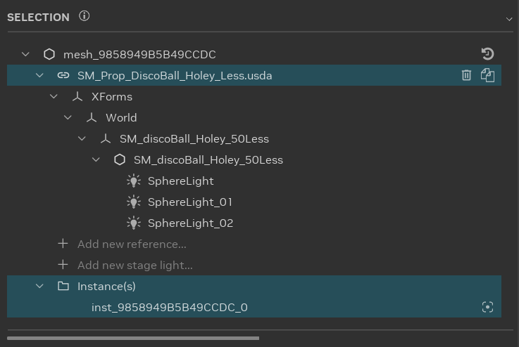

Самое важное на панели Selection — тип выделенного элемента. Тип обозначается значком перед именем элемента:

*  **Mesh** (меш): меши можно трансформировать, и у них должен быть назначенный материал.
*  **Transform** (трансформ, _Xform_): трансформы можно перемещать, вращать и масштабировать, но материалов у них нет.
*  **Light** (источник света): источники света можно трансформировать, и у них есть настраиваемые свойства освещения.
*  **Reference** (ссылка): ссылки можно заменять другими ассетами, дублировать или удалять из сцены. Напрямую трансформировать их нельзя, и свойств материала у них нет.

```{seealso}
Подробнее о ссылках и работе с ними см. в разделе [Настройка замены ассетов](learning-assets.md).

Подробные сведения о добавлении и редактировании источников света см. в разделе
[Переосвещение игры](learning-lighting.md).
```

***

### Свойства объекта

Панели свойств — [Object Properties](#свойства-объекта) (свойства объекта) и
[Material Properties](#свойства-материала) (свойства материала) — самые используемые компоненты RTX Remix Toolkit. Они
занимают центральное место в работе над модом и позволяют изменить практически любой аспект визуальных элементов игры.
С их помощью можно заменять исходные меши игры новыми ассетами, настраивать все свойства материалов, включая назначение
текстур, и менять параметры любых источников света в сцене. Кроме того, панели свойств позволяют трансформировать меши
(перемещать, вращать и масштабировать), то есть управлять размещением и внешним видом объектов в обновлённом игровом
мире. Хорошее понимание этих панелей необходимо, чтобы воплощать творческие замыслы и добиваться нужного качества
изображения в проектах RTX Remix.

Панель Object Properties позволяет изменять атрибуты объектов сцены. Её содержимое динамически подстраивается под
свойства выделенных объектов.

Например:

* **Выделена ссылка**: панель показывает путь к файлу ссылки. Эти свойства позволяют добавлять, удалять и заменять
  ссылки в моде.

  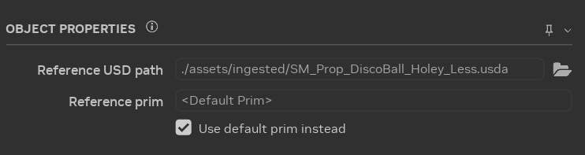

* **Выделен трансформируемый элемент (XFormable)**: отображаются свойства трансформации. С их помощью можно менять
  положение, поворот и масштаб объекта в 3D-пространстве.

  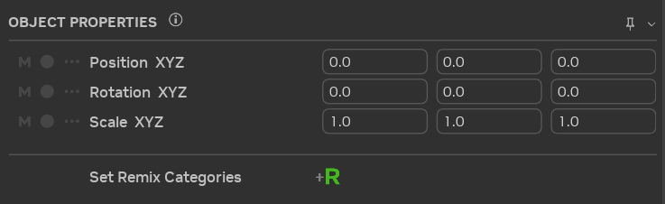

* **Выделен источник света**: панель показывает свойства источника света. Они позволяют менять его параметры, например
  цвет и интенсивность.

  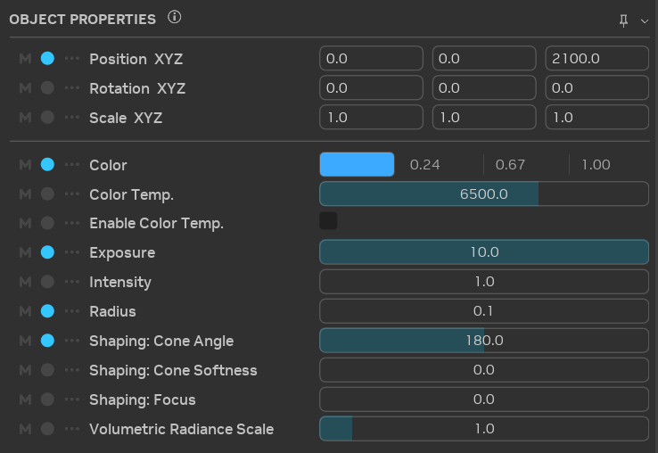

* Кроме того, на этой панели можно назначать объектам сцены категории рендеринга (Render Categories), которые влияют на
  то, как RTX Remix Runtime их отрисовывает.

***

### Свойства материала

Панель Material Properties позволяет изменять атрибуты материалов сцены. На ней отображаются входные параметры шейдера,
определённые выбранным MDL-файлом.

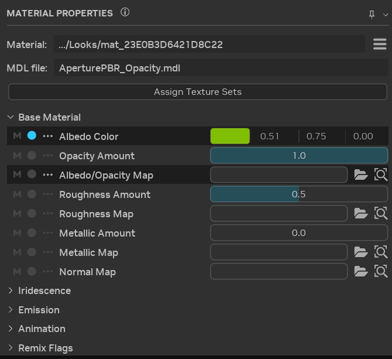

На этой же панели можно переключать материал между полупрозрачным и непрозрачным состоянием, в зависимости от
характеристик исходного материала.

Кроме того, можно назначить материалу полный набор текстур, перетащив его мышью или нажав кнопку «Assign Texture Set».

***

### Дополнительные возможности панелей свойств

#### Закрепление свойств

Текущее выделение можно закрепить на панели свойств, нажав значок булавки в её правом верхнем углу. Тогда панель
свойств останется открытой и будет показывать определённый элемент, даже если в сцене выделяются другие объекты.

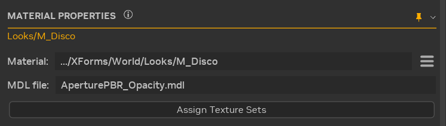

#### Состояние атрибута

У каждого атрибута на панели свойств есть несколько индикаторов состояния, которые сразу показывают, в каком состоянии
находится выделение.

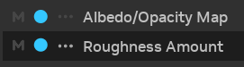

* Значок **Mixed Value**  показывает, различаются ли значения атрибута у выделенных объектов. Если у всех выделенных объектов значение одинаковое, значок неактивен. Если значения различаются, значок становится ярким и цветным. При наведении на него появляется подсказка с подробностями о выделении.
* Значок-кружок показывает, совпадает ли значение атрибута со значением по умолчанию. Если значение стандартное, значок неактивен. Если оно отличается от значения по умолчанию, значок становится ярким и цветным. Щелчок по значку сбрасывает значение к значению по умолчанию. При наведении появляется подсказка с информацией о выделении.
* Значок **Overrides Menu**  и затемнённый фон показывают, переопределён ли атрибут. Если атрибут переопределён, значок становится ярким и цветным, а фон темнеет. Если нет, значок неактивен, а фон остаётся обычного цвета. Щелчок по значку открывает меню, в котором можно удалить все переопределения или переопределения из определённых слоёв.

#### Копирование и вставка значений

Удобный способ переносить значения между объектами — контекстное меню на панели свойств. Если щёлкнуть правой кнопкой
по выделенным свойствам, появится контекстное меню со следующими пунктами:

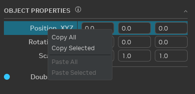

* `Copy All`: копирует в буфер обмена все элементы дерева независимо от текущего выделения, в том числе элементы в
  свёрнутых группах.
  ```{note}
  `OBJECT PROPERTIES` и `MATERIAL PROPERTIES` — это два отдельных дерева, и копировать из обоих одновременно нельзя.
  ```
* `Copy Selected`: копирует в буфер обмена выделенные элементы. Если выделена группа, выделение распространяется на все
  её дочерние элементы.
* `Paste All`: если в буфере обмена есть данные, совместимые с какими-либо элементами дерева, этот пункт становится
  активным и вставляет соответствующие элементы из буфера.
* `Paste Selected`: работает так же, как `Paste All`, но вставляет значения только в выделенные элементы.

```{important}
Это контекстное меню позволяет переносить одни и те же атрибуты между разными объектами, но не между разными
атрибутами одного объекта.
```

***

### Stage Manager

Stage Manager в RTX Remix Toolkit — мощный инструмент для управления данными сцены (stage) и их наглядного
отображения.

Вкладки вверху позволяют удобно переключаться между разными представлениями данных сцены. У каждой вкладки свой набор
фильтров и столбцов, которые можно настроить под свои задачи. Благодаря этому данные можно группировать так, чтобы в
сцене было проще разбираться и ею было удобнее управлять.

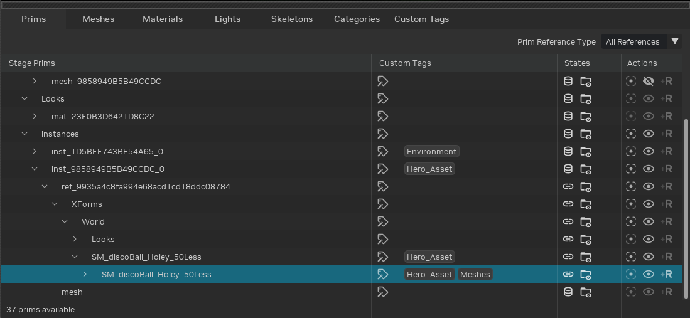

### Производительность

Stage Manager автоматически обновляется при изменении данных сцены. Обновления выполняются асинхронно и не блокируют
интерфейс. Однако при очень большом количестве примов производительность может снизиться, и Stage Manager начнёт
работать медленнее.

Если Stage Manager начинает мешать работе, его можно отключить в разделе
[Optional Features](../toolkitinterface/remix-toolkitinterface-layouttab.md#настройка-мода), доступном через меню-«гамбургер».
Это позволяет управлять использованием Stage Manager, чтобы он оставался помощником, а не помехой.

```{important}
Настройки дополнительных функций сохраняются между перезапусками RTX Remix Toolkit, поэтому включать или отключать
Stage Manager каждый раз заново не нужно.
```

***

## Упаковка мода

Вкладка `Mod Packaging` — основное место для подготовки мода к распространению среди других игроков.

```{seealso}
Подробные инструкции по упаковке мода и публикации см. в разделе [Упаковка мода](learning-packaging.md).
```

***

## Телеметрия

RTX Remix Toolkit собирает анонимные данные об использовании, чтобы мы понимали, как пользователи работают с
приложением, и видели, что можно улучшить. Эти данные помогают делать Toolkit удобнее и своевременно исправлять
проблемы.

Данные телеметрии собирает расширение `omni.flux.telemetry.core`. Оно включено по умолчанию, но его можно отключить,
переопределив настройку `/exts/omni.flux.telemetry.core/enabled`.

```{seealso}
Как переопределить настройку телеметрии, см. в разделе [Переопределение настроек](#переопределение-настроек).
```

***

## Расширенные возможности

```{warning}
В следующих разделах описаны возможности для опытных пользователей.

Неправильное использование этих возможностей может привести к сбою приложения или его непредсказуемому поведению.
```

***

### Альтернативные исполняемые файлы приложения

В составе RTX Remix Toolkit есть много альтернативных исполняемых файлов для разных целей.

Несколько примеров перечислено ниже.

Все исполняемые файлы приложения находятся в
[каталоге установки RTX Remix Toolkit](../remix-faq.md#как-найти-папку-установки-rtx-remix-toolkit).

| Приложение                                 | Исполняемый файл                          | Описание                                                                                                                                                                  |
|--------------------------------------------|-------------------------------------------|---------------------------------------------------------------------------------------------------------------------------------------------------------------------------|
| Релизная версия RTX Remix Toolkit          | `lightspeed.app.trex.bat`                 | Стандартная версия RTX Remix Toolkit для рабочего использования.                                                                                                          |
| Версия RTX Remix Toolkit для разработчиков | `lightspeed.app.trex_dev.bat`             | Специальная версия RTX Remix Toolkit для разработки. В ней доступны дополнительные меню и настройки, которых нет в релизной версии.                                        |
| Автономный CLI импорта RTX Remix           | `lightspeed.app.trex.ingestcraft.cli.bat` | Инструмент командной строки для импорта ассетов в RTX Remix Toolkit без запуска полного RTX Remix Toolkit.                                                                |

```{seealso}
Подробнее об автономном приложении импорта см. в разделе
[Использование CLI инструмента импорта (для опытных пользователей)](learning-ingestion.md#использование-cli-инструмента-импорта-для-опытных-пользователей).
```

***

### Переопределение настроек

В RTX Remix Toolkit предусмотрен механизм переопределения некоторых настроек приложения. Это особенно полезно тем, кому
нужна конфигурация, отличающаяся от стандартной.

Чтобы переопределить настройку:

1. Откройте командную строку и перейдите в
   [каталог установки RTX Remix Toolkit](../remix-faq.md#как-найти-папку-установки-rtx-remix-toolkit).

   Например, выполните следующую команду:

    ```bash
    cd "C:\Program Files\NVIDIA Corporation\RTX Remix"
    ```

2. Запустите исполняемый файл приложения с нужными настройками.

   Например, чтобы отключить телеметрию в релизной версии RTX Remix Toolkit, выполните команду:

    ```bash
    ./lightspeed.app.trex.bat --/exts/omni.flux.telemetry.core/enabled=0
    ```

   Подробнее о разных исполняемых файлах приложения см. в разделе
   [Альтернативные исполняемые файлы приложения](#альтернативные-исполняемые-файлы-приложения).

#### Получение списка доступных настроек

Чтобы получить список доступных настроек:

1. Откройте версию RTX Remix Toolkit для разработчиков (подробнее см. в разделе
   [Альтернативные исполняемые файлы приложения](#альтернативные-исполняемые-файлы-приложения)).

2. Откройте окно `Script Editor`:
    1. Откройте меню `Window`.
    2. Выберите `Script Editor`.

   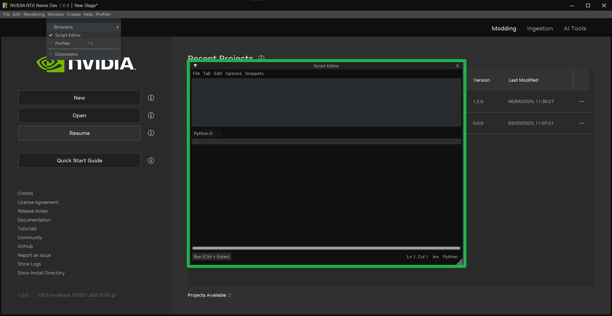

3. Скопируйте в окно `Script Editor` следующий скрипт:

   ```python
   import carb
   print(carb.settings.get_settings().get("/"))
   ```

4. Нажмите кнопку `Run` в левом нижнем углу.

5. Результат появится в верхней части окна `Script Editor` и в командной строке, из которой была запущена версия RTX
   Remix Toolkit для разработчиков.

```{note}
Из-за большого количества настроек вывод, скорее всего, окажется очень объёмным. Чтобы его было легче читать, можно
его отформатировать.

Если запрашивать отдельные подразделы настроек, вывод станет значительно короче.

Например, чтобы получить настройки расширения `omni.flux.telemetry.core`, выполните ту же команду, заменив `/` на
`/exts/omni.flux.telemetry.core`.
```

***
<sub> Хотите оставить отзыв о документации RTX Remix? [Нажмите здесь](https://github.com/NVIDIAGameWorks/rtx-remix/issues/new?assignees=nvdamien&labels=documentation%2Cfeedback%2Ctriage&projects=&template=documentation_feedback.yml&title=%5BDocumentation+feedback%5D%3A+) </sub>
