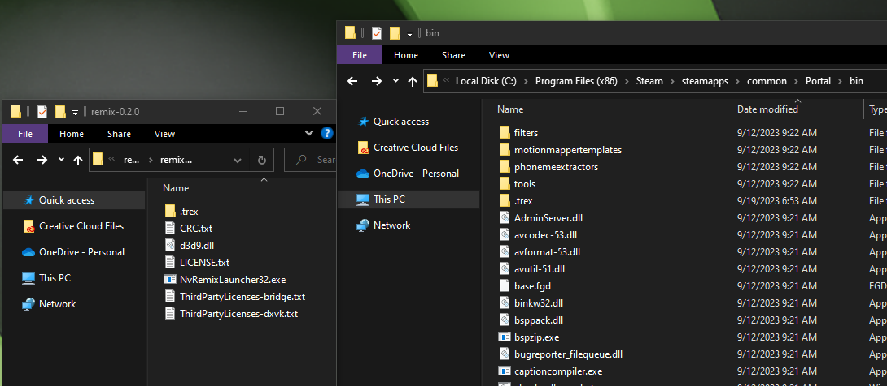
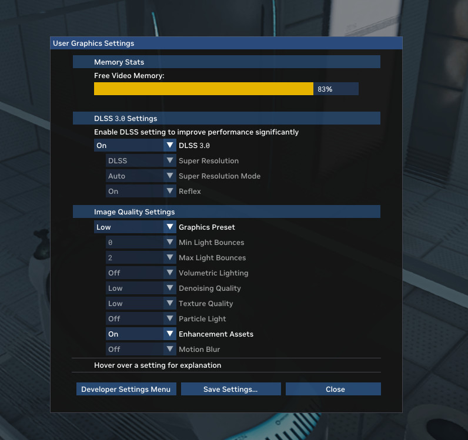

# Установка RTX Remix Runtime

RTX Remix Runtime нужен, чтобы играть в моды RTX Remix. **Он также устанавливается вместе с Toolkit.**

## Определение платформы игры

Сначала нужно определить, для какой платформы собрана игра, то есть 32- или 64-битная она. Большинство игр на D3D9
32-битные, но модифицированные или перекомпилированные игры могут быть 64-битными. Если вы не уверены, запустите игру,
откройте `Task Manager` (Диспетчер задач), перейдите на вкладку `Details` (Подробности), щёлкните правой кнопкой по
заголовку столбца и выберите `Select columns` (Выбрать столбцы), чтобы включить столбец `Platform` (Платформа). Затем
посмотрите значение для исполняемого файла игры.

## Рантайм в составе RTX Remix Toolkit

Если у вас установлен RTX Remix Toolkit, рантайм уже есть в системе.

Он находится в следующей папке:
<code>
[<INSTALL_DIRECTORY>](../remix-faq.md#как-найти-папку-установки-rtx-remix-toolkit)\deps\remix_runtime\runtime
</code>

Найдя этот каталог, установите рантайм для своей игры по [инструкции ниже](#установка-rtx-remix-runtime-для-вашей-игры).

## Загрузка с GitHub

Чтобы получить доступ к новейшим (возможно, нестабильным) возможностям, можно установить RTX Remix Runtime с GitHub.

Скачайте файлы RTX Remix Runtime из
[последнего релиза на GitHub](https://github.com/NVIDIAGameWorks/rtx-remix/releases/).

Для 32-битных игр скачайте пакет `rtx-remix-for-x86-games-...`, для 64-битных — пакет `rtx-remix-for-x64-games-...`.
Скачанный zip-архив содержит файлы, необходимые для подготовки поддерживаемой игры к работе с RTX Remix. Распаковав
его, установите рантайм для своей игры по [инструкции ниже](#установка-rtx-remix-runtime-для-вашей-игры).

```{tip}
Исходники DXVK-Remix и предварительные сборки выложены на GitHub для тех, кто хочет получать экспериментальные
обновления рендерера ещё до их выхода в полном релизе рантайма:

[dxvk-remix](https://github.com/NVIDIAGameWorks/dxvk-remix/).
```

## Установка RTX Remix Runtime для вашей игры

### 32-битные игры

Найдя каталог рантайма или скачав и распаковав пакет, вы увидите следующие файлы:

```text
rtx-remix-for-x86-games
├── d3d9.dll                    # 32-битный клиент моста (Bridge)
├── .trex/
│   ├── NvRemixBridge.exe       # 64-битный сервер моста (Bridge)
│   ├── d3d9.dll                # 64-битный рендерер Remix / DXVK-Remix
│   └── ... (зависимости рантайма, usd/)
└── .trex_arm64/
    ├── NvRemixBridge.exe       # сервер моста (Bridge) для ARM64
    ├── d3d9.dll                # рендерер Remix / DXVK-Remix для ARM64
    └── ... (зависимости рантайма, usd/)
```

Чтобы подготовить игру, скопируйте содержимое этого каталога в основной каталог игры. Файл `d3d9.dll` и папки `.trex/`
и `.trex_arm64/` должны оказаться рядом с основным исполняемым файлом игры.

```{tip}
Удаление папки `.trex_arm64/` может уменьшить размер мода, но мы не рекомендуем этого делать: это может снизить
производительность на NVIDIA Spark.
```

### 64-битные игры

Найдя каталог рантайма или скачав и распаковав пакет, вы увидите следующие файлы:

```text
rtx-remix-for-x64-games
├── d3d9.dll                    # 64-битная прослойка (shim): выбирает реализацию
├── d3d9_x64.dll                # 64-битный рендерер Remix / DXVK-Remix
├── d3d9_a64ec.dll              # рендерер Remix / DXVK-Remix для ARM64EC
└── ... (зависимости рантайма, usd/)
```

Чтобы подготовить 64-битную игру, скопируйте содержимое пакета в основной каталог игры. Файл `d3d9.dll` и все остальные
файлы и папки должны оказаться рядом с основным исполняемым файлом игры.

```{tip}
Удаление файла `d3d9_a64ec.dll` может уменьшить размер мода, но мы не рекомендуем этого делать: это может снизить
производительность на NVIDIA Spark.
```

### Проверка установки

Когда файлы RTX Remix на месте, запустите игру как обычно. Убедиться, что RTX Remix работает, можно по приветственному
сообщению в верхней части экрана при запуске игры. В нём должно быть написано «Welcome to RTX Remix…» и указаны горячие
клавиши для вызова меню Remix.

```{warning}
Некоторые игры ищут `d3d9.dll` не в каталоге основного исполняемого файла, а в другом месте. Например, игры на движке
Source ищут d3d9.dll в каталоге bin рядом с основным исполняемым файлом игры.
```

```{seealso}
Другие способы проверить, что RTX Remix работает, описаны в разделе
[Обрабатывается ли моя игра через RTX Remix?](../remix-faq.md#обрабатывается-ли-моя-игра-через-rtx-remix)
```

## Поддержка других графических API

Поддержка D3D9 встроена в Remix изначально, но игры на других графических API тоже можно заставить работать с помощью
слоёв трансляции в D3D9. Их нужно получить отдельно. Например, игры на D3D8 можно поддержать с помощью
[D3D8to9](https://github.com/crosire/d3d8to9).

1. Откройте папку с файлами игры, которую хотите модифицировать.
2. Найдите, где лежит исполняемый файл (.exe). Обычно он находится в папке с названием «bin».
3. Скопируйте содержимое папки RTX Remix Runtime в папку с исполняемым файлом (.exe).

   

4. Убедитесь, что файл d3d9.dll из папки RTX Remix заменил файл d3d9.dll в папке игры.
5. Запустите игру. Если рантайм установлен успешно, меню Remix **User Graphics Settings** (пользовательские настройки
   графики) будет открываться по нажатию **Alt + X**.

   

```{tip}
Если возникают проблемы, попробуйте запустить игру в режиме DirectX 7 или ниже.
```

***
<sub> Хотите оставить отзыв о документации RTX Remix? [Нажмите здесь](https://github.com/NVIDIAGameWorks/rtx-remix/issues/new?assignees=nvdamien&labels=documentation%2Cfeedback%2Ctriage&projects=&template=documentation_feedback.yml&title=%5BDocumentation+feedback%5D%3A+) </sub>
