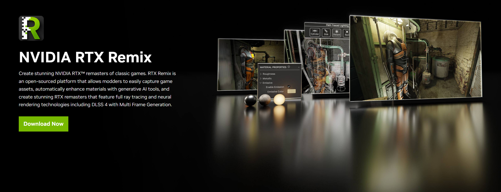

# Установка RTX Remix Toolkit

RTX Remix Toolkit содержит всё необходимое для создания собственных модов RTX Remix, включая сборку RTX Remix Runtime.
Вот как его установить:

```{tip}
Как найти каталог установки RTX Remix Toolkit, см. в разделе
[Как найти папку установки RTX Remix Toolkit?](../remix-faq.md#как-найти-папку-установки-rtx-remix-toolkit)
```

## Установка через NVIDIA App

1. Перейдите на [сайт RTX Remix](https://www.nvidia.com/en-us/geforce/rtx-remix/).
2. Следуя инструкциям, скачайте и установите [NVIDIA App](https://www.nvidia.com/en-us/software/nvidia-app/).
3. Откройте NVIDIA App и установите `RTX Remix`.



## Установка с GitHub

Чтобы получить доступ к новейшим (возможно, нестабильным) возможностям, можно установить RTX Remix Toolkit с GitHub.

### Загрузка готового пакета для разработки

1) Войдите в [GitHub](https://github.com).
2) Откройте страницу запусков
   [Download RTX Remix Toolkit Package](https://github.com/NVIDIAGameWorks/toolkit-remix/actions/workflows/toolkit-package.yml).
3) Откройте самый свежий запуск с зелёной галочкой, артефакт которого называется
   `rtx_remix@...+main...windows-x86_64.release`.
4) На странице **Summary** этого запуска в разделе **Artifacts** нажмите на артефакт, чтобы скачать его в виде ZIP.
5) Распакуйте ZIP по короткому пути, например `C:\rtx_remix`. Имя папки по умолчанию длинное и может упереться в
   ограничение Windows на длину пути.
6) Необязательно: один раз запустите `install.bat` из распакованной папки, чтобы «прогреть» приложения перед первым
   запуском.
7) Запустите `lightspeed.app.trex.bat` из распакованной папки, чтобы открыть Toolkit.

### Сборка из исходников

1) Клонируйте [этот репозиторий](https://github.com/NVIDIAGameWorks/toolkit-remix).
2) Следуйте
   [инструкциям по сборке](https://github.com/NVIDIAGameWorks/toolkit-remix?tab=readme-ov-file#build-instructions) в
   README.

***
<sub> Хотите оставить отзыв о документации RTX Remix? [Нажмите здесь](https://github.com/NVIDIAGameWorks/rtx-remix/issues/new?assignees=nvdamien&labels=documentation%2Cfeedback%2Ctriage&projects=&template=documentation_feedback.yml&title=%5BDocumentation+feedback%5D%3A+) </sub>
