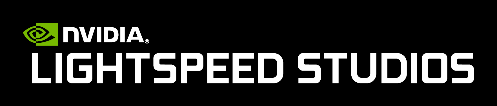

# Что такое RTX Remix?

RTX Remix — это платформа для моддинга, которая позволяет делать ремастеры классических игр на DirectX 8 и 9 с
современной графикой. С её помощью моддеры могут:

* улучшать текстуры с помощью ИИ;
* заменять игровые ассеты высококачественными физически корректными (PBR) моделями;
* добавлять в игры трассировку лучей RTX, DLSS и Reflex.

Проще говоря, это инструмент, который даёт старым играм впечатляющее визуальное обновление.

## Как работает RTX Remix?

RTX Remix состоит из двух основных частей:

1. **RTX Remix Runtime (рантайм):** работает вместе с игрой. Он захватывает игровые сцены, а когда вы играете с модом,
   в реальном времени заменяет старые ассеты обновлёнными и заново освещает игру с помощью трассировки пути
   (path tracing).
2. **RTX Remix Toolkit:** офлайн-редактор, в котором создаются моды. Он помогает настраивать замену ассетов, изменять и
   добавлять источники света и улучшать захваченные текстуры с помощью ИИ-инструментов.

### Подробнее о RTX Remix Runtime

Рантайм состоит из двух компонентов:

* **Remix Bridge (мост):** служит посредником между игрой и отдельной программой `NvRemixBridge.exe`. Мост позволяет
  исходной игре (часто 32-битной) работать в 64-битном режиме и использовать больше системной памяти. Это критически
  важно для рендеринга текстур и мешей высокого разрешения с трассировкой лучей.
* **Renderer (рендерер):** мощный графический движок, который принимает команды отрисовки игры и рендерит всё с
  помощью трассировки пути в реальном времени. Он также подменяет старые игровые ассеты новыми, добавленными в ваш мод,
  и отслеживает, что нужно заменить, по хешам ассетов.

### Подробнее о RTX Remix Toolkit

Toolkit содержит инструменты, с помощью которых легко создавать и добавлять новые игровые объекты, материалы и
источники света. Он построен на экосистеме NVIDIA Omniverse и даёт доступ к продвинутым возможностям, которые помогут
сделать вашу игру по-настоящему красивой.

```{note}
Игровые объекты, добавленные в игру с помощью RTX Remix, не влияют на игровой процесс. Это исключительно визуальные
улучшения.
```

***
<sub> Хотите оставить отзыв о документации RTX Remix? [Нажмите здесь](https://github.com/NVIDIAGameWorks/rtx-remix/issues/new?assignees=nvdamien&labels=documentation%2Cfeedback%2Ctriage&projects=&template=documentation_feedback.yml&title=%5BDocumentation+feedback%5D%3A+) </sub>
