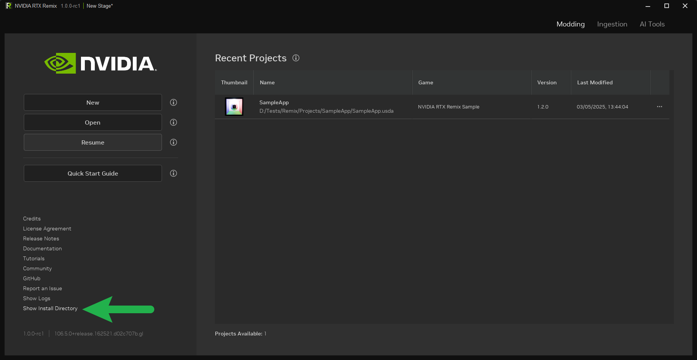
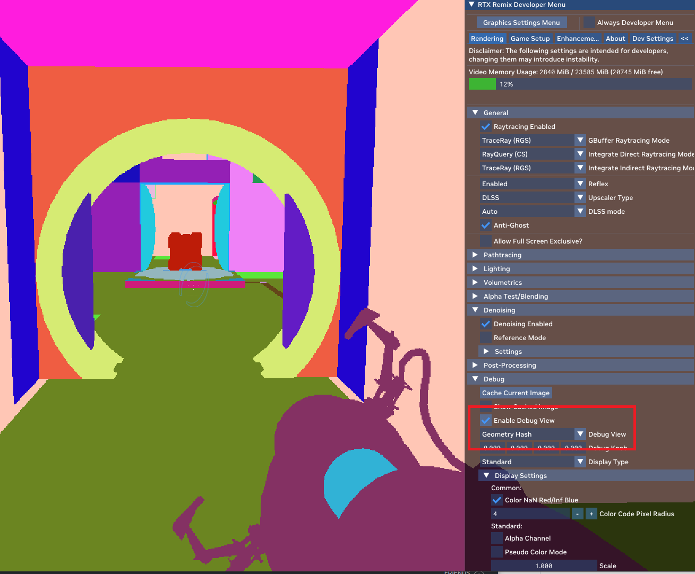

# Часто задаваемые вопросы

## Что такое RTX Remix и чем он отличается от других инструментов для моддинга?

RTX Remix — передовая платформа для моддинга, построенная на NVIDIA Omniverse. Её отличает возможность захватывать
игровые сцены, улучшать материалы с помощью генеративных ИИ-инструментов и эффективно создавать впечатляющие
RTX-ремастеры с трассировкой пути, DLSS и Reflex. В игровые движки, которые изначально поддерживали лишь простые цветовые
текстуры и ассеты с примитивной полигональной детализацией, можно даже добавить современные ассеты с физически точными
материалами и потрясающей детализацией.

Помимо основных возможностей, RTX Remix особенный тем, что позволяет моддерам делать графические ремастеры самых разных
игр по одному и тому же процессу и одним и тем же инструментом — редкость в мире моддинга. Эксперты, освоившие
традиционные инструменты моддинга, могут использовать их вместе с RTX Remix и создавать ещё более впечатляющие моды.

## Как найти папку установки RTX Remix Toolkit?

Расположение папки RTX Remix Toolkit по умолчанию зависит от способа установки.

Проще всего найти её, нажав кнопку «Show Install Directory» на главном экране RTX Remix Toolkit.



Откроется папка установки RTX Remix Toolkit.

## Обрабатывается ли моя игра через RTX Remix?

Вот как проверить, обрабатывает ли RTX Remix содержимое игры, то есть правильно ли подключён рантайм:

1. Откройте меню разработчика.
2. Включите «Enable Debug View».
3. Выберите в списке «Geometry Hash».

* **Скорее всего, подключён:** если изображение похоже на картинку ниже и у объектов стабильные цвета, эти объекты,
  вероятно, можно заменить — значит, рантайм работает.
* **Возможны проблемы:** если цвет меша в этом режиме меняется, при текущих настройках его, возможно, не удастся надёжно
  заменить (хотя обходные пути могут существовать); это может указывать на проблему с конфигурацией.
* **Не подключён:** если ничего не меняется, Remix вообще не обрабатывает содержимое игры, и рантайм, скорее всего,
  подключён неправильно. Попробуйте понизить настройки графики, сменить модель шейдеров или применить другие приёмы,
  чтобы принудительно включить резервный режим фиксированного конвейера.



**Как понимать режим Geometry Hash:**

* Динамические меши (например, частицы и, возможно, анимированные меши) будут менять цвет каждый кадр — это ожидаемо.
* **Анимированные меши:**
    * **Программная анимация (CPU):** скорее всего, будет мерцать.
    * **Аппаратная анимация (GPU):** должна быть стабильной. Некоторые игры позволяют принудительно включить аппаратную
      анимацию в настройках.

```{seealso}
Подробнее о ремастеринге анимированных ассетов см. в разделе
[Анимированные ассеты](howto/learning-assets.md#анимированные-ассеты).
```

## Какую роль играют генеративные ИИ-инструменты для текстур в RTX Remix и как они автоматически улучшают материалы?

RTX Remix предлагает генеративные ИИ-инструменты для автоматического улучшения текстур классических игр. Нейросеть
обучена на огромном разнообразии текстур и умеет анализировать их, определяя, какими свойствами материала они должны
обладать. Она генерирует карты шероховатости и нормалей для имитации реалистичных материалов и увеличивает разрешение
текстур в 4 раза, чтобы обновлённый контент не только выглядел потрясающе, но и сохранял дух оригинальной игры.

## Как RTX Remix использует трассировку лучей при создании ремастеров?

RTX Remix использует полную трассировку лучей (её также называют трассировкой пути) для моделирования поведения света
в виртуальной среде. Это даёт очень реалистичное освещение, отражения и тени, значительно повышая визуальную
привлекательность ремастеров. Трассировка лучей в RTX Remix делает игру более захватывающей и красивой. Кроме того,
с полной трассировкой лучей проще делать ремастер и создавать сцены: когда свет ведёт себя реалистично, заново
осветить игру гораздо легче.

## Какую роль в RTX Remix играет DLSS и как она влияет на производительность?

NVIDIA DLSS 3 использует алгоритмы глубокого обучения для генерации кадров (DLSS Frame Generation) и повышения
разрешения (DLSS Super Resolution), увеличивая производительность при сохранении высокого качества изображения. Это
ключевая технология для полной трассировки лучей, также называемой трассировкой пути (самой реалистичной из доступных
симуляций света), которая используется в передовых играх и блокбастерах. Благодаря DLSS 3 мощные видеокарты RTX могут
выдавать потрясающую картинку без ущерба для плавности и качества изображения.

## Можно ли использовать RTX Remix с любой игрой или только с определёнными?

RTX Remix рассчитан на поддержку широкого круга игр, но уровень совместимости может различаться в зависимости от
сложности ассетов и движка игры. Лучше всего RTX Remix работает с играми на DirectX 8 и 9 с фиксированным конвейером,
такими как Call of Duty 2, Hitman 2: Silent Assassin, Garry's Mod, Freedom Fighters, Need for Speed Underground 2 и
Vampire: The Masquerade – Bloodlines; список совместимых игр от сообщества можно найти на ModDB. Скачайте файл
конфигурации rtx.conf для нужной игры и подходящую версию рантайма RTX Remix — и можно приступать к созданию мода.

Со временем совместимость будет расширяться — отчасти по мере того, как NVIDIA будет выпускать всё более
функциональные версии RTX Remix Runtime (компонента, который отвечает за подключение RTX Remix к играм). Отчасти
совместимость будет улучшаться и благодаря сообществу: в апреле мы открыли исходный код RTX Remix Runtime, чтобы
сообществу было проще вносить код, улучшающий работу RTX Remix с разными играми.

Кроме того, сообщество делает невероятные вещи: встраивает фиксированный конвейер в существующие игры, использует
обёртки для обеспечения совместимости и даже помогает пополнять список совместимых игр на ModDB. Мы призываем сообщество
и дальше работать с нами, расширяя круг игр, с которыми работает RTX Remix. Подробнее о совместимости см. в
соответствующем разделе.

## Я положил рядом с игрой рантайм RTX Remix и файл RTX.conf с ModDB, но RTX Remix не подключается к игре правильно. Что делать?

Многие классические игры отрисовывают не всё через фиксированный конвейер и поэтому могут плохо работать с RTX Remix.
Чтобы лучше разобраться в вопросах совместимости, рекомендуем моддерам прочитать соответствующий раздел текстового
руководства RTX Remix. В некоторых случаях игра может не работать потому, что её техники рендеринга слишком современные
или слишком примитивные. Либо она может требовать нестандартных шагов — например, обёртки, особой структуры файлов,
позволяющей RTX Remix Runtime правильно подключиться к игре, или другой версии игры.

Рекомендуем моддерам изучить ресурсы сообщества на ModDB: таблицу совместимости, файлы rtx.conf с правильными
настройками для каждой игры и описанные пользователями особые шаги, необходимые для нормальной работы той или иной
игры. Эти ресурсы будут становиться лучше по мере их обновления сообществом.

## Может ли RTX Remix сделать ремастер игры с новым освещением и текстурами одним щелчком?

RTX Remix — не решение «в одну кнопку». Создать мод с полной трассировкой лучей в RTX Remix относительно просто, но
если игровые ассеты не обновлены до физически точных материалов, мод, скорее всего, будет выглядеть неправильно: многие
текстуры окажутся одинаково блестящими или матовыми.

PBR-ассеты с физически точными материалами правильно реагируют на реалистичное освещение. Стекло чётко отражает
окружающий мир, ламинат даёт грубые, размытые отражения, а камень, хоть и без видимых отражений, всё равно отражает
свет и влияет на сцену. Без PBR моддер не использует все возможности полной трассировки лучей.

Генеративные ИИ-инструменты для текстур помогут начать переводить устаревшие текстуры в физически точные материалы. Но
самые впечатляющие проекты RTX Remix (такие как Portal With RTX, Portal: Prelude RTX и Half Life 2 RTX: An RTX Remix
Project) наполнены любовно созданными вручную высококачественными ассетами с огромным числом полигонов и реалистичными
материалами. Лучшие художники Blender будут рады возможности переносить в игры свои тщательно проработанные ассеты без
компромиссов в качестве.

В самых амбициозных модах моддеры также настраивают и добавляют в каждую сцену новые источники света, учитывая, как
игра теперь выглядит с реалистичным освещением и тенями. Такое переосвещение позволяет получить все преимущества
источников света с трассировкой пути, сохранив облик оригинальной игры.

В сочетании с традиционными инструментами моддинга, например Hammer Editor от Valve, RTX Remix позволяет делать ещё
более зрелищные моды. Моддеры могут переделывать системы частиц и менять те аспекты игры, с которыми RTX Remix
взаимодействовать не умеет, — например, дизайн уровней, физику и игровой ИИ.

## Как RTX Remix упрощает захват игровых ассетов?

RTX Remix упрощает захват ассетов с помощью интуитивного интерфейса, позволяющего легко захватить игровую сцену и её
ассеты и затем сконвертировать их в OpenUSD. Программа упрощает зачастую сложную задачу захвата моделей, текстур и
других элементов, делая её доступной для моддеров.

## Какие есть яркие примеры игр, получивших ремастер с помощью RTX Remix?

RTX Remix использовался при создании ремастеров нескольких игр, включая Portal With RTX от самой NVIDIA, а также
созданные сообществом Portal: Prelude RTX и находящийся в разработке Half-Life 2 RTX: An RTX Remix Project. Каждый из
этих ремастеров получился потрясающе красивым и захватывающим. Больше примеров возможностей RTX Remix можно найти в
Discord-сообществе RTX Remix.

## Насколько RTX Remix удобен для моддеров с разным уровнем опыта?

RTX Remix рассчитан на опытных моддеров. Интуитивный интерфейс в сочетании с пошаговыми руководствами и уроками
помогает моддерам уверенно пользоваться программой и раскрывать творческий потенциал. Рекомендуем участвовать в
Discord-сообществе RTX Remix, чтобы сотрудничать и учиться друг у друга.

## Сколько времени нужно, чтобы сделать мод в RTX Remix?

Это полностью зависит от моддера. Одни будут активно использовать ИИ и выпускать моды с полной трассировкой лучей и
заменёнными текстурами, но без изменения геометрии и мешей. Другие потратят месяцы на создание идеального ремастера с
ассетами, детализация которых в 20, 30, а в случае Half Life 2 RTX: An RTX Remix Project иногда и в 70 раз выше, чем у
ассетов оригинальной игры.

RTX Remix экономит массу времени: больше не нужно жонглировать десятками инструментов, чтобы модифицировать графику
одной игры. Не нужно быть специалистом по реверс-инжинирингу игр, чтобы добавить в мод RTX Remix полную трассировку
лучей. А в игре с полной трассировкой лучей, где освещение моделируется реалистично, гораздо проще переделывать и заново
освещать сцены, потому что каждый источник света ведёт себя именно так, как вы ожидаете.

Всё сэкономленное время можно потратить на улучшение других аспектов мода или на то, чтобы выпустить его раньше.

## Почему игры с шейдерами сложно перевести на трассировку пути?

```{note}
Это упрощённое объяснение для тех, кто совсем не знаком с компьютерной графикой.
```

Что такое фиксированный конвейер? Представьте, что вы делаете маленькую диораму в обувной коробке и хотите, чтобы фон
выглядел как кирпичная стена. Вы распечатываете фотографию кирпичной стены и приклеиваете её на заднюю стенку коробки.
Просто, легко, отлично работает. Примерно так и работает фиксированный конвейер: поверхность + текстура, вывели на
экран, готово.

Что такое шейдер? А если хочется чего-то поинтереснее? Если нужно больше художественной свободы в оформлении задней
стенки? Можно поставить туда планшет и показывать на экране что угодно. Можно даже написать небольшую программу,
которая определяет, откуда человек смотрит на коробку, и меняет изображение на планшете в зависимости от угла обзора.
Примерно это и делают шейдеры: они получают от приложения кучу произвольных данных, положение камеры и вопрос, какого
цвета должен быть крошечный кусочек объекта.

Пока пиксельный шейдер не выполнится для этого крошечного кусочка объекта при этом конкретном положении камеры, у
объекта фактически нет цвета. Шейдер должен вычислить, каким он должен быть. Причём на выходе шейдер даёт не «сырой»
цвет — в него уже входят освещение и всё, что ещё делает игра.

Но это описание только пиксельных шейдеров. Вершинные шейдеры позволяют планшету менять форму как угодно... и здесь,
пожалуй, метафора начинает разваливаться.

Так почему шейдеры — проблема? Во-первых, шейдеры не требуют стандартизированного описания сцены (положений
поверхностей, камер, источников света и т. д.). Remix нужна эта информация, чтобы воссоздать сцену для трассировки пути,
а стандартного способа извлечь её, который работал бы во всех играх, не существует.

Это можно сделать для каждой игры отдельно, но для каждой игры это немалый объём работы.

Во-вторых, нам нужно знать цвет (и другие свойства материала) каждой поверхности — без вмешательства освещения и
затенения. С пиксельными шейдерами простого способа получить его нет: даже если бы мы могли выполнить шейдер для
каждой поверхности, он не выдал бы нужных нам «сырых» данных о цвете. Возможно, это решаемо с помощью автоматической
обработки шейдеров или если позволить моддерам писать новые шейдеры попадания лучей (ray-hit shaders), заменяющие
функциональность пиксельных шейдеров игры, но чтобы понять, какой подход действительно сработает, нужно больше
экспериментов.

В-третьих, есть вершинные шейдеры — но, к счастью, у нас уже есть экспериментальное решение, которое справляется с
большинством из них.

Когда Remix станет стабильнее и функциональнее, возможно, появится возможность делать ремастеры игр на шейдерах. Я
видел, как сообщество моддеров справлялось с не менее сложными проектами, так что не исключаю этого. Но браться за такие
проекты пока, на мой взгляд, не стоит: сначала нужно сосредоточиться на играх, которые действительно хорошо подходят,
развить и стабилизировать технологию для них и выпустить несколько ремастеров.

## Как оставить NVIDIA отзыв о работе с RTX Remix?

Делитесь любыми отзывами с нами на GitHub RTX Remix. Для этого выполните следующие шаги:

1. Перейдите на страницу [NVIDIA GameWorks RTX Remix](https://github.com/NVIDIAGameWorks/rtx-remix/issues).
2. Нажмите зелёную кнопку «New Issue».
3. Выберите шаблон (Runtime, Documentation, Toolkit, Feature Request) и нажмите «Get Started».
4. Заполните шаблон, указав как можно больше подробностей; приложите файлы и скриншоты.
5. Нажмите зелёную кнопку «Submit new issue».

Мы развиваем RTX Remix, внимательно следя за описанными там проблемами.

***
<sub> Хотите оставить отзыв о документации RTX Remix? [Нажмите здесь](https://github.com/NVIDIAGameWorks/rtx-remix/issues/new?assignees=nvdamien&labels=documentation%2Cfeedback%2Ctriage&projects=&template=documentation_feedback.yml&title=%5BDocumentation+feedback%5D%3A+) </sub>
