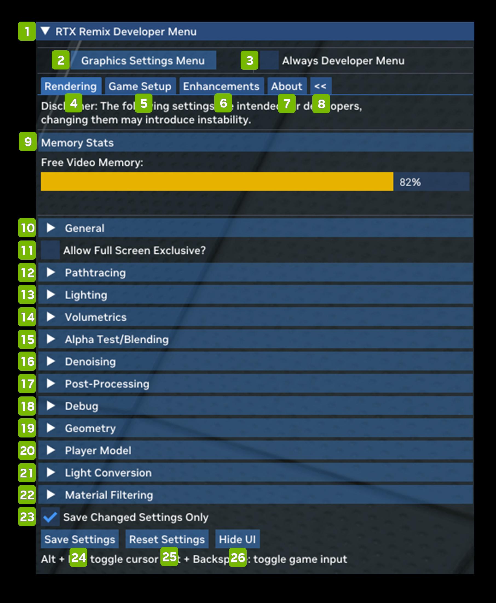

# Меню разработчика

| **№** | **Параметр** | **Описание** |
|---------|---------------------------------------|-----------------------------------------------------------------------------------------------------------------------------------------------------------------------------------------------------------------------------------------------------------------------------------------------------------------------------------------------------------------|
| 1       | RTX Remix Developer Menu              | Меню разработчика Remix |
| 2       | Graphics Settings Menu                | Открывает меню настроек графики |
| 3       | Always Developer Menu Checkbox        | (По умолчанию: выключен) |
| 4       | Rendering Tab                         | Позволяет задавать параметры рендеринга |
| 5       | Game Setup Tab                        |                                                                                                                                                                                                                                                                                                                                                                 |
| 6       | Enhancements Tab                      |                                                                                                                                                                                                                                                                                                                                                                 |
| 7       | About Tab                             | Показывает сведения о приложении Remix |
| 8       | Panel Switch                          | Переключает меню между левой и правой панелью |
| 9       | Memory Stats                          | Показывает объём доступной памяти |
| 10      | General                               | Настройки General в основном касаются производительности и включают различные параметры апскейла и снижения задержки. |
| 11      | Allow Full Screen Exclusive? Checkbox |                                                                                                                                                                                                                                                                                                                                                                 |
| 12      | Pathtracing                           | Pathtracing позволяет как тонко, так и радикально настраивать поведение трассировщика пути. Технические подробности уходят глубоко в теорию трассировки лучей |
| 13      | Lighting                              | Lighting позволяет настраивать глобальную интенсивность освещения и другие параметры, а также глубоко погружаться во внутреннее устройство двух основных алгоритмов освещения рендерера Remix с трассировкой пути: RTXDI и ReSTIR GI. О каждой технологии можно прочитать подробнее. |
| 14      | Volumetrics                           | Volumetrics позволяет настраивать всё, что связано с объёмным туманом в Remix. Включить или выключить объёмный туман можно флажком Enable Volumetric Lighting. Если включить «Enable Legacy Fog Remapping», объёмный туман будет брать данные из исходного тумана игры и стараться повторить его вид. |
| 15      | Alpha Test / Blending                 | Alpha Test / Blending позволяет включать и выключать альфа-тест и альфа-смешивание. |
| 16      | Denoising                             | Denoising позволяет включать и выключать шумоподавление и детально настраивать его параметры. Шумоподавление — критически важная часть современных рендереров с трассировкой пути, и полностью отключать его имеет смысл в основном в учебных целях. Настройка отдельных параметров может улучшить качество изображения или совместимость в зависимости от конкретной игры и мода. |
| 17      | Post-Processing                       | Post-Processing позволяет включать, выключать и настраивать каждый из поддерживаемых в Remix эффектов постобработки. |
| 18      | Debug                                 | Debug даёт доступ к множеству отладочных представлений для поиска проблем с совместимостью, контентом или рендерингом в игре или моде. Подробное руководство по режимам отладочного отображения см. в соответствующем документе. |
| 19      | Geometry                              | Различные параметры совместимости для обработки геометрии. |
| 20      | Player Model                          | Player Model позволяет включать параметры совместимости, связанные с рендерингом персонажа от первого лица, а также тени персонажа от первого лица. |
| 21      | Light Conversion                      | Light Conversion позволяет управлять тем, как игровые источники света преобразуются в физические источники, совместимые с трассировкой пути в рендерере Remix. |
| 22      | Material Filtering                    | Material Filtering позволяет настраивать фильтрацию материалов или рендерить все материалы белыми, чтобы было проще настраивать освещение. |
| 23      | Save Changed Settings Only Checkbox   | (По умолчанию: включён) |
| 24      | Save Settings                         | Сохраняет параметры настроек |
| 25      | Reset Settings                        | Сбрасывает все параметры к значениям по умолчанию |
| 26      | Hide UI                               | Закрывает интерфейс RTX Remix |

***
 Хотите оставить отзыв о документации RTX Remix? [Нажмите здесь](https://github.com/NVIDIAGameWorks/rtx-remix/issues/new?assignees=nvdamien&labels=documentation%2Cfeedback%2Ctriage&projects=&template=documentation_feedback.yml&title=%5BDocumentation+feedback%5D%3A+) 
