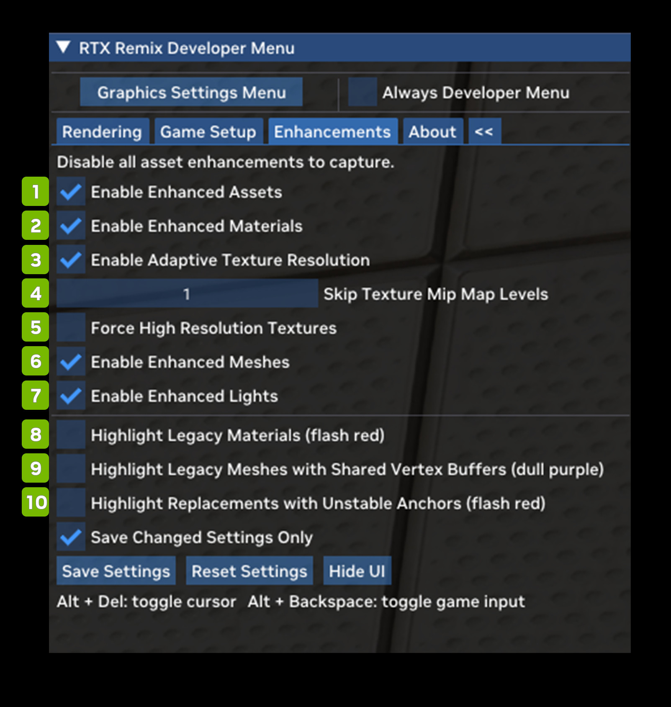

# Вкладка Enhancements

Вкладка Enhancements позволяет оценить влияние и масштаб замен в активном моде. Моды Remix могут заменить практически
любой меш, текстуру или источник света в игре, а это меню позволяет по желанию включать и выключать эти улучшения,
чтобы сравнить их с исходными ассетами.

В верхней части вкладки Enhancements также находится важнейшая кнопка Capture Frame in USD. Нажатие на неё создаёт
захват игрового мира в этом месте и в этот момент и сохраняет его на диск в формате USD. Эти захваты — основа всей
работы по ремастерингу в приложении Remix, где материалы, меши и источники света можно заменять физически корректными
современными аналогами.

| **№** | **Параметр** | **RTX Option**                                  | **Значение по умолчанию** | **Описание** |
|---------|---------------------------------------------------------------------------|-------------------------------------------------|-------------------|---------------------------------------------------------------------------------------------------------------------------------------------------------------------------------------------------------------------------------------------------------------------------------------------------------------------------------------------------------------------------------------------------------------------------------------------------------------------------------------------------------------------------------------------------------------------------------------------------------------------------------------------------------------------------------------------------------------------------------------------------------------------------|
| 1       | Enable Enhanced Assets Checkbox                                           | rtx.enableReplacementAssets                     | Checked           | Глобально включает или выключает всю функциональность улучшенной замены ассетов (материалов, мешей, источников света). |
| 2       | Enable Enhanced Materials Checkbox                                        | rtx.enableReplacementMeshes                     | Checked           | Включает или выключает улучшенные замены мешей.  Действует, только если замена ассетов включена в целом. |
| 3       | Enable Adaptive Texture Resolution Checkbox                               | rtx.enableAdaptiveResolutionReplacementTextures | Checked           | Флаг, включающий или выключающий текстуры-замены с адаптивным разрешением.  В этом режиме текстуры-замены загружаются только до адаптивного минимального MIP-уровня, что снижает расход памяти, — но только если принудительная загрузка текстур-замен высокого разрешения отключена.  Как правило, этот режим всегда должен быть включён, чтобы Remix не исчерпывал память CPU или GPU при загрузке текстур.  Кроме того, эта настройка задаётся при запуске, и её изменение во время работы не применяется. |
| 4       | Skip Texture Mip Map Levels                                               | rtx.minReplacementTextureMipMapLevel            | 0                 | Параметр, задающий минимальный MIP-уровень текстур-замен: чем больше значение, тем ниже качество текстур; 0 — поведение по умолчанию, при котором минимум фактически не ограничивается.  Этот минимум учитывается всегда, пока не включена принудительная загрузка текстур-замен высокого разрешения, то есть независимо от того, включены ли текстуры с адаптивным разрешением.  Обычно его меняют, чтобы глобально снизить качество текстур и уменьшить расход памяти CPU и GPU; как правило, им должна управлять какая-либо настройка качества текстур.  Кроме того, эта настройка задаётся при запуске, и её изменение во время работы не применяется. |
| 5       | Force High Resolution Textures Checkbox                                   | rtx.forceHighResolutionReplacementTextures      | Unchecked         | Флаг, включающий или выключающий принудительную загрузку текстур-замен высокого разрешения.  Этот режим переопределяет все остальные способы вычисления MIP-уровня (адаптивное разрешение и минимальный MIP-уровень) и принудительно задаёт уровень 0, чтобы всегда загружались текстуры наивысшего качества.  Обычно его следует использовать только для отладки или визуального сравнения: этот режим игнорирует любые ограничения памяти CPU или GPU и может привести к её нехватке в системе или в Remix.  Кроме того, эта настройка задаётся при запуске, и её изменение во время работы не применяется. |
| 6       | Enable Enhanced Meshes Checkbox                                           | rtx.enableReplacementMaterials                  | Checked           | Включает или выключает улучшенные замены материалов.  Действует, только если замена ассетов включена в целом. |
| 7       | Enable Enhanced Lights Checkbox                                           | rtx.enableReplacementLights                     | Checked           | Включает или выключает улучшенные замены источников света.  Действует, только если замена ассетов включена в целом. |
| 8       | Highlight Legacy Materials (flash red) Checkbox                           |                                                 | Unchecked         |                                                                                                                                                                                                                                                                                                                                                                                                                                                                                                                                                                                                                                                                                                                                                                           |
| 9       | Highlight Legacy Meshes with Shared Vertex Buffers (dull purple) Checkbox |                                                 | Unchecked         |                                                                                                                                                                                                                                                                                                                                                                                                                                                                                                                                                                                                                                                                                                                                                                           |
| 10      | Highlight Replacements with Unstable Anchors (flash red) Checkbox         | rtx.useHighlightUnsafeAnchorMode                | Unchecked         |                                                                                                                                                                                                                                                                                                                                                                                                                                                                                                                                                                                                                                                                                                                                                                           |

***
 Хотите оставить отзыв о документации RTX Remix? [Нажмите здесь](https://github.com/NVIDIAGameWorks/rtx-remix/issues/new?assignees=nvdamien&labels=documentation%2Cfeedback%2Ctriage&projects=&template=documentation_feedback.yml&title=%5BDocumentation+feedback%5D%3A+) 
