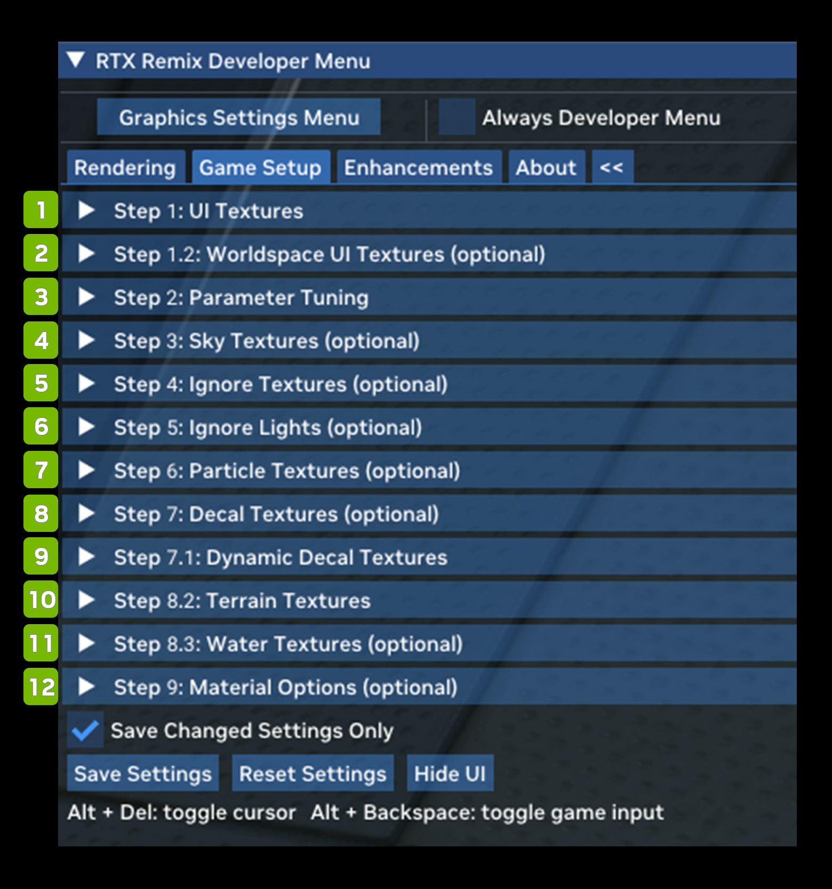
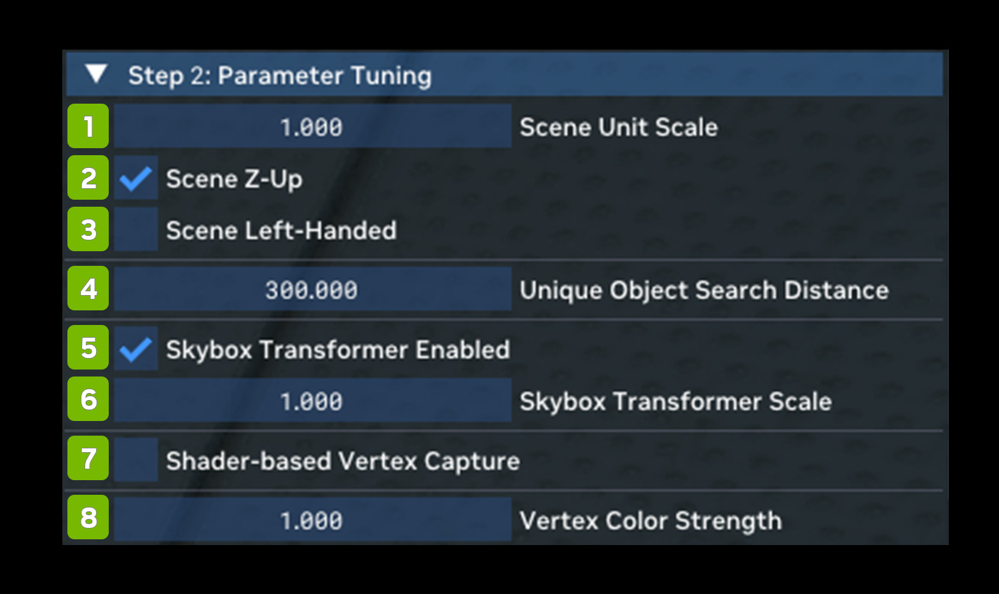
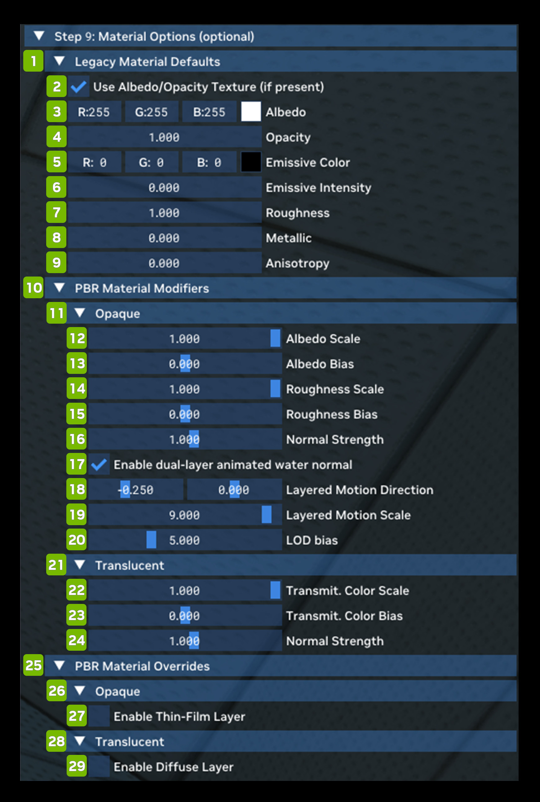

# Вкладка Game Setup

| **№** | **Параметр** | **Описание** |
|---------|---------------------------------------------|----------------------------------------------------------------------------------------------------------------------------------------------------------------------------------------------------------------------------------------------------------------------------------------------------------------------------------------------------------------------------------------------------------------------------------------------------------------------------------------------------------------------|
| 1       | Step 1: UI Textures                         | Позволяет пометить все текстуры, относящиеся к интерфейсу (UI). Тогда Remix сможет пропускать их при трассировке пути и рисовать поверх полноценный интерфейс. |
| 2       | Step 1.2: Worldspace UI Textures (optional) | Как и шаг 1, этот раздел позволяет помечать текстуры интерфейса, но для рендеринга в мировом пространстве (а не в экранном) — то есть элементы интерфейса, которые существуют в 3D-мире игры вместе с персонажами, а не плоским слоем поверх экрана. |
| 3       | Step 2: Parameter Tuning                    | Позволяет указать систему координат игры, чтобы Remix мог правильно сопоставить рендеринг, а захваты в приложении Remix выглядели правильно и с корректным направлением «вверх». Здесь же можно включить захват вершин на основе шейдеров и настроить его параметры. *(См. таблицу параметров настройки ниже)* |
| 4       | Step 3: Sky Textures (optional)             | Позволяет настроить внешний вид неба при трассировке пути, а также параметры совместимости для лучшего распознавания неба. |
| 5       | Step 4: Ignore Textures (optional)          | Позволяет полностью игнорировать определённые объекты по их текстуре. |
| 6       | Step 5: Ignore Lights (optional)            | Позволяет полностью игнорировать определённые источники света по их текстуре. |
| 7       | Step 6: Particle Textures (optional)        | Позволяет пометить определённые текстуры как частицы. Тогда Remix сможет правильно распознавать эти частицы и корректно отрисовывать их при трассировке пути. |
| 8       | Step 7: Decal Textures (optional)           | То же, что шаг 7, но для динамических декалей. Динамические декали используются для эффектов, возникающих во время игры, например следов от пуль. Статические декали — часть карты. |
| 9       | Step 7.1: Dynamic Decal Textures            | То же, что шаг 7, но для динамических декалей. Динамические декали используются для эффектов, возникающих во время игры, например следов от пуль. Статические декали — часть карты. |
| 10      | Step 8.1: Legacy Cutout Textures            | Позволяет пометить определённые текстуры как альфа-тестируемые («cutout»), даже если исходная игра использовала альфа-смешивание для поверхностей с «дырами». Для рендерера с трассировкой пути большая разница, используется альфа-тест или смешивание, поэтому такая разметка помогает правильно отрисовывать эти поверхности. |
| 11      | Step 8.2: Water Textures                    | Как и в случае с декалями, разметка текстур ландшафта (Terrain) помогает Remix правильно рендерить ландшафт. |
| 12      | Step 8.3: Water Textures (optional)         | Как и в случае с декалями и ландшафтом, разметка текстур воды помогает Remix правильно рендерить воду. |
| 13      | Step 9: Material Options (optional)         | Позволяет настроить свойства стандартного материала Remix для трассировки пути. Этот материал используется, если для меша или текстуры игры не найдено замены материала (например, когда мод не загружен или замены выключены). Здесь же можно задать модификаторы для PBR-материалов в целом — как стандартных, так и загруженных из мода, — которые меняют их общие свойства, например шероховатость или масштаб цвета. *(См. таблицу параметров материалов ниже)* |

## Параметры настройки

| **№** | **Параметр** | **RTX Option**           | **Значение по умолчанию** | **Описание** |
|---------|--------------------------------------|--------------------------|-------------------|--------------------------------------------------------------------------------------------------------------------------------------------------------------------------------------------------------------------------------------------------------------------------------------------------------------------------------------------------|
| 1       | Scene Unit Scale                     | rtx.sceneScale           | 1.000             | Задаёт соотношение единицы рендеринга (1 см) и игровой единицы, т. е. sceneScale = 1 см / GameUnit. |
| 2       | Scene Z-Up Checkbox                  |                          | Checked           |                                                                                                                                                                                                                                                                                                                                                  |
| 3       | Scene Left-Handed Checkbox           |                          | Unchecked         |                                                                                                                                                                                                                                                                                                                                                  |
| 4       | Unique Object search Distance        | rtx.uniqueObjectDistance | 300.000           | [см] |
| 5       | Skybox Transformer Enabled Checkbox  |                          | 1.000             |                                                                                                                                                                                                                                                                                                                                                  |
| 6       | Skybox Transformer Scale             |                          | Checked           |                                                                                                                                                                                                                                                                                                                                                  |
| 7       | Shader-based Vertex Capture Checkbox | rtx.useVertexCapture     | Unchecked         | Если включено, в исходный вершинный шейдер внедряется код, захватывающий итоговые положения вершин после шейдинга. Полезно для игр с простыми вершинными шейдерами, которые всё же задают матрицы трансформации фиксированного конвейера. |
| 8       | Vertex Color Strength                | rtx.vertexColorStrength  | 0.6               | Множитель, определяющий, насколько сильно цвет вершин влияет на материалы.  Значение 1 означает, что цвет вершин учитывается полностью (при этом операция текстуры и соответствующие параметры по-прежнему определяют, насколько сильно он смешивается с реальным цветом альбедо), значение 0 — что он полностью игнорируется. |

## Параметры материалов (необязательно)

| **№** | **Параметр** | **RTX Option**                                     | **Значение по умолчанию** | **Описание** |
|---------|--------------------------------------------------|----------------------------------------------------|----------------------|--------------------------------------------------------------------------------------------------------------------------------------------------------------------------------------------------------------------------------------------------------------------------------------------------------------------------------------------------------------------------------------------------------------------------------------------------------------------------|
| **1**   | **Legacy Material Defaults**                     |                                                    |                      |                                                                                                                                                                                                                                                                                                                                                                                                                                                                          |
| 2       | Use Albedo/Opacity Texture (if present) Checkbox | rtx.legacyMaterial.useAlbedoTextureIfPresent       | Checked              | Флаг, определяющий, использовать ли «альбедо»-текстуру (подходящую цветовую текстуру) исходного приложения, если она есть у незаменённых «устаревших» (legacy) материалов. |
| 3       | Albedo                                           | rtx.legacyMaterial.albedoConstant                  | R: 255 G: 255 B: 255 | Константа альбедо по умолчанию для незаменённых «устаревших» материалов. Цвет в пространстве sRGB с гамма-кодированием. |
| 4       | Opacity                                          | rtx.legacyMaterial.opacityConstant                 | 1.0                  | Константа непрозрачности по умолчанию для незаменённых «устаревших» материалов. Диапазон от 0 до 1. |
| 5       | Emissive Color                                   | rtx.legacyMaterial.emissiveColorConstant           | R: 0, G: 0, B: 0     | Константа цвета излучения по умолчанию для незаменённых «устаревших» материалов. Цвет в пространстве sRGB с гамма-кодированием. |
| 6       | Emissive Intensity                               | rtx.legacyMaterial.emissiveIntensity               | 0.0                  | Интенсивность излучения по умолчанию для незаменённых «устаревших» материалов. |
| 7       | Roughness                                        | rtx.legacyMaterial.roughnessConstant               | 0.7                  | Константа перцептивной шероховатости по умолчанию для незаменённых «устаревших» материалов. Диапазон от 0 до 1. |
| 8       | Metallic                                         | rtx.legacyMaterial.metallicConstant                | 0.1                  | Константа металличности по умолчанию для незаменённых «устаревших» материалов. Диапазон от 0 до 1. |
| 9       | Anisotropy                                       | rtx.legacyMaterial.anisotropy                      | 0.0                  | Анизотропия шероховатости по умолчанию для незаменённых «устаревших» материалов. Диапазон от -1 до 1, где 0 — изотропия. |
| **10**  | **PBR Material Modifiers**                       |                                                    |                      |                                                                                                                                                                                                                                                                                                                                                                                                                                                                          |
| **11**  | **Opaque**                                       |                                                    |                      |                                                                                                                                                                                                                                                                                                                                                                                                                                                                          |
| 12      | Albedo Scale Slider                              | rtx.opaqueMaterial.albedoScale                     | 1.0                  | Множитель для всех значений альбедо непрозрачного материала. Только для отладки или разработки. |
| 13      | Albedo Bias Slider                               | rtx.opaqueMaterial.albedoBias                      | 0.0                  | Смещение, добавляемое ко всем значениям альбедо непрозрачного материала. Только для отладки или разработки. |
| 14      | Roughness Scale Slider                           | rtx.opaqueMaterial.roughnessScale                  | 1.0                  | Множитель для всех значений шероховатости непрозрачного материала. Только для отладки или разработки. |
| 15      | Roughness Bias Slider                            | rtx.opaqueMaterial.roughnessBias                   | 0.0                  | Смещение, добавляемое ко всем значениям шероховатости непрозрачного материала. Только для отладки или разработки. |
| 16      | Normal Strength Slider                           | rtx.translucentMaterial.normalIntensity            | 1.0                  | Произвольный множитель силы, применяемый при декодировании нормалей полупрозрачного материала. Только для отладки или разработки. |
| 17      | Enable dual-layer animated water normal Checkbox | rtx.opaqueMaterial.layeredWaterNormalEnable        | Checked              | Флаг, включающий или выключающий слоистые нормали воды.  Учтите, что для отрисовки в этом режиме объекты должны быть правильно классифицированы как анимированная вода. |
| 18      | Layered Motion Direction Sliders                 | rtx.opaqueMaterial.layeredWaterNormalMotion        | -0.250, 0.0          | Вектор движения по осям U и V текстуры, применяемый для слоистой воды.  Действует, только если включены слоистые нормали воды (и объект правильно классифицирован как анимированная вода). |
| 19      | Layered Motion Scale  Slider                     | rtx.opaqueMaterial.layeredWaterNormalMotionScale   | 9.000                | Множитель вектора движения слоистых нормалей воды.  Действует, только если включены слоистые нормали воды (и объект правильно классифицирован как анимированная вода). |
| 20      | LOD bias  Slider                                 | rtx.opaqueMaterial.layeredWaterNormalLodBias       | 5.000                | Смещение уровня детализации (LoD bias) при выборке из карты нормалей слоистой воды для второго слоя детализации.  Обычно значение должно быть больше 0, чтобы выбирался более размытый MIP-уровень: так низкочастотные вариации нормалей накладываются на высокочастотные вариации обычной карты нормалей.  Действует, только если включены слоистые нормали воды (и объект правильно классифицирован как анимированная вода). |
| **21**  | **Translucent**                                  |                                                    |                      |                                                                                                                                                                                                                                                                                                                                                                                                                                                                          |
| 22      | Transmit. Color Scale Slider                     | rtx.translucentMaterial.transmittanceColorScale    | 1.0                  | Множитель для всех значений цвета пропускания (transmittance) полупрозрачного материала. Только для отладки или разработки. |
| 23      | Transmit. Color Bias Slider                      | rtx.translucentMaterial.transmittanceColorBias     | 0.0                  | Смещение, добавляемое ко всем значениям цвета пропускания непрозрачного материала. Только для отладки или разработки. |
| 24      | Normal Strength Slider                           | rtx.opaqueMaterial.normalIntensity                 | 1.0                  | Произвольный множитель силы, применяемый при декодировании нормалей непрозрачного материала. Только для отладки или разработки. |
| **25**  | **PBR Material Overrides**                       |                                                    |                      |                                                                                                                                                                                                                                                                                                                                                                                                                                                                          |
| **26**  | **Opaque**                                       |                                                    |                      |                                                                                                                                                                                                                                                                                                                                                                                                                                                                          |
| 27      | Enable Thin-Film Layer Checkbox                  | rtx.legacyMaterial.alphaIsThinFilmThickness        | Unchecked            | Флаг, определяющий, считать ли альфа-канал источника альбедо толщиной тонкой плёнки у незаменённых «устаревших» материалов. |
| **28**  | **Translucent**                                  |                                                    |                      |                                                                                                                                                                                                                                                                                                                                                                                                                                                                          |
| 29      | Enable Diffuse Layer Checkbox                    | rtx.translucentMaterial.enableDiffuseLayerOverride | Unchecked            | Флаг, принудительно включающий диффузный слой полупрозрачного материала. Только для отладки или разработки. |

***
 Хотите оставить отзыв о документации RTX Remix? [Нажмите здесь](https://github.com/NVIDIAGameWorks/rtx-remix/issues/new?assignees=nvdamien&labels=documentation%2Cfeedback%2Ctriage&projects=&template=documentation_feedback.yml&title=%5BDocumentation+feedback%5D%3A+) 
