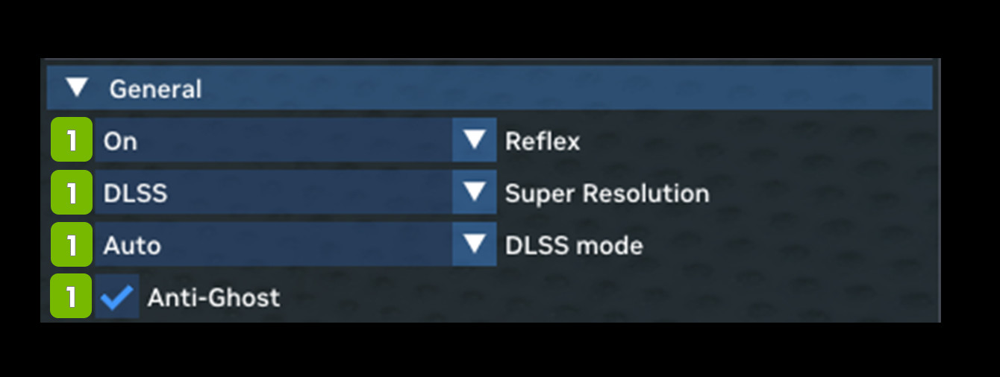

# Общие настройки (General)

Настройки General в основном касаются производительности и включают различные параметры апскейла и снижения задержки.

| **№**   | **Параметр**              | **RTX Option** | **Значение по умолчанию** | **Описание** |
|---------|---------------------------|----------------|---------------------------|--------------|
| **1**   | **General**               |                |                   |                                                                                                                                                                                                                                                                                                                 |
| 2       | Reflex Dropdown           | rtx.reflexMode | On                | Выбор режима Reflex для минимизации задержки ввода; режим Boost может дополнительно снижать задержку за счёт повышения частот GPU, когда узким местом является CPU. Варианты: On, Off, Boost  **ПРИМЕЧАНИЕ:** при значении «Off» инициализация всё равно будет предпринята. Чтобы полностью отключить Reflex, используйте параметр RTX **rtx.isReflexEnabled**. |
| 3       | Super Resolution Dropdown |                | DLSS              | Варианты: None, DLSS, NIS, TAA-U |
| 4       | DLSS Mode Dropdown        |                | Auto              | Варианты: Ultra Performance, Performance, Balance  Quality, Auto, Full Resolution |
| 5       | Anti-Ghost Checkbox       |                | Checked           |                                                                                                                                                                                                                                                                                                                 |

***
 Хотите оставить отзыв о документации RTX Remix? [Нажмите здесь](https://github.com/NVIDIAGameWorks/rtx-remix/issues/new?assignees=nvdamien&labels=documentation%2Cfeedback%2Ctriage&projects=&template=documentation_feedback.yml&title=%5BDocumentation+feedback%5D%3A+) 
