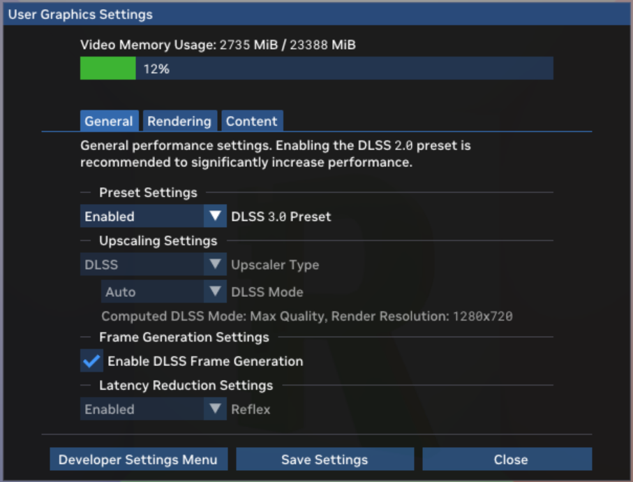
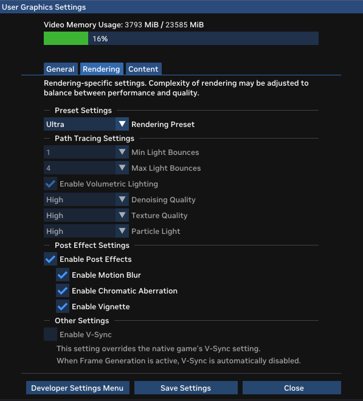
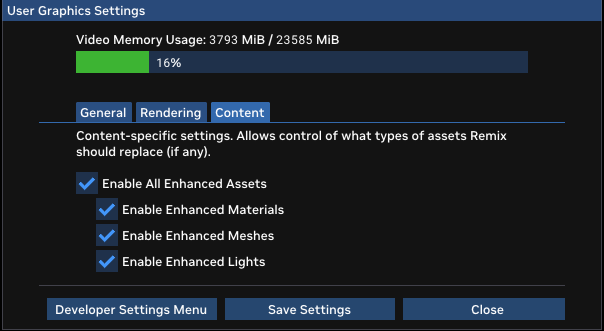
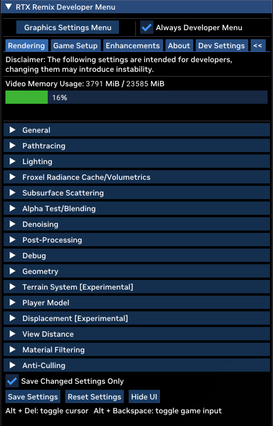
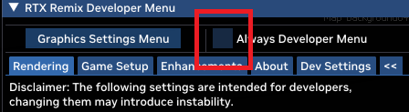

# Обзор интерфейса

RTX Remix включает внутриигровое меню рантайма (оверлей), с помощью которого легко настраивать внешний вид и работу
игры. В нём собраны подробные настройки всех основных функций: рендеринга, замены ассетов и захвата. Открыть меню можно,
нажав в игре **Alt + X** (это сочетание клавиш можно изменить в файле конфигурации rtx.conf).

```{note}
Размер панелей меню можно менять: наведите курсор на край панели, дождитесь, когда значок сменится двойной стрелкой, и перетащите край до нужного размера.
```

## Пользовательские настройки графики



При нажатии **Alt + X** сначала открывается меню
[User Graphic Settings](remix-runtimeinterface-usergraphicsettings.md). В нём собраны высокоуровневые настройки, с
помощью которых пользователи модов RTX Remix могут быстро настроить игру под себя. Здесь три вкладки: General, Rendering
и Content. Для каждой настройки при наведении курсора показывается подсказка.

[FIXME: are these tabs outdated?]::

Настройки **General** в основном касаются производительности и включают различные параметры апскейла и снижения
задержки.



Настройки **Rendering** — высокоуровневые параметры качества изображения рендерера RTX Remix с трассировкой пути. Можно
выбрать один из готовых пресетов или настроить каждый параметр отдельно.



Настройки **Content** позволяют включать и выключать каждый из трёх типов замен, поддерживаемых RTX Remix: замены
материалов, мешей и источников света. Это полезно, когда нужно оценить, как каждый тип замен влияет на проект мода.
Учтите, однако, что выключение всех замен не возвращает исходный рендеринг игры: трассировка пути по-прежнему
работает, просто для материалов и источников света используются глобальные значения по умолчанию, а меши-замены не
используются.

## Настройки разработчика

Внизу меню User Graphics Settings есть кнопка Developer Settings Menu. Она открывает более глубокое и подробное меню
разработчика RTX Remix. В нём есть следующие основные вкладки.



1. [Вкладка Rendering](renderingtab/index.md) предназначена в основном для авторов модов и разработчиков рантайма,
   которым нужен полный контроль над внутренними параметрами рендерера, чтобы добиться совместимости или нужного вида
   мода или игры.
2. [Вкладка Game Setup](remix-runtimeinterface-gamesetup.md) содержит процесс разметки, необходимый, чтобы игру можно
   было модифицировать и она была совместима с RTX Remix.
3. [Вкладка Enhancements](remix-runtimeinterface-enhancements.md) позволяет захватывать сцены, включать и выключать
   разные типы замен, а также подсвечивать незаменённые ассеты — всё это полезно для тестирования и проверки
   содержимого мода.
4. [Вкладка About](remix-runtimeinterface-about.md) содержит сведения об участниках проекта.
5. [Вкладка Developer Settings](remix-runtimeinterface-developermenu.md) содержит настройки камеры и прочие параметры.

```{note}
В верхней части меню Developer Settings есть флажок «Always Developer Menu». Если включить его (и сохранить настройки), по нажатию **Alt + X** будет сразу открываться меню разработчика — на один щелчок меньше! <p></p>
```

```{warning}
**Программистам:** документация по параметрам RTX Options находится на GitHub [здесь](https://github.com/NVIDIAGameWorks/dxvk-remix/blob/main/RtxOptions.md).
```

## Сохранение настроек

Любые изменённые в меню настройки можно сохранить как новые значения по умолчанию. Они записываются в файл
**rtx.conf** рядом с папкой рантайма **.trex/**. Если файла нет, он будет создан. При следующем запуске игры с
RTX Remix настройки будут прочитаны из этого файла и применены автоматически.

## Сочетания клавиш

| **Клавиши**          | **Описание**                                         |
|----------------------|------------------------------------------------------|
| **Alt + X**          | Открыть меню настроек разработчика RTX Runtime       |
| **Alt + Delete**     | Показать/скрыть курсор                               |
| **Alt + Backspace**  | Включить/выключить передачу ввода в игру             |
| **CTRL + SHIFT + Q** | Открыть меню разработчика **Enhancements**           |

***
<sub> Хотите оставить отзыв о документации RTX Remix? [Нажмите здесь](https://github.com/NVIDIAGameWorks/rtx-remix/issues/new?assignees=nvdamien&labels=documentation%2Cfeedback%2Ctriage&projects=&template=documentation_feedback.yml&title=%5BDocumentation+feedback%5D%3A+) </sub>
