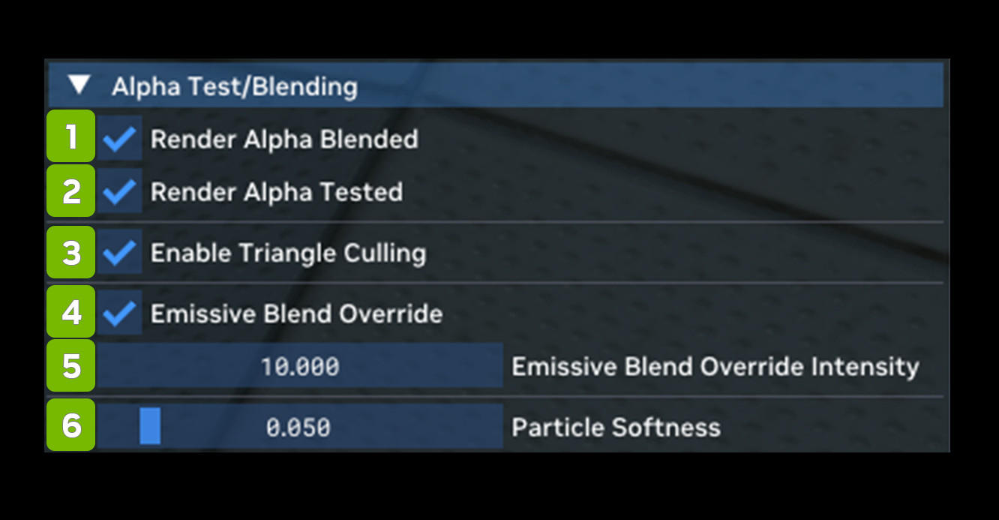

# Альфа-тест и смешивание

Alpha Test / Blending позволяет включать и выключать альфа-тест и альфа-смешивание.

| **№** | **Параметр** | **RTX Option**                             | **Значение по умолчанию** | **Описание** |
|---------|-----------------------------------|--------------------------------------------|-------------------|-----------------------------------------------------------------------------------------------------------------------------------------------|
| 1       | Render Alpha Blended Checkbox     | rtx.enableAlphaBlend                       | Checked           | Включает рендеринг геометрии с альфа-смешиванием, которое во многих играх используется для частичной прозрачности и других эффектов смешивания на поверхностях. |
| 2       | Render Alpha Tested Checkbox      | rtx.enableAlphaTest                        | Checked           | Включает рендеринг геометрии с альфа-тестом, который в некоторых играх используется для прозрачности с отсечением (cutout). |
| 3       | Enable Triangle Culling Checkbox  |                                            | Checked           | <!--- Needs Description --->                                                                                                                  |
| 4       | Emissive Blend Override Checkbox  | rtx.enableEmissiveBlendEmissiveOverride    | Checked           | Переопределяет обычные данные излучения материала в вызовах отрисовки с любыми режимами излучающего смешивания, чтобы точнее воспроизвести их исходный вид. |
| 5       | Emissibe Blend Override Intensity | rtx.emissiveBlendOverrideEmissiveIntensity | 0.2               | Интенсивность излучения при включённом переопределении излучающего смешивания. Подстройте её, если, например, частицы выглядят слишком яркими в целом. |
| 6       | Particle Softness                 | rtx.particleSoftnessFactor                 | 0.050             | Множитель расстояния обзора, используемого для расчёта диапазона смешивания частиц. |

***
 Хотите оставить отзыв о документации RTX Remix? [Нажмите здесь](https://github.com/NVIDIAGameWorks/rtx-remix/issues/new?assignees=nvdamien&labels=documentation%2Cfeedback%2Ctriage&projects=&template=documentation_feedback.yml&title=%5BDocumentation+feedback%5D%3A+) 
