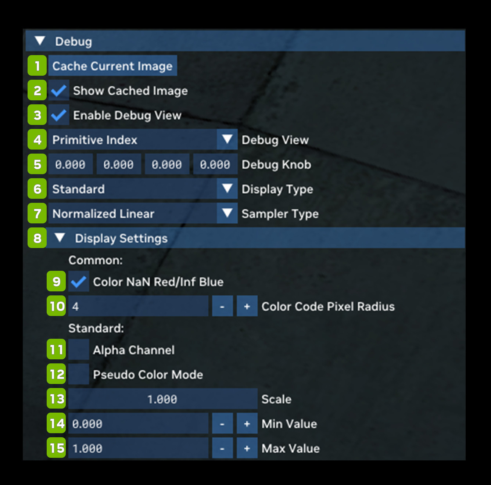

# Отладка

Debug даёт доступ к множеству отладочных представлений для поиска проблем с совместимостью, контентом или рендерингом в
игре или моде. Подробное руководство по режимам отладочного отображения приведено в этом документе.

**Меню поиска отладки**

В меню поиска отладки (Debug Search Menu) можно ввести название отладочной настройки, которую нужно проверить.

| **№** | **Параметр** | **RTX Option**                  | **Значение по умолчанию** | **Описание** |
|---------|----------------------------|---------------------------------|------------------------|--------------------------------------------------------------------------------------------------------------------------------------------------------------|
| 1       | Cache Current Image Button |                                 |                        |                                                                                                                                                              |
| 2       | Show Cached Image Checkbox |                                 | Unchecked              |                                                                                                                                                              |
| 3       | Enable Debug View Checkbox |                                 | Unchecked              |                                                                                                                                                              |
| 4       | Debug View                 |                                 | Primitive Index        | *(См. **таблицу отладочных представлений** ниже)* |
| 5       | Debug Knob                 |                                 | 0.000 (for each value) |                                                                                                                                                              |
| 6       | Display Type Dropdown      | rtx.debugView.displayType       | Standard               | Варианты: Standard, BGR Exclusive Color, Exposure Value (EV100) и HDR Waveform |
| 8       | Sampler Type               | rtx.debugView.samplerType       | Normalized Linear      | Тип сэмплера для отладочных представлений, выполняющих выборку из текстуры (применяется только к части отладочных представлений). Варианты: Nearest, Normalized Nearest и Normalized Linear |
| **8**   | **Display Settings**       |                                 |                        |                                                                                                                                                              |
|         | **Common:**                |                                 |                        |                                                                                                                                                              |
| 9       | Color NaN/Inf Red Checkbox |                                 | Checked                |                                                                                                                                                              |
| 10      | Color Code Pixel Radius    |                                 | 4                      |                                                                                                                                                              |
|         | **Standard:**              |                                 |                        |                                                                                                                                                              |
| 11      | Alpha Channel Checkbox     |                                 | Unchecked              |                                                                                                                                                              |
| 12      | Pseudo Color Mode Checkbox | rtx.debugView.enablePseudoColor | Unchecked              | Включает цветовое кодирование RGB для скалярного значения отладочного представления. |
| 13      | Scale                      |                                 | 1.000                  |                                                                                                                                                              |
| 14      | Min Value                  | rtx.debugView.evMinValue        | -4                     |                                                                                                                                                              |
| 15      | Max Value                  | rtx.debugView.evMaxValue        | 4                      |                                                                                                                                                              |

**Таблица отладочных представлений**

| **Debug View**                                                        | **Описание** |
|-----------------------------------------------------------------------|--------------------------------------------------------------------------------------------------------------------------------------------------------------------------------------------------------------------------------------------------------------------------------------------------------------------------------------------------------------------------------------------------------------------------------------------------------------------------------------------------------------------------------------------------------|
| Primitive Index                                                       | Уникальный идентификатор или индекс примитива в конвейере рендеринга. Примитивы — базовые геометрические фигуры, из которых в компьютерной графике строятся более сложные сцены и объекты: точки, линии, треугольники и т. д. Каждому примитиву присваивается уникальный индекс, позволяющий GPU обрабатывать их по отдельности или группами, как требует алгоритм рендеринга. |
| Geometry Hash                                                         |                                                                                                                                                                                                                                                                                                                                                                                                                                                                                                                                                        |
| Custom Index                                                          |                                                                                                                                                                                                                                                                                                                                                                                                                                                                                                                                                        |
| Barycentric Coordinates                                               | Набор координат, описывающих положение точки внутри треугольника или другого выпуклого многоугольника. Координаты задаются относительно вершин многоугольника и полезны для разных операций рендеринга, включая интерполяцию и наложение текстур. Барицентрические координаты представляют собой набор весов для каждой вершины многоугольника. |
| Is Front Hit                                                          |                                                                                                                                                                                                                                                                                                                                                                                                                                                                                                                                                        |
| Is Static                                                             |                                                                                                                                                                                                                                                                                                                                                                                                                                                                                                                                                        |
| Is Opaque                                                             |                                                                                                                                                                                                                                                                                                                                                                                                                                                                                                                                                        |
| Is Direction Altered                                                  |                                                                                                                                                                                                                                                                                                                                                                                                                                                                                                                                                        |
| Is Emissive Blend                                                     |                                                                                                                                                                                                                                                                                                                                                                                                                                                                                                                                                        |
| View Direction                                                        |                                                                                                                                                                                                                                                                                                                                                                                                                                                                                                                                                        |
| Cone Radius                                                           | Путь луча света от камеры в сцену; помогает определить, с какими объектами или поверхностями 3D-окружения пересекается луч. |
| Position                                                              |                                                                                                                                                                                                                                                                                                                                                                                                                                                                                                                                                        |
| Texture Coordinates                                                   | Текстурные координаты задают, какая часть 2D-текстуры накладывается на каждую точку поверхности 3D-модели. Это позволяет реалистично и детально текстурировать 3D-объекты, накладывая цветовые текстуры, карты рельефа, карты нормалей и т. д. Если задать текстурные координаты для каждой вершины, графическое оборудование может плавно интерполировать и накладывать текстурные данные по всей поверхности, создавая при рендеринге иллюзию сложных свойств и деталей поверхности 3D-объекта. |
| Virtual Motion Vector                                                 | Движение объектов между кадрами. Векторы движения описывают, как объекты перемещаются от кадра к кадру, что помогает уменьшить избыточность данных и повысить эффективность сжатия. |
| Screen-Space Motion Vector                                            | Экранные векторы движения (SSMV) — представление данных, фиксирующее движение объектов или пикселей между последовательными кадрами в экранном пространстве. SSMV используются в различных техниках рендеринга, например в размытии в движении и временном сглаживании, для реалистичной передачи движения. |
| Triangle Normal                                                       | Эти нормали помогают определить, как лучи света отражаются или преломляются поверхностью треугольника, что влияет на его вид в итоговом изображении. |
| Interpolated Normal                                                   | Вектор нормали для конкретной точки 3D-поверхности, вычисленный интерполяцией или смешиванием нормалей соседних вершин. Интерполированные нормали определяют, как свет взаимодействует с поверхностью, и критически важны для плавного затенения и реалистичного освещения. |
| Tangent                                                               | Вектор, лежащий в плоскости 3D-поверхности и перпендикулярный её нормали. Касательные векторы используются в таких техниках, как карты нормалей и карты рельефа, для имитации мелких деталей поверхности и повышения реалистичности... |
| Bitangent                                                             | Вектор, перпендикулярный и нормали поверхности, и касательному вектору 3D-поверхности в данной точке. Битангенс обычно используется в продвинутых техниках затенения, например в картах нормалей и рельефа, чтобы дополнить локальную систему координат, называемую касательным пространством. |
| Shading Normal                                                        | Часто называется «геометрической нормалью» — вектор, задающий ориентацию поверхности в определённой точке 3D-объекта. Используется в расчётах затенения, чтобы определить, как свет взаимодействует с поверхностью и как её следует освещать или затенять. |
| Virtual Shading Normal                                                |                                                                                                                                                                                                                                                                                                                                                                                                                                                                                                                                                        |
| Vertex Color                                                          | Цвет, связанный с отдельными вершинами (угловыми точками) 3D-модели или объекта. Каждой вершине может быть назначен свой цвет, обычно в виде сочетания значений красного, зелёного и синего (RGB). |
| Portal Space                                                          |                                                                                                                                                                                                                                                                                                                                                                                                                                                                                                                                                        |
| Material Type                                                         | Классификация физических свойств и визуальных характеристик поверхностей или материалов в 3D-сценах. Типы материалов описывают, как свет взаимодействует с поверхностью и как её следует затенять и рендерить. Распространённые типы: диффузные, бликовые (specular), полупрозрачные и излучающие материалы. |
| Diffuse Albedo                                                        | Собственный цвет или отражательная способность поверхности, равномерно рассеивающей падающий свет во всех направлениях. Это базовый цвет поверхности при диффузном освещении, то есть без бликов и отражений. |
| Base Reflectivity                                                     |                                                                                                                                                                                                                                                                                                                                                                                                                                                                                                                                                        |
| Isotropic Roughness                                                   | Свойство, описывающее степень равномерной и ненаправленной микронеровности (шероховатости) поверхности 3D-объекта. Шероховатость влияет на рассеивание света и его взаимодействие с поверхностью, приводя к диффузным отражениям. |
| Perceptual Roughness                                                  |                                                                                                                                                                                                                                                                                                                                                                                                                                                                                                                                                        |
| Anisotropy                                                            | Свойство материалов или поверхностей, из-за которого их отражающие или затеняющие характеристики различаются в разных направлениях. Анизотропные материалы ведут себя по-разному в зависимости от направления: в одном направлении они могут выглядеть более блестящими, а в других — иначе. |
| Anisotropic Roughness                                                 | Свойство, описывающее шероховатость поверхности, которая зависит от направления измерения. В отличие от изотропной шероховатости, одинаковой во всех направлениях, анизотропная означает, что микронеровности поверхности объекта имеют преимущественное направление. |
| Opacity                                                               | Степень, в которой объект или его часть прозрачны или пропускают свет. Основное свойство, управляющее видимостью и прозрачностью 3D-объектов и их компонентов в отрендеренной сцене. |
| Emissive Radiance                                                     | Энергия излучения, испускаемая поверхностью или объектом в 3D-сцене. Это свет или цвет, который поверхность излучает сама, а не отражает или рассеивает, как большинство материалов. |
| Thin Film Thickness                                                   | Толщина тонкой плёнки или слоя материала, нанесённого на поверхность. Используется в компьютерной графике для имитации взаимодействия света с тонкими слоями, например масляными плёнками на воде или мыльными пузырями. |
| Virtual Hit Distance                                                  |                                                                                                                                                                                                                                                                                                                                                                                                                                                                                                                                                        |
| Primary Depth                                                         | Информация о глубине для первичных лучей в конвейере трассировки лучей. |
| Blue Noise                                                            | Особый тип шумового узора, полезный для наложения текстур, сэмплирования и сглаживания. Синий шум характеризуется таким распределением точек или значений, при котором они расположены равномернее, а энергия в высокочастотной («синей») части спектра распределена перцептивно равномерно. |
| Pixel Checkerboard                                                    | Техника анализа и визуализации распределения нагрузки шейдинга пикселей по экрану. Поверх сцены рисуется шахматный узор, где каждая клетка соответствует пикселю, а её цвет может показывать сложность или вычислительную нагрузку соответствующего пикселя. |
| Volume Radiance Depth Layers                                          |                                                                                                                                                                                                                                                                                                                                                                                                                                                                                                                                                        |
| Surface Volume Radiance                                               |                                                                                                                                                                                                                                                                                                                                                                                                                                                                                                                                                        |
| Composite Output                                                      | Итоговое изображение, получаемое объединением и смешиванием различных графических элементов или слоёв. Обычно для этого несколько отрендеренных изображений, часто с информацией о прозрачности, сводятся в одно цельное изображение, представляющее итоговую сцену в том виде, в каком её увидит зритель. |
| Local Tonemapper Luminance Output                                     | Результат локального тонмаппинга, настраивающего яркость и контраст изображения попиксельно на основе значений яркости пикселей. |
| Local Tonemapper Blend Weight                                         |                                                                                                                                                                                                                                                                                                                                                                                                                                                                                                                                                        |
| Local Tonemapper Assembled Exposure                                   |                                                                                                                                                                                                                                                                                                                                                                                                                                                                                                                                                        |
| Local Tonemapper Final Multiplier                                     |                                                                                                                                                                                                                                                                                                                                                                                                                                                                                                                                                        |
| Final Output                                                          |                                                                                                                                                                                                                                                                                                                                                                                                                                                                                                                                                        |
| Final Output (pre-tonemap)                                            |                                                                                                                                                                                                                                                                                                                                                                                                                                                                                                                                                        |
| Exposure Histogram                                                    | Графическое представление, наглядно показывающее распределение яркости пикселей изображения: сколько пикселей приходится на разные уровни яркости или экспозиции; обычно отображается в виде гистограммы. |
| View Model: Final Output                                              |                                                                                                                                                                                                                                                                                                                                                                                                                                                                                                                                                        |
| ReSTIR GI Initial Sample                                              |                                                                                                                                                                                                                                                                                                                                                                                                                                                                                                                                                        |
| ReSTIR GI Temporal Reprojection                                       |                                                                                                                                                                                                                                                                                                                                                                                                                                                                                                                                                        |
| ReSTIR GI Spatial Reuse                                               |                                                                                                                                                                                                                                                                                                                                                                                                                                                                                                                                                        |
| ReSTIR GI Final Shading MIS Weight                                    |                                                                                                                                                                                                                                                                                                                                                                                                                                                                                                                                                        |
| ReSTIR GI Virtual Hit Distance                                        |                                                                                                                                                                                                                                                                                                                                                                                                                                                                                                                                                        |
| ReSTIR GI Gradients                                                   |                                                                                                                                                                                                                                                                                                                                                                                                                                                                                                                                                        |
| ReSTIR GI Confidence                                                  |                                                                                                                                                                                                                                                                                                                                                                                                                                                                                                                                                        |
| Stochastic Alpha Blend Color                                          |                                                                                                                                                                                                                                                                                                                                                                                                                                                                                                                                                        |
| Stochastic Alpha Blend Normal                                         |                                                                                                                                                                                                                                                                                                                                                                                                                                                                                                                                                        |
| Stochastic Alpha Blend Geometry Hash                                  |                                                                                                                                                                                                                                                                                                                                                                                                                                                                                                                                                        |
| Stochastic Alpha Blend Background Transparency                        |                                                                                                                                                                                                                                                                                                                                                                                                                                                                                                                                                        |
| Geometry Flags: First Sampled Lobe is Specular                        |                                                                                                                                                                                                                                                                                                                                                                                                                                                                                                                                                        |
| Indirect First Ray Throughput                                         |                                                                                                                                                                                                                                                                                                                                                                                                                                                                                                                                                        |
| Indirect First Sampled Lobe PDF                                       |                                                                                                                                                                                                                                                                                                                                                                                                                                                                                                                                                        |
| Indirect First Sampled Solid Angle PDF                                |                                                                                                                                                                                                                                                                                                                                                                                                                                                                                                                                                        |
| Primary Ray Interactions (RTS TR Only)                                |                                                                                                                                                                                                                                                                                                                                                                                                                                                                                                                                                        |
| Secondary Ray Interactions (RGX TR Only)                              |                                                                                                                                                                                                                                                                                                                                                                                                                                                                                                                                                        |
| Primary Ray Bounces                                                   | Первый набор лучей, испускаемых из камеры в 3D-сцену при трассировке лучей. Первичные лучи определяют, какие объекты или поверхности сцены видны с точки зрения камеры. |
| Secondary Ray Bounces                                                 | Лучи, испускаемые после первичных при трассировке лучей. Первичные лучи сначала испускаются из камеры в 3D-сцену, чтобы определить видимые объекты и поверхности. Когда они попадают на отражающую или преломляющую поверхность, генерируются вторичные лучи, имитирующие дополнительные световые эффекты — отражения и преломления. |
| Primary Unordered Ray Interactions                                    |                                                                                                                                                                                                                                                                                                                                                                                                                                                                                                                                                        |
| Secondary Unordered Ray Interactions                                  |                                                                                                                                                                                                                                                                                                                                                                                                                                                                                                                                                        |
| Primary Ray Interactions (+Unordered) (RGS TR Only)                   |                                                                                                                                                                                                                                                                                                                                                                                                                                                                                                                                                        |
| Secondary Ray Interactions (+Unordered) (RGS TR Only)                 |                                                                                                                                                                                                                                                                                                                                                                                                                                                                                                                                                        |
| PSR Primary Secondary Surface Mask                                    |                                                                                                                                                                                                                                                                                                                                                                                                                                                                                                                                                        |
| PSR Selected Integration Surface PDF                                  |                                                                                                                                                                                                                                                                                                                                                                                                                                                                                                                                                        |
| Primary Use Alternative Disocclusion Threshold                        |                                                                                                                                                                                                                                                                                                                                                                                                                                                                                                                                                        |
| Primary Specular Albedo                                               | Альбедо (отражательная способность), задающее цвет и интенсивность бликовых отражений поверхности при трассировке лучей или других техниках рендеринга; относится именно к отражению света от прямых источников, например точечных или направленных. |
| Secondary Specular Albedo                                             | Альбедо (отражательная способность), задающее цвет и интенсивность вторичных, или непрямых, бликовых отражений поверхности при трассировке лучей или других продвинутых техниках рендеринга. |
| Primary Direct Diffuse: Noisy Color                                   |                                                                                                                                                                                                                                                                                                                                                                                                                                                                                                                                                        |
| Primary Direct Diffuse: Noisy HitT                                    |                                                                                                                                                                                                                                                                                                                                                                                                                                                                                                                                                        |
| Primary Direct Diffuse: Demodulated Noisy Color                       |                                                                                                                                                                                                                                                                                                                                                                                                                                                                                                                                                        |
| Primary Direct Diffuse: Denoised Color                                |                                                                                                                                                                                                                                                                                                                                                                                                                                                                                                                                                        |
| Primary Direct Diffuse: Denoised HitT (ReBLUR) \| Дисперсия (ReLAX) |                                                                                                                                                                                                                                                                                                                                                                                                                                                                                                                                                        |
| Primary Direct Diffuse: NRD Normalized HitT                           |                                                                                                                                                                                                                                                                                                                                                                                                                                                                                                                                                        |
| Primary Direct Specular: Noisy Color                                  |                                                                                                                                                                                                                                                                                                                                                                                                                                                                                                                                                        |
| Primary Direct Specular: Noisy Color                                  |                                                                                                                                                                                                                                                                                                                                                                                                                                                                                                                                                        |
| Primary Direct Specular: Noisy HitT                                   |                                                                                                                                                                                                                                                                                                                                                                                                                                                                                                                                                        |
| Primary Direct Specular: Demodulated Noisy Color                      |                                                                                                                                                                                                                                                                                                                                                                                                                                                                                                                                                        |
| Primary Direct Specular: Denoised Color                               |                                                                                                                                                                                                                                                                                                                                                                                                                                                                                                                                                        |
| Primary Direct Specular: Denoised HitT (ReBLUR) \| Дисперсия (ReLAX) |                                                                                                                                                                                                                                                                                                                                                                                                                                                                                                                                                        |
| Primary Direct Specular: NRD Normalized HitT                          |                                                                                                                                                                                                                                                                                                                                                                                                                                                                                                                                                        |
| Primary Indirect Diffuse: Noisy Color                                 |                                                                                                                                                                                                                                                                                                                                                                                                                                                                                                                                                        |
| Primary Indirect Diffuse: Noisy Color                                 |                                                                                                                                                                                                                                                                                                                                                                                                                                                                                                                                                        |
| Primary Indirect Diffuse: Noisy HitT                                  |                                                                                                                                                                                                                                                                                                                                                                                                                                                                                                                                                        |
| Primary Indirect Diffuse: Demodulated Noisy Color                     |                                                                                                                                                                                                                                                                                                                                                                                                                                                                                                                                                        |
| Primary Indirect Diffuse: Denoised Color                              |                                                                                                                                                                                                                                                                                                                                                                                                                                                                                                                                                        |
| Primary Indirect Diffuse: Denoised HitT (ReBLUR) \| Дисперсия (ReLAX) |                                                                                                                                                                                                                                                                                                                                                                                                                                                                                                                                                        |
| Primary Indirect Diffuse: NRD Normalized HitT                         |                                                                                                                                                                                                                                                                                                                                                                                                                                                                                                                                                        |
| Primary Indirect Specular: Noisy Color                                |                                                                                                                                                                                                                                                                                                                                                                                                                                                                                                                                                        |
| Primary Indirect Specular: Diffuse: Noisy Color                       |                                                                                                                                                                                                                                                                                                                                                                                                                                                                                                                                                        |
| Primary Indirect Specular: Diffuse: Noisy HitT                        |                                                                                                                                                                                                                                                                                                                                                                                                                                                                                                                                                        |
| Primary Indirect Specular: Demodulated Noisy Color                    |                                                                                                                                                                                                                                                                                                                                                                                                                                                                                                                                                        |
| Primary Indirect Specular: Denoised Color                             |                                                                                                                                                                                                                                                                                                                                                                                                                                                                                                                                                        |
| Primary Indirect Specular: Denoised HitT (ReBLUR) \| Дисперсия (ReLAX) |                                                                                                                                                                                                                                                                                                                                                                                                                                                                                                                                                        |
| Primary Indirect Specular: NRD Normalized HitT                        |                                                                                                                                                                                                                                                                                                                                                                                                                                                                                                                                                        |
| Secondary Direct Diffuse: Noisy Color                                 |                                                                                                                                                                                                                                                                                                                                                                                                                                                                                                                                                        |
| Secondary Indirect Diffuse: Noisy Color                               |                                                                                                                                                                                                                                                                                                                                                                                                                                                                                                                                                        |
| Secondary Combined Diffuse: Noisy Color                               |                                                                                                                                                                                                                                                                                                                                                                                                                                                                                                                                                        |
| Secondary Combined Diffuse: Demodulated Noisy Color                   |                                                                                                                                                                                                                                                                                                                                                                                                                                                                                                                                                        |
| Secondary Combined Diffuse: Denoised Color                            |                                                                                                                                                                                                                                                                                                                                                                                                                                                                                                                                                        |
| Secondary Direct Speculary: Noisy Color                               |                                                                                                                                                                                                                                                                                                                                                                                                                                                                                                                                                        |
| Secondary Indirect Specular: Noisy Color                              |                                                                                                                                                                                                                                                                                                                                                                                                                                                                                                                                                        |
| Secondary Combined Specular: Noisy Color                              |                                                                                                                                                                                                                                                                                                                                                                                                                                                                                                                                                        |
| Secondary Combined Specular: Demodulated Noisy Color                  |                                                                                                                                                                                                                                                                                                                                                                                                                                                                                                                                                        |
| Secondary Combined Specular: Denoised Color                           |                                                                                                                                                                                                                                                                                                                                                                                                                                                                                                                                                        |
| Thread Divergence (Debug Knob.x)                                      |                                                                                                                                                                                                                                                                                                                                                                                                                                                                                                                                                        |
| Inf/Nan Check                                                         | Процесс или техника выявления и обработки числовых значений, которые при рендеринге или вычислениях оказываются бесконечными (Inf) или не являются числом (NaN). |
| Surface / Lobe Consistency Check                                      |                                                                                                                                                                                                                                                                                                                                                                                                                                                                                                                                                        |
| Scrolling Line                                                        |                                                                                                                                                                                                                                                                                                                                                                                                                                                                                                                                                        |

***
 Хотите оставить отзыв о документации RTX Remix? [Нажмите здесь](https://github.com/NVIDIAGameWorks/rtx-remix/issues/new?assignees=nvdamien&labels=documentation%2Cfeedback%2Ctriage&projects=&template=documentation_feedback.yml&title=%5BDocumentation+feedback%5D%3A+) 
