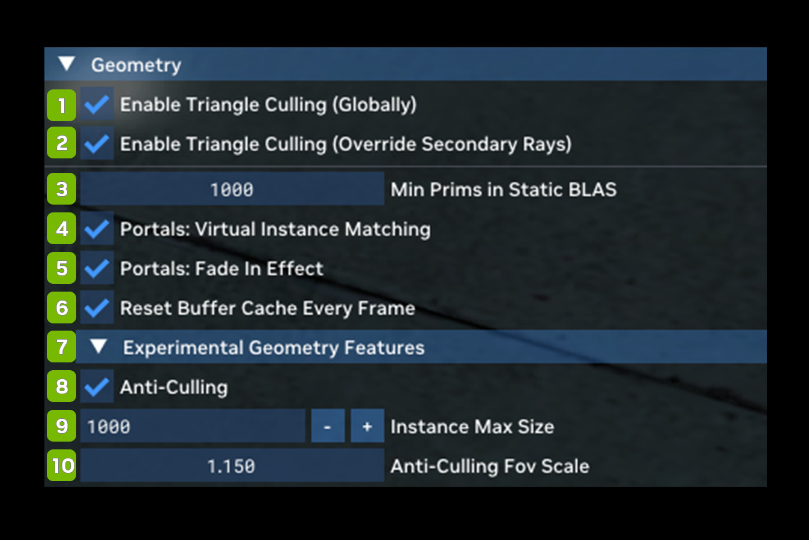

# Геометрия

Различные параметры совместимости для обработки геометрии.

| **№** | **Параметр** | **RTX Option**                          | **Значение по умолчанию** | **Описание** |
|---------|---------------------------------------------------|-----------------------------------------|-------------------|----------------------------------------------------------------------------------------|
| 1       | Enable Triangle Culling (Globally)                |                                         |                   |                                                                                        |
| 2       | Enable Triangle Culling (Override Secondary Rays) |                                         |                   |                                                                                        |
| 3       | Min Prims in Static BLAS                          |                                         | 1000              |                                                                                        |
| 4       | Portals: Virtual Instance Matching Checkbox       | rtx.useRayPortalVirtualInstanceMatching | Checked           |                                                                                        |
| 5       | Portals: Fade in Effect Checkbox                  | rtx.enablePortalFadeInEffect            | Unchecked         |                                                                                        |
| 6       | Reset Buffer Cache Every Frame Checkbox           |                                         |                   |                                                                                        |
| **7**   | **Experimental Geometry Features**                |                                         |                   |                                                                                        |
| 8       | Anti-Culling Checkbox                             | rtx.antiCulling.object.enable           | Unchecked         | Продлевает время жизни объектов, выходящих за пределы пирамиды видимости камеры (пирамида anti-culling). |
| 9       | Instance Max Size                                 | rtx.antiCulling.object.numObjectsToKeep | 1000              | Максимальное число экземпляров трассировки лучей, сохраняемых при включённом anti-culling. |
| 10      | Anti-Culling FoV Scale                            | rtx.antiCulling.object.fovScale         | 1.000             | Множитель поля зрения (FOV) пирамиды anti-culling. |

***
 Хотите оставить отзыв о документации RTX Remix? [Нажмите здесь](https://github.com/NVIDIAGameWorks/rtx-remix/issues/new?assignees=nvdamien&labels=documentation%2Cfeedback%2Ctriage&projects=&template=documentation_feedback.yml&title=%5BDocumentation+feedback%5D%3A+) 
