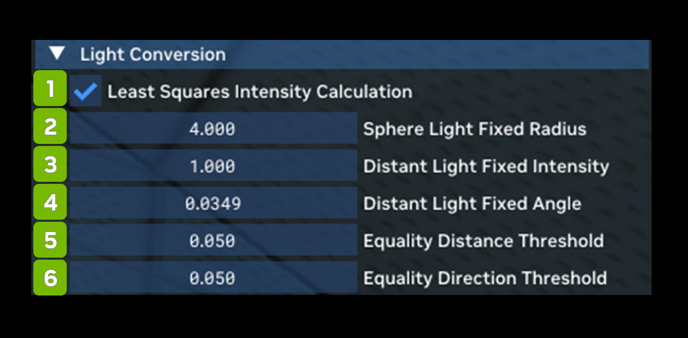

# Преобразование источников света

Light Conversion позволяет управлять тем, как игровые источники света преобразуются в физические источники,
совместимые с трассировкой пути в Remix.

| **№** | **Параметр** | **RTX Option**                                | **Значение по умолчанию** | **Описание** |
|---------|----------------------------------------------|-----------------------------------------------|-------------------|--------------------------------------------------------------------------------------------------------------------------------------------------------------------------------------------------------------------------------------------------------------------------------------------------------------------------------------------------------------------------------|
| 1       | Least Squares Intensity Calculation Checkbox | rtx.calculateLightIntensityUsingLeastSquares  | Checked           | Использовать метод наименьших квадратов для аппроксимации кривой затухания источника света вместо более простого подхода по одной точке. Обычно это точнее воспроизводит собственные кривые затухания исходного приложения, особенно нефизичное линейное затухание. |
| 2       | Sphere Light Fixed Radius                    | rtx.lightConversionSphereLightFixedRadius     | 4                 | Фиксированный радиус в мировых единицах для устаревших источников света, преобразованных в сферические (сейчас в сферические преобразуются точечные источники и прожекторы). Осторожнее с большими радиусами: многие устаревшие источники расположены близко к геометрии и пересекаются с ней, что ухудшает эффективность сэмплирования источников или вызывает другие визуальные артефакты (свет проходит сквозь стены и т. п.). |
| 3       | Distant Light Fixed Intensity                | rtx.lightConversionDistantLightFixedIntensity | 1                 | Фиксированная интенсивность (в Вт/ср) для устаревших источников света, преобразованных в удалённые (сейчас в удалённые преобразуются направленные источники). |
| 4       | Distant Light Fixed Angle                    | rtx.lightConversionDistantLightFixedAngle     | 0.0349            | Угловой размер (в радианах) удалённого источника для устаревших источников света, преобразованных в удалённые. По умолчанию около 2 градусов в радианах. |
| 5       | Equality Distance Threshold                  | rtx.lightConversionEqualityDistanceThreshold  | 0.05              | Верхний порог расстояния между двумя положениями, по которому при однозначной идентификации устаревших источников для преобразования определяется, что два позиционных источника — это один и тот же источник. |
| 6       | Equality Direction Threshold                 | rtx.lightConversionEqualityDirectionThreshold | 0.99              | Нижний порог косинуса угла между двумя направлениями, по которому при однозначной идентификации устаревших источников для преобразования определяется, что два направленных источника — это один и тот же источник. |

***
 Хотите оставить отзыв о документации RTX Remix? [Нажмите здесь](https://github.com/NVIDIAGameWorks/rtx-remix/issues/new?assignees=nvdamien&labels=documentation%2Cfeedback%2Ctriage&projects=&template=documentation_feedback.yml&title=%5BDocumentation+feedback%5D%3A+) 
