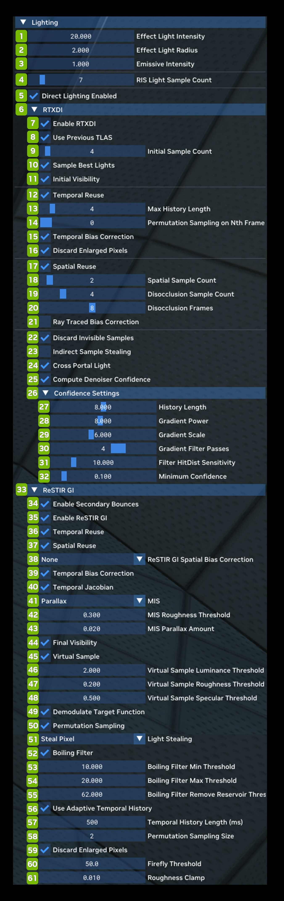

# Освещение

Lighting позволяет настраивать глобальную интенсивность освещения и другие параметры, а также глубоко погружаться во
внутреннее устройство двух основных алгоритмов освещения рендерера Remix с трассировкой пути: RTXDI и ReSTIR GI. О
каждой технологии можно прочитать подробнее.

| **№** | **Параметр** | **RTX Option**                                     | **Значение по умолчанию** | **Описание** |
|---------|-------------------------------------------------|----------------------------------------------------|-----------------------------|-----------------------------------------------------------------------------------------------------------------------------------------------------------------------------------------------------------------------------------------------------------------------------------------------------------------------------------------------------------------------------------------------------------------------------------------------------------------------------------------------------------------|
| 1       | Froxel Grid Resolution Scale                    | rtx.froxelGridResolutionScale                      | 16                          | Коэффициент, на который делится разрешение рендеринга по x и y, чтобы получить размеры сетки фрокселей (froxel grid) по x и y. |
| 2       | Froxel Depth Slices                             | rtx.froxelDepthSlices                              | 48                          | Размер сетки фрокселей по оси z. После инициализации должен оставаться постоянным. |
| 3       | Max Accumulation Frames                         | rtx.maxAccumulationFrames                          | 254                         | Число кадров, за которые накапливаются сэмплы объёмного освещения, максимум 254.  Большие значения дают более стабильное изображение ценой возможного временного запаздывания. Обычно следует задавать максимально возможное значение, поскольку кеш излучения фрокселей предполагается практически свободным от шума и стабильным, чему и способствует временное накопление. |
| 4       | Froxel Depth Slice Distribution Exponent        | rtx.froxelDepthSliceDistributionExponent           | 2.000                       | Показатель степени для значений глубины, задающий нелинейное распределение фрокселей по удалению от камеры. Чем больше значение, тем больше фрокселей ближе к камере; 1 — линейное распределение. |
| 5       | Froxel Max Distance                             | rtx.froxelMaxDistance                              | 2000.00                     | Максимальное расстояние в мировых единицах, до которого строится сетка фрокселей. Должно быть меньше расстояния между ближней и дальней плоскостями камеры, иначе сетка фрокселей будет обрезана дальней плоскостью. |
| 6       | Froxel Firefly Filtering Luminance Threshold    | rtx.froxelFireflyFilteringLuminanceThreshold       | 1000.000                    | Максимальный порог яркости, до которого фильтр «светлячков» (firefly) в объёмном освещении ограничивает значения. |
| 7       | Froxel Filter Gaussian Sigma                    | rtx.froxelFilterGaussianSigma                      | 1.20                        | Сигма гауссовой функции, используемой для фильтрации значений объёмного излучения. Чем больше значение, тем более сглаживающий фильтр используется. |
| 8       | Per-Portal Volumes Checkbox                     | rtx.enableVolumetricsInPortals                     | Checked                     | Включает дополнительные объёмы, выровненные по пирамиде видимости, для освещения в порталах.  Учтите, что этот параметр требует в 3 раза больше памяти, чем обычная сетка фрокселей, и в некоторых случаях снижает производительность.  В играх с порталами лучей (ray portals) его следует всегда включать, чтобы объёмные эффекты сквозь порталы выглядели правильно, а в играх без порталов — выключать.  Кроме того, эта настройка задаётся при запуске, и её изменение во время работы не применяется. |
| 9       | Initial RIS Sample Count                        | rtx.volumetricInitialRISSampleCount                | 8                           | Число RIS-сэмплов, выбираемых из глобального набора источников света при построении сэмпла резервуара (Reservoir).  Большие значения обычно повышают качество выбранного сэмпла источника, но, как и в случае общего числа RIS-сэмплов источников, отдача от увеличения постепенно снижается. |
| 10      | Enable Initial Visibility Checkbox              | rtx.volumetricEnableInitialVisibility              | Checked                     | Определяет, трассировать ли луч видимости для сэмплов резервуара.  Даёт немного более качественные сэмплы источников света в сетке фрокселей ценой одного луча на ячейку фрокселя за кадр; обычно следует включать. |
| 11      | Enable Temporal Resampling Checkbox             | rtx.volumetricEnableTemporalResampling             | Checked                     | Указывает, использовать ли временную перевыборку (temporal resampling) при интегрировании объёма.  Временная перевыборка позволяет повторно использовать временную информацию при выборе сэмплов источников для сетки фрокселей — аналогично ReSTIR, — что даёт более качественные сэмплы.  Обычно её следует включать, но сейчас из-за отсутствия коррекции временного смещения этот параметр немного смещает результат освещения. |
| 12      | Temporal Reuse Max Sample Count                 | rtx.volumetricTemporalReuseMaxSampleCount          | 200                         | Число сэмплов, до которого ограничиваются временные резервуары; обычно около значения: желаемое_макс_число_кадров_истории * среднее_число_сэмплов_резервуара. |
| 13      | Clamped Reprojection Confidence Penalty         | rtx.volumetricClampedReprojectionConfidencePenalty | 0.500                       | Штраф в диапазоне [0, 1], применяемый к числу сэмплов временно перепроецированных резервуаров, когда перепроецирование ограничено пирамидой видимости (что означает перепроецирование более низкого качества). |
| 14      | Min Reservoir Samples                           | rtx.froxelMinReservoirSamples                      | 1                           | Минимальное число сэмплов резервуара на ячейку фрокселя при максимальной стабильности; должно быть не меньше 1. |
| 15      | Max Reservoir Samples                           | rtx.froxelMaxReservoirSamples                      | 6                           | Максимальное число сэмплов резервуара на ячейку фрокселя при минимальной стабильности; должно быть не меньше 1 и не меньше минимального. |
| 16      | Min Reservoir Samples Stability History         | rtx.froxelMinReservoirSamplesStabilityHistory      | 1                           | Минимальная длина истории, при которой история считается имеющей минимальную стабильность, для сэмплов резервуара. |
| 17      | Max Reservoir Samples Stability History         | rtx.froxelMaxReservoirSamplesStabilityHistory      | 64                          | Максимальная длина истории, при которой история считается имеющей максимальную стабильность, для сэмплов резервуара. |
| 18      | Reservoir Samples Stability History Power       | rtx.froxelReservoirSamplesStabilityHistoryPower    | 2.00                        | Степень, применяемая к весу истории стабильности сэмплов резервуара. |
| 19      | Min Kernel Radius                               | rtx.froxelMinKernelRadius                          | 2                           | Минимальный радиус ядра фильтрации при максимальной стабильности; должен быть не меньше 1. |
| 20      | Max Kernel Radius                               | rtx.froxelMaxKernelRadius                          | 4                           | Максимальный радиус ядра фильтрации при минимальной стабильности; должен быть не меньше 1 и не меньше минимального. |
| 21      | Min Kernel Radius Stability History             | rtx.froxelMinKernelRadiusStabilityHistory          | 1                           | Минимальная длина истории, при которой история считается имеющей минимальную стабильность, для фильтрации. |
| 22      | Max Kernel Radius Stability History             | rtx.froxelMaxKernelRadiusStabilityHistory          | 64                          | Максимальная длина истории, при которой история считается имеющей максимальную стабильность, для фильтрации. |
| 23      | Kernel Radius Stability History Power           | rtx.froxelKernelRadiusStabilityHistoryPower        | 2.00                        | Степень, применяемая к весу истории стабильности радиуса ядра. |
| 24      | Enable Volumetric Lighting Checkbox             | rtx.enableVolumetricLighting                       | Unchecked                   | Включение объёмного освещения даёт более качественные физически корректные объёмные эффекты с трассировкой лучей; при выключении используется более дешёвый туман на основе глубины.  Учтите, что выключение этого параметра не отключает кеш излучения фрокселей целиком, поскольку он нужен и для других, необъёмных аппроксимаций освещения. |
| 25      | Transmittance Color                             | rtx.volumetricTransmittanceColor                   | 0.953237, 0.92879, 0.903545 | Цвет для вычисления пропускания (transmittance), измеренного на определённом расстоянии.  Учтите, что этот цвет считается заданным в пространстве sRGB с гамма-кодированием, поскольку для объёмных эффектов он преобразуется в линейное пространство. |
| 26      | Transmittance Measurement Distance              | rtx.volumetricTransmittanceMeasurementDistance     | 10000                       | Расстояние, на котором измерен заданный цвет пропускания. Чем меньше расстояние, тем плотнее среда. |
| 27      | Single Scattering Albedo                        | rtx.volumetricSingleScatteringAlbedo               | 0.900, 0.900, 0.900         | Альбедо однократного рассеяния (также называемое альбедо частиц) — отношение рассеяния к поглощению.  Хотя во многом это значение похоже на цвет, оно считается скорее математическим альбедо (в отличие от альбедо материала, которое трактуется скорее как цвет), поэтому обрабатывается как линейно закодированные данные (без гаммы). |
| 28      | Anisotropy                                      | rtx.volumetricAnisotropy                           | 0.000                       | Анизотропия фазовой функции рассеяния (-1 — обратное рассеяние, 0 — изотропное, 1 — прямое рассеяние). |
| 29      | Enable Legacy Fog Remapping Checkbox            | rtx.enableFogRemap                                 | Unchecked                   | Флаг, включающий или выключающий преобразование тумана фиксированного конвейера. Действует, только если включены объёмные эффекты.  Многие старые игры использовали туман фиксированного конвейера для разных эффектов, и хотя иногда его можно глобально заменить полноценными объёмными эффектами, в других случаях нужно определённое динамическое поведение, управляемое игрой.  Если параметр включён, параметры тумана фиксированного конвейера из игры преобразуются в объёмные параметры, чтобы учесть это динамическое поведение. |
| 30      | Color Strength                                  | rtx.vertexColorStrength                            | 0.6                         | Множитель, определяющий, насколько сильно цвет вершин влияет на материалы.  Значение 1 означает, что цвет вершин учитывается полностью (при этом операция текстуры и соответствующие параметры по-прежнему определяют, насколько сильно он смешивается с реальным цветом альбедо), значение 0 — что он полностью игнорируется. |
| 31      | Legacy Max Distance Min                         | rtx.fogRemapMaxDistanceMin                         | 100.00                      | Минимальная граница преобразования параметра тумана фиксированного конвейера «max distance».  Учтите, что настройка действует, только если включены преобразование тумана и преобразование его максимального расстояния. |
| 32      | Legacy Max Distance Max                         | rtx.fogRemapMaxDistanceMax                         | 4000.00                     | Максимальная граница преобразования параметра тумана фиксированного конвейера «max distance».  Учтите, что настройка действует, только если включены преобразование тумана и преобразование его максимального расстояния. |
| 33      | Remapped Transmittance Measurement Distance Min | rtx.fogRemapTransmittanceMeasurementDistanceMin    | 2000.00                     | Минимальная граница преобразования расстояния измерения пропускания.  Когда параметр тумана фиксированного конвейера «max distance» не превышает заданного минимума, расстояние измерения пропускания в объёмной системе принимает это значение и интерполируется вверх.  Учтите, что настройка действует, только если включены преобразование тумана и преобразование его максимального расстояния. |
| 34      | Remapped Transmittance Measurement Distance Max | rtx.fogRemapTransmittanceMeasurementDistanceMax    | 12000.00                    | Максимальная граница преобразования расстояния измерения пропускания.  Когда параметр тумана фиксированного конвейера «max distance» не меньше заданного максимума, расстояние измерения пропускания в объёмной системе принимает это значение и интерполируется вверх.  Учтите, что настройка действует, только если включены преобразование тумана и преобразование его максимального расстояния. |

***
 Хотите оставить отзыв о документации RTX Remix? [Нажмите здесь](https://github.com/NVIDIAGameWorks/rtx-remix/issues/new?assignees=nvdamien&labels=documentation%2Cfeedback%2Ctriage&projects=&template=documentation_feedback.yml&title=%5BDocumentation+feedback%5D%3A+) 
