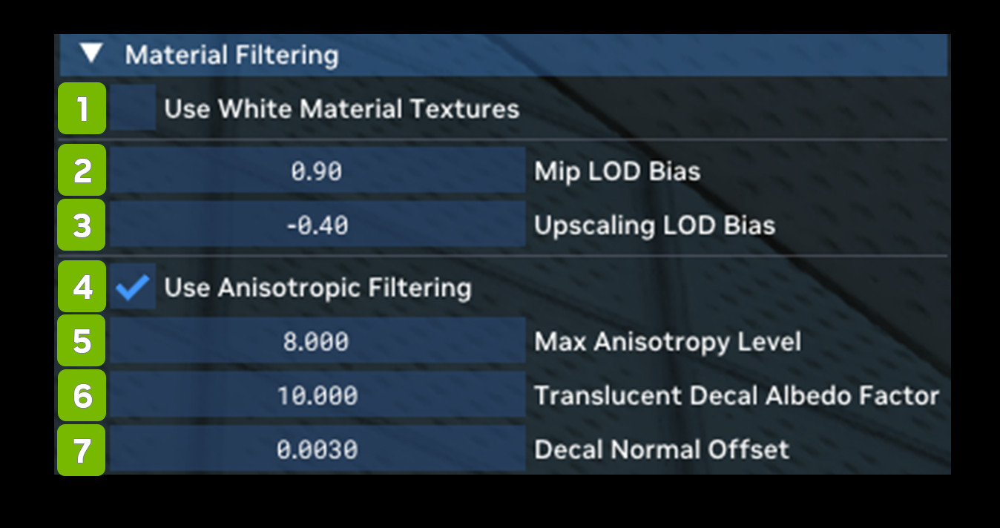

# Фильтрация материалов

Material Filtering позволяет настраивать фильтрацию материалов или рендерить все материалы белыми, чтобы было проще
настраивать освещение.

| **№** | **Параметр** | **RTX Option**                   | **Значение по умолчанию** | **Описание** |
|---------|--------------------------------------|----------------------------------|-------------------|----------------------------------------------------------------------------------------------------------------------------------------------------------------------------------------------------------------------------------------------------------------------------------------------------------------------------------------------------------------------------------------------------------------------------------------------------------------------------------------------------------------------------------------------------------------------------------------------|
| 1       | Use White Material Textures Checkbox | rtx.useWhiteMaterialMode         | Unchecked         |                                                                                                                                                                                                                                                                                                                                                                                                                                                                                                                                                                                              |
| 2       | Mip LOD Bias                         |                                  | 0.90              |                                                                                                                                                                                                                                                                                                                                                                                                                                                                                                                                                                                              |
| 3       | Upscaling LOD Bias                   |                                  | -0.4              |                                                                                                                                                                                                                                                                                                                                                                                                                                                                                                                                                                                              |
| 4       | Use Anisotropic Filtering Checkbox   | rtx.useAnisotropicFiltering      | Checked           | Флаг, указывающий, использовать ли анизотропную фильтрацию текстур материалов; иначе используется обычная трилинейная фильтрация.  Обычно его следует включать: анизотропная фильтрация меньше размывает текстуры под острыми углами, чем трилинейная, и, как правило, лишь незначительно влияет на производительность (в зависимости от максимального числа сэмплов анизотропии). |
| 5       | Max Anisotropy Level                 | rtx.maxAnisotropySamples         | 8.000             | Максимальное число сэмплов при включённой анизотропной фильтрации.  Фактически используется меньшее из этого значения и аппаратного максимума. Большие значения повышают качество, но, скорее всего, снижают производительность. |
| 6       | Translucent Decal Albedo Factor      | rtx.translucentDecalAlbedoFactor | 10                | Глобальный множитель альбедо декалей, наложенных на полупрозрачный базовый материал, чтобы декали были заметнее.  Обычно он нужен потому, что значения альбедо декалей для непрозрачных поверхностей могут быть довольно низкими, а полупрозрачному диффузному слою для ожидаемого вида требуется довольно высокое альбедо.  Без этого параметра можно обойтись, если изначально создавать декали для полупрозрачных материалов с более высоким альбедо, но иногда приложения используют одни и те же декали для материалов разных типов. |
| 7       | Decal Normal Offset                  |                                  | 0.0030            |                                                                                                                                                                                                                                                                                                                                                                                                                                                                                                                                                                                              |

***
 Хотите оставить отзыв о документации RTX Remix? [Нажмите здесь](https://github.com/NVIDIAGameWorks/rtx-remix/issues/new?assignees=nvdamien&labels=documentation%2Cfeedback%2Ctriage&projects=&template=documentation_feedback.yml&title=%5BDocumentation+feedback%5D%3A+) 
