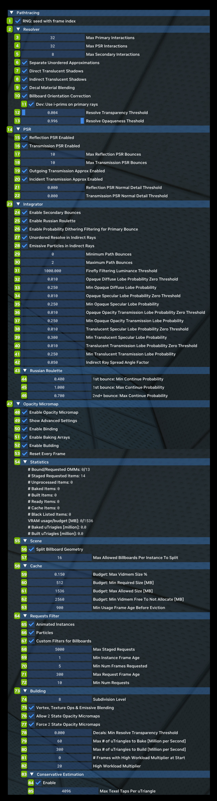

# Трассировка пути

Pathtracing позволяет как тонко, так и радикально настраивать поведение трассировщика пути. Технические подробности
уходят глубоко в теорию трассировки лучей.

| **№** | **Параметр** | **RTX Option**                                                                   | **Значение по умолчанию** | **Описание** |
|---------|--------------------------------------------------------------------|----------------------------------------------------------------------------------|-------------------|--------------------------------------------------------------------------------------------------------------------------------------------------------------------------------------------------------------------------------------------------------------------------------------------------------------------------------------------------------------------------------------------------------------------------------------------------------------------------------------------------------------------------------------------------------------------------------------------------------------------------------------------------------------------------------------------------------------------------------------------------------------------------------------------------------------------------------------------------------------------------------------------------------------------------------------------------------------------------------|
| 1       | RNG: Seed with Frame Index Checkbox                                | rtx.rngSeedWithFrameIndex                                                        | Checked           | Указывает, что генератор псевдослучайных чисел каждый кадр инициализируется номером кадра приложения; иначе — нулём.  Как правило, этот параметр всегда должен быть включён: без индекса кадра случайные значения в каждом кадре обычно совпадают, что приводит к неправильному рендерингу. Предназначен только для отладки. |
| **2**   | **Resolver**                                                       |                                                                                  |                   |                                                                                                                                                                                                                                                                                                                                                                                                                                                                                                                                                                                                                                                                                                                                                                                                                                                                                                                                                                                |
| 3       | Max Primary Interactions                                           | rtx.primaryRayMaxInteractions                                                    | 32                | Максимальное число взаимодействий разрешителя (resolver) для первичных лучей (исходный G-буфер).  Определяет, со сколькими декалями, порталами лучей и, возможно, частицами (если неупорядоченные аппроксимации не включены) может взаимодействовать луч; большее число взаимодействий снижает производительность. |
| 4       | Max PSR Interactions                                               | rtx.psrRayMaxInteractions                                                        | 32                | Максимальное число взаимодействий разрешителя для лучей PSR (замена первичной поверхности в G-буфере). Определяет, со сколькими декалями, порталами лучей и, возможно, частицами (если неупорядоченные аппроксимации не включены) может взаимодействовать луч; большее число взаимодействий снижает производительность. |
| 5       | Max Secondary Interactions                                         | rtx.secondaryRayMaxInteractions                                                  | 8                 | Максимальное число взаимодействий разрешителя (resolver) для первичных лучей (исходный G-буфер).  Определяет, со сколькими декалями, порталами лучей и, возможно, частицами (если неупорядоченные аппроксимации не включены) может взаимодействовать луч; большее число взаимодействий снижает производительность. |
| 6       | Separate Unordered Approximations Checkbox                         | rtx.enableSeparateUnorderedApproximations                                        | Checked           | Использовать при разрешении отдельный цикл для поверхностей, освещение которых можно приближённо вычислять в неупорядоченном виде на каждом сегменте пути (например, для частиц).  Обычно это повышает производительность при отрисовке частиц или декалей, и параметр, как правило, всегда следует включать.  Учтите, однако, что из-за неупорядоченности этого метода при большом числе наложенных друг на друга частиц возможны визуальные артефакты, поскольку трудно определить нужный порядок.  Кроме того, неупорядоченные аппроксимации выполняются только на первом непрямом отражении луча (поскольку на последующих отражениях частицы менее важны) и только если это включено соответствующей настройкой. |
| 7       | Direct Translucent Shadows Checkbox                                | rtx.enableDirectTranslucentShadows                                               | Unchecked         | Включать OBJECT_MASK_TRANSLUCENT в первичные лучи видимости. |
| 8       | Indirect Translucent Shadows Checkbox                              | rtx.enableIndirectTranslucentShadows                                             | Unchecked         | Включать OBJECT_MASK_TRANSLUCENT во вторичные лучи видимости. |
| 9       | Decal Material Blending Checkbox                                   | rtx.enableDecalMaterialBlending                                                  | Checked           | Флаг, включающий или выключающий смешивание материалов на декалях.  Если используются декали, его, как правило, всегда следует включать: так декали смешиваются с поверхностью, над которой они немного приподняты, и выглядят убедительнее. |
| 10      | Billboard Orientation Correction Checkbox                          | rtx.enableBillboardOrientationCorrection                                         | Checked           |                                                                                                                                                                                                                                                                                                                                                                                                                                                                                                                                                                                                                                                                                                                                                                                                                                                                                                                                                                                |
| 11      | Dev: Use I-Prims on Primary Rays Checkbox                          |                                                                                  | Unchecked         |                                                                                                                                                                                                                                                                                                                                                                                                                                                                                                                                                                                                                                                                                                                                                                                                                                                                                                                                                                                |
| 12      | Resolve Transparency Threshold                                     | rtx.resolveTransparencyThreshold                                                 | 0.00392157        | Порог, ниже которого любое значение непрозрачности считается полностью прозрачным, и такие поверхности можно безопасно пропускать без заметных потерь производительности. |
| 13      | Resolve Opaqueness Threshold                                       | rtx.resolveOpaquenessThreshold                                                   | 0.996078          | Порог, выше которого любое значение непрозрачности считается полностью непрозрачным. |
| **14**  | **PSR**                                                            |                                                                                  |                   |                                                                                                                                                                                                                                                                                                                                                                                                                                                                                                                                                                                                                                                                                                                                                                                                                                                                                                                                                                                |
| 15      | Reflection PSR Enabled Checkbox                                    | rtx.enablePSRR                                                                   | Checked           | Флаг, включающий или выключающий PSR (замену первичной поверхности) для отражений.  Позволяет в особых случаях получать более качественные зеркальные отражения, заменяя поверхность в G-буфере отражённой поверхностью.  Обычно его следует включать ради качества, поскольку почти все приложения используют это в виде стекла или зеркал. |
| 16      | Transmission PSR Enabled                                           | rtx.enablePSTR                                                                   | Checked           | Флаг, включающий или выключающий PSR (замену первичной поверхности) для пропускания.  Позволяет в особых случаях получать более качественное преломление, как у стекла, заменяя поверхность в G-буфере преломлённой поверхностью.  Обычно его следует включать ради качества, поскольку почти все приложения используют это в виде стекла. |
| 17      | Max Reflection PSR Bounces                                         | rtx.psrrMaxBounces                                                               | 10                | Максимальное число отражений PSR. Из-за кодирования полезной нагрузки должно быть не больше 15.  Увеличьте значение, если нужно много зеркальных отражений, но учтите, что больше отражений может стоить больше производительности. |
| 18      | Max Transmission PSR Bounces                                       | rtx.pstrMaxBounces                                                               | 10                | Максимальное число проходов PSR для пропускания. Из-за кодирования полезной нагрузки должно быть не больше 15.  Увеличьте значение, если нужно преломление сквозь много слоёв стекла, но учтите, что больше проходов может стоить больше производительности. |
| 19      | Outgoing Transmission Approx Enabled Checkbox                      | rtx.enablePSTROutgoingSplitApproximation                                         | Checked           | Включить PSR для пропускания при исходящих событиях пропускания, например при выходе из полупрозрачных материалов (вместо соблюдения правила PSR о пути без ветвления).  ... Обычно при включении стекло выглядит лучше (ценой точности, поскольку игнорируются переотражения внутри самого стекла, не являющиеся полным внутренним отражением). |
| 20      | Incident Transmission Approx Enabled Checkbox                      |                                                                                  | Checked           |                                                                                                                                                                                                                                                                                                                                                                                                                                                                                                                                                                                                                                                                                                                                                                                                                                                                                                                                                                                |
| 21      | Reflection PSR Normal Detail Threshold                             | rtx.psrrNormalDetailThreshold                                                    | 0.000             | Порог, при превышении которого «детальностью» карты нормалей на поверхности PSR отражения шумоподавитель использует альтернативный порог дезокклюзии.  Детальность нормали определяется как 1-dot(tangent_normal, vec3(0, 0, 1)): она равна 0, если карта нормалей не используется, и 1, если нормаль из карты перпендикулярна исходной нормали.  Обычно это используется для уменьшения мерцания отражений на поверхностях вроде стекла с картами нормалей, поскольку при DLSS или другом дрожании камеры шумоподавитель часто слишком агрессивно проверяет дезокклюзию между кадрами. |
| 22      | Transmission PSR Normal Detail Threshold                           | rtx.pstrNormalDetailThreshold                                                    | 0.000             | Порог, при превышении которого «детальностью» карты нормалей на поверхности PSR пропускания шумоподавитель использует альтернативный порог дезокклюзии.  Детальность нормали определяется как 1-dot(tangent_normal, vec3(0, 0, 1)): она равна 0, если карта нормалей не используется, и 1, если нормаль из карты перпендикулярна исходной нормали.  Обычно это используется для уменьшения мерцания преломлений на поверхностях вроде стекла с картами нормалей, поскольку при DLSS или другом дрожании камеры шумоподавитель часто слишком агрессивно проверяет дезокклюзию между кадрами. |
| **23**  | **Integrator**                                                     |                                                                                  |                   |                                                                                                                                                                                                                                                                                                                                                                                                                                                                                                                                                                                                                                                                                                                                                                                                                                                                                                                                                                                |
| 24      | Enable Secondary Bounces Checkbox                                  | rtx.enableSecondaryBounces                                                       | Checked           | Если true, включает непрямое освещение поверхностей (свет от диффузных или бликовых отражений от одной или нескольких других поверхностей); если false — выключает. |
| 25      | Enable Russian Roulette Checkbox                                   | rtx.enableRussianRoulette                                                        | Checked           | Флаг, включающий или выключающий «русскую рулетку» — технику рендеринга, при которой путь на каждом отражении может случайно завершиться с вероятностью, зависящей от его важности.  Обычно её полезно включать: бесполезные пути завершаются раньше, а более важные могут набрать больше отражений.  Кроме того, это позволяет рендереру оставаться несмещённым, тогда как жёсткое ограничение числа отражений вносит смещение (впрочем, в Remix оно тоже используется ради производительности).  С другой стороны, слишком агрессивное случайное завершение путей может оставлять потоки в варпах GPU без работы, что ухудшает загрузку потоков, если не используется техника переупорядочивания потоков вроде SER. |
| 26      | Enable Probability Dithering Filtering for Primary Bounch Checkbox | rtx.enableFirstBounceLobeProbabilityDithering                                    | Checked           | Флаг, включающий или выключающий экранное вероятностное дизеринг-распределение на первом сэмплируемом непрямом лепестке.  Обычно выбор диффузного, бликового или другого лепестка основан на случайном числе, сравниваемом с вероятностью выбора каждого лепестка, что фактически направляет больше лучей и путей на более важные лепестки.  Однако это может создавать проблемы для шумоподавителей, которые плохо справляются с разреженными стохастическими сигналами (как от трассировки пути) и ожидают более «полного» сигнала, как в простых ветвящихся схемах трассировки лучей.  Чтобы решить эту проблему, этот параметр на первом непрямом отражении выбирает лепесток с помощью временного экранного дизеринга на основе вероятности, а не чисто случайно.  В результате в пределах области дизеринга всегда будет диффузный или бликовый сэмпл, что помогает шумоподавителю получить более стабильный результат. |
| 27      | Unordered Resolve in Indirect Rays Checkbox                        | rtx.enableUnorderedResolveInIndirectRays                                         | Checked           | Флаг, включающий или выключающий неупорядоченные аппроксимации разрешения в непрямых лучах.  Позволяет переопределять наличие неупорядоченных аппроксимаций в непрямых лучах, поэтому действует, только если включены отдельные неупорядоченные аппроксимации.  Его следует включать, если для более качественных отражений ожидаются объекты, которые можно разрешать в непрямых лучах неупорядоченно, но это может стоить производительности.  Учтите, что даже при включённом параметре неупорядоченные аппроксимации ради общей производительности выполняются только на первом непрямом отражении. |
| 28      | Emissive Particles in Indirect Rays Checkbox                       | rtx.beamTextures                                                                 | Unchecked         | Текстуры вызовов отрисовки, которые уже являются частицами или смешиваются как излучающие и имеют геометрию в виде луча.  Обычно объекты, помеченные как частицы или использующие излучающее смешивание, рендерятся особым методом, позволяющим переориентировать геометрию билборда, из которой предположительно состоит вызов отрисовки, в непрямых лучах (например, в отражениях).  Для обычных частиц этот метод работает хорошо, но некоторые объекты (например, лазерный луч) плохо описываются обычным предположением о билборде, который достаточно повернуть вокруг центра к направлению взгляда.  Для таких случаев используется особый режим луча: объект обрабатывается скорее как цилиндрический луч и переориентируется вокруг своей главной оси, что улучшает отрисовку таких эффектов. |
| 29      | Minimum Path Bounces                                               | rtx.pathMinBounces                                                               | 1                 | Минимальное число непрямых отражений, которое путь должен пройти, прежде чем можно будет применить «русскую рулетку». Должно быть < 16.  Рекомендуется держать это значение довольно низким (например, 1), поскольку принудительное продление путей с малым вкладом быстро вредит производительности. |
| 30      | Maximum Path Bounces                                               | rtx.pathMaxBounces                                                               | 4                 | Максимальное число непрямых отражений, которое может пройти путь. Должно быть < 16.  Большие значения дают более качественное непрямое освещение за счёт меньшего смещения сигнала, меньшие — лучшую производительность.  Очень большие значения не рекомендуются: хотя для несмещённого рендеринга технически могут понадобиться длинные пути, на практике вклад дальних отражений быстро убывает. |
| 31      | Firefly Filtering Luminance Threshold                              | rtx.fireflyFilteringLuminanceThreshold                                           | 1000.000          | Максимальный порог яркости, до которого фильтр «светлячков» (firefly) ограничивает значения. |
| 32      | Opaque Diffuse Lobe Probability Zero Threshold                     | rtx.opaqueDiffuseLobeSamplingProbabilityZeroThreshold                            | 0.010             | Порог, ниже которого вероятностный вес диффузной составляющей непрозрачного материала обнуляется. |
| 33      | Min Opaque Diffuse Lobe Probability                                | rtx.minOpaqueDiffuseLobeSamplingProbability                                      | 0.250             | Минимальное допустимое ненулевое значение вероятностного веса диффузной составляющей непрозрачного материала. |
| 34      | Opaque Specular Lobe Probability Zero Threshold                    | rtx.opaqueSpecularLobeSamplingProbabilityZeroThreshold                           | 0.010             | Порог, ниже которого вероятностный вес бликовой составляющей непрозрачного материала обнуляется. |
| 35      | Min Opaque Specular Lobe Probability                               | rtx.minOpaqueSpecularLobeSamplingProbability                                     | 0.250             | Минимальное допустимое ненулевое значение вероятностного веса бликовой составляющей непрозрачного материала. |
| 36      | Opaque Opacity Transmission Lobe Probability Zero Threshold        | rtx.opaqueOpacityTransmissionLobeSamplingProbabilityZeroThreshold                | 0.010             | Порог, ниже которого вероятностный вес непрозрачности непрозрачного материала обнуляется. |
| 37      | Min Opaque Opacity Transmission Lobe Probability                   | rtx.minOpaqueOpacityTransmissionLobeSamplingProbability                          | 0.250             | Минимальное допустимое ненулевое значение вероятностного веса непрозрачности непрозрачного материала. |
| 38      | Translucent Specular Lobe Probability Zero Threshold               | rtx.translucentSpecularLobeSamplingProbabilityZeroThreshold                      | 0.010             | Порог, ниже которого вероятностный вес бликовой составляющей полупрозрачного материала обнуляется. |
| 39      | Min Translucent Specular Lobe Probability                          | rtx.minTranslucentSpecularLobeSamplingProbability                                | 0.300             | Минимальное допустимое ненулевое значение вероятностного веса бликовой составляющей полупрозрачного материала. |
| 40      | Translucent Transmission Lobe Probability Zero Threshold           | rtx.translucentTransmissionLobeSamplingProbabilityZeroThreshold                  | 0.010             | Порог, ниже которого вероятностный вес пропускания полупрозрачного материала обнуляется. |
| 41      | Min Translucent Transmission Lobe Probability                      | rtx.minTranslucentTransmissionLobeSamplingProbability                            | 0.250             | Минимальное допустимое ненулевое значение вероятностного веса пропускания полупрозрачного материала. |
| 42      | Indirect Ray Spread Angle Factor                                   | rtx.indirectRaySpreadAngleFactor                                                 | 0.050             | Корректирующий коэффициент для угла расхождения, вычисленного по PDF телесного угла выбранного лепестка. Должен быть в диапазоне 0–1.  Масштабированный угол расхождения используется, чтобы расширять угол конуса луча после сэмплирования BRDF непрямого освещения, фактически предварительно фильтруя эффект расхождения лепестка BRDF, что может уменьшить шум от непрямых лучей (например, отражений).  Однако предварительная фильтрация излишне размывает детали по сравнению с эталоном из множества сэмплов, тем более что вычисленный угол расхождения — грубое приближение, да и сами конусы лучей — лишь простое приближение площади пикселя, покрываемой лучом.  Поэтому вместо полного угла расхождения этот коэффициент позволяет сузить его, чтобы свести излишнее размытие к минимуму. Значение 0 отключает расширение конуса. |
| **43**  | **Russian Roulette**                                               |                                                                                  |                   |                                                                                                                                                                                                                                                                                                                                                                                                                                                                                                                                                                                                                                                                                                                                                                                                                                                                                                                                                                                |
| 44      | 1st Bounce: Min Continue Probability                               | rtx.russianRoulette1stBounceMinContinueProbability                               | 0.600             | Минимальная вероятность продолжения пути при использовании «русской рулетки» на первом отражении.  Это гарантирует, что на первом отражении лучи не будут завершаться слишком агрессивно: некоторым шумоподавителям полезнее получить хоть какой-то, пусть и малозначимый, вклад, чем отсутствие непрямого сэмпла. |
| 45      | 1st Bounce: Max Continue Probability                               | rtx.russianRoulette1stBounceMaxContinueProbability                               | 1.000             | Максимальная вероятность продолжения пути при использовании «русской рулетки» на первом отражении.  Аналогична обычной максимальной вероятности продолжения для «русской рулетки», но относится только к первому отражению. |
| 46      | 2nd+ Bounce: Max Continue Probability                              | rtx.russianRouletteMaxContinueProbability                                        | 0.900             | «Максимальная вероятность продолжения пути при использовании „русской рулетки“.  Это гарантирует, что у любого луча на каждом отражении есть небольшая вероятность завершиться, — в основном чтобы не было бесконечных путей в комнатах с идеально отражающими зеркалами (хотя это гарантирует и максимальное число отражений пути).» |
| **47**  | **Opacity Micromap**                                               |                                                                                  |                   |                                                                                                                                                                                                                                                                                                                                                                                                                                                                                                                                                                                                                                                                                                                                                                                                                                                                                                                                                                                |
| 48      | Enable Opacity Micromap Checkbox                                   | rtx.opacityMicromap.enable                                                       | Unchecked         | Включает Opacity Micromaps для геометрии с текстурами с альфа-отсечением.  Обычно это заборы, растительность, частицы и т. п.  Opacity Micromaps значительно ускоряют трассировку лучей для частично непрозрачных треугольников.  Примеры сцен, которые сильно выигрывают: несколько деревьев с густой листвой,  земля, густо покрытая травинками, или пар из множества частиц. |
| 49      | Show Advanced Settings Checkbox                                    | rtx.opacityMicromap.showAdvancedOptions                                          | Unchecked         | Показывает расширенные параметры. |
| 50      | Enable Binding Checkbox                                            | rtx.opacityMicromap.enableBinding                                                | Checked           | Включает привязку построенных Opacity Micromaps к структурам ускорения нижнего уровня (BLAS). |
| 51      | Enable Baking Arrays Checkbox                                      | rtx.opacityMicromap.enableBakingArrays                                           | Checked           | Включает запекание текстур непрозрачности в массивы Opacity Micromap для каждого треугольника. |
| 52      | Enable Building Checkbox                                           | rtx.opacityMicromap.enableBuilding                                               | Checked           | Включает построение массивов Opacity Micromap. |
| 53      | Reset Every Frame Checkbox                                         | rtx.opacityMicromap.enableResetEveryFrame                                        | Unchecked         | Отладка: сбрасывает данные Opacity Micromap в рантайме каждый кадр. |
| **54**  | **Statistics**                                                     |                                                                                  |                   | Просмотр статистики сцены |
| **55**  | **Scene**                                                          |                                                                                  |                   |                                                                                                                                                                                                                                                                                                                                                                                                                                                                                                                                                                                                                                                                                                                                                                                                                                                                                                                                                                                |
| 56      | Split Billboard Geometry Checkbox                                  | rtx.opacityMicromap.building.splitBillboardGeometry                              | Checked           | Разбивает геометрию билбордов и соответствующие Opacity Micromaps на квады для более частого повторного использования.  Игры часто объединяют в пакеты экземпляры геометрии с одинаковыми геометрией и текстурами, например частицы.  Разбиение таких пакетов на уникальные подгеометрии позволяет чаще повторно использовать построенные Opacity Micromaps. |
| 57      | Max Allowed Billboards Per Instance To Split                       | rtx.opacityMicromap.building.maxAllowedBillboardsPerInstanceToSplit              | 16                | Максимальное число билбордов на экземпляр, рассматриваемых для разбиения (большое значение увеличивает нагрузку на CPU при построении BLAS). |
| **58**  | **Cache**                                                          |                                                                                  |                   |                                                                                                                                                                                                                                                                                                                                                                                                                                                                                                                                                                                                                                                                                                                                                                                                                                                                                                                                                                                |
| 59      | Budget: Max Vidmem Size %                                          | rtx.opacityMicromap.cache.maxVidmemSizePercentage                                | 0.015             | Бюджет: максимальный размер видеопамяти, %. |
| 60      | Budget: MIn Required Size [MB]                                     | rtx.opacityMicromap.cache.minBudgetSizeMB                                        | 512               | Бюджет: минимальный требуемый объём видеопамяти [МБ].  Если минимальный объём недоступен, бюджет устанавливается равным 0. |
| 61      | Budget: Max Allowed Size [MB]                                      | rtx.opacityMicromap.cache.maxBudgetSizeMB                                        | 1536              | Бюджет: максимальный допустимый размер [МБ] |
| 62      | Budget: Min Vidmem Free to Not Allocate [MB]                       | rtx.opacityMicromap.cache.minFreeVidmemMBToNotAllocate                           | 2560              | Минимальный объём видеопамяти [МБ], который должен оставаться свободным, прежде чем выделять память для Opacity Micromaps. |
| 63      | Budget: Min Vidmem Free To Not Allocate [MB]                       |                                                                                  | 900               |                                                                                                                                                                                                                                                                                                                                                                                                                                                                                                                                                                                                                                                                                                                                                                                                                                                                                                                                                                                |
| **64**  | **Request Filter**                                                 |                                                                                  |                   |                                                                                                                                                                                                                                                                                                                                                                                                                                                                                                                                                                                                                                                                                                                                                                                                                                                                                                                                                                                |
| 65      | Animated Instances Checkbox                                        | rtx.opacityMicromap.buildRequests.enableAnimatedInstances                        | Unchecked         | Включает Opacity Micromaps для анимированных экземпляров. |
| 66      | Particles Checkbox                                                 | rtx.opacityMicromap.buildRequests.enableParticles                                | Checked           | Включает Opacity Micromaps для частиц. |
| 67      | Custom Filters for Billboards Checkbox                             | rtx.opacityMicromap.buildRequests.customFiltersForBillboards                     | Checked           | Применяет пользовательские фильтры к запросам билбордов в очереди подготовки. |
| 68      | Max Staged Requests                                                | rtx.opacityMicromap.buildRequests.maxRequests                                    | 5000              | Максимальное число уникальных запросов на построение Opacity Micromap в очереди подготовки.  Все последующие запросы просто отбрасываются, пока число запросов в очереди не опустится ниже этого порога.  Как только запрос проходит фильтры на построение, он удаляется из очереди подготовки. |
| 69      | MIn Instance Frame Age                                             | rtx.opacityMicromap.buildRequests.minInstanceFrameAge                            | 1                 | Минимальный возраст экземпляра в кадрах, при котором для него разрешено строить Opacity Micromaps. |
| 70      | Min Num Frames Requested                                           | rtx.opacityMicromap.buildRequests.minNumFramesRequested                          | 5                 | Минимальное число кадров, которое запрос Opacity Micromap должен провести в очереди подготовки, прежде чем его разрешено строить. |
| 71      | Max Request Frame Age                                              | rtx.opacityMicromap.buildRequests.maxRequestFrameAge                             | 300               | Максимальный возраст запроса в кадрах, при котором ещё разрешено строить Opacity Micromaps. Более старые запросы удаляются. |
| 72      | Min Num Requests                                                   | rtx.opacityMicromap.buildRequests.minNumRequests                                 | 10                | Минимальное число запросов на использование Opacity Micromap, которое должен набрать запрос в очереди подготовки, прежде чем его разрешено строить. |
| **73**  | **Building**                                                       |                                                                                  |                   |                                                                                                                                                                                                                                                                                                                                                                                                                                                                                                                                                                                                                                                                                                                                                                                                                                                                                                                                                                                |
| 74      | Subdivision Level                                                  | rtx.opacityMicromap.building.subdivisionLevel                                    | 8                 | Уровень подразделения Opacity Micromap на треугольник. |
| 75      | Vertex, Texture Ops & Emissive Blending Checkbox                   | rtx.opacityMicromap.building.enableVertexAndTextureOperations                    | Checked           | Применяет операции с вершинами и текстурами при запекании. |
| 76      | Allow 2 State Opacity Micromaps Checkbox                           | rtx.opacityMicromap.building.allow2StateOpacityMicromaps                         | Checked           | Разрешает создание двухсостоятельных Opacity Micromaps. |
| 77      | Force 2 State Opacity Micromaps Checkbox                           | rtx.opacityMicromap.building.force2StateOpacityMicromaps                         | Unchecked         | Принудительно создаёт двухсостоятельные Opacity Micromaps. |
| 78      | Decals: Min Resolve Transparency Threshold                         | rtx.opacityMicromap.building.decalsMinResolveTransparencyThreshold               | 0.0               | Минимальный порог прозрачности при разрешении для декалей. |
| 79      | Max # of uTriangles to Bake [Million per Second]                   | rtx.opacityMicromap.building.maxMicroTrianglesToBakeMillionPerSecond             | 60                | Максимальное число микротреугольников для запекания [млн/с]. |
| 80      | Max # of uTriangles to Build [Million per Second]                  | rtx.opacityMicromap.building.maxMicroTrianglesToBuildMillionPerSecond            | 300               | Максимальное число микротреугольников для построения [млн/с]. |
| 81      | # Frames with High Workload Multiplier at Start                    | rtx.opacityMicromap.building.numFramesAtStartToBuildWithHighWorkload             | 0                 | Число кадров, в течение которых Opacity Micromaps запекаются и строятся с повышенными множителями нагрузки.  Используется при тестировании, чтобы сократить задержку в кадрах до готовности Opacity Micromaps. |
| 82      | High Workload Multiplier                                           | rtx.opacityMicromap.building.highWorkloadMultiplier                              | 20                | Повышенный множитель нагрузки, применяемый к числу Opacity Micromaps, запекаемых и строящихся за кадр.  Используется при тестировании, чтобы сократить задержку в кадрах до готовности Opacity Micromaps. |
| **83**  | **Conservative Estimation**                                        |                                                                                  |                   |                                                                                                                                                                                                                                                                                                                                                                                                                                                                                                                                                                                                                                                                                                                                                                                                                                                                                                                                                                                |
| 84      | Enable Checkbox                                                    | rtx.opacityMicromap.building.conservativeEstimation.enable                       | Checked           | Включает консервативную оценку непрозрачности микротреугольников. |
| 85      | Max Texel Taps Per uTriangle                                       | rtx.opacityMicromap.building.conservativeEstimation.maxTexelTapsPerMicroTriangle | 64                | Максимальное число выборок текселей на микротреугольник при включённой консервативной оценке.  Установлено 64 как более безопасный предел: при 512 наблюдался тайм-аут.  Микротреугольники, которым требуется больше выборок, помечаются как Opaque Unknown. |

***
 Хотите оставить отзыв о документации RTX Remix? [Нажмите здесь](https://github.com/NVIDIAGameWorks/rtx-remix/issues/new?assignees=nvdamien&labels=documentation%2Cfeedback%2Ctriage&projects=&template=documentation_feedback.yml&title=%5BDocumentation+feedback%5D%3A+) 
