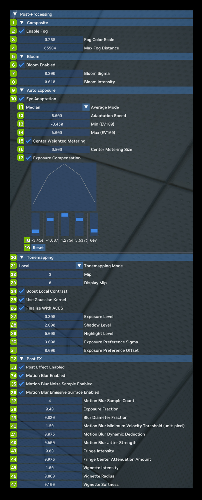

# Постобработка

Post-Processing позволяет включать, выключать и настраивать каждый из поддерживаемых в Remix эффектов постобработки.

| **№** | **Параметр** | **RTX Option**                                       | **Значение по умолчанию** | **Описание** |
|---------|-----------------------------------------------------|------------------------------------------------------|--------------------------|------------------------------------------------------------------------------------------------------------------------------------------------------------------------------------------------------------------------------------------------------------------------------------------------------------------------------------------------------------------------------------------------------------------------------------------------------------------------------------------------------------------------------------------------|
| **1**   | **Composite**                                       |                                                      |                          |                                                                                                                                                                                                                                                                                                                                                                                                                                                                                                                                                |
| 2       | Enable Fog Checkbox                                 | rtx.enableFog                                        | Checked                  |                                                                                                                                                                                                                                                                                                                                                                                                                                                                                                                                                |
| 3       | Fog Color Scale                                     | rtx.fogColorScale                                    | 0.250                    |                                                                                                                                                                                                                                                                                                                                                                                                                                                                                                                                                |
| 4       | Max Fog Distance                                    | rtx.maxFogDistance                                   | 65504                    |                                                                                                                                                                                                                                                                                                                                                                                                                                                                                                                                                |
| **5**   | **Bloom**                                           |                                                      |                          |                                                                                                                                                                                                                                                                                                                                                                                                                                                                                                                                                |
| 6       | Bloom Enabled Checkbox                              | rtx.bloom.enable                                     | Checked                  |                                                                                                                                                                                                                                                                                                                                                                                                                                                                                                                                                |
| 7       | Bloom Sigma                                         | rtx.bloom.sigma                                      | 0.100                    |                                                                                                                                                                                                                                                                                                                                                                                                                                                                                                                                                |
| 8       | Bloom Intensity                                     | rtx.bloom.intensity                                  | 0.06                     |                                                                                                                                                                                                                                                                                                                                                                                                                                                                                                                                                |
| **9**   | **Auto Exposure**                                   |                                                      |                          |                                                                                                                                                                                                                                                                                                                                                                                                                                                                                                                                                |
| 10      | Eye Adaptation Checkbox                             | rtx.autoExposure.enabled                             | Checked                  | Автоматически подстраивает экспозицию, чтобы изображение не было слишком ярким или слишком тёмным. |
| 11      | Average Mode Dropdown                               | rtx.autoExposure.exposureAverageMode                 | Median                   | Режим усреднения. Режим Mean усредняет экспозицию по пикселям. Режим Median стабильнее при экстремальных значениях пикселей. Варианты: Mean и Median |
| 12      | Adaptation Speed                                    | rtx.autoExposure.autoExposureSpeed                   | 5.000                    | Скорость изменения средней экспозиции при изменении изображения. |
| 13      | Min (EV100)                                         | rtx.autoExposure.evMinValue                          | -2.000                   | Значения Min/Max подбираются переходом между светлыми и тёмными местами в игре и подстройкой, пока изображение не будет выглядеть правильно. |
| 14      | Max (EV100)                                         | rtx.autoExposure.evMaxValue                          | 5                        | Значения Min/Max подбираются переходом между светлыми и тёмными местами в игре и подстройкой, пока изображение не будет выглядеть правильно. |
| 15      | Center Weighted Metering Checkbox                   | rtx.autoExposure.exposureCenterMeteringEnabled       | Unchecked                | Придаёт больший вес пикселям в центре экрана. |
| 16      | Center Metering Size                                | rtx.autoExposure.centerMeteringSize                  | 0.500                    | Важность пикселей в центре экрана. |
| 17      | Exposure Compensation Checkbox                      | rtx.autoExposure.useExposureCompensation             | Unchecked                | Использует кривую, определяющую важность разных уровней экспозиции при вычислении средней экспозиции. |
| 18      | Exposure Compensation Graph Values                  | rtx.autoExposure.useExposureCompensation             | 1 (for all Curve Values) | Значения кривой компенсации экспозиции |
| 19      | Reset                                               |                                                      |                          | Сброс значений кривой компенсации экспозиции к значениям по умолчанию |
| **20**  | **Tonemapping**                                     |                                                      |                          |                                                                                                                                                                                                                                                                                                                                                                                                                                                                                                                                                |
| 21      | Tonemapping Mode Dropdown                           | rtx.tonemappingMode                                  | Local                    | Глобальный тонмаппинг обрабатывает изображение с учётом глобальных параметров, обычно на основе статистики по всему отрендеренному изображению.  Локальный тонмаппинг, напротив, использует пространственно-локальные параметры, определяемые по областям изображения, а не по всему изображению.  Локальный тонмаппинг лучше сохраняет света и тени в сценах с большим динамическим диапазоном, тогда как глобальному приходится выбирать между пере- и недоэкспонированием. Варианты: Global и Local |
| 22      | Mip                                                 | rtx.localtonemap.mip                                 | 3                        | Верхний MIP-уровень пирамиды тонмаппинга. |
| 23      | Display Mip                                         | rtx.localtonemap.displayMip                          | 0                        | Нижний MIP-уровень пирамиды тонмаппинга. |
| 24      | Boot Local Contrast Checkbox                        | rtx.localtonemap.boostLocalContrast                  | Unchecked                | Усиливает контраст локальных деталей. |
| 25      | Use Gaussian Kernel Checkbox                        | rtx.localtonemap.useGaussian                         | Checked                  | Использует гауссово ядро для построения пирамиды тонмаппинга. |
| 26      | Finalize with ACES Checkbox                         | rtx.tonemap.finalizeWithACES                         | Checked                  | Применяет к итоговому результату тонмаппинг ACES... |
| 27      | Exposure Level                                      | rtx.localtonemap.exposure                            | 0.750                    | Множитель экспозиции, применяемый к средней экспозиции. |
| 28      | Shadow Level                                        | rtx.localtonemap.shadows                             | 2.000                    | Сила в области теней. Чем больше значение, тем светлее тени. |
| 29      | Highlight Level                                     | rtx.localtonemap.highlights                          | 4.000                    | Сила в области светов. Чем больше значение, тем темнее света. |
| 30      | Exposure Preference Sigma                           | rtx.localtonemap.exposurePreferenceSigma             | 4                        | Резкость перехода между областями разной экспозиции. Чем меньше значение, тем резче переходы. |
| 31      | Exposure Preference Offset                          | rtx.localtonemap.exposurePreferenceOffset            | 0                        | Смещение опорной яркости при вычислении весов принадлежности пикселя к областям теней, средних тонов и светов. |
| **32**  | **Post FX**                                         |                                                      |                          |                                                                                                                                                                                                                                                                                                                                                                                                                                                                                                                                                |
| 33      | Post Effect Enabled Checkbox                        | rtx.postfx.enable                                    | Checked                  | Включает эффекты постобработки |
| 34      | Motion Blur Enabled                                 | rtx.postfx.enableMotionBlur                          | Checked                  | Включает эффект постобработки «размытие в движении» (motion blur). |
| 35      | Motion Blur Noise Sample Enabled                    | rtx.postfx.enableMotionBlurNoiseSample               | Checked                  | Включает случайную выборку расстояния на каждом шаге вдоль вектора движения. Случайный узор генерируется чередующимся градиентным шумом (interleaved gradient noise). |
| 36      | Motion Blur Emissive Surface Enabled                | rtx.postfx.enableMotionBlurEmissive                  | Checked                  | Включает размытие в движении для излучающих поверхностей. Выключите, если размытие на излучающих поверхностях вызывает сильные артефакты. |
| 37      | Motion Blur Sample Count                            | rtx.postfx.motionBlurSampleCount                     | 4                        | Число сэмплов вдоль вектора движения. Больше сэмплов может помочь уменьшить шум размытия в движении. |
| 38      | Exposure Fraction                                   | rtx.postfx.exposureFraction                          | 0.4                      | Имитирует выдержку камеры: чем длиннее выдержка, тем сильнее размытие в движении. |
| 39      | Blur Diameter Fraction                              | rtx.postfx.blurDiameterFraction                      | 0.02                     | Диаметр круга, в пределах которого берутся сэмплы размытия в движении. Векторы движения за пределами этого круга ограничиваются. |
| 40      | Motion Blur Minimum Velocity Threshold (unit:pixel) | rtx.postfx.motionBlurMinimumVelocityThresholdInPixel | 1                        | Минимальная длина вектора движения, при которой включается размытие. Единица измерения — размер пикселя. |
| 41      | Motion Blur Dynamic Deduction                       | rtx.postfx.motionBlurDynamicDeduction                | 1                        | Ослабление размытия в движении для динамических объектов. |
| 42      | Motion Blur Jitter Strength                         | rtx.postfx.motionBlurJitterStrength                  | 0.6                      | Сила дрожания (jitter) каждого сэмпла вдоль вектора движения. |
| 43      | Fringe Intensity                                    | rtx.postfx.chromaticAberrationAmount                 | 0.02                     | Сила хроматической аберрации. |
| 44      | Fringe Center Attenuation Amount                    | rtx.postfx.chromaticCenterAttenuationAmount          | 0.975                    | Насколько ослабляется эффект хроматической аберрации ближе к центру экрана. |
| 45      | Vignette Intensity                                  | rtx.postfx.vignetteIntensity                         | 0.8                      | Сила затемнения в эффекте виньетирования. |
| 46      | Vignette Radius                                     | rtx.postfx.vignetteRadius                            | 0.8                      | Радиус, с которого начинается виньетирование. Единица измерения — нормализованное экранное пространство: 0 — центр, 1 — край короткой стороны окна рендеринга. Поэтому значение может быть больше 1, вплоть до длинной стороны окна рендеринга. |
| 47      | Vignette Softness                                   | rtx.postfx.vignetteSoftness                          | 0.2                      | Градиент, с которым цвет уходит в чёрный от vignetteRadius до края окна рендеринга. |

***
 Хотите оставить отзыв о документации RTX Remix? [Нажмите здесь](https://github.com/NVIDIAGameWorks/rtx-remix/issues/new?assignees=nvdamien&labels=documentation%2Cfeedback%2Ctriage&projects=&template=documentation_feedback.yml&title=%5BDocumentation+feedback%5D%3A+) 
