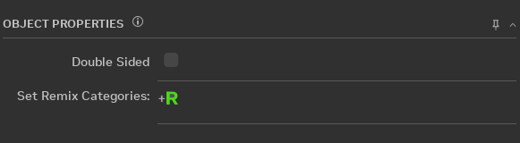
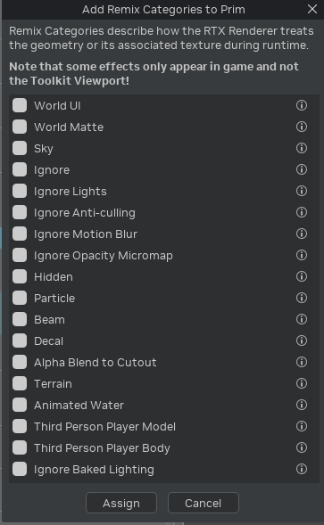
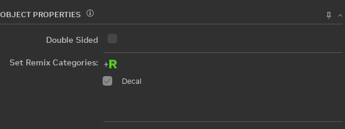

# Категории рендеринга

Чтобы задать категорию Remix в интерфейсе Toolkit, воспользуйтесь кнопкой Set Remix Category на вкладке Asset
Replacements в разделе Object Properties.

Категория Remix задаётся в окне, которое открывает эта кнопка. Можно выбрать сразу несколько категорий. Учтите, что не
все категории будут правильно работать во вьюпорте Toolkit, поскольку для корректной отрисовки им нужен игровой
движок. Кроме того, некоторые категории скрывают геометрию во вьюпорте, и выделить её там будет уже нельзя.

Категории рендеринга, доступные сейчас в Toolkit, и их описания:

|   Отображаемое имя        | Имя атрибута                             | Описание |
|:-------------------------:|:-----------------------------------------|:---------|
|         World UI          | remix_category:world_ui                  | Текстуры вызовов отрисовки, которые следует считать элементами интерфейса в экранном пространстве. Так следует классифицировать все текстуры, относящиеся исключительно к интерфейсу: тогда интерфейс, как обычно, растеризуется поверх сцены с трассировкой лучей. Учтите, что сейчас первая встреченная текстура интерфейса запускает внедрение RTX (в будущем это может измениться, поскольку вызывает проблемы в играх, рисующих интерфейс в середине кадра). |
|        World Matte        | remix_category:world_matte               | Текстуры вызовов отрисовки, которые следует считать элементами интерфейса в мировом пространстве. В отличие от обычных текстур интерфейса, этот вариант улучшает отрисовку элементов интерфейса, которые являются частью сцены (перемещаются в 3D-пространстве, а не находятся в экранном пространстве). |
|            Sky            | remix_category:sky                       | Геометрия вызовов отрисовки, используемая для неба или иным образом предназначенная всегда находиться очень далеко от камеры (без параллакса). Все вызовы отрисовки с хешем геометрии из этого списка считаются небом и рендерятся иначе, чем обычная геометрия. Хеш геометрии для распознавания неба вычисляется по правилу хеширования ассетов (asset hash rule). |
|          Ignore           | remix_category:ignore                    | Текстуры вызовов отрисовки, которые следует игнорировать. Любой вызов отрисовки с такой текстурой пропускается и не трассируется. Полезно для удаления нежелательных растеризованных эффектов или геометрии, не подходящей для трассировки лучей. |
|       Ignore Lights       | remix_category:ignore_lights             | Источники света, которые следует игнорировать. Любой подходящий источник пропускается и не добавляется в трассировку лучей. |
|    Ignore Anti-culling    | remix_category:ignore_anti_culling       | Текстуры, время жизни которых принудительно продлевается при включённом anti-culling (защите от отсечения). Некоторые игры используют методы отсечения, которые мы не можем точно воспроизвести; этот вариант позволяет вручную добавить текстуры, время жизни которых нужно продлевать, когда anti-culling не срабатывает. |
|    Ignore Motion Blur     | remix_category:ignore_motion_blur        | Отключает размытие в движении для мешей с определённой текстурой. |
|  Ignore Opacity Micromap  | remix_category:ignore_opacity_micromap   | Текстуры, которые игнорируются при создании Opacity Micromap (микрокарт непрозрачности). Обычно задавать не нужно; полезно лишь для исключения проблемных случаев использования Opacity Micromap. |
|          Hidden           | remix_category:hidden                    | Текстуры вызовов отрисовки, которые следует скрыть при рендеринге, но не игнорировать полностью. Похоже на rtx.ignoreTextures, но такие вызовы отрисовки не игнорируются полностью, а только скрываются при рендеринге, так что скрытые объекты по-прежнему попадают в захваты. Поэтому это в основном инструмент разработки, позволяющий скрыть объекты, пока они не заменены как следует; в остальных случаях для лучшей производительности объекты следует игнорировать через rtx.ignoreTextures. |
|         Particle          | remix_category:particle                  | Текстуры вызовов отрисовки, которые следует считать частицами. Для объектов, помеченных как частицы, используются более приближённые методы рендеринга, что позволяет отрисовывать частицы эффективнее и обычно красивее. Как правило, так следует классифицировать все смешиваемые частицы-билборды исходного приложения. |
|           Beam            | remix_category:beam                      | Текстуры вызовов отрисовки, которые уже являются частицами или смешиваются как излучающие и имеют геометрию в виде луча. Для случаев, когда обычный билборд не подходит, используется особый режим луча: объект обрабатывается скорее как цилиндрический луч и переориентируется вокруг своей главной оси, что улучшает отрисовку таких эффектов. |
|           Decal           | remix_category:decal_Static              | Текстуры вызовов отрисовки, используемые для статических геометрических декалей или декалей со сложной топологией. Когда включено смешивание материалов декалей, эти материалы смешиваются с материалами под ними. К каждой плоской (копланарной) части таких декалей применяется небольшое настраиваемое смещение, чтобы избежать копланарной геометрии, которая создаёт проблемы для трассировки лучей. |
|   Alpha Blend to Cutout   | remix_category:alpha_blend_to_cutout     | Объекту, добавленному в список cutout-текстур, принудительно назначается режим альфа-отсечения (cutout) с этим значением для альфа-теста. Это улучшает внешний вид некоторых материалов устаревшего режима, использующих текстуры низкого разрешения и альфа-смешивание в Remix. Обычно такие объекты лучше заменять настоящими ассетами — полностью непрозрачной геометрией или альфа-отсечением с текстурами более высокого разрешения, — поэтому на этот вариант стоит полагаться только до тех пор, пока не будут созданы полноценные замены. |
|          Terrain          | remix_category:terrain                   | Альбедо-текстуры, которые запекаются и смешиваются в единую текстуру ландшафта, используемую при трассировке лучей. Помещайте альбедо-текстуры в эту категорию, если игра рендерит ландшафт как смесь нескольких текстур. |
|      Animated Water       | remix_category:animated_water            | Текстуры вызовов отрисовки, которые следует считать «анимированной водой». Объекты с этим флагом анимируют свои нормали, имитируя простой эффект воды на основе параметров слоистого материала воды, и только если rtx.opaqueMaterial.layeredWaterNormalEnable имеет значение true. Обычно используется для статичных плоскостей воды, которые исходное приложение могло анимировать шейдерами. |
| Third Person Player Model | remix_category:third_person_player_model | Считается моделью от третьего лица: используется для теней, но не рендерится. |
| Third Person Player Body  | remix_category:third_person_player_body  | Считается моделью от третьего лица: используется для теней, но не рендерится. |
|   Ignore Baked Lighting   | remix_category:ignore_baked_lighting     | Текстуры, для которых игнорируются два вида запечённого освещения: Texture Factors и Vertex Color. Отключение Texture Factor: для выбранных текстур устраняются коэффициенты текстуры. Отключение Vertex Color: для выбранных текстур устраняются цвета вершин. Учтите, что включение этой настройки автоматически отключает многоступенчатое смешивание коэффициентов текстуры для выбранных текстур. |

|   Ignore Transparency Layer   | remix_category:ignore_transparency_layer     | Текстуры вызовов отрисовки, которые следует игнорировать при рендеринге слоёв прозрачности. |

|   Particle Emitter   | remix_category:particle_emitter     | Геометрия вызовов отрисовки, которую следует считать излучателями частиц. |

|   Ignore Alpha Channel   | remix_category:ignore_alpha_channel     | Флаг, отключающий учёт альфа-канала карты цвета (colormap) непрозрачного материала. Следует использовать только для отладки или разработки. |

После назначения список обновится в разделе Object Properties:

