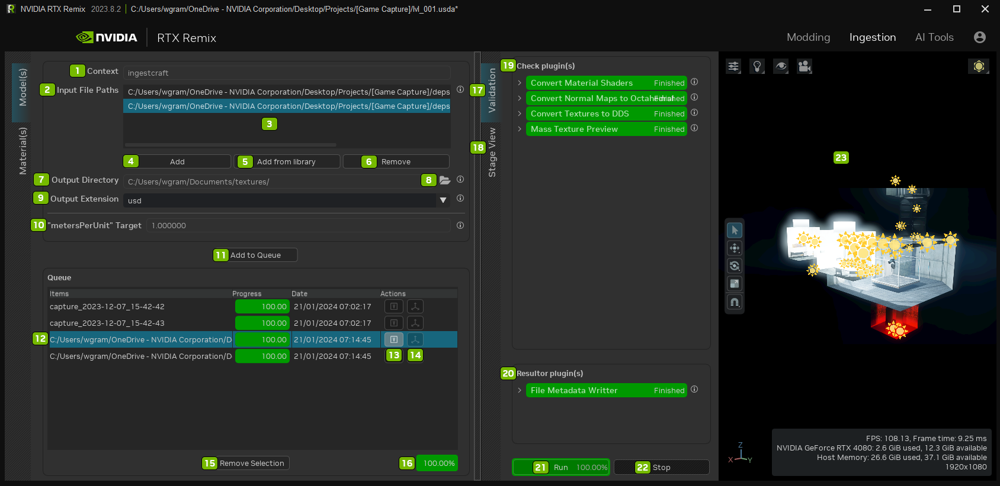
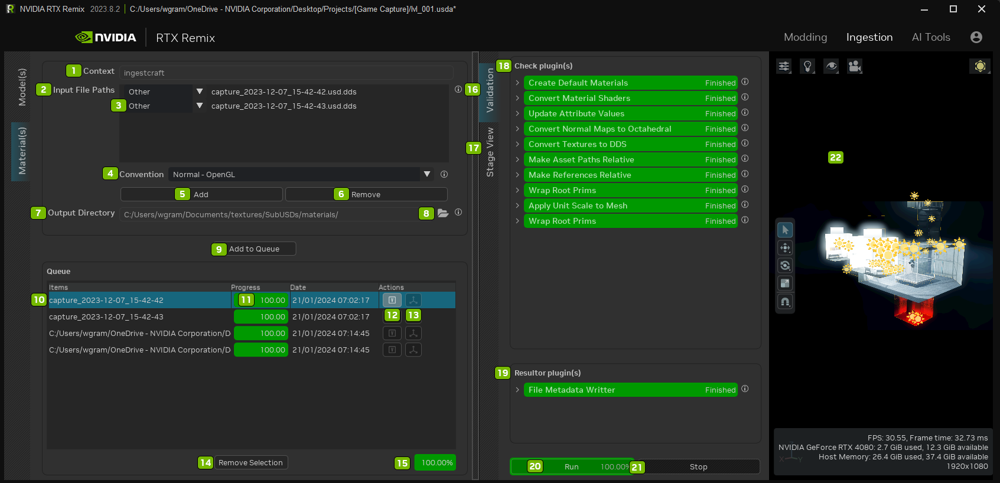

# Вкладка Ingest

В обоих режимах импорта есть поле **Max Concurrent Texture Conversions**. Это общее значение ограничивает, сколько
преобразований текстур в DDS и октаэдрический формат может выполняться одновременно. По умолчанию — `2`; уменьшите
значение, если импорт зависает или не хватает видеопамяти. Задайте его до добавления ассетов в очередь.

На вкладке **Model(s)** поле находится под **Output Extension**, на вкладке **Material(s)** — под **Output Directory**.

## Импорт моделей

Параметр **Normal Map Convention** находится под **Asset Scale Factor**. Оставьте значение **Preserve Imported**, чтобы
сохранить соглашения, заданные импортёром моделей, или переопределите их для всего пакета импортируемых моделей,
выбрав **Normal - OpenGL**, **Normal - DirectX** или **Normal - Octahedral**. Этот параметр относится к текстурам карт
нормалей, на которые ссылаются импортированные модели, а не к нормалям меша. После смены соглашения модели нужно
импортировать заново.

| №   | Параметр                     | Описание                                                                                    |
|:---:|:-----------------------------|:--------------------------------------------------------------------------------------------|
|  1  | Context                      | Ingestcraft                                                                                 |
|  2  | Input File Paths             | Список файлов, импортируемых как USD-файлы                                                  |
|  3  | List of Path(s) Field(s)     | Список файлов, импортируемых как USD-файлы                                                  |
|  4  | Add                          | Добавляет файлы в поле путей                                                                |
|  5  | Add from Library             | Открывает каталог библиотечных ассетов                                                      |
|  6  | Remove                       | Удаляет файлы из поля путей                                                                 |
|  7  | Output Directory             | Каталог, в который импортируются сконвертированные входные файлы                            |
|  8  | Opens File Explorer          |
|  9  | Output Extension             | Расширение USD-файла для сконвертированного входного файла                                  |
|  —  | Max Concurrent Texture Conversions | Ограничивает число одновременных преобразований текстур в DDS и октаэдрический формат общим значением |
| 10  | Apply Unit Scale to Mesh     | Применяет масштаб «metersPerUnit» к масштабу XForm меша                                     |
| 11  | Add to Queue                 | Добавляет ассеты из Input File Path в очередь импорта и помещает результат в Output Directory |
| 12  | Selected Asset               |
| 13  | Toggle Validation Tab        | Открывает или закрывает вкладку проверки (Validation)                                       |
| 14  | Show in Viewport             | Открывает или закрывает вьюпорт                                                             |
| 15  | Remove Selection             | Удаляет выбранный ассет из очереди                                                          |
| 16  | Queue Ingestion Progress Bar | Процент выполнения                                                                          |
| 17  | Validation Tab               | Проверяет импортированные ассеты                                                            |
| 18  | Stage View Tab               | Показывает список ассетов в сцене                                                           |
| 19  | Check Plugin(s)              | Плагины проверки, используемые при импорте                                                  |
| 20  | Resulter Plugin(s)           | Плагины обработки результатов, используемые при импорте                                     |
| 21  | Run                          | Запускает импорт моделей                                                                    |
| 22  | Stop                         | Останавливает импорт моделей                                                                |
| 23  | Viewport                     | Просмотр импорта моделей                                                                    |

## Импорт материалов

Параметр **Normal Map Convention** находится среди параметров импорта материалов под элементами выбора файлов и
выходного каталога. Он задаёт соглашение по умолчанию для текстур карт нормалей, добавленных или найденных в текущем
пакете. Импорт материалов предлагает варианты **Normal - OpenGL**, **Normal - DirectX** и **Normal - Octahedral**.

| №   | Параметр                           | Описание                                                                                                                                                                       |
|:---:|:-----------------------------------|:-------------------------------------------------------------------------------------------------------------------------------------------------------------------------------|
|  1  | Context                            | Ingestcraft                                                                                                                                                                    |
|  2  | Input File Paths                   | Список файлов, импортируемых как USD-файлы                                                                                                                                     |
|  3  | Material Type Dropdown             | Выбор типа материала из списка.  
Варианты: Other, Albedo, Emissive Mask, Metallic, Normal - OpenGL, Normal - DirectX, Normal - Octahedral или Roughness
                 |
|  4  | Normal Map Convention              | Выбор соглашения по умолчанию для текстур карт нормалей в пакете: Normal - OpenGL, Normal - DirectX или Normal - Octahedral                                                    |
|  5  | Add                                | Добавляет файлы в поле путей                                                                                                                                                   |
|  6  | Remove                             | Удаляет файлы из поля путей                                                                                                                                                    |
|  7  | Output Directory                   | Каталог, в который импортируются сконвертированные входные файлы                                                                                                               |
|  8  | Opens File Explorer                |
|  —  | Max Concurrent Texture Conversions | Ограничивает число одновременных преобразований текстур в DDS и октаэдрический формат общим значением                                                                          |
|  9  | Add to Queue                       | Добавляет ассеты из Input File Path в очередь импорта и помещает результат в Output Directory                                                                                  |
| 10  | Selected Asset                     |
| 11  | Queue Asset Ingestion Progress Bar | Процент выполнения                                                                                                                                                             |
| 12  | Toggle Validation Tab              | Открывает или закрывает вкладку проверки (Validation)                                                                                                                          |
| 13  | Show in Viewport                   | Открывает или закрывает вьюпорт                                                                                                                                                |
| 14  | Remove Selection                   | Удаляет выбранный ассет из очереди                                                                                                                                             |
| 15  | Queue Ingestion Progress Bar       | Процент выполнения                                                                                                                                                             |
| 16  | Validation Tab                     | Проверяет импортированные ассеты                                                                                                                                               |
| 17  | Stage View Tab                     | Показывает список ассетов в сцене                                                                                                                                              |
| 18  | Check Plugin(s)                    | Плагины проверки, используемые при импорте                                                                                                                                     |
| 19  | Resulter Plugin(s)                 | Плагины обработки результатов, используемые при импорте                                                                                                                        |
| 20  | Run                                | Запускает импорт моделей                                                                                                                                                       |
| 21  | Stop                               | Останавливает импорт моделей                                                                                                                                                   |
| 22  | Viewport                           | Просмотр импорта моделей                                                                                                                                                       |

***
 Хотите оставить отзыв о документации RTX Remix? [Нажмите здесь](https://github.com/NVIDIAGameWorks/rtx-remix/issues/new?assignees=nvdamien&labels=documentation%2Cfeedback%2Ctriage&projects=&template=documentation_feedback.yml&title=%5BDocumentation+feedback%5D%3A+) 
