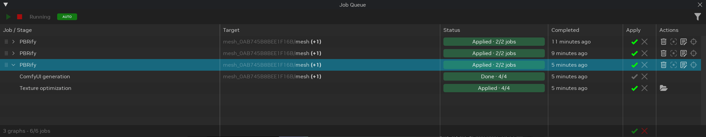
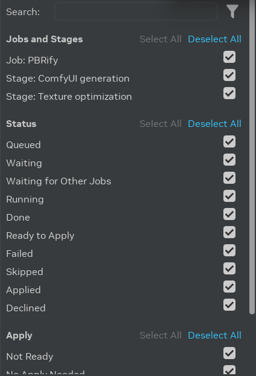
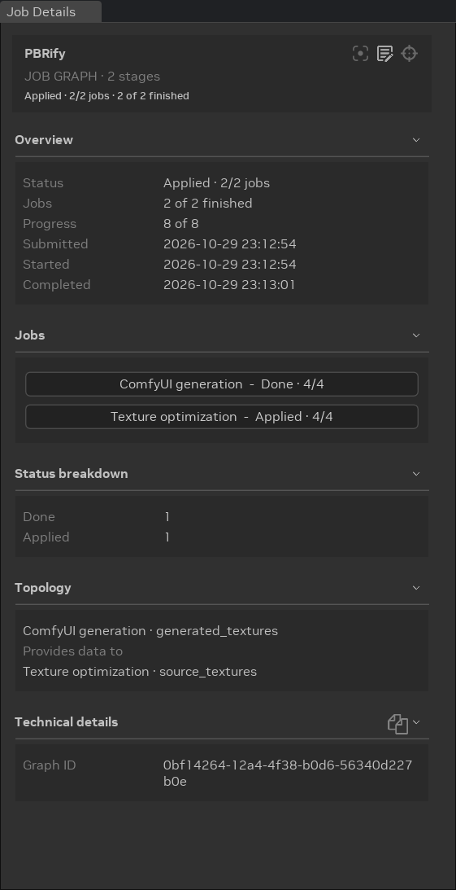

# Очередь заданий

**Очередь заданий** (Job Queue) показывает работу, которую Toolkit выполняет в фоне, например запускаемые вами рабочие
процессы [AI Tools](../howto/learning-aitools.md) и [модификаторы ассетов](../howto/learning-assetmodifiers.md). Пока
задания выполняются, можно продолжать редактировать проект.
Очередь показывает ход выполнения каждого задания, позволяет применить или отклонить его результаты и хранит историю
между перезапусками.

## Как открыть очередь заданий

- **Макет AI Tools:** вкладка **Job Queue** находится под вьюпортом, рядом со **Stage Manager**. **Job Details** —
  справа.
- **Макет Modding:** вкладка **Job Queue** находится за вкладкой **Stage Manager**.
- **Любой макет:** выберите **Window** > **Jobs** > **Job Queue** или **Job Details**.

## Графы заданий и этапы

Одна отправка добавляет в очередь один или несколько **графов заданий** (job graphs). Граф задания — это одна строка
очереди. Нажмите стрелку в начале строки, чтобы увидеть его **этапы** (stages) — шаги, выполняемые по порядку.
Например, у рабочего процесса AI Tools для текстур есть этап **ComfyUI generation**, а затем этап **Texture
optimization**. Модификатор ассета, изменяющий меш, запускает сам модификатор, а затем этапы оптимизации, как у
импортированной модели.

Этап начинается, когда завершаются предшествующие ему этапы. Граф меняет проект, только когда какой-либо этап
применяет свой результат, поэтому этап, завершившийся с ошибкой, оставляет проект без изменений.

| Столбец | Что показывает |
|--------|-------|
| **Job / Stage** | Имя графа задания (например, имя рабочего процесса) или имя этапа. |
| **Target** | Примы, которые задание читает и изменяет, в виде родителя и имени, как в Stage Manager. **(+N)** — количество остальных примов. Наведите курсор на ячейку, чтобы увидеть все пути примов. Строка графа показывает цель первого этапа, у которого она есть. |
| **Status** | Статус этапа или всего графа с числом завершённых заданий. Наведите курсор на статус, чтобы увидеть причину. |
| **Completed** | Когда задание завершилось, например **Just now** («только что»). Щёлкните по времени или по заголовку столбца, чтобы переключиться между относительным и абсолютным временем. |
| **Apply** | Кнопки **Apply** (✔️) и **Decline** (✖️). См. [Применение результатов](#применение-результатов). |
| **Actions** | Действия графа или этапа. См. [Действия в строке](#действия-в-строке). |

Внизу показано количество графов и видимых заданий.

## Панель инструментов

| Элемент | Назначение |
|---------|-----|
| **Start** (▶️) | Начинает отправлять задания из очереди на выполнение. |
| **Stop** (⏹️) | Прекращает отправку новых заданий. Уже выполняющиеся задания продолжают работу до завершения. |
| **Running**, **Stopping**, **Stopped** | Состояние планировщика. **Stopping** означает ожидание завершения выполняющихся заданий. Наведите курсор, чтобы увидеть, какие графы ещё выполняются. |
| **AUTO** / **MANUAL** | Режим применения. Щёлкните по значку, чтобы переключить. **AUTO** применяет каждый результат сразу по готовности. **MANUAL** ждёт, пока вы нажмёте **Apply**. |
| **Filter** | Открывает [дополнительные фильтры](#фильтрация-заданий). |

По умолчанию планировщик работает, а режим применения — **AUTO**. Toolkit запоминает обе настройки между перезапусками.

## Статусы заданий

| Статус | Значение |
|--------|---------|
| **Queued** | Задание ждёт своей очереди. |
| **Waiting** | Задание ждёт завершения предшествующих этапов или чего-то ещё, например сервера ComfyUI. Наведите курсор на статус, чтобы увидеть причину. |
| **Running** | Задание выполняется. Статус показывает ход выполнения. |
| **Done** | Задание завершено. Результата для применения у него нет. |
| **Ready to Apply** | Задание завершено, и его результат ждёт команды **Apply**. |
| **Applying...**, **Reapplying...**, **Reverting...** | Toolkit вносит изменения в проект. |
| **Applied** | Результат внесён в проект. |
| **Partially Applied** | Часть результатов графа применена, а часть отклонена. |
| **Declined** | Результат не будет добавлен в проект. Его всё ещё можно применить. |
| **Skipped** | Заданию не нужно было выполняться, например потому, что ассет уже оптимизирован. Наведите курсор на статус, чтобы увидеть причину. Если у задания всё же есть результаты, их можно применить. |
| **Failed** | Задание не удалось завершить. Наведите курсор на статус, чтобы увидеть причину. |
| **Timed Out** | Задание не завершилось до истечения тайм-аута. Нажмите **Retry**, чтобы запустить его снова. |
| **Stopped** | Вы остановили задание до завершения. Нажмите **Retry**, чтобы запустить его снова. |
| **Apply Failed**, **Reapply Failed**, **Revert Failed** | Toolkit не смог изменить проект. Нажмите ту же кнопку ещё раз, чтобы повторить попытку. |
| **Unavailable** | Функция, необходимая заданию, не загружена. |

## Применение результатов

Завершённое задание, которое изменяет проект, показывает кнопки **Apply** (✔️) и **Decline** (✖️):

- **Apply** добавляет результат в проект. После этого кнопки меняются на **Reapply** (✔️) и **Revert** (✖️).
- **Decline** сохраняет обработанные файлы, но не изменяет проект. Позже всё равно можно нажать **Apply**.
- **Revert** запрашивает подтверждение, а затем восстанавливает значения проекта, которые были до применения
  результата. Обработанные файлы остаются на диске, поэтому позже можно нажать **Reapply**.

Кнопки в строке графа действуют на все подходящие этапы графа. Кнопки внизу действуют на все подходящие задания очереди
сверху вниз. «Подходящие» — это задания, которые показываются с учётом текущих фильтров.

Если кнопка недоступна, наведите на неё курсор, чтобы узнать причину. Например, результат нельзя применить, пока его
проект закрыт.

## Действия в строке

У строки графа есть следующие действия:

- **Delete** после подтверждения удаляет граф, его задания и их выходные файлы. Изменения, уже применённые к проекту,
  сохраняются. Можно также выделить графы и нажать **Delete**.
- **Stop** заменяет **Delete**, пока выполняется какой-либо этап графа. Останавливает выполняющийся этап, после чего он
  получает статус **Stopped**.
- Действия, зависящие от типа задания, например **Focus in Viewport**, **Open Workflow** и **Retarget** для
  [заданий AI Tools](../howto/learning-aitools.md#управление-заданиями-ai-tools).

У строки этапа могут быть следующие действия:

- **Retry** запускает этап со статусом **Timed Out** или **Stopped** заново с теми же входами.
- **Reveal in File Explorer** открывает папку обработанных текстур этапа **Texture optimization**.

Перетащите граф за маркер в начале строки, чтобы изменить его место в очереди. Графы в очереди запускаются в порядке
очереди.

## Фильтрация заданий

Нажмите значок **Filter** на панели инструментов, чтобы открыть **Additional Filters**.

- **Search** показывает задания и этапы, имя которых содержит введённый текст.
- **Jobs and Stages** показывает только отмеченные имена заданий и этапов.
- **Status** показывает только отмеченные статусы. **Failed** также включает **Timed Out**, **Stopped** и статусы
  неудачного применения.
- **Apply** показывает только отмеченные состояния применения: **Not Ready**, **No Apply Needed**, **Ready to Apply**,
  **Applied** и **Declined**.

В каждом разделе есть **Select All** и **Deselect All**. Нажмите **Reset All**, чтобы убрать все фильтры. Пока
какой-либо фильтр активен, значок **Filter** меняет цвет. Граф остаётся видимым, пока хотя бы один его этап подходит
под фильтр.

## Сведения о задании

Выберите граф или этап, чтобы показать информацию о нём в окне **Job Details**.

Для **графа задания** Job Details показывает:

- **Overview:** статус, число завершённых заданий, ход выполнения, время отправки, начала и завершения.
- **Jobs:** каждый этап с его статусом. Щёлкните по этапу, чтобы увидеть сведения о нём.
- **Status breakdown:** количество этапов в каждом статусе.
- **Problems:** этапы, завершившиеся с ошибкой, и причины ошибок.
- **Topology:** какой этап передаёт данные какому.
- **Technical details:** идентификатор графа.

Для **этапа** Job Details показывает:

- **Overview:** статус, причину, ход выполнения, источник и время.
- **Logs:** сообщения, записанные этапом. Нажмите значок копирования, чтобы скопировать их.
- Разделы, зависящие от типа задания. Например, этап **ComfyUI generation** AI Tools показывает раздел **ComfyUI
  server**, а этап **Texture optimization** — раздел **Processed textures**.
- **Inputs** и **Outputs:** значения, которые этап получил и выдал. Нажмите значок папки в заголовке раздела, чтобы
  открыть папку с этими файлами.
- **Topology** и **Technical details:** этапы, которым он передаёт данные или перед которыми выполняется, а также его
  идентификаторы и ошибки.

## Сохранение заданий

Очередь сохраняется на диске. Если закрыть Toolkit, пока в очереди есть задания, при следующем запуске они останутся в
очереди. Запустите планировщик, чтобы продолжить их выполнение. Удалить граф из очереди можно только командой удаления.

***
 Хотите оставить отзыв о документации RTX Remix? [Нажмите здесь](https://github.com/NVIDIAGameWorks/rtx-remix/issues/new?assignees=sambvfx&labels=documentation%2Cfeedback%2Ctriage&projects=&template=documentation_feedback.yml&title=%5BDocumentation+feedback%5D%3A+) 
