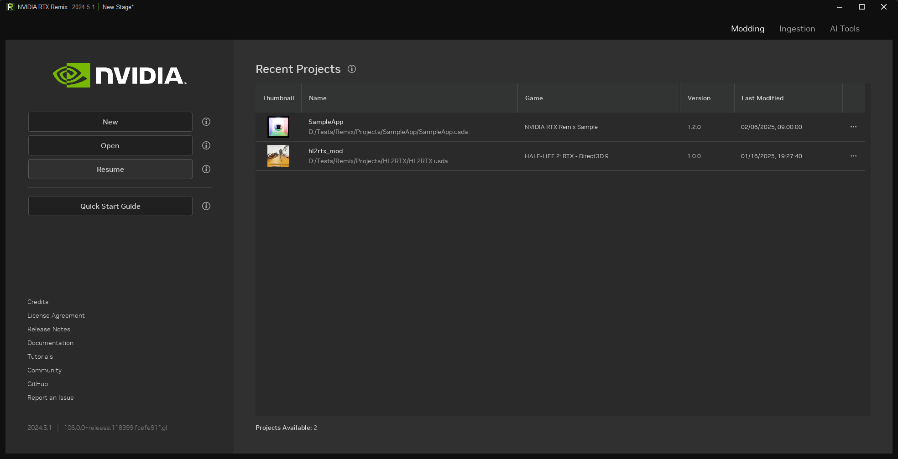

# Стартовый экран

| Параметр            | Описание                                                                                  |
|:--------------------|:------------------------------------------------------------------------------------------|
| New                 | Запускает мастер проектов, чтобы создать или открыть проект                               |
| Open                | Открывает существующий проект                                                             |
| Resume              | Продолжает редактирование проекта, над которым вы сейчас работаете                        |
| Quick Start Guide   | Открывает в браузере страницу документации с кратким руководством по началу работы        |
| Recent Projects     | Список недавно открытых проектов                                                          |
| Modding             | Открывает вкладку Modding, если проект открыт; иначе показывается главная страница        |
| Ingest              | Открывает вкладку импорта (Ingestion)                                                     |
| AI Tools            | Открывает вкладку AI Tools                                                                |

***
 Хотите оставить отзыв о документации RTX Remix? [Нажмите здесь](https://github.com/NVIDIAGameWorks/rtx-remix/issues/new?assignees=nvdamien&labels=documentation%2Cfeedback%2Ctriage&projects=&template=documentation_feedback.yml&title=%5BDocumentation+feedback%5D%3A+) 
