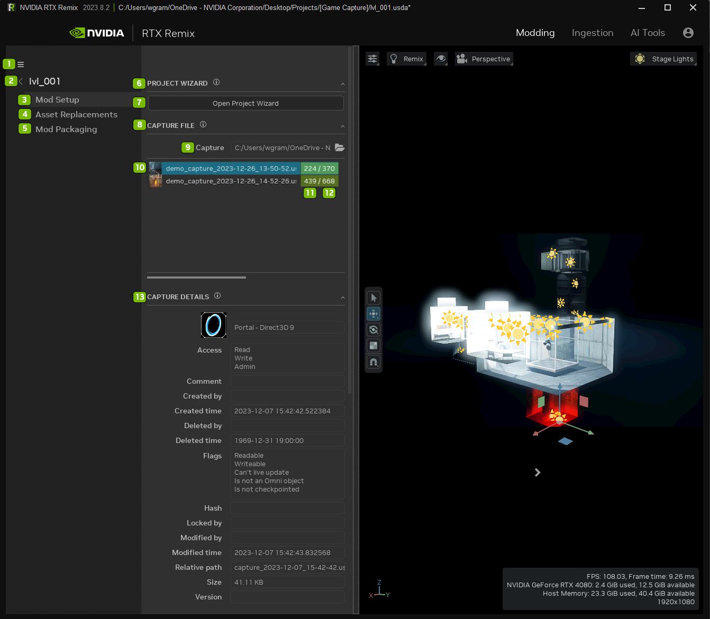
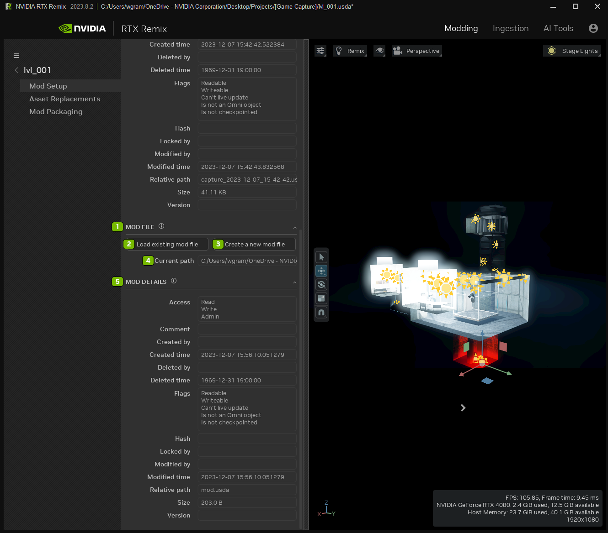
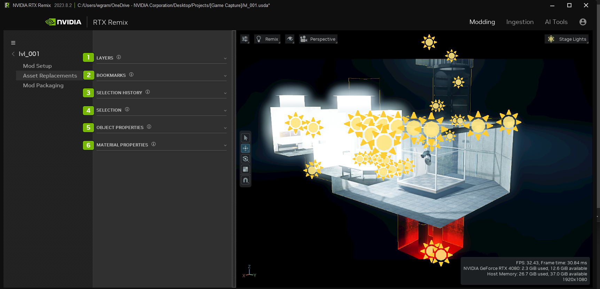
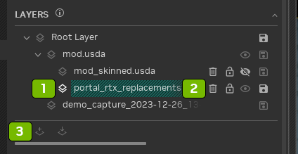
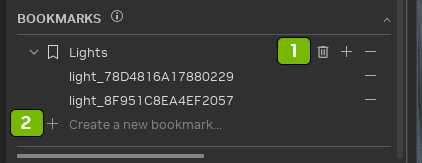
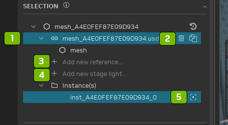
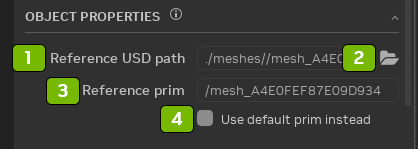
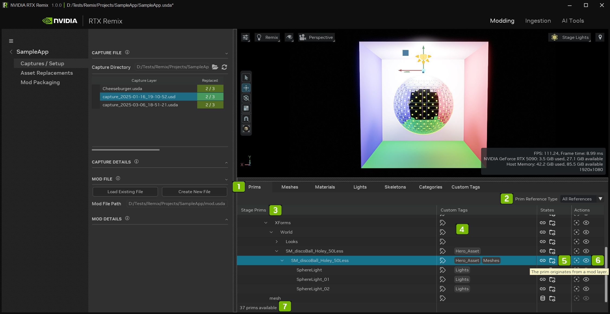
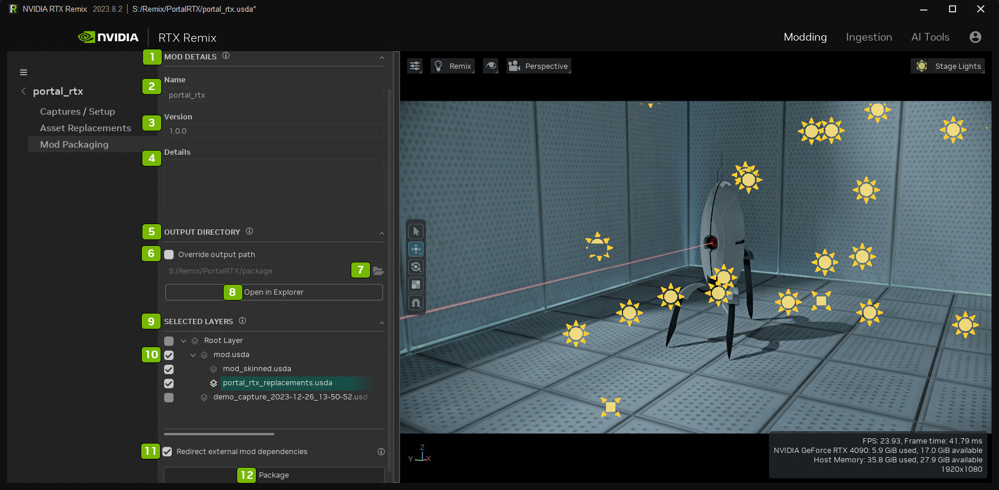
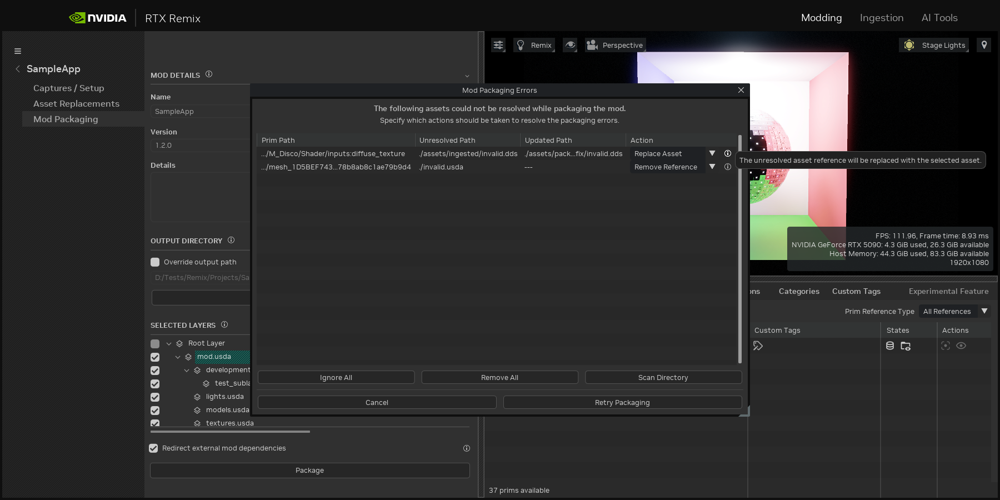

# Вкладка макета (Layout)

## Настройка мода

| № | Параметр | Описание |
|:---:|:-----------------------|:-----------------------------------------------------------------------------------------------------------------------------------------------------------------------------------|
|  1  | Hamburger Menu         | Close Project`*` (закрыть проект) Save (Ctrl + S) — сохранить Save As (Ctrl + Shift + S) — сохранить как Undo (Ctrl + Z) — отменить Redo (Ctrl + Y) — повторить Preferences — настройки Optional Features`**` — дополнительные функции Show Logs`***` — показать журналы About — о программе |
|  2  | Project Title          |
|  3  | Mod Setup Tab          | Задание сведений о проекте мода |
|  4  | Asset Replacements Tab |
|  5  | Mod Packaging Tab      |
|  7  | Open Project Wizard    | Запускает панель [мастера проектов](remix-toolkitinterface-projectwizard.md) |
|  8  | Capture File           | Загрузка файла захваченной игровой сцены |
|  9  | Capture File Location  | Каталог, в котором находится файл захвата |
| 10  | Loaded Capture         |
| 11  | Replaces Prims         | Цвет фона показывает процент замен (красный = 0%, зелёный = 100%) |
| 12  | Total Prims in Capture | Цвет фона показывает процент замен (красный = 0%, зелёный = 100%) |
| 13  | Capture Details        | Показывает сведения о файле слоя захвата, загруженном в сцену |

**ПРИМЕЧАНИЯ:**

- `*` **Close Project:** закрытие проекта выгружает сцену и освобождает ресурсы для других задач, например для импорта
  или AI Tools.
- `**` **Optional Features:** некоторые функции могут влиять на производительность RTX Remix Toolkit, поэтому их можно
  выборочно отключать в окне Optional Features. Все изменения состояния функций сохраняются между перезапусками
  приложения.
- `***` **Show Logs:** если с Toolkit возникла проблема, в журналах, скорее всего, есть информация, необходимая для её
  диагностики. Создавая обращение на GitHub, прикрепите к нему соответствующие журналы.

| № | Параметр | Описание |
|:---:|:---------------------------|:---------------------------------------------------------------|
|  1  | Mod File                   | Изменение файла захвата |
|  2  | Load Existing Mod File     | Загрузка существующего файла мода |
|  3  | Create a New Mod File      | Создание нового файла мода |
|  4  | Current Path File Location | Каталог, в котором находится текущий файл |
|  5  | Mod Details                | Показывает сведения о файле слоя мода, загруженном в сцену |

## Замена ассетов

| № | Параметр | Описание |
|:---:|:--------------------------|:------------------------------------------------------------|
|  1  | Layers Panel              | Наглядное представление USD-слоёв мода |
|  2  | Bookmarks Panel           | Дерево всех коллекций закладок и элементов в закладках |
|  3  | Selection History Panel   | Список недавно выделенных ассетов |
|  4  | Selection Panel           | Показывает свойства выделенного меша |
|  5  | Object Properties Panel   | Свойства выделенного меша |
|  6  | Material Properties Panel | Свойства материала выделенного меша |

**Панель Layers**

| № | Параметр |
|:---:|:-------------------------|
|  1  | Выбранный слой |
|  2  | Удалить, заблокировать, отключить (mute), сохранить |
|  3  | Создать или вставить слой |

**Панель Bookmarks**

| № | Параметр |
|:---:|:---------------------------------|
|  1  | Выбранная закладка |
|  2  | Удалить, добавить или очистить коллекцию |

**Панель Selection**

| № | Параметр |
|:---:|:------------------------------------------------------------|
|  1  | Выбранный ассет |
|  2  | Удалить или дублировать ссылку |
|  3  | Создать в том же приме новую ссылку на другой USD-файл |
|  4  | Создать новый источник света в сцене |
|  5  | Сфокусироваться на экземпляре |

| № | Параметр |
|:---:|:----------------------------------|
|  1  | Путь к USD-файлу ссылки |
|  2  | Открыть Проводник |
|  3  | Прим, на который указывает ссылка |
|  4  | Флажок «использовать вместо него прим по умолчанию» |

## Stage Manager

| № | Параметр | Описание |
|:---:|:-------------------------|:-----------------------------------------------------------------------------------------------------------------------------------------------------------------------------------------------------------------------------------------------|
|  1  | **Tabs**                 | Позволяют переключаться между разными представлениями данных сцены. Каждая вкладка показывает информацию по-своему, помогая сосредоточиться на определённых аспектах сцены. Щёлкните по вкладке, чтобы обновить содержимое Stage Manager. |
|  2  | **Filters**              | Позволяют уточнить данные, отображаемые на каждой вкладке. Фильтры зависят от вкладки и дают больше контроля над тем, что вы видите, помогая сузить информацию до самого важного. |
|  3  | **Columns**              | На каждой вкладке может быть несколько столбцов с разным назначением. Это помогает организовать данные так, чтобы их было легко понимать и с ними было удобно работать, упрощая управление сценой. |
|  4  | **Widget**               | Интерактивные элементы, заполняющие столбцы. Они могут показывать информацию или запускать действия, упрощая управление сценой. Виджеты можно настраивать под свои задачи. |
|  5  | **State Widget**         | Пример виджета, который при наведении курсора показывает подробную информацию о выделенном приме. Это позволяет быстро получить важные сведения, не уходя из текущего представления. |
|  6  | **Action Widget**        | Кликабельный виджет, выполняющий действия с выделенными элементами. При наведении на него показывается, что он делает, так что вы всегда знаете, к чему приведёт действие. Это ускоряет работу, избавляя от лишних шагов. |
|  7  | **Overview Information** | Сводка общего состояния всех видимых примов на вкладке. Позволяет с одного взгляда оценить состояние сцены и держать всё под контролем. |

## Упаковка мода

| № | Параметр | Описание |
|:---:|:--------------------------------------------|:--------------------------------------------------------------------------------------------------------------------------------------------------------------------------------------|
|  1  | Mod Details Panel                           | Имя упаковываемого мода и любые дополнительные сведения о нём |
|  2  | Name                                        | Имя мода |
|  3  | Version                                     | Версия мода |
|  4  | Details                                     | Информация о моде |
|  5  | Output Directory Panel                      | Выходной каталог пакета — точный путь, по которому будут скопированы собранные ассеты |
|  6  | Override Output Path Checkbox               | Флажок определяет, использовать каталог упаковки по умолчанию или заданный пользователем |
|  7  | Open File Explorer                          | Открыть каталог в файловом менеджере |
|  8  | Open in Explorer                            | Открывает каталог упаковки; эта возможность доступна не всегда. |
|  9  | Selected Layers Panel                       | Полный список слоёв, которые можно упаковать |
| 10  | Checked or Unchecked Layers                 | Будьте осторожны со слоями без галочки: их исключение может нарушить целостность мода. Слои без галочки не копируются в пакет |
| 11  | Packaging Mode Dropdown                     | Выбор, будут ли внешние зависимости перенаправлены, импортированы в пакет или импортированы и сведены в один корневой слой пакета. Во всплывающей справке описаны побочные эффекты каждого режима |
| 12  | Package Button                              | Запуск упаковки |

### Исправление неразрешённых ассетов

| Параметр | Описание |
|:----------------|:--------------------------------------------------------------------------------------------------------------------------------------------------------------|
| Prim Path       | Путь к приму, где обнаружен неразрешённый ассет |
| Unresolved Path | Относительный путь к неразрешённому ассету. Наведите курсор, чтобы увидеть полный путь. |
| Updated Path    | Относительный путь к обновлённому (исправленному) ассету. Наведите курсор, чтобы увидеть полный путь. |
| Action          | Действие для исправления ссылки (Ignore, Removed Reference или Replace Asset). Наведите курсор на значок информации, чтобы узнать подробности о действии. |
| Ignore All      | Назначить всем неразрешённым ассетам действие «игнорировать». |
| Remove All      | Назначить всем неразрешённым ассетам действие «удалить ссылку». |
| Scan Directory  | Открыть диалог выбора и указать каталог для сканирования. Для неразрешённых ассетов, найденных в этом каталоге, будет назначено действие «заменить ассет». |
| Cancel          | Закрыть окно, не применяя никаких действий. |
| Retry Packaging | Применить действия и перезапустить упаковку. |

***
 Хотите оставить отзыв о документации RTX Remix? [Нажмите здесь](https://github.com/NVIDIAGameWorks/rtx-remix/issues/new?assignees=nvdamien&labels=documentation%2Cfeedback%2Ctriage&projects=&template=documentation_feedback.yml&title=%5BDocumentation+feedback%5D%3A+) 
