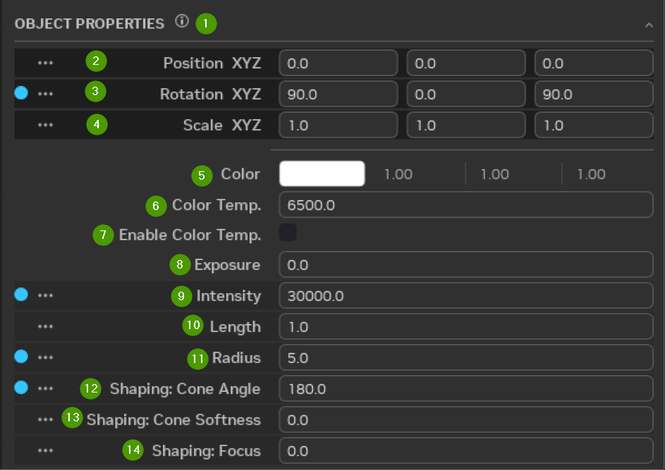
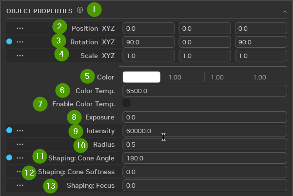
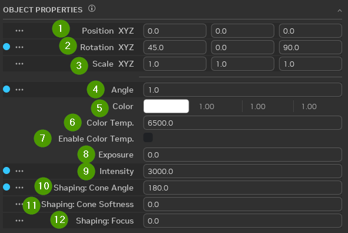
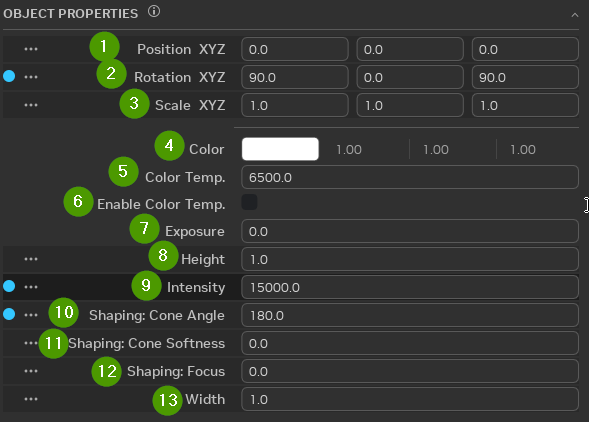
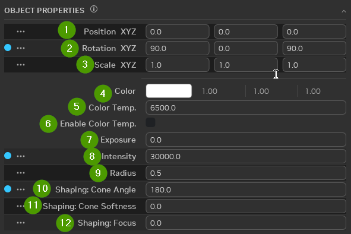

# Освещение

## Манипуляторы источников света

### Отображение и скрытие манипуляторов

Манипуляторы источников света можно включать и выключать во вьюпорте. Откройте меню **Show by Type** на панели
инструментов вьюпорта и переключите **Lights > Manipulators**, чтобы показать или скрыть 3D-маркеры всех источников
света в сцене. Пункт **Lights > Spotlight Cones** независимо включает зелёный каркасный конус, который рисуется у примов
DiskLight и SphereLight с заданным конусом формирования (shaping cone). Обе настройки сохраняются между сеансами.

### Использование

Выделите один или несколько источников света и перетаскивайте маркеры манипулятора, чтобы изменить форму источника.

При наведении на «лучи света» они превращаются в стрелки, с помощью которых можно управлять интенсивностью источника.
У некоторых типов источников есть квадратные маркеры, которые появляются при наведении на определённые области
манипулятора. Перетаскивая их в разных направлениях, можно менять сразу несколько атрибутов выбранного источника.

### Визуализация конуса прожектора

Если у DiskLight или SphereLight параметр **Shaping: Cone Angle** задан меньше 90°, от излучающей поверхности источника
вдоль его главной оси рисуется зелёный каркасный конус. Конус показывает освещённую область источника на расстоянии,
где освещённость на оси падает ниже настраиваемого порога, поэтому длина каркаса зависит от интенсивности, экспозиции,
цвета и цветовой температуры источника.
Эта визуализация не меняет атрибуты источника света в USD, затухание, ослабление или итоговое освещение; меняется только
каркас во вьюпорте, по которому удобно оценивать источник.

Если **Shaping: Cone Softness** больше 0, внутри зелёного внешнего конуса рисуется второй, голубой каркас, показывающий
внутреннюю (полностью освещённую) область конуса. Кольцевая область между двумя каркасами — это полутень, где
интенсивность света плавно спадает до нуля.

Порог, количество подразделений и цвета обоих конусов настраиваются в меню Display панели инструментов вьюпорта
(значок глаза) в разделе **Custom Manipulators > Light Manipulator** (см.
[справочную страницу о вьюпорте](remix-toolkitinterface-viewport.md#настройки-манипулятора-источников-света)).

## Параметры цилиндрического источника

| № | Параметр | Описание |
|:---:|:-------------------------|:-------------------------------------------------------------|
|  1  | Object Properties Tab    |                                                              |
|  2  | Position XYZ             | Положение ассета относительно его начала координат |
|  3  | Rotation XYZ             | Поворот ассета относительно его начала координат |
|  4  | Scale XYZ                | Масштаб ассета относительно масштаба по умолчанию |
|  5  | Color                    | Значения цвета RGB |
|  6  | Color Temperature        | В кельвинах |
|  7  | Enable Color Temperature | Флажок, включающий учёт цветовой температуры |
|  8  | Exposure                 | Значение экспозиции |
|  9  | Intensity                | Интенсивность света |
| 10  | Length                   | Длина источника света |
| 11  | Radius                   | Радиус источника; на радиус влияет и размер источника |
| 12  | Shaping: Cone Angle      | Угол светового конуса: позволяет сделать пучок шире или уже |
| 13  | Shaping: Cone Softness   | Определяет жёсткость или мягкость края света |
| 14  | Shaping: Focus           | Определяет общую рассеянность или резкость света |

## Параметры дискового источника

| № | Параметр | Описание |
|:---:|:-------------------------|:-------------------------------------------------------------|
|  1  | Object Properties Tab    |                                                              |
|  2  | Position XYZ             | Положение ассета относительно его начала координат |
|  3  | Rotation XYZ             | Поворот ассета относительно его начала координат |
|  4  | Scale XYZ                | Масштаб ассета относительно масштаба по умолчанию |
|  5  | Color                    | Значения цвета RGB |
|  6  | Color Temperature        | В кельвинах |
|  7  | Enable Color Temperature | Флажок, включающий учёт цветовой температуры |
|  8  | Exposure                 | Значение экспозиции |
|  9  | Intensity                | Интенсивность света |
| 10  | Radius                   | Радиус источника; на радиус влияет и размер источника |
| 11  | Shaping: Cone Angle      | Угол светового конуса: позволяет сделать пучок шире или уже |
| 12  | Shaping: Cone Softness   | Определяет жёсткость или мягкость края света |
| 13  | Shaping: Focus           | Определяет общую рассеянность или резкость света |

## Параметры удалённого источника

| № | Параметр | Описание |
|:---:|:-------------------------|:-------------------------------------------------------|
|  1  | Position XYZ             | Положение ассета относительно его начала координат |
|  2  | Rotation XYZ             | Поворот ассета относительно его начала координат |
|  3  | Scale XYZ                | Масштаб ассета относительно масштаба по умолчанию |
|  4  | Angle                    | Угол падения света относительно мира |
|  5  | Color                    | Значения цвета RGB |
|  6  | Color Temperature        | В кельвинах |
|  7  | Enable Color Temperature | Флажок, включающий учёт цветовой температуры |
|  8  | Exposure                 | Значение экспозиции |
|  9  | Intensity                | Интенсивность света |
| 10  | Shaping: Cone Angle      | Угол светового конуса: позволяет сделать пучок шире или уже |
| 11  | Shaping: Cone Softness   | Определяет жёсткость или мягкость края света |
| 12  | Shaping: Focus           | Определяет общую рассеянность или резкость света |

## Параметры прямоугольного источника

| № | Параметр | Описание |
|:---:|:-------------------------|:-------------------------------------------------------|
|  1  | Position XYZ             | Положение ассета относительно его начала координат |
|  2  | Rotation XYZ             | Поворот ассета относительно его начала координат |
|  3  | Scale XYZ                | Масштаб ассета относительно масштаба по умолчанию |
|  4  | Color                    | Значения цвета RGB |
|  5  | Color Temperature        | В кельвинах |
|  6  | Enable Color Temperature | Флажок, включающий учёт цветовой температуры |
|  7  | Exposure                 | Значение экспозиции |
|  8  | Height                   | Высота источника света |
|  9  | Intensity                | Интенсивность света |
| 10  | Shaping: Cone Angle      | Угол светового конуса: позволяет сделать пучок шире или уже |
| 11  | Shaping: Cone Softness   | Определяет жёсткость или мягкость края света |
| 12  | Shaping: Focus           | Определяет общую рассеянность или резкость света |
| 13  | Width                    | Ширина источника света 

## Параметры сферического источника

| № | Параметр | Описание |
|:---:|:-------------------------|:-------------------------------------------------------------|
|  1  | Position XYZ             | Положение ассета относительно его начала координат |
|  2  | Rotation XYZ             | Поворот ассета относительно его начала координат |
|  3  | Scale XYZ                | Масштаб ассета относительно масштаба по умолчанию |
|  4  | Color                    | Значения цвета RGB |
|  5  | Color Temperature        | В кельвинах |
|  6  | Enable Color Temperature | Флажок, включающий учёт цветовой температуры |
|  7  | Exposure                 | Значение экспозиции |
|  8  | Intensity                | Интенсивность света |
|  9  | Radius                   | Радиус источника; на радиус влияет и размер источника |
| 10  | Shaping: Cone Angle      | Угол светового конуса: позволяет сделать пучок шире или уже |
| 11  | Shaping: Cone Softness   | Определяет жёсткость или мягкость края света |
| 12  | Shaping: Focus           | Определяет общую рассеянность или резкость света |

***
 Хотите оставить отзыв о документации RTX Remix? [Нажмите здесь](https://github.com/NVIDIAGameWorks/rtx-remix/issues/new?assignees=nvdamien&labels=documentation%2Cfeedback%2Ctriage&projects=&template=documentation_feedback.yml&title=%5BDocumentation+feedback%5D%3A+) 
