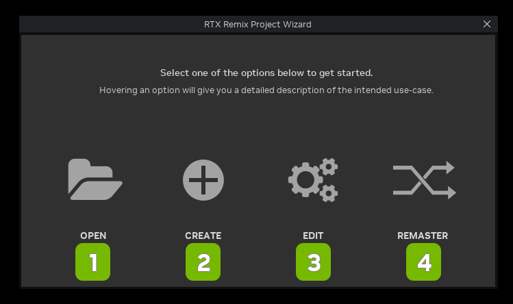
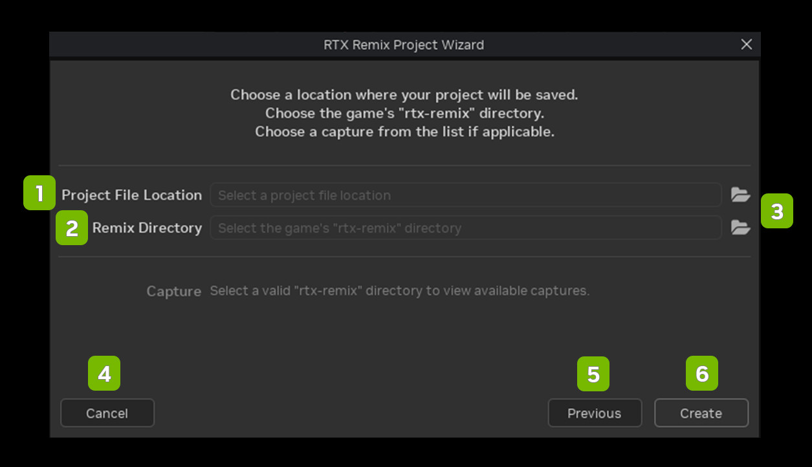

# Мастер проектов

| **№** | **Параметр** | **Описание**                                                      |
|-------|--------------|-------------------------------------------------------------------|
| 1     | Open         | Открыть существующий проект                                       |
| 2     | Create       | Создать проект для нового мода                                    |
| 3     | Edit         | Создать проект для редактирования существующего мода              |
| 4     | Remaster     | Создать проект для нового мода с зависимостями                    |

## Выбор файла захвата сцены

| **№** | **Параметр**          | **Описание**                                                                                  |
|-------|-----------------------|-----------------------------------------------------------------------------------------------|
| 1     | Project File Location | Путь к каталогу с USD-файлом проекта                                                          |
| 2     | Remix Directory       | Путь к папке rtx-remix, в которой находятся захваты игровых сцен                              |
| 3     | File Browser Icons    | Открывает диалог выбора файла                                                                 |
| 4     | Cancel                | Закрывает мастер проектов                                                                     |
| 5     | Previous              | Возвращает к предыдущему экрану меню                                                          |
| 6     | Create                | Запускает процесс создания проекта                                                            |

***
 Хотите оставить отзыв о документации RTX Remix? [Нажмите здесь](https://github.com/NVIDIAGameWorks/rtx-remix/issues/new?assignees=nvdamien&labels=documentation%2Cfeedback%2Ctriage&projects=&template=documentation_feedback.yml&title=%5BDocumentation+feedback%5D%3A+) 
