# Вьюпорт

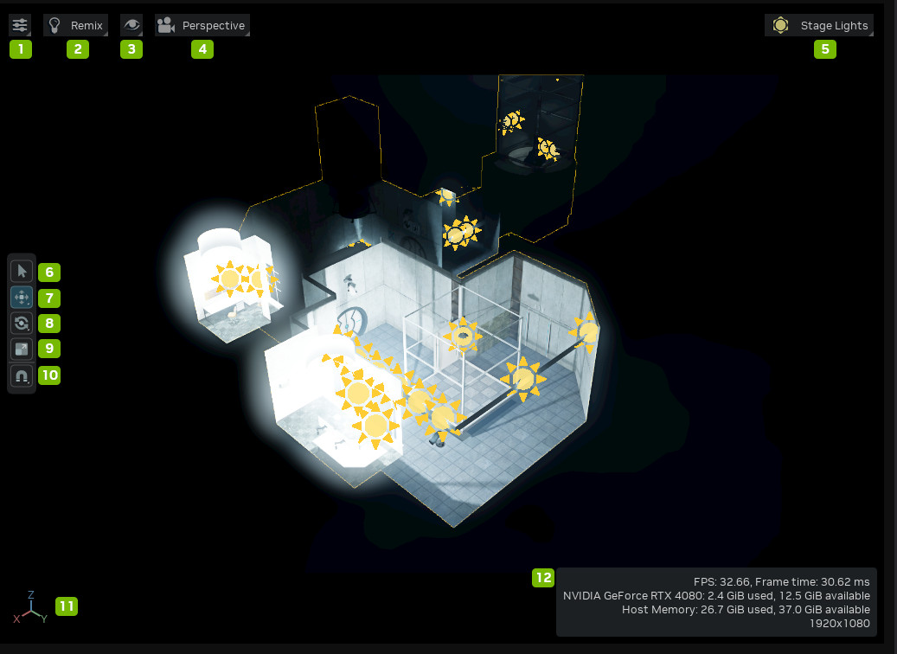

| № | Параметр | Описание |
|:---:|:------------------------------|:---------------------------------------------------------------------------------------------------------------------------------------------------------------------------------------------------------------------------------------------------------------------------------------------------|
|  1  | Viewport Settings             | Открывает меню настроек вьюпорта |
|  2  | Render Mode Settings          | Доступность этих параметров зависит от выбранного рендерера. |
|  3  | Interface Visibility Settings | Открывает меню настроек видимости интерфейса |
|  4  | Camera Settings               | Открывает меню настроек камеры |
|  5  | Stage Lighting                | Открывает панель освещения сцены |
|  6  | Select (Q)                    | Нажмите Q на клавиатуре |
|  7  | Move (W)                      | Перемещение выделенного объекта |
|  8  | Rotate (E)                    | Чтобы повернуть объект в режиме вращения, выделите его и нажмите E или кнопку Rotate |
|  9  | Scale (R)                     | Чтобы изменить размер объекта в режиме масштабирования, выделите его и нажмите R или кнопку Scale |
| 10  | Snap (S)                      | Инструмент привязки — расширение, помогающее располагать объекты, «примагничивая» их к геометрии, примам, сетке или заданному шагу. Чтобы включить или выключить привязку, щёлкните левой кнопкой по значку магнита на панели инструментов. Переключать её можно также клавишей S. |

## Навигация во вьюпорте

### Обзор навигации

| Навигация | Описание | Иллюстрация |
|:-------------|:-------------------------------------------------------------------------------------------------------------------------------------------------------------------------------------------------------------------------------------------------------------------------------------------------------|:---------------------------------------------------------------------------------------------------------------------------------------------------:|
| **Home**     | **Home** возвращает камеру в исходную точку сцены. |                                                                                                                                                     |
| **Orbit**    | **Orbit** вращает камеру вокруг точки — словно вы обходите объект по кругу, не выпуская его из виду. |                                                   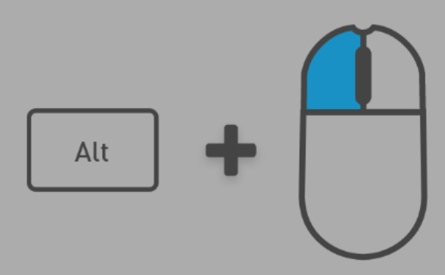                                                    |
| **Look**     | Чтобы использовать **Orbit**, выберите объект в фокусе, удерживайте Alt и двигайте мышь с нажатой левой кнопкой. |                                                    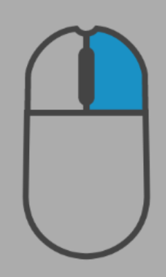                                                    |
| **Walk**     | Перемещает камеру по прямой относительно текущего вида. Удерживайте правую кнопку мыши, чтобы осматриваться (**Look**), и используйте клавиши W, A, S, D, Q, E для перемещения (**Walk**). Можно также использовать клавиши со стрелками, Page Up и Page Down. Скорость перемещения меняется прокруткой колеса при удержании правой кнопки мыши. | 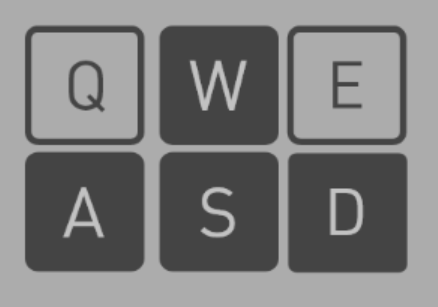 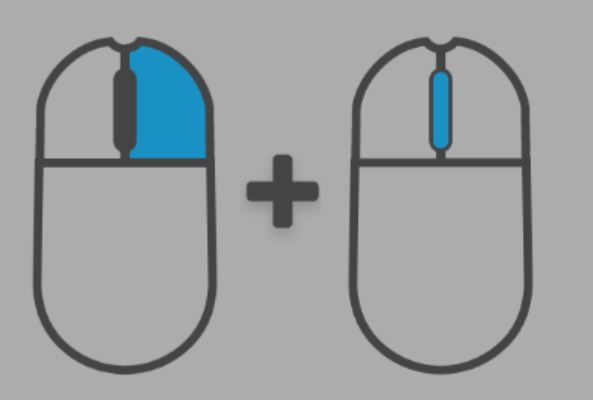 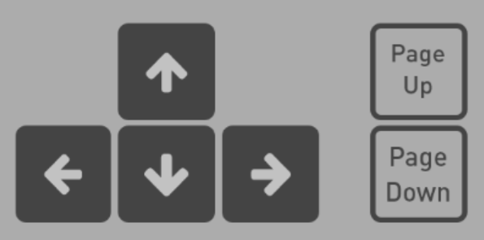 |
| **Pan**      | Перемещает камеру параллельно плоскости обзора: удерживайте среднюю кнопку мыши и двигайте мышь. |                                                    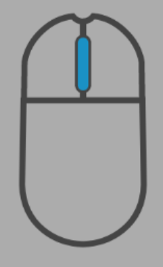                                                     |
| **Focus**    | **Focus** приближает камеру к объекту. Щёлкните по объекту, нажмите F для фокусировки и вращайте камеру вокруг него (**Orbit**). Повторное нажатие F снимает фокус. |                                                                                                                                                     |
| **Dolly**    | Перемещает камеру вперёд или назад прокруткой колеса мыши. |                                                                                                       |
| **Teleport** | Мгновенно перемещает камеру в заданную точку и направление. Удерживайте Y и двигайте мышь, чтобы указать цель. |                                                                                                                                                     |

### Сочетания клавиш для навигации

* ПКМ (RMB) — правая кнопка мыши

| Название | Клавиши | Описание |
|:-----------------|:--------|:-------------------------------------------------------------------------------------------------------------------|
| **Home**         | H       | **Home** возвращает камеру вьюпорта в начальную точку сцены. |
| **Focus**        | F       | **Focus** приближает камеру вьюпорта к определённому объекту. |
| **Teleport**     | Y       | **Teleport** мгновенно перемещает камеру вьюпорта в определённую точку с определённым направлением взгляда. |
| Up (Walk)        | RMB + W | Движение вперёд |
| Left (Walk)      | RMB + A | Движение влево |
| Down (Walk)      | RMB + S | Движение назад |
| Right (Walk)     | RMB + D | Движение вправо |
| Page Up (Walk)   | RMB + Q | Движение вниз |
| Page Down (Walk) | RMB + E | Движение вверх |

## Настройки вьюпорта

**Навигация**

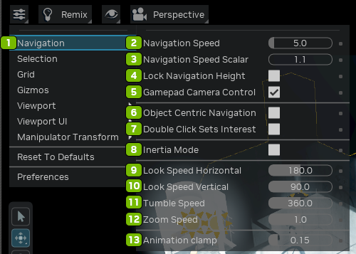

| № | Параметр | Описание |
|:---:|:---------------------------|:----------------------------------------------------------------------------------------------------------------------------------------------------------|
|  1  | Navigation Menu            | Открывает меню навигации |
|  2  | Navigation Speed           | Задаёт скорость камеры при навигации во вьюпорте |
|  3  | Navigation Speed Scalar    | Управляет скоростью навигации |
|  4  | Lock Navigation Height     | Фиксирует высоту наблюдателя при навигации, чтобы при перемещении во вьюпорте сохранялась постоянная высота точки обзора. |
|  5  | Gamepad Camera Control     | Включает управление камерой вьюпорта с подключённого геймпада. |
|  6  | Object Centric Navigation  | Строит навигацию вокруг выделенного объекта, упрощая точные перемещения, облёт и приближение относительно него. |
|  7  | Double Click Sets Interest | Позволяет быстро задать точку фокуса двойным щелчком по любому элементу, перецентрируя камеру для удобной навигации. |
|  8  | Inertia Mode               | Включает естественное ускорение и замедление при любых движениях камеры. Тип инерционного движения выбирается в списке Inertia Decay |
|  9  | Lock Speed Horizontal      | Фиксирует скорость навигации по горизонтали |
| 10  | Lock Speed Vertical        | Фиксирует скорость навигации по вертикали |
| 11  | Tumble Speed               | Настраивает скорость вращения во вьюпорте, позволяя подобрать отзывчивость управления при навигации. |
| 12  | Zoom Speed                 | Увеличивает или уменьшает скорость камеры при приближении и отдалении |
| 13  | Animation Clamp            | Задаёт максимальную длительность анимации в секундах |

**Выделение**

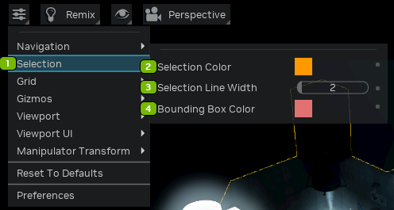

| № | Параметр | Описание |
|:---:|:---------------------|:-------------------------------------|
|  1  | Selection Menu       | Открывает меню выделения |
|  2  | Selection Color      | Задаёт цвет выделенных объектов |
|  3  | Selection Line Width | Задаёт толщину рамки выделения |
|  4  | Bounding Box Color   | Задаёт цвет ограничивающего параллелепипеда |

**Сетка**

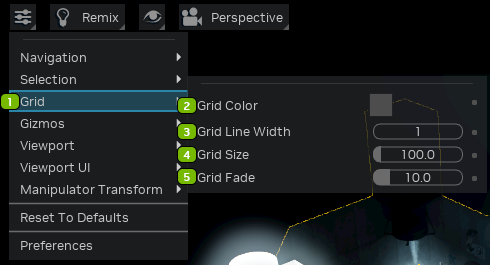

| № | Параметр | Описание |
|:---:|:----------------|:----------------------------------------------------------------|
|  1  | Grid Menu       | Открывает меню сетки |
|  2  | Grid Color      | Задаёт цвет линий сетки |
|  3  | Grid Line Width | Задаёт толщину линий сетки |
|  4  | Grid Size       | Задаёт размер ячеек сетки |
|  5  | Grid Fade       | Задаёт расстояние от камеры, на котором линии сетки исчезают |

**Гизмо**

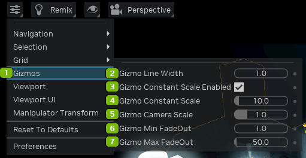

| № | Параметр | Описание |
|:---:|:-----------------------------|:-----------------------------------------------------------------------------------------------------------------------------------------------------------------------------------------------------|
|  1  | Gizmos Menu                  | Открывает меню гизмо |
|  2  | Gizmo Line Width             | Настраивает толщину контура гизмо. |
|  3  | Gizmo Constant Scale Enabled | Включает постоянный масштаб гизмо. |
|  4  | Gizmo Constant Scale         | Равномерно масштабирует все гизмо на постоянную величину. |
|  5  | Gizmo Camera Scale           | Масштабирует гизмо в зависимости от положения камеры. |
|  6  | Gizmo Min FadeOut            | Расстояние от камеры, на котором гизмо отображаются в полном размере. Более удалённые гизмо постепенно уменьшаются и на расстоянии Gizmo Max FadeOut исчезают. |
|  7  | Gizmo Max FadeOut            | Расстояние от камеры, на котором гизмо полностью исчезают. |

**Вьюпорт**

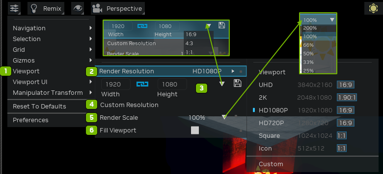

| № | Параметр | Описание |
|:---:|:------------------|:-------------------------------------------------------------------------------------------------------------------------------------------------------------------------------------------------------------------------------------------------------------------------------------------------------------|
|  1  | Viewport Menu     | Открывает меню вьюпорта |
|  2  | Render Resolution | Задаёт базовое или пользовательское разрешение рендеринга во вьюпорте; позволяет создавать, сохранять и удалять пользовательские разрешения. Варианты: <li>Viewport<li>USD 3840x2160 16:9<li>2048x1080 1.90:1<li>HD1080P 1920x1080 16:9<li>HD720P 1280x720 16:9<li>Square 1024x1024 1:1<li>Icon 512x512 1:1<li>Custom |
|  3  | Ratio Options     | Нажмите значок дискеты, чтобы сохранить настройки. Варианты: <li>16:9<li>4:3<li>1:1 |
|  4  | Custom Resolution | Позволяет задать собственное разрешение вьюпорта |
|  5  | Render Scale      | Меняет размер вьюпорта относительно заданного разрешения рендеринга с повышающей или понижающей дискретизацией. |
|  6  | Fill Viewport     | Заполняет сценой весь вьюпорт. |

**Интерфейс вьюпорта**

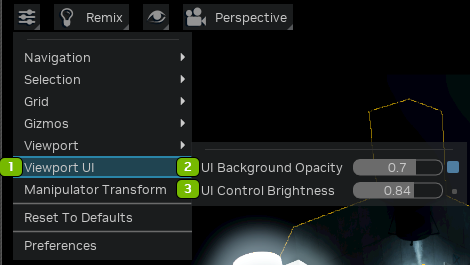

| № | Параметр | Описание |
|:---:|:----------------------|:---------------------------------------------------------|
|  1  | UI Background Opacity | Задаёт непрозрачность фона элементов управления вьюпорта |
|  2  | UI Control Brightness | Задаёт яркость элементов управления вьюпорта |

**Манипулятор трансформации**

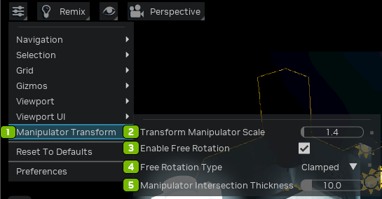

| № | Параметр | Описание |
|:---:|:-----------------------------------|:-----------------------------------------------------------------------------------------------------------|
|  1  | Manipulator Transform              | Инструмент для интуитивного и точного перемещения объектов |
|  2  | Transform Manipulator Scale        | Настраивает размер манипулятора трансформации для точного управления во вьюпорте |
|  3  | Enable Free Rotation Checkbox      | Если включено, разрешает свободное вращение объекта |
|  4  | Free Rotation Type                 | Определяет характер вращения: «Clamped» — ограниченное, «Continuous» — неограниченное |
|  5  | Manipulator Intersection Thickness | Задаёт толщину маркеров, чтобы было удобнее выбирать компоненты объекта и управлять ими |

**Сброс и настройки**

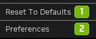

| № | Параметр | Описание |
|:---:|:------------------|:--------------------------------------------|
|  1  | Reset To Defaults | Сбрасывает все настройки к значениям по умолчанию |
|  2  | Preferences       | Открывает панель настроек |

## Настройки манипулятора источников света

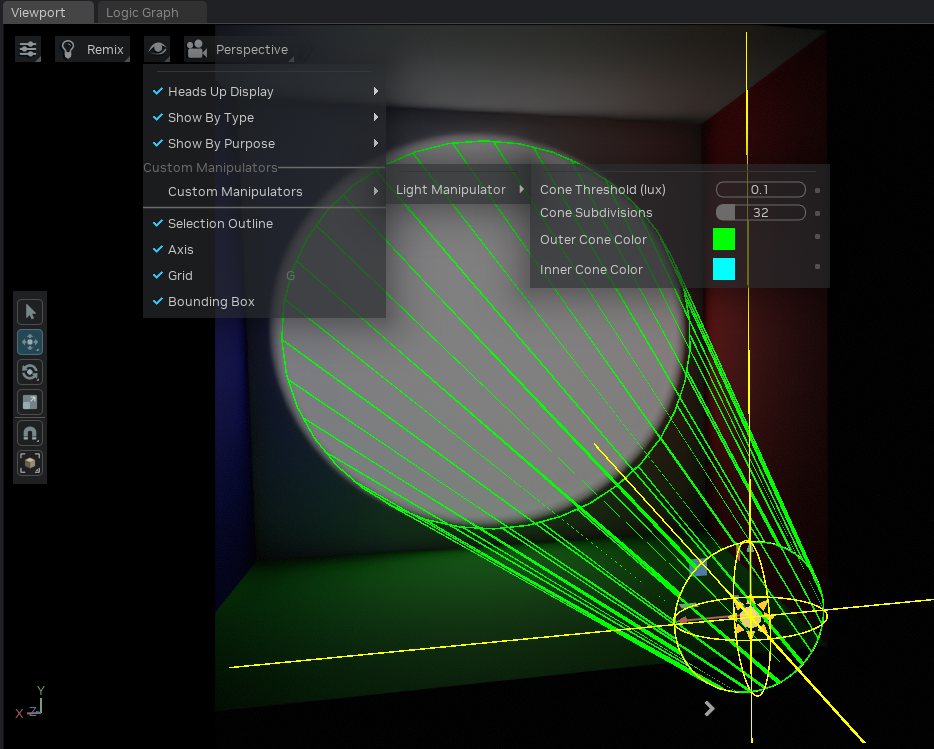

Открываются в меню Display панели инструментов вьюпорта (значок глаза) в разделе **Custom Manipulators > Light
Manipulator**. Управляют внешним видом каркасного конуса прожектора, который рисуется у примов DiskLight и SphereLight
(см. [Освещение](remix-toolkitinterface-lighting.md#визуализация-конуса-прожектора)).

| № | Параметр | Описание |
|:---:|:--------------------|:--------------------------------------------------------------------------------------------------------------------------------------------------|
|  1  | Cone Threshold (lux)| Порог, на котором заканчивается отображение каркаса конуса; на физическое или отрисовываемое затухание света не влияет. Чем меньше значение, тем длиннее каркас при той же интенсивности. По умолчанию 0,1; минимум 0,001. |
|  2  | Cone Subdivisions   | Количество спиц, рисуемых по окружности конуса. Чем больше значение, тем глаже окружности; диапазон 6–128, по умолчанию 32. |
|  3  | Outer Cone Color    | Цвет каркаса внешнего конуса (где интенсивность достигает порога). По умолчанию зелёный. |
|  4  | Inner Cone Color    | Цвет каркаса внутреннего конуса (где интенсивность максимальна). Рисуется, только если Shaping: Cone Softness > 0. По умолчанию голубой. |

<!---
## Preferences Panel

**Audio**

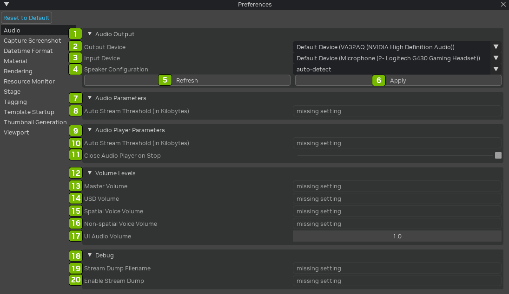

| № | Параметр | Описание |
|:---:|:---|:---|
| 1 | Audio Output | Selects the audio output destination, determining where the audio playback will be directed. |
| 2 | Output Device | Specifies the device used for audio output, allowing users to choose the desired playback hardware |
| 3 | Input Device | Chooses the device for audio input, specifying the source from which audio data is captured. |
| 4 | Speaker Configuration | Defines the arrangement of speakers for audio playback, tailoring the audio experience based on the speaker setup. |
| 5 | Refresh Button | Updates the audio settings in real-time, ensuring changes made to preferences are immediately applied. |
| 6 | Apply Button | Confirms and applies changes to the audio settings, making adjustments effective within the RTX Remix environment. |
| 7 | Audio Parameters | Accesses settings related to audio, providing control over various aspects of the audio playback experience. |
| 8 | Auto Stream Threshold (in Kilobytes) | Sets the threshold for automatic streaming of audio data, managing the streaming behavior based on file size. |
| 9 | Audio Player Parameters | Adjusts parameters related to the audio player, fine-tuning aspects of audio playback within the viewport. |
| 10 | Auto Stream Threshold (in Kilobytes) | Sets the threshold for automatic streaming of audio data, managing the streaming behavior based on file size. |
| 11 | Close Audio Player on Stop Checkbox | Toggles the behavior of closing the audio player automatically when audio playback is stopped. |
| 12 | Volume Levels | Controls the overall volume levels for different audio components within the RTX Remix environment. |
| 13 | Master Volume | Sets the overall master volume for audio playback in the viewport. |
| 14 | USD Volume | Adjusts the volume specifically for Universal Scene Description (USD) audio components. |
| 15 | Spatial Voice Volume | Manages the volume of spatialized voice audio, enhancing the immersive quality of audio within the 3D environment. |
| 16 | Non-Spatial Voice Volume | Controls the volume of non-spatialized voice audio, providing flexibility in managing different audio sources. |
| 17 | UI Audio Volume | Sets the volume level for user interface (UI) audio elements, allowing customization of the interface sound levels. |
| 18 | Debug | Provides access to debugging options and settings related to audio functionality within the RTX Remix environment. |
| 19 | Stream Dump Filename | Specifies the filename for storing streamed audio data, allowing users to save and analyze audio streams. |
| 20 | Enable Stream Dump | Activates the option to capture and save audio stream data for debugging or analysis purposes. |


**Capture Screenshot**

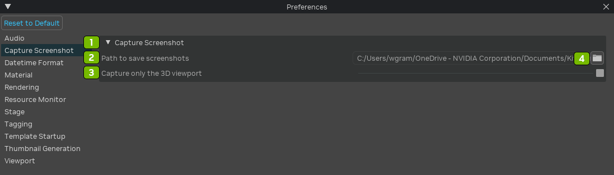

| № | Параметр | Описание |
|:---:|:---|:---|
| 1 | Capture Screenshot | Initiates the process of capturing a screenshot of the current view within the viewport in RTX Remix. |
| 2 | Path to Save Screenshots | Specifies the directory or folder where captured screenshots will be saved, allowing users to define the storage location. |
| 3 | Capture Only the 3D Viewport Checkbox | Selectively captures only the 3D viewport area in the screenshot, excluding other interface elements or overlays for a clean output. |
| 4 | Open File Explorer | Opens the file explorer |


**Datetime Format**

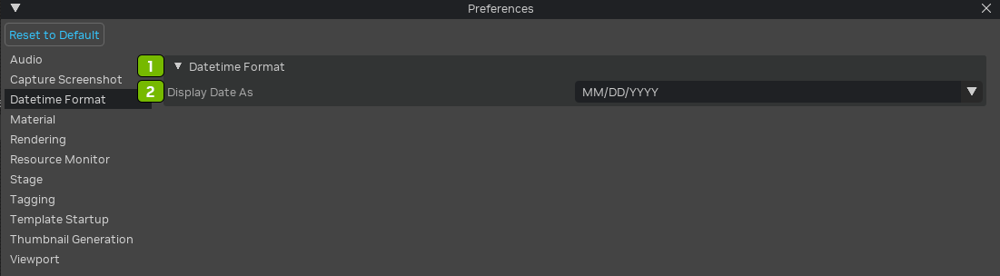

| № | Параметр | Описание |
|:---:|:---|:---|
| 1 | Datetime Format | Configures the format used to display the date and time information on captured screenshots. |
| 2 | Display Date As | Specifies the arrangement and style for presenting the date on captured screenshots, allowing customization based on user preference. |


**Material**

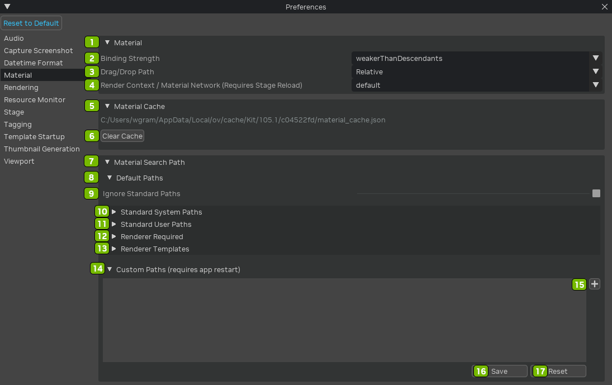

| № | Параметр | Описание |
|:---:|:---|:---|
| 1 | Material | Selects and manages the material used for rendering in the Material viewport of RTX Remix. |
| 2 | Binding Strength | Adjusts the strength or influence of the material binding, controlling how the material is applied to the associated object. |
| 3 | Drag/Drop Path | Specifies the file path or location for dragging and dropping material assets into the Material viewport. |
| 4 | Render Context / Material Network (Requires Stage Reload) | Switches the render context or material network, with changes requiring a stage reload to take effect. |
| 5 | Material Cache | Manages the cache for materials, optimizing performance by storing frequently used material data. |
| 6 | Clear Cache Button | Removes cached material data, providing a way to refresh and update materials in the viewport. |
| 7 | Material Search Path | Defines the directory where the system searches for material assets, aiding in organization and retrieval. |
| 8 | Default Paths | Sets the default paths for materials, establishing a baseline for material asset storage. |
| 9 | Ignore Standard Paths Checkbox | Toggles the option to disregard standard material paths when searching for material assets. |
| 10 | Standard System Paths | Specifies standard system paths for material assets, aiding in locating and utilizing predefined materials. |
| 11 | Standard User Paths | Establishes standard user paths for material assets, facilitating organized storage and retrieval. |
| 12 | Renderer Required | Indicates the renderer required for proper material rendering in the Material viewport. |
| 13 | Renderer Templates | Manages and selects renderer templates for materials, allowing customization based on predefined rendering configurations. |
| 14 | Custom Paths (Requires App Restart) | Defines custom paths for material assets, with changes requiring a restart of the application to take effect. |
| 15 | Add Custom Path | Add a custom path (requires an app restart) |
| 16 | Save Button | Saves changes made to material preferences, ensuring that modifications are retained. |
| 17 | Reset Button | Restores material preferences to their default settings, providing a quick reset option. |


**Rendering**

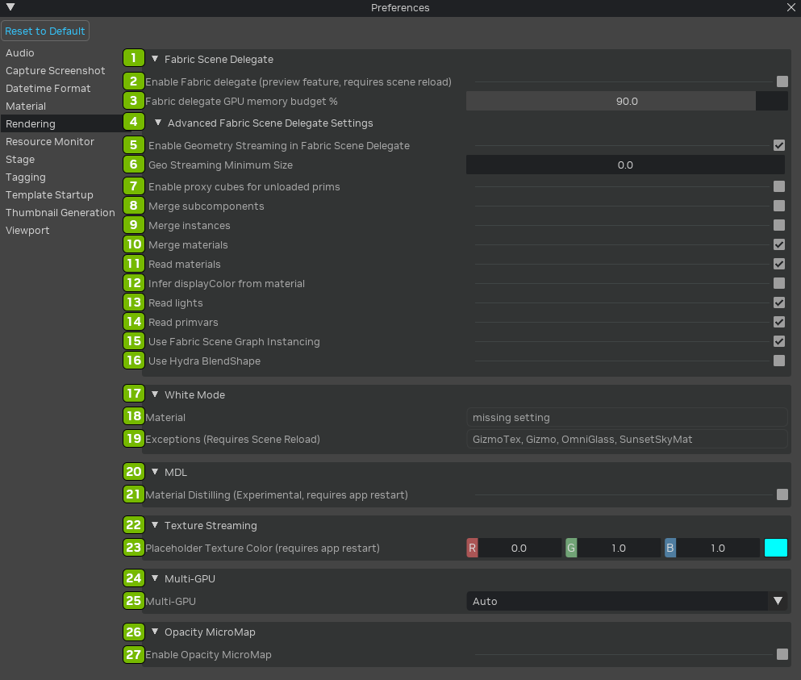

| № | Параметр | Описание |
|:---:|:---|:---|
| 1 | Fabric Scene Delegate | Selects the Fabric Scene Delegate for rendering in the viewport, influencing how scenes are processed and displayed. |
| 2 | Enable Fabric Delegate (Preview Feature Requires Scene Reload) Checkbox | ctivates the Fabric Scene Delegate as a preview feature, with changes requiring a scene reload for implementation. |
| 3 | Fabric Delegate GPU Memory Budget % | Allocates a percentage of GPU memory as a budget for the Fabric Scene Delegate, optimizing performance. |
| 4 | Advanced Fabric Scene Delegate Settings | Accesses advanced settings for fine-tuning and customizing the behavior of the Fabric Scene Delegate. |
| 5 | Enable Geometry Streaming in Fabric Scene Delegate Checkbox | Allows the streaming of geometry data in the Fabric Scene Delegate, optimizing resource usage and performance. |
| 6 | Geo Streaming Minimum Size | Sets the minimum size for geometry streaming, controlling when streaming is activated for specific elements. |
| 7 | Enable Proxy Cubes for Unloaded Prims Checkbox | Activates proxy cubes for unloaded primitives in the scene, enhancing visualization and performance. |
| 8 | Merge Subcomponents Checkbox | Toggles the merging of subcomponents in the Fabric Scene Delegate, optimizing scene complexity. |
| 9 | Merge Instances Checkbox | Combines instances in the Fabric Scene Delegate, reducing redundancy and improving rendering efficiency. |
| 10 | Merge Materials Checkbox | Merges materials in the Fabric Scene Delegate, streamlining material handling and rendering. |
| 11 | Read Materials Checkbox | Enables the reading of material information in the Fabric Scene Delegate for accurate rendering. |
| 12 | Infer DisplayColor from Material Checkbox | Infers display color from materials, ensuring accurate color representation in the Fabric Scene Delegate. |
| 13 | Read Lights Checkbox | Activates the reading of lights in the Fabric Scene Delegate, incorporating lighting information into the rendering. |
| 14 | Read Primvars Checkbox | Enables the reading of primitive variables (primvars) in the Fabric Scene Delegate for enhanced scene detail. |
| 15 | Use Fabric Scene Graph Instancing Checkbox | Utilizes instancing in the Fabric Scene Delegate based on the scene graph structure. |
| 16 | Use Hydra BlendShape Checkbox | Incorporates Hydra BlendShapes in the Fabric Scene Delegate for handling shape variations. |
| 17 | White Mode | Adjusts the rendering mode to display the scene in white, providing an alternative visual representation. |
| 18 | Material | Manages and selects materials for rendering in the viewport. |
| 19 | Exceptions (Requires Scene Reload) | Handles exceptions in the rendering process, with changes requiring a scene reload for implementation. |
| 20 | MDL | Manages and selects materials defined in MDL (Material Definition Language) format for rendering. |
| 21 | Material Distilling (Experimental, Requires App Restart) Checkbox | Activates experimental material distilling, with changes requiring a restart of the application for implementation. |
| 22 | Texture Streaming | Manages and optimizes the streaming of textures for efficient rendering. |
| 23 | Placeholder Texture Color (Requires App Restart) | Sets the color for placeholder textures, with changes requiring a restart of the application to take effect. |
| 24 | Multi-GPU | Enables multi-GPU rendering, distributing rendering tasks across multiple GPUs for improved performance. |
| 25 | Multi-GPU Selection | Selects the GPUs to be utilized for multi-GPU rendering. |
| 26 | Opacity Micromap | Adjusts the micromap for opacity, influencing how opacity is represented in the rendering. |
| 27 | Enable Opacity Micromap Checkbox | Activates the opacity micromap for enhanced transparency representation in the rendering. |


**Resource Monitor**

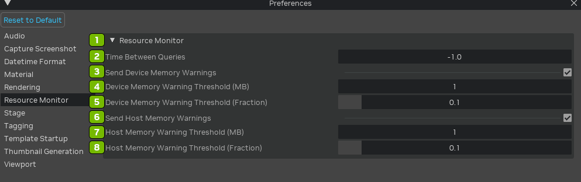

| № | Параметр | Описание |
|:---:|:---|:---|
| 1 | Resource Monitor | Activates the Resource Monitor, providing real-time insights into system resource usage within the viewport. |
| 2 | Time Between Queries | Sets the interval between queries for resource monitoring, regulating the frequency of data updates. |
| 3 | Send Device Memory Warnings Checkbox | Enables the sending of warnings when device memory usage approaches or exceeds specified thresholds. |
| 4 | Device Memory Warning Threshold (MB) | Defines the threshold for device memory usage, triggering warnings when the specified limit is reached in megabytes. |
| 5 | Device Memory Warning Threshold (Fraction) | Sets the threshold for device memory usage as a fraction, triggering warnings based on the specified proportion. |
| 6 | Send Host Memory Warnings Checkbox | Activates the sending of warnings when host (system) memory usage approaches or exceeds specified thresholds. |
| 7 | Host Memory Warning Threshold (MB) | Specifies the threshold for host memory usage, triggering warnings when the specified limit is reached in megabytes. |
| 8 | Host Memory Warning Threshold (Fraction) | Establishes the threshold for host memory usage as a fraction, triggering warnings based on the specified proportion. |


**Stage**

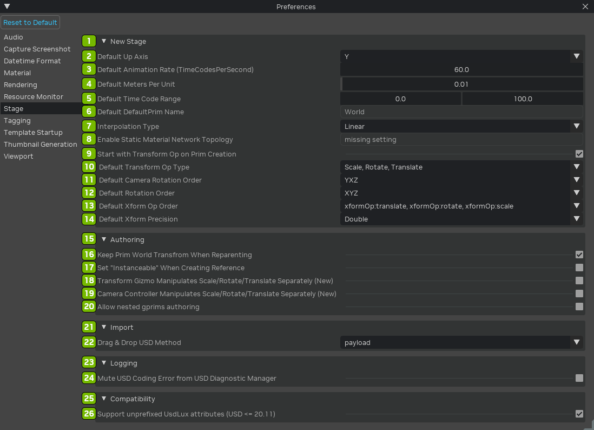

| № | Параметр | Описание |
|:---:|:---|:---|
| 1 | New Stage | Initiates the creation of a new stage, providing a starting point for scene development in RTX Remix. |
| 2 | Default Up Axis | Sets the default up axis for the stage, influencing the orientation of the scene. |
| 3 | Default Animation Rate (Timecodes Per Second) | Defines the default animation rate in timecodes per second for animations within the stage. |
| 4 | Default Meters Per Unit | Specifies the default meters per unit for defining the scale of objects in the stage. |
| 5 | Default Time Code Range | Sets the default time code range, determining the temporal scope of the stage's animation. |
| 6 | Default DefaultPrim Name | Defines the default name for the default prim created when starting a new stage. |
| 7 | Interpolation Type | pecifies the default interpolation type for animations within the stage. |
| 8 | Enable Static Material Network Topology | Activates the static material network topology for optimized material handling in the stage |
| 9 | Start With Transform Op on Prim Creation Checkbox | Enables the inclusion of a transform operation by default when creating new primitives in the stage. |
| 10 | Default Transform Op Type | Sets the default type for transform operations applied to primitives in the stage. |
| 11 | Default Camera Rotation Order | Defines the default rotation order for cameras within the stage. |
| 12 | Default Rotation Order | pecifies the default rotation order for objects in the stage. |
| 13 | Default Xform Op Order | Sets the default order of transformation operations applied to objects in the stage. |
| 14 | Default Xform Precision | Specifies the default precision for transformation operations in the stage. |
| 15 | Authoring | Manages preferences related to scene authoring within the stage. |
| 16 | Keep Prim World Transform When Reparenting Checkbox | Preserves the world transform of primitives when reparenting them in the stage. |
| 17 | Set "Instanceable" When Creating Reference Checkbox | Automatically sets the "Instanceable" attribute when creating a reference in the stage. |
| 18 | Transform Gizmo Manipulates Scale/Rotate/Translate Separately (New) Checkbox | Allows the transformation gizmo to manipulate scale, rotation, and translation separately in the stage. |
| 19 | Camera Controller Manipulates Scale/Rotate/Translate Separately (New) Checkbox | Permits the camera controller to manipulate scale, rotation, and translation separately in the stage. |
| 20 | Allow Nested Gprims Authoring Checkbox | Authorizes the creation of nested gprims in the stage, allowing for more complex scene hierarchies. |
| 21 | Import | Manages preferences related to importing assets and elements into the stage. |
| 22 | Drag & Drop USD Material | Enables the drag-and-drop functionality for importing USD materials into the stage. |
| 23 | Logging | Controls preferences related to logging and error reporting within the stage. |
| 24 | Mute USD Coding Error from USD Diagnostic Manager Checkbox | Mutes USD coding errors from the USD Diagnostic Manager, reducing verbosity in error reporting. |
| 25 | Compatibility | Manages preferences related to compatibility with different versions of USD. |
| 26 | Support Unprefixed Usdlux Attributes (USD <= 20.11) Checkbox | Supports unprefixed Usdlux attributes for compatibility with USD versions up to 20.11. |


**Tagging**

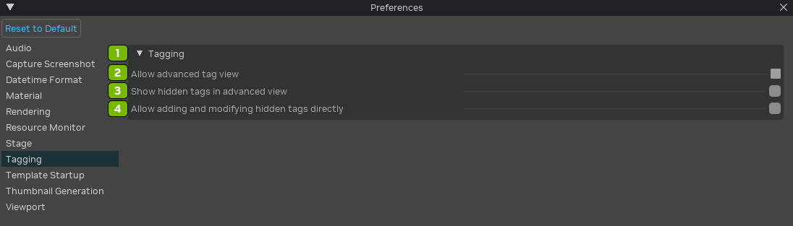

| № | Параметр | Описание |
|:---:|:---|:---|
| 1 | Tagging | Manages tagging preferences for organizing and categorizing elements within the viewport in RTX Remix. |
| 2 | Allow Advanced Tag View Checkbox | Enables the advanced tag view, providing users with additional options and features for managing tags. |
| 3 | Show Hidden Tags in Advanced View Checkbox | Reveals hidden tags in the advanced tag view, allowing users to access and manipulate tags that are not visible in the standard view. |
| 4 | Allow Adding and Modifying Hidden Tags Directly Checkbox | Permits users to directly add and modify hidden tags, providing a more granular level of control over tagging preferences. |


**Template Startup**

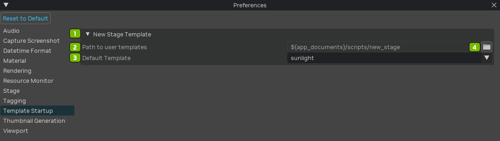

| № | Параметр | Описание |
|:---:|:---|:---|
| 1 | New Stage Template | Defines a template for creating new stages, offering a predefined starting point with specific configurations. |
| 2 | Path to User Templates | Specifies the directory or folder where user-created templates are stored, allowing customization and access to personalized templates. |
| 3 | Default Template | Sets the default template to be applied when creating a new stage, streamlining the initial setup based on user preferences. |
| 4 | Open File Browser | Activates the file browser for selecting templates or navigating to the location of user templates in RTX Remix. |


**Thumbnail Generation**

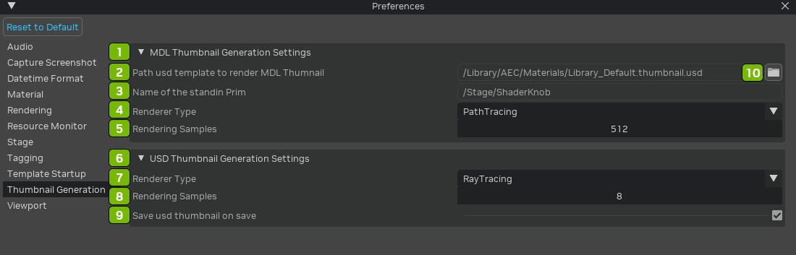

| № | Параметр | Описание |
|:---:|:---|:---|
| 1 | MDL Thumbnail Generation Settings | Manages settings for generating thumbnails using MDL (Material Definition Language) in RTX Remix. |
| 2 | Path USD Template to Render MDL Thumbnail | Specifies the USD template path for rendering MDL thumbnails, defining the location and format of the generated thumbnails. |
| 3 | Name of the Standin Prim | Sets the name of the stand-in primitive used in MDL thumbnail generation, providing a reference for rendering. |
| 4 | Renderer Type | Specifies the type of renderer to be used in generating thumbnails, allowing customization based on rendering preferences. |
| 5 | Rendering Samples | Determines the number of samples used in the rendering process for generating high-quality thumbnails. |
| 6 | USD Thumbnail Generation Settings | Manages settings for generating thumbnails in USD (Universal Scene Description) format in RTX Remix. |
| 7 | Renderer Type | Specifies the type of renderer employed in USD thumbnail generation, offering flexibility in rendering options. |
| 8 | Rendering Samples | Defines the number of samples used in the rendering process for generating high-quality USD thumbnails. |
| 9 | Save USD Thumbnail on Save Checkbox | Activates the option to automatically save USD thumbnails when saving the project, ensuring thumbnails are updated and synchronized with the scene. |
| 10 | Open File Browser | Activates the file browser for selecting templates or navigating to the location of user templates in RTX Remix. |


**Viewport**

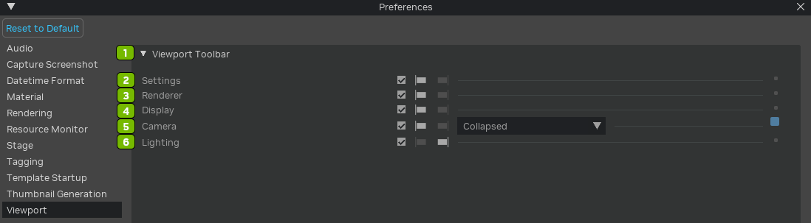

| № | Параметр | Описание |
|:---:|:---|:---|
| 1 | Viewport Toolbar | Manages the visibility and settings of the toolbar within the viewport, providing quick access to various tools and options in RTX Remix. |
| 2 | Settings Checkbox | Toggles the display of settings options on the viewport toolbar, allowing users to customize and control various viewport parameters. |
| 3 | Renderer Checkbox | Controls the visibility of renderer-related options on the toolbar, providing quick access to settings related to rendering. |
| 4 | Display Checkbox | Manages the display of options on the toolbar related to viewport display settings, offering quick adjustments to visual preferences. |
| 5 | Camera Checkbox | Toggles the visibility of camera-related options on the toolbar, allowing users to access and control camera settings within the viewport. |
| 6 | Lighting Checkbox | Controls the display of lighting-related options on the toolbar, providing quick access to settings and controls for scene lighting. |


**Reset to Default**

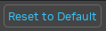

Restores all viewport preferences in RTX Remix to their default settings, providing a quick and standardized reset for the viewport configuration.


## Render Settings

These settings allow you to chose the type of renderer you want to use, the Rendering Mode, and Renderer specific settings.

**Remix Render Settings**

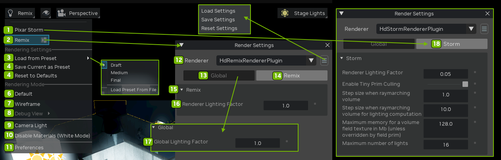

| № | Параметр | Описание |
|:---:|:---|:---|
| 1 | Pixar Storm | Opens Storm renderer settings panel |
| 2 | Remix | Opens renderer settings panel |
| 3 | Load from preset | Apply settings from the in-built Draft, Medium or Final presets, or load your own from a presets file |
| 4 | Save Current as Preset | Saves the current render settings as a new preset. You will be prompted for where to save the settings file. Note that settings that are at their default values are not saved to the settings file. If you wish to include those values in the settings file, modify them slightly then edit the settings file in a text editor to set the desired values. |
| 5 | Reset to Defaults | Reset all render settings to the application default values |
| 6 | Default | Rendering Mode for the Viewport is set to default settings |
| 7 | Wireframe | Rendering Mode for the Viewport is set to wireframe |
| 8 | Debug View | Select one of the renderer-provided debug views to visualize |
| 9 | Camera Light | Replaces the Stage lighting with a light behind the camera. This is useful for inspecting dark areas of your scene |
| 10 | Disable Materials (White Mode) | Uses a simple white material for all opaque objects. This is useful for inspecting that the lighting looks correct |
| 11 | Preferences | Открывает панель настроек |
| 12 | Renderer | Renderer Selection Options |
| 13 | Global | Opens global light factor settings |
| 14 | Remix | Opens renderer light factor settings |
| 15 | Remix Panel Options | Remix Renderer Lighting Options |
| 16 | Renderer Lighting Factor | Value to set Renderer Lighting |
| 17 | Global Lighting Factor | Value to set Global Lighting |
| 18 | Pixar Storm Rendering Settings | Allows you to adjust the setting of the Storm Renderer. Options Include:<li>Renderer Lighting Factor<li>Enable Tiny Prim Culling<li>Step size when raymarching volume<li>Step size when raymarching volume for lighting computation<li>Maximum memory for a volume field texture in Mb (unless overridden by field prim)<li>Maximum number of lights |

--->

## Параметры отображения

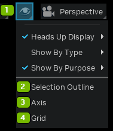

При изменении этих пунктов меню слева от них появляются значки:

* Синяя галочка означает, что отображение включено.
* Синяя буква «M» означает, что параметры отображения «смешанные» (mixed): одни элементы видимы, другие нет.

| № | Параметр | Описание |
|:---:|:---------------------|:-----------------------------------|
|  1  | Interface Visibility |                                    |
|  2  | Selection Outline    | Включает подсветку выделения |
|  3  | Axis                 | Включает отображение осей |
|  4  | Grid                 | Включает отображение сетки |

**Индикаторы на экране (HUD)**

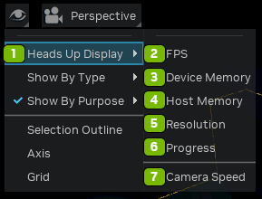

| № | Параметр | Описание |
|:---:|:-----------------|:-------------------------------------------------------------------------------------------------------------------------|
|  1  | Heads Up Display | Включает отображение статистики HUD |
|  2  | FPS              | Показывает в HUD частоту кадров в секунду — текущую производительность. |
|  3  | Device Memory    | Показывает использование видеопамяти GPU. |
|  4  | Host Memory      | Показывает использование оперативной памяти системы. |
|  5  | Resolution       | Показывает текущее разрешение изображения. |
|  6  | Progress         | Показывает ход выполнения текущих задач и процессов во вьюпорте. |
|  7  | Camera Speed     | Показывает скорость навигации камеры во вьюпорте. |

**Показ по типу**

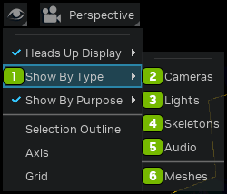

| № | Параметр | Описание |
|:---:|:-------------|:---------------------------------------------------------------------------------------------------------------------------------------------------|
|  1  | Show By Type | Включает отображение во вьюпорте следующих элементов |
|  2  | Cameras      | Камеры сцены. |
|  3  | Lights       | Источники света — для удобной работы с освещением. |
|  4  | Skeletions   | Скелеты — упрощают просмотр и настройку анимации персонажей и объектов. |
|  5  | Audio        | Звуковые компоненты сцены. |
|  6  | Meshes       | 3D-меши — позволяет выборочно просматривать геометрию и работать с ней. |
|  7  | Physics      | Объекты физической симуляции — помогают разобраться в физическом поведении элементов сцены и настроить его. |

**Показ по назначению**

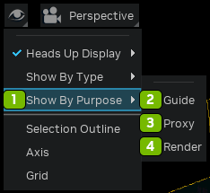

| № | Параметр | Описание |
|:---:|:----------------|:---------------------------------------------------------------------------------------------------------------------------------------------|
|  1  | Show By Purpose | Включает отображение ассетов по назначению (Display Purpose) |
|  2  | Guide           | Вспомогательные (guide) элементы сцены. |
|  3  | Proxy           | Прокси-объекты — упрощённые представления сложных ассетов для повышения производительности. |
|  4  | Render          | Элементы для рендеринга, определяющие итоговое изображение сцены. |

## Настройки камеры

```{seealso}
Remix Toolkit построен на Omniverse, поэтому дополнительные сведения о настройках камеры можно найти здесь: https://docs.omniverse.nvidia.com/materials-and-rendering/latest/cameras.html
```

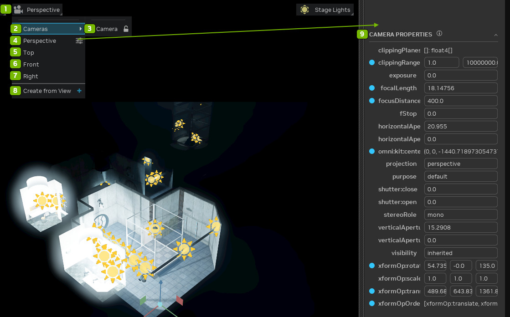

| № | Параметр | Описание |
|:---:|:------------------|:--------------------------------------------------------------------|
|  1  | Camera Settings   | Открывает меню настроек камеры |
|  2  | Camera Lock       | Блокирует камеры сцены |
|  3  | Cameras           | Вид через выбранную камеру |
|  4  | Perspective       | Вид через настроенную перспективу |
|  5  | Top               | Вид на начало координат с положительной стороны оси Z |
|  6  | Front             | Вид на начало координат с положительной стороны оси X |
|  7  | Right             | Вид на начало координат с положительной стороны оси Y |
|  8  | Create from View  | Создаёт новую камеру на основе текущей |
|  9  | Camera Properties | Открывает панель свойств камеры |

## Освещение сцены

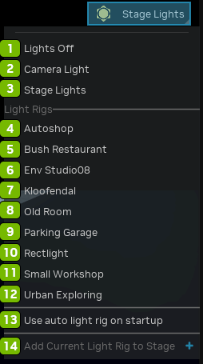

| № | Параметр | Описание |
|:---:|:---------------------------------------|:-----------------------------------------------------------------------------------------------------------------------------------------------------------------------|
|  1  | Lights Off                             | Выключает все источники света во вьюпорте, показывая сцену без освещения |
|  2  | Camera Light                           | Включает источник света, прикреплённый к камере, который освещает сцену с точки зрения камеры. |
|  3  | Stage Lights                           | Использует источники света, настроенные в самой сцене, позволяя работать с освещением сцены во вьюпорте |
|  4  | Autoshop                               | Готовое освещение в стиле автомастерской. |
|  5  | Bush Restaurant                        | Освещение уличного ресторана с естественным рассеянным светом. |
|  6  | Env Studio08                           | Студийная схема освещения с контролируемыми настраиваемыми условиями. |
|  7  | Kloofendal                             | Освещение в духе местности Клофендал (Kloofendal) с характерной атмосферой. |
|  8  | Old Room                               | Освещение, имитирующее атмосферу старого или винтажного интерьера. |
|  9  | Parking Garage                         | Освещение, имитирующее условия подземной парковки. |
| 10  | Rectlight                              | Освещение прямоугольными источниками света для контролируемой подсветки во вьюпорте. |
| 11  | Small Workshop                         | Освещение, имитирующее небольшую мастерскую. |
| 12  | Urban Exploring                        | Атмосферное освещение в духе урбан-эксплоринга (исследования заброшенных городских объектов). |
| 13  | Use Auto Light Rig on Startup Checkbox | Автоматически применять схему освещения по умолчанию при запуске вьюпорта. |
| 14  | Add Current Light Rig to Stage         | Сохраняет текущую схему освещения в сцену, чтобы её можно было использовать повторно. |

***
<sub> Хотите оставить отзыв о документации RTX Remix? [Нажмите здесь](https://github.com/NVIDIAGameWorks/rtx-remix/issues/new?assignees=nvdamien&labels=documentation%2Cfeedback%2Ctriage&projects=&template=documentation_feedback.yml&title=%5BDocumentation+feedback%5D%3A+) </sub>
