# Создание первого мода для RTX Remix Sample

В этом руководстве на практике показано, как создать мод для демонстрационного приложения RTX Remix (Sample
Application).

Чтобы создать любой мод, рекомендуется выполнить следующие шаги. Мы пройдём каждый из них на примере демонстрационного
приложения, а подробно все они описаны здесь:

1. [Установка RTX Remix Runtime](../installation/install-runtime.md)
2. [Установка RTX Remix Toolkit](../installation/install-toolkit.md)
3. [Настройка RTX Remix Runtime для вашей игры](../gettingstarted/learning-runtimesetup.md)
4. [Создание проекта](../gettingstarted/learning-toolkitsetup.md)
5. [Импорт и замена ассетов](../howto/learning-assets.md)


## 1. Установка RTX Remix Runtime

В этом руководстве используется RTX Remix Runtime, входящий в состав RTX Remix Toolkit. Поэтому сразу переходите к
шагу 2.

## 2. Установка RTX Remix Toolkit

Удобнее всего установить RTX Remix Toolkit, скачав последнюю версию через
[NVIDIA App](https://www.nvidia.com/en-us/software/nvidia-app/). Скачайте установщик на сайте.

Установив NVIDIA App, запустите его и установите приложение `RTX Remix`.

```{important}
Если приложение RTX Remix недоступно для установки, возможно, система не соответствует
[минимальным системным требованиям](../introduction/intro-requirements.md#требования-для-моддеров-и-игроков).

Если оборудование соответствует требованиям, но приложение всё равно недоступно, убедитесь, что установлены последние
драйверы.
```

## 3. Настройка RTX Remix Runtime для демонстрационного приложения

Когда RTX Remix Runtime и RTX Remix Toolkit установлены, можно настроить RTX Remix Runtime для демонстрационного
приложения.

1. [Найдите каталог установки RTX Remix Toolkit](../remix-faq.md#как-найти-папку-установки-rtx-remix-toolkit).
   Для этого откройте RTX Remix Toolkit и нажмите кнопку `Show Install Directory` на главном экране.

   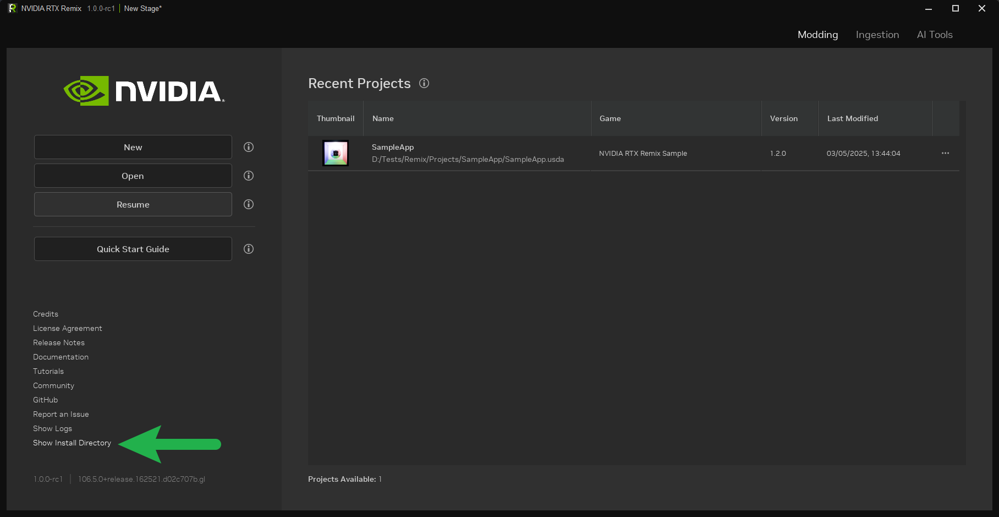

2. Перейдите в каталог
   <code>
   [<INSTALL_DIRECTORY>](../remix-faq.md#как-найти-папку-установки-rtx-remix-toolkit)\deps\remix_runtime
   </code>
   В нём два подкаталога: `runtime` и `sample`.

   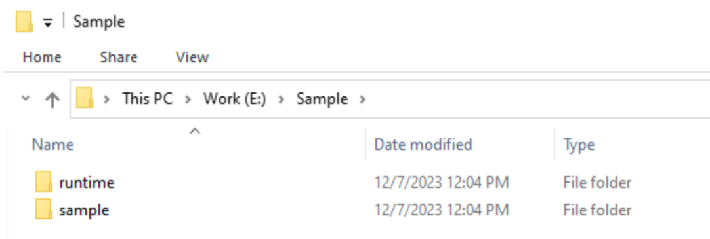

3. Переместите оба каталога из каталога установки Toolkit в любое удобное место. (На этих скриншотах используется
   E:/Sample.)
4. Установите RTX Remix Runtime, скопировав содержимое каталога `runtime` в каталог `sample`.

   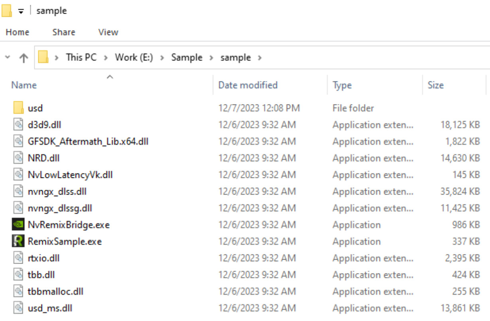

5. Теперь демонстрационное приложение RTX Remix можно запустить двойным щелчком по файлу `RemixSample.exe`. Должно
   появиться следующее окно:

   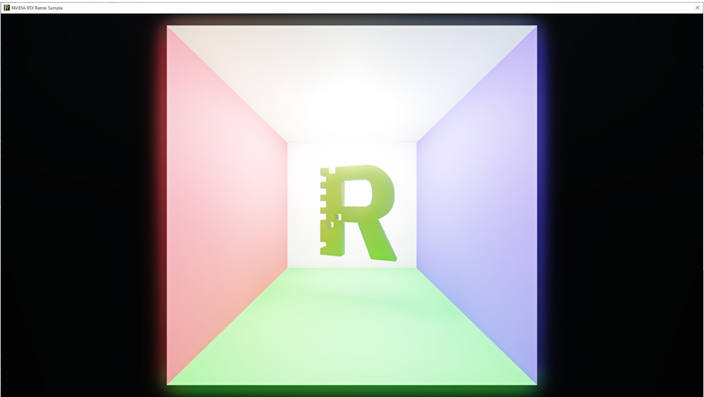

6. Демонстрационное приложение простое и не содержит
   [текстур интерфейса](../gettingstarted/learning-runtimesetup.md#настройка-текстур-интерфейса), поэтому разметку текстур
   можно пропустить.

   Переходите к захвату первой сцены.

   Откройте меню RTX Remix «Graphics Settings Menu», нажав `Alt+X`. Затем откройте `Developer Settings Menu`, нажав
   кнопку «Developer Settings Menu».

   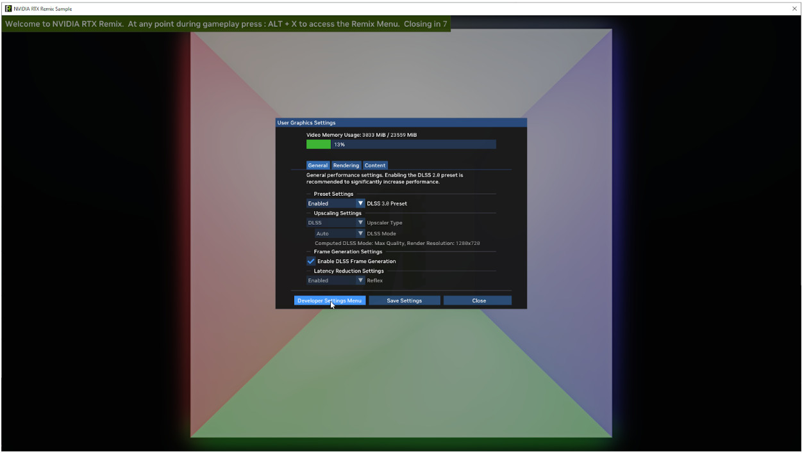

7. В «Developer Settings Menu» откройте вкладку `Enhancements Tab`, чтобы увидеть настройки «Enhancements», в том
   числе настройки захвата.

   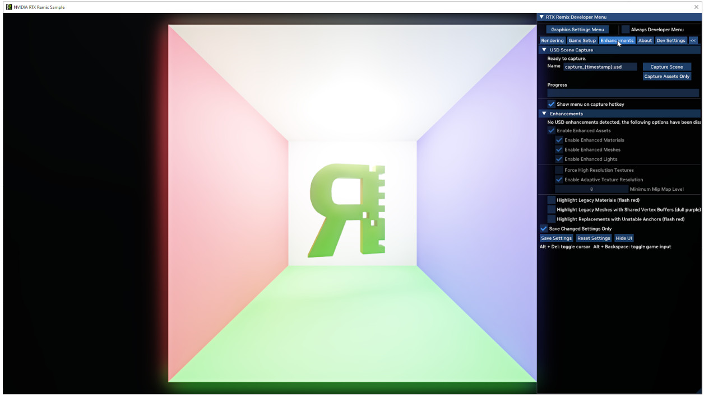

8. **Отключив улучшения (enhancements)**, можно задать имя захвата. Затем нажмите кнопку `Capture Scene`.

   Текущий кадр будет захвачен, и на диск сохранится USD-файл со всеми данными. Ход захвата показывает индикатор
   выполнения. Когда он дойдёт до 100%, можно приступать к созданию проекта в RTX Remix Toolkit.

   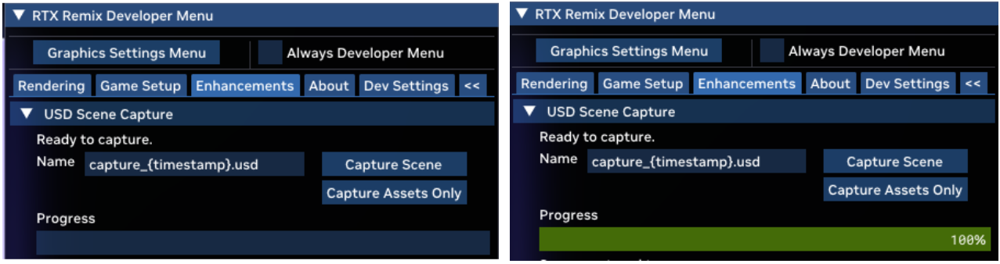

## 4. Создание проекта для мода демонстрационного приложения

Когда демонстрационное приложение захвачено, можно создать проект для его мода.

1. Запустите RTX Remix Toolkit из NVIDIA App. После запуска нажмите кнопку `New`, чтобы открыть мастер создания
   проекта.

   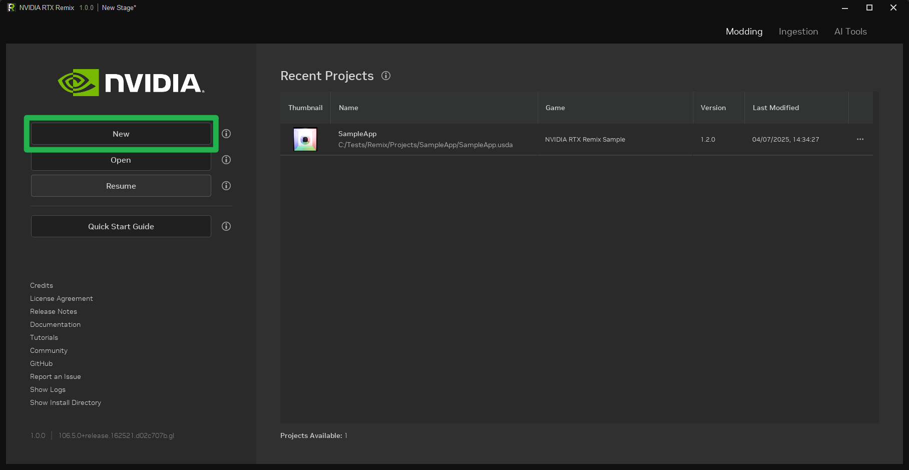

2. В «RTX Remix Project Wizard» нажмите кнопку `Create`, чтобы начать создание нового проекта.

   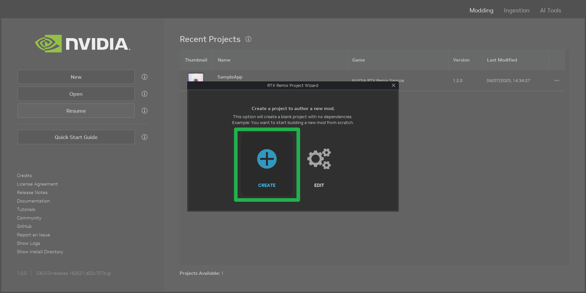

3. Нажмите кнопку **Browse**  у поля `Project File Location`, чтобы выбрать путь к файлу мода.

   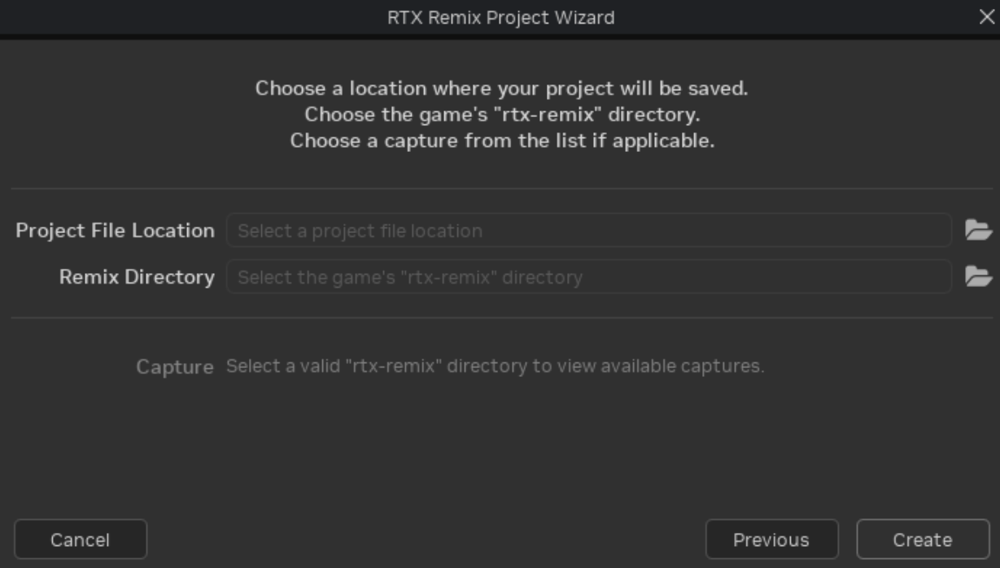

4. В диалоге выбора файла **создайте новый каталог** для проекта через контекстное меню (правая кнопка мыши). Затем
   **задайте имя файла** слоя проекта и выберите тип файла USDA.

   Рекомендуется сохранять слой проекта в формате USDA: в данном случае читаемость файла важнее производительности.

   Если в выбранном пути обнаружатся ошибки, они будут показаны в диалоговом окне.

   ```{seealso}
   Сейчас самое время прочитать раздел документации о рекомендуемых практиках.

   В разделе [Выбор каталогов проекта](../howto/learning-bestpractices.md#выбор-каталогов-проекта) есть полезные
   сведения о том, где размещать каталог проекта, создаваемый на этом шаге.
   ```

   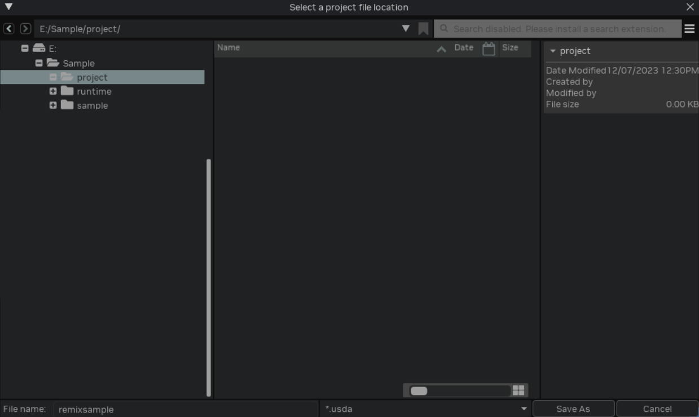

5. Затем нажмите кнопку **Browse**  у поля `Remix Directory`.

   Выберите каталог `rtx-remix`, созданный ранее при захвате демонстрационного приложения.

   Где находится каталог демонстрационного приложения, см. на [шаге 3](#3-настройка-rtx-remix-runtime-для-демонстрационного-приложения).
   Каталог `rtx-remix` находится внутри каталога `sample`.

6. Задав расположение файла проекта и каталог Remix, выберите сделанный ранее захват сцены и нажмите кнопку `Create`.

   ```{note}
   Появится запрос на разрешение выполнить действие RTX Remix Toolkit от имени администратора. Это разрешение нужно,
   чтобы создать символическую ссылку на проект в каталоге игры.

   Подробнее о том, зачем нужно это разрешение, см.
   [статью](https://learn.microsoft.com/en-us/windows/security/threat-protection/security-policy-settings/create-symbolic-links)
   Microsoft.
   ```

7. Проект RTX Remix создан и готов к работе.

   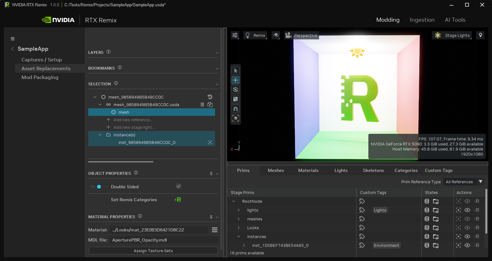

## 5. Импорт и замена ассетов

Проект создан, и можно приступать к замене ассетов в моде.

Заменим меш **RTX Remix**  на обновлённый ассет.

Для проверки можно использовать этот ассет диско-шара:
[SM_Prop_Discoball](https://d4i3qtqj3r0z5.cloudfront.net/SM_Prop_DiscoBall%402.zip)

1. Прежде чем использовать ассет в моде, его нужно импортировать. Перейдите на вкладку `Ingest`.

   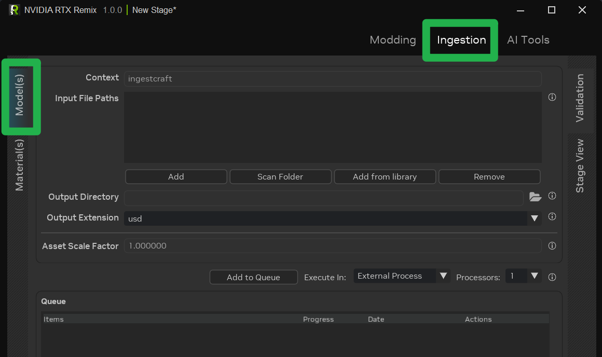

2. Перетащите скачанный ассет (или любой другой) в область `Input File Paths`.

3. Нажмите кнопку `Add to Queue`, чтобы добавить ассет в очередь импорта. Процесс завершён, когда прогресс ассета
   достигнет 100% и индикатор станет зелёным.

   ```{tip}
   Выходной каталог импортированных ассетов можно настроить, но по умолчанию он уже задан.

   Если выходной каталог не задан вручную, импортированный ассет помещается в каталог
   `<PROJECT_DIRECTORY>\assets\ingested`.
   ```

4. Ассет импортирован, и пора заменить захваченный ассет. Вернитесь на вкладку `Modding`.

5. Выберите ассет, который нужно заменить. В данном случае выделите во вьюпорте меш **RTX Remix** .

   Выделив ассет, убедитесь, что на [панели «Selection»](../howto/learning-toolkit.md#панель-selection) выбрана ссылка. Затем нажмите кнопку **Browse**  на панели `Object Properties` и выберите только что импортированный ассет.

   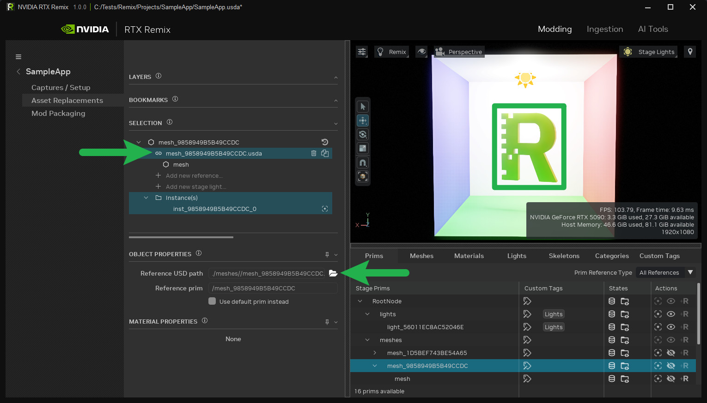

6. После замены при необходимости трансформируйте ассет (переместите, поверните и отмасштабируйте), чтобы он совпадал
   с исходным. Для этого используйте панель `Object Properties`.

   Новый ассет должен появиться во вьюпорте.

   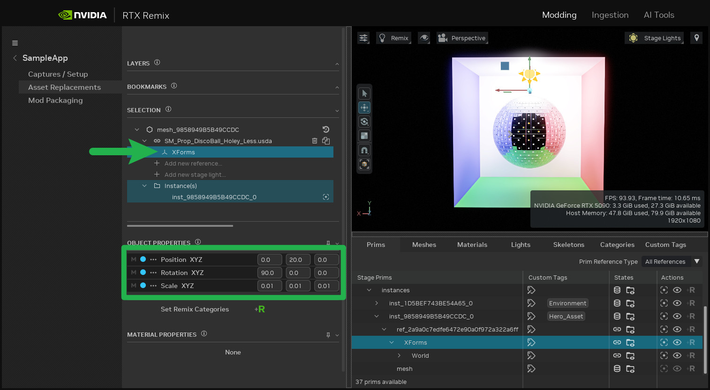

7. Чтобы увидеть изменения в игре, сохраните мод (`CTRL+S`) и запустите исполняемый файл `RemixSample.exe`.

   Обновлённый ассет должен появиться в игре.

   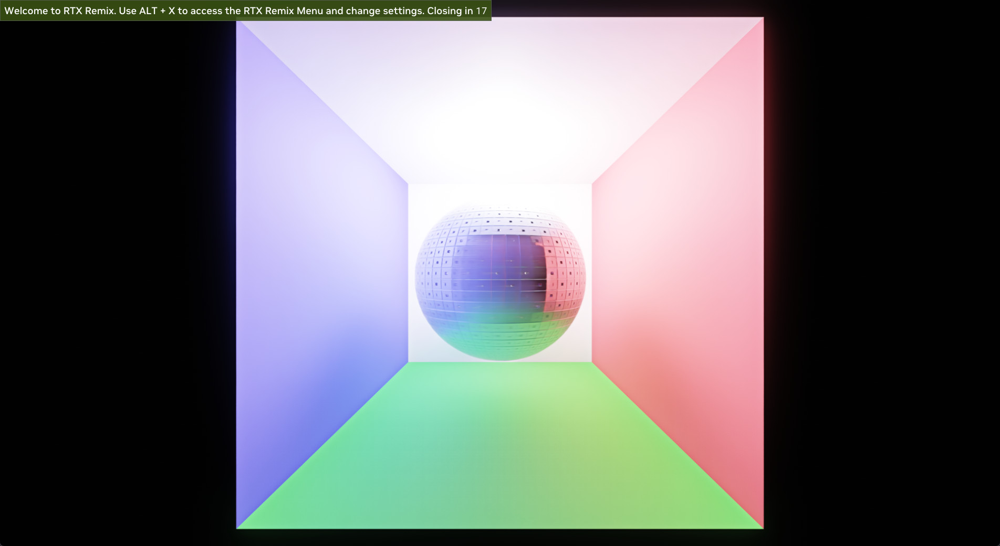

Поздравляем! Вы успешно создали свой первый мод RTX Remix.

***
<sub> Хотите оставить отзыв о документации RTX Remix? [Нажмите здесь](https://github.com/NVIDIAGameWorks/rtx-remix/issues/new?assignees=nvdamien&labels=documentation%2Cfeedback%2Ctriage&projects=&template=documentation_feedback.yml&title=%5BDocumentation+feedback%5D%3A+) </sub>
