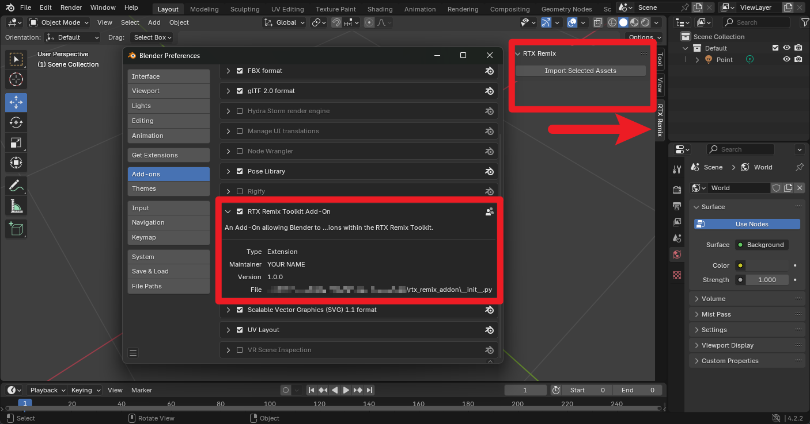
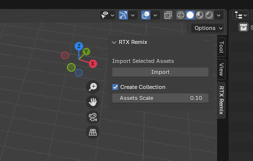
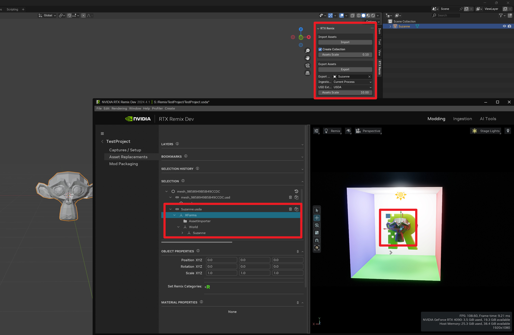

# Создание дополнения для Blender с помощью REST API

```{note}
**Это руководство рассчитано на технически подготовленных пользователей.**

Чтобы следовать ему, нужно иметь базовое представление о языке программирования Python, RESTful API и Blender.
```

В этом руководстве мы создадим дополнение (add-on) для Blender, которое взаимодействует с внешним приложением через
REST API.

Дополнение Blender — это код, добавляющий в Blender новые возможности. С его помощью можно расширять функциональность
Blender или интегрировать его с другими программами.

Мы сосредоточимся на REST API RTX Remix, но для любого другого REST API процесс будет таким же.

---

## Требования

Прежде чем создавать дополнение для Blender, убедитесь, что установлено следующее:

- [Blender](https://www.blender.org/)
- [Python](https://www.python.org/downloads/) ([версии 3.11 или новее](https://studio.blender.org/pipeline/td-guide/python))
- [RTX Remix Toolkit](https://docs.omniverse.nvidia.com/kit/docs/rtx_remix/2024.4.1/docs/remix-installation.html#installing-the-rtx-remix-toolkit) (
  версии 2024.4.0 или новее)

**_Необязательно:_**

- Удобный вам редактор кода может оказаться лучше встроенного окна Scripting в Blender:
    - [Visual Studio Code](https://code.visualstudio.com/)
        - [Настройка Python](https://code.visualstudio.com/docs/python/python-tutorial)
    - [JetBrains PyCharm](https://www.jetbrains.com/pycharm/)

- Хорошая идея — хранить код в системе контроля версий, например Git.
    - [Git](https://git-scm.com/)
    - [Учётная запись GitHub](https://github.com/)

---

## Готовый код руководства

Код, написанный в этом руководстве, можно скачать по ссылке:

[Скачать код](../data/zips/rtx_remix_addon.zip)

---

## Архитектура

В самых общих чертах архитектура дополнения RTX Remix для Blender будет такой:

- Дополнение строится с помощью [Blender Python API](https://docs.blender.org/api/current/).
    - Дополнения Blender создаются в виде скриптов на Python.
    - Скрипт дополнения определяет его поведение: создание интерфейса, взаимодействие с REST API и многое другое.
        - Панели (panels) — это компоненты интерфейса, отображаемые в Blender.
        - Операторы (operators) — это действия, которые выполняются, когда пользователь взаимодействует с панелью.


- Дополнение взаимодействует с RTX Remix Toolkit через
  [REST API](https://docs.omniverse.nvidia.com/kit/docs/rtx_remix/latest/docs/toolkitinterface/remix-toolkitinterface-restapi.html).
    - [REST API](https://www.geeksforgeeks.org/rest-api-introduction/) — способ, которым разные программы общаются друг
      с другом без явных соединений между ними. Это что-то вроде набора правил о том, как запрашивать и передавать
      информацию.
    - [REST API](https://docs.omniverse.nvidia.com/kit/docs/rtx_remix/latest/docs/toolkitinterface/remix-toolkitinterface-restapi.html)
      RTX Remix Toolkit позволяет любому внешнему приложению получать выбранные ассеты или текстуры, запускать импорт,
      заменять ссылки и многое другое.
        - Все эти действия описаны в REST API как конечные точки (`endpoints`).


- С помощью RTX API дополнение сможет выполнять любые функции и получать информацию из любой
  [конечной точки](https://docs.omniverse.nvidia.com/kit/docs/rtx_remix/latest/docs/howto/learning-restapi-docs.html), определённой в REST API.

**ПРИМЕЧАНИЕ:** чтобы дополнение могло отправлять HTTP-запросы серверу REST API, который создаётся при запуске Toolkit,
RTX Remix Toolkit должен быть открыт.

---

## Начало работы

### Настройка редактора кода

1. Откройте удобный вам редактор кода.
2. Создайте новый проект (каталог) для дополнения.
3. Создайте новый скрипт Python с именем `rtx_remix_addon.py`.

### _[НЕОБЯЗАТЕЛЬНО]_ Открытие и закрытие окна консоли Blender

Поскольку мы создаём дополнение для Blender, открытая консоль Blender поможет лучше понимать, что происходит во время
выполнения скрипта.

1. Откройте меню `Window`.
2. Выберите пункт `Toggle System Console`.

Консоль откроется в отдельном окне, и следить за происходящим станет проще.

Чтобы закрыть консоль, просто повторите те же действия.

---

## Структура файлов дополнения Blender

Чтобы код оставался упорядоченным, а дополнение было легко расширять, разделим код на несколько модулей.

Подробнее о модулях и пакетах Python см. [в этой статье](https://www.geeksforgeeks.org/python-packages/).

Хотя мы планируем создать только одну панель с несколькими операторами, используем следующую структуру файлов, чтобы
дополнение было хорошо организовано и расширяемо:

```
rtx_remix_addon/
    blender_manifest.toml
    __init__.py
    operators/
        __init__.py
        operator1.py
        operator2.py
        ...
    panels/
        __init__.py
        panel1.py
        panel2.py
        ...
    properties/
        __init__.py
        property1.py
        property2.py
        ...
    utils/
        __init__.py
        utils1.py
        utils2.py
        ...
```

С учётом дополнения, которое мы начинаем создавать, и описанной выше структуры у нас должна получиться следующая
структура файлов:

```
rtx_remix_addon/
    blender_manifest.toml
    __init__.py
    operators/
        __init__.py
        import_assets_operator.py
    panels/
        __init__.py
        viewport_panel.py
```

**Если вы ещё этого не сделали, создайте эту структуру файлов в редакторе кода.**

---

## Создание дополнения для Blender

Лучше всего начинать создание дополнения для Blender с
[официального руководства Blender](https://docs.blender.org/manual/en/latest/advanced/scripting/addon_tutorial.html).

Это руководство посвящено дополнению, работающему с RTX Remix Toolkit.

### `rtx_remix_addon/blender_manifest.py`

Начиная с Blender 4.2, чтобы менеджер дополнений распознал дополнение, в его каталоге должен быть файл
`blender_manifest.toml`.

```toml
id = "rtx_remix_addon"

name = "RTX Remix Toolkit Add-On"
maintainer = "YOUR NAME <you@email.com>"

type = "Add-On"

version = "1.0.0"
schema_version = "1.0.0"
blender_version_min = "4.2.0"

tagline = "An Add-On allowing Blender to perform actions within the RTX Remix Toolkit"

license = ["SPDX:GPL-3.0-or-later"]
```

### `rtx_remix_addon/__init__.py`

Файл `__init__.py` верхнего уровня импортирует подмодули и регистрирует их при включении дополнения.

Не беспокойтесь, если какие-то методы пока не определены: мы определим их на следующих шагах.

```python
from .operators import register as register_operators
from .operators import unregister as unregister_operators
from .panels import register as register_panels
from .panels import unregister as unregister_panels


def register():
    register_operators()
    register_panels()


def unregister():
    unregister_panels()
    unregister_operators()


if __name__ == "__main__":
    register()
```

### `rtx_remix_addon/operators/__init__.py`

Файлы `__init__.py` в подпапках импортируют панели, операторы и другие классы, определённые в их пакете. Благодаря этому
модуль становится доступен файлу `__init__.py` верхнего уровня.

Кроме того, функции `register` и `unregister` должны регистрировать классы пакета в Blender с помощью модуля Blender
Python API.

И снова не беспокойтесь, если какие-то классы пока не определены: мы определим их на следующих шагах.

```python
import bpy

from .import_assets_operator import REMIX_OT_ImportAssets


def register():
    bpy.utils.register_class(REMIX_OT_ImportAssets)


def unregister():
    bpy.utils.unregister_class(REMIX_OT_ImportAssets)


if __name__ == "__main__":
    register()
```

### `rtx_remix_addon/operators/import_assets_operator.py`

Этот класс определяет простой оператор — функцию, которую можно вызвать из интерфейса Blender. Метод `execute`
определяет, что происходит при вызове оператора. В данном случае он просто выводит сообщение и сообщает Blender, что
работа выполнена.

```python
import bpy


class REMIX_OT_ImportAssets(bpy.types.Operator):
    bl_idname = "rtx_remix.import_selected_assets"
    bl_label = "Import Selected Assets"
    bl_description = "Import the assets selected in the RTX Remix Toolkit"
    bl_options = {"REGISTER", "UNDO"}  # Enable undo for the operator.

    def execute(self, context):
        self.report({"INFO"}, "Operator executed")
        return {"FINISHED"}
```

### `rtx_remix_addon/panels/__init__.py`

Файлы `__init__.py` в этом пакете выполняют ту же роль, что и файлы `__init__.py` в пакете `operators`.

```python
import bpy

from .viewport_panel import REMIX_PT_ViewportPanel


def register():
    bpy.utils.register_class(REMIX_PT_ViewportPanel)


def unregister():
    bpy.utils.unregister_class(REMIX_PT_ViewportPanel)


if __name__ == "__main__":
    register()
```

### `rtx_remix_addon/panels/viewport_panel.py`

Этот класс определяет панель в интерфейсе Blender. Метод `draw` определяет, что отображается на панели. Здесь он
добавляет кнопку для вызова нашего оператора Import Assets.

```python
import bpy

from ..operators import REMIX_OT_ImportAssets


class REMIX_PT_ViewportPanel(bpy.types.Panel):
    bl_label = "RTX Remix"
    bl_idname = "REMIX_PT_ViewportPanel"
    bl_space_type = "VIEW_3D"
    bl_region_type = "UI"
    bl_category = "RTX Remix"

    def draw(self, context):
        self.layout.operator(REMIX_OT_ImportAssets.bl_idname)
```

### У нас есть простое дополнение!

На этом этапе можно перейти сразу к разделу [Установка дополнения Blender](#установка-дополнения-blender) и начать
тестировать дополнение в Blender.

Однако пока возможности дополнения весьма ограничены, поэтому следующий раздел руководства посвящён расширению его
функциональности с помощью REST API RTX Remix Toolkit.

### _[НЕОБЯЗАТЕЛЬНО]_ Структура репозитория Git

Если вы используете Git, папка `rtx_remix_addon` должна быть подкаталогом репозитория Git, например так:

```
Blender-RTX-Remix/
    .gitignore
    LICENSE.md
    README.md
    rtx_remix_addon/
        blender_manifest.toml
        __init__.py
        operators/
            __init__.py
            import_assets_operator.py
        panels/
            __init__.py
            viewport_panel.py
```

---

## Добавление функций Remix с помощью REST API

Теперь, когда у нас есть хорошо организованное дополнение со всеми нужными файлами, добавим в него реальную
функциональность с помощью REST API RTX Remix Toolkit.

Как описано в разделе [Архитектура](#архитектура), теперь дополнению нужно отправлять HTTP-запросы
к REST API.

Для начала напишем простую обёртку над модулем `requests`, которая будет отправлять HTTP-запросы к REST API.

### Утилиты для примов

Хотя этот класс понадобится только позже, сейчас мы создадим вспомогательный класс для работы с примами, а точнее — с
путями к примам.

Создайте файл `rtx_remix_addon/utils/prims.py` и начните с импорта нужных модулей.

#### Импорт нужных модулей

```python
import re
```

Модуль `re` будет использоваться для применения [регулярных выражений](https://www.geeksforgeeks.org/python-regex/) к
путям примов, полученным от REST API.

#### Создание вспомогательного класса

```python
class PrimsUtils:
```

Классу `PrimsUtils` не нужны атрибуты, поэтому оставим его пустым.

#### Вспомогательный метод для получения пути корневого меша по мешу-ссылке

```python
@staticmethod
def get_mesh_path(prim_path: str) -> str | None:
    """
    Get the root mesh path from a refrence prim path using regular expressions.

    Examples:
        /RootNode/meshes/mesh_HASH/mesh -> /RootNode/meshes/mesh_HASH

    Args:
        prim_path: The prim path to get the mesh path from

    Returns:
        The mesh path if the prim path matches the pattern, otherwise None
    """
    mesh_pattern = r"^(.*mesh_[A-Z0-9]{16}(?:_[0-9])*)\/.*$"
    pattern_match = re.match(mesh_pattern, prim_path)
    if pattern_match:
        return pattern_match.group(1)
    return None
```

Определённый выше метод `get_mesh_path` принимает путь к приму. Если путь соответствует определённому шаблону, метод
возвращает путь к базовому мешу, иначе — `None`. Подробнее см. пример в строке документации (docstring).

Пока это единственный нужный нам вспомогательный метод для примов.

### Утилиты для REST API

Теперь напишем вспомогательный класс, оборачивающий HTTP-запросы в удобные методы Python.

При создании вспомогательных методов можно использовать
[документацию REST API RTX Remix](https://docs.omniverse.nvidia.com/kit/docs/rtx_remix/latest/docs/howto/learning-restapi-docs.html), где описаны возможные параметры запроса,
содержимое тела запроса, возвращаемые значения и т. д.

Создайте файл `rtx_remix_addon/utils/api.py` и начните с импорта нужных модулей.

#### Импорт нужных модулей

```python
import requests
import json
from http import HTTPMethod
from pathlib import Path
```

Модуль `requests` будет отправлять HTTP-запросы к REST API. Модуль `json` будет преобразовывать данные в формат JSON.
Модуль `http` будет задавать HTTP-метод запроса. Наконец, модуль `pathlib` будет использоваться для работы с путями к
файлам.

#### Создание вспомогательного класса

```python
class APIUtils:
    def __init__(self, base_url: str = "http://127.0.0.1:8011"):
        self.base_url = base_url
```

По умолчанию REST API RTX Remix доступен по адресу `http://127.0.0.1:8011`. Этот базовый URL берётся из настроек Kit
`/exts/omni.services.transport.server.http/host` и `/exts/omni.services.transport.server.http/port`, поэтому если при
запуске Toolkit вы переопределяете какую-либо из них, измените значение `base_url` в соответствии с заданными хостом/IP
и портом. Таким образом, переменная `base_url` задаёт базовый URL REST API и гарантирует, что код не сломается при
изменении адреса.

Пример переопределения при запуске и адрес динамической документации см. в разделе
[Использование REST API](../howto/learning-restapi.md).

Если смена URL создаёт проблемы, его можно даже вынести в интерфейс дополнения Blender как параметр, который задаёт
пользователь.

#### Метод для отправки запроса

```python
def _send_request(
    self,
    method: HTTPMethod,
    endpoint: str,
    data: dict = None,
    params: dict = None,
    version: str = "1.0"
) -> dict:
    """
    Sends a request to the RTX Remix REST API and returns the response as a dictionary.

    Args:
        method: The HTTP method to use for the request (e.g. GET, POST, PUT, DELETE).
        endpoint: The endpoint to send the request to.
        data: The data to send in the request body.
        params: The query parameters to send with the request.
        version: The version of the API to use.
    """

    url = f"{self.base_url}{endpoint}"
    headers = {
        "Content-Type": "application/json",
        "Accept": f"application/lightspeed.remix.service+json; version={version}",
    }

    response = requests.request(
        method, url, headers=headers, data=json.dumps(data), params=params
    )
    response.raise_for_status()

    return response.json()
```

Здесь мы определили
[защищённый метод](https://www.geeksforgeeks.org/access-modifiers-in-python-public-private-and-protected/), который
отправляет HTTP-запрос к REST API и возвращает ответ в виде словаря.

Если происходит ошибка ([код ответа не 2XX](https://restfulapi.net/http-status-codes/)), метод также выбрасывает
исключение.

#### Вспомогательный метод для кодирования строк в URL

```python
def _encode_string(self, string: str) -> str:
    """
    Encode a string to be used in a URL.
    """
    return requests.utils.quote(string, safe='')
```

Поскольку в будущем может понадобиться динамически строить URL, создадим вспомогательный метод, который кодирует строки
безопасным для URL образом. Так генерировать URL будет проще, а логика их построения будет собрана в одном месте.

#### Вспомогательный метод для получения статуса API RTX Remix

```python
def get_status(self) -> bool:
    """
    Get the status of the RTX Remix API.
    """
    try:
        self._send_request(HTTPMethod.GET, "/status")
        return True
    except Exception:
        return False
```

Этот простой метод отправляет GET-запрос к конечной точке `/status` API RTX Remix и возвращает True, если запрос
успешен, и False в противном случае.

Нужно перехватывать любые исключения, которые могут возникнуть при запросе: если API недоступен, скорее всего,
возникнет ошибка соединения, а если API доступен, но не работает, мы можем просто получить ответ с кодом не 2XX.

#### Вспомогательный метод для получения открытого проекта

```python
def get_opened_project(self) -> str | None:
    """
    Get the currently opened project. Will return None if no project is opened.
    """
    try:
        response = self._send_request(HTTPMethod.GET, "/stagecraft/project")
        return response.get("layer_id")
    except requests.exceptions.HTTPError as e:
        # The REST API is expected to return a 404 if no project is opened
        if e.response.status_code == 404:
            return None
        else:
            raise
```

Этот метод отправляет GET-запрос к конечной точке `/stagecraft/project` API RTX Remix и возвращает данные проекта, если
запрос успешен, и None в противном случае.

Ожидается, что эта конечная точка вернёт ответ 404, если проект не открыт, поэтому этот случай нужно обработать.

Наконец, при любой другой ошибке мы повторно выбрасываем исключение, поскольку обрабатывать его здесь не нужно.

#### Вспомогательный метод для получения ассетов открытого проекта

```python
def get_assets(self, **kwargs) -> list[str]:
    """
    Get the assets in the currently opened project.

    Args:
        **kwargs: Additional query parameters to send with the request.

    Possible Query Parameters:
    - prim_hashes: list[str] - A list of specific asset hashes to get
    - prim_types: list[str] - A list of specific asset types to get
    - selection: bool - Whether to return only selected assets or all assets
    - filter_session_assets: bool - Whether to filter out assets defined on the session layer or not
    - layer_identifier: str - Look for assets that exists or not on a given layer
    - exists: bool - Whether to look for assets that exists or not on `layer_identifier`
    """
    params = {k: v for k, v in kwargs.items() if v is not None}
    response = self._send_request(HTTPMethod.GET, "/stagecraft/assets", params=params)

    return response.get("prim_paths")
```

Этот метод отправляет GET-запрос к конечной точке `/stagecraft/assets` API RTX Remix и возвращает данные об ассетах
(список [путей примов](https://openusd.org/dev/api/class_sdf_path.html)).

Метод также позволяет добавить к запросу дополнительные параметры. Они передаются в аргументе `kwargs`. Мы не
определяем в методе каждый параметр запроса по отдельности, потому что хотим отправлять только те параметры, которые
вы задали при вызове метода.

Недостаток такого подхода в том, что методу можно передать недопустимые параметры запроса. К счастью, недопустимые
параметры просто молча игнорируются.

#### Вспомогательный метод для получения путей к файлам, на которые ссылается ассет

```python
def get_file_paths(self, prim_path: str) -> list[str]:
    """
    Get the referenced absolute file paths for the given asset path.

    Args:
        prim_path: The asset path to get the referenced file paths for
    """
    encoded_path = self._encode_string(prim_path)
    response = self._send_request(HTTPMethod.GET, f"/stagecraft/assets/{encoded_path}/file-paths")
    reference_paths = response.get("reference_paths")

    # Build absolute paths from the reference paths
    file_paths = []
    for _, path in reference_paths:
        asset_path, layer_id = path
        file_paths.append(str(Path(layer_id).parent / asset_path))

    return file_paths
```

Этот метод делает немного больше, чем предыдущий. Он отправляет GET-запрос к конечной точке
`/stagecraft/assets/{prim_path}/file-paths` API RTX Remix, где `{prim_path}` — один из путей `prim_path`, полученных
методом `get_assets`.

Затем метод обрабатывает ответ REST API и возвращает список абсолютных путей к файлам, на которые ссылается ассет.

### Импорт выбранных ассетов

Теперь, когда у нас есть вспомогательный метод для получения информации из REST API RTX Remix, напишем полноценный метод
`execute` для оператора `REMIX_OT_ImportSelectedAssets`, определённого в файле
`rtx_remix_addon/operators/import_assets_operator.py`.

Это будет процесс из нескольких шагов. Нужно:

1. Убедиться, что REST API доступен.
2. Убедиться, что проект открыт.
3. Получить ассеты, выделенные во вьюпорте.
4. Получить пути к файлам, на которые ссылаются выделенные ассеты.
5. Импортировать эти файлы в сцену Blender.

#### Импорт нужных модулей

```python
import re

from ..utils.api import APIUtils
```

Класс `APIUtils` будет удобным способом отправлять HTTP-запросы к REST API. Модуль `re` понадобится позже, чтобы
извлекать путь базового меша с помощью [регулярных выражений](https://www.geeksforgeeks.org/python-regex/).

#### Инициализация вспомогательного класса

```python
def __init__(self):
    self._api = APIUtils()


def __del__(self):
    self._api = None
```

При инициализации класса оператора (`__init__`) мы создаём экземпляр класса `APIUtils` и сохраняем его в атрибуте
`_api`. Так один и тот же экземпляр можно будет использовать во всём классе.

При удалении класса оператора (`__del__`) атрибут `_api` также удаляется.

#### Реализация метода `execute`

```python
def execute(self, context):
    ASSETS_SCALE = 0.1
    CREATE_COLLECTION = True

    # Make sure the API is running
    if not self._api.get_status():
        self.report({"ERROR"}, "The REST API is not running")
        return {"CANCELLED"}

    # Make sure a project is opened
    if not self._api.get_opened_project():
        self.report({"ERROR"}, "No project is opened")
        return {"CANCELLED"}

    try:
        # Get the assets selected in the RTX Remix viewport
        assets = self._api.get_assets(selection=True, prim_types="models")

        # Get the mesh paths for the selected assets
        meshes = [PrimsUtils.get_mesh_path(asset) for asset in assets if PrimsUtils.get_mesh_path(asset)]

        # Get the referenced file paths for the selected assets
        file_paths = set()
        for mesh in meshes:
            file_paths = file_paths.union(self._api.get_file_paths(mesh))

        # Import the selected assets
        for file_path in file_paths:
            # Assets coming from Remix are always in USD format
            bpy.ops.wm.usd_import(
                filepath=file_path,
                create_collection=CREATE_COLLECTION,
                scale=ASSETS_SCALE,
                import_visible_only=False,
                relative_path=False,
            )
    except Exception as e:
        self.report({"ERROR"}, str(e))
        return {"CANCELLED"}

    return {"FINISHED"}
```

**ПРИМЕЧАНИЕ: чтобы содержимое метода выполнялось правильно, нужно импортировать PrimsUtils:**

```python
from ..utils.prims import PrimsUtils
```

Вернёмся к описанным ранее шагам:

1. Убедиться, что REST API доступен.
    ```python
    if not self._api.get_status():
        self.report({"ERROR"}, "The REST API is not running")
        return {"CANCELLED"}
    ```
   Здесь мы проверяем, что REST API работает. Если нет, выводим сообщение об ошибке и отменяем операцию.

2. Убедиться, что проект открыт.
    ```python
    if not self._api.get_opened_project():
        self.report({"ERROR"}, "No project is opened")
        return {"CANCELLED"}
    ```
   Здесь мы проверяем, что проект открыт. Если нет, выводим сообщение об ошибке и отменяем операцию.

3. Получить ассеты, выделенные во вьюпорте.
    ```python
    assets = self._api.get_assets(selection=True, prim_types="models")

    # /RootNode/meshes/mesh_HASH/mesh -> /RootNode/meshes/mesh_HASH
    mesh_pattern = r"^(.*mesh_[A-Z0-9]{16}(?:_[0-9])*)\/.*$"
    meshes = []
    for asset in assets:
        pattern_match = re.match(mesh_pattern, asset)
        if pattern_match:
            meshes.append(pattern_match.group(1))
    ```
   Здесь мы получаем ассеты-модели, выделенные во вьюпорте, и сохраняем их в переменной `assets`. Обратите внимание на
   аргументы `selection=True` и `prim_types="models"`: они указывают, что нужны только выделенные ассеты-модели.

   Затем с помощью модуля `re` мы извлекаем путь базового меша из пути ассета. Например, если путь ассета —
   `/RootNode/meshes/mesh_HASH/mesh`, путь базового меша будет `/RootNode/meshes/mesh_HASH`. Обратите внимание, что меш
   добавляется, только если найдено совпадение. Меши всегда должны совпадать с шаблоном, но если вдруг нет, мы не хотим
   выбрасывать ошибку.

   Подробнее о регулярных выражениях и модуле `re` см. [в этом руководстве](https://www.geeksforgeeks.org/python-regex/).

4. Получить пути к файлам, на которые ссылаются выделенные ассеты.
    ```python
    file_paths = set()
    for mesh in meshes:
        file_paths = file_paths.union(self._api.get_file_paths(mesh))
    ```
   Здесь мы получаем пути к файлам, на которые ссылаются выделенные ассеты, и сохраняем их в переменной `file_paths`.
   Обратите внимание, что для удаления повторяющихся путей используется
   [структура данных `set`](https://www.geeksforgeeks.org/python-sets/).

5. Импортировать эти файлы в сцену Blender.
    ```python
    for file_path in file_paths:
        # Assets coming from Remix are always in USD format
        bpy.ops.wm.usd_import(
            filepath=file_path,
            create_collection=CREATE_COLLECTION,
            scale=ASSETS_SCALE,
            import_visible_only=False,
            relative_path=False,
        )
    ```
   Здесь мы импортируем в сцену Blender файлы мешей, на которые ведут ссылки. Параметр `import_visible_only` равен
   `False`, чтобы импортировались все меши, а не только видимые.

---

## Установка дополнения Blender

1. Упакуйте содержимое дополнения (в данном случае `rtx_remix_addon`) в ZIP-архив.
2. В Blender откройте меню `Edit`.
3. Выберите пункт `Preferences`.
4. В окне настроек откройте вкладку `Add-ons`.
5. Нажмите кнопку `⌄` в правом верхнем углу панели.
6. Выберите пункт `Install from Disk`.
7. Выберите ZIP-архив, созданный на шаге 1.

Дополнение включено и должно появиться на боковой панели вьюпорта Blender!



### Обновление дополнения Blender

Если вы внесли изменения в дополнение, обновите его в Blender, просто повторив
[те же шаги установки](#установка-дополнения-blender).

Установка дополнения поверх существующего просто обновит его в Blender.

---

## Заключение

Поздравляем! Вы создали дополнение для Blender, которое отправляет HTTP-запросы к REST API RTX Remix. Этот код можно
адаптировать под свои задачи, например изменить URL или добавить новые функции.

---

## Дополнительные возможности

Теперь, когда у вас есть работающее дополнение Blender, умеющее импортировать ассеты через REST API RTX Remix, в него
можно добавить новые функции.

Следующие разделы не так подробны, как остальная часть руководства, но помогут расширить возможности дополнения.

### Добавление параметров в дополнение Blender

Обратите внимание, что в разделе [Реализация метода `execute`](#реализация-метода-execute) в начале метода есть две
переменные:

```python
ASSETS_SCALE = 0.1
CREATE_COLLECTION = True
```

Если дать пользователю возможность их менять, дополнение станет функциональнее.

Для этого нужно сделать две вещи:

1. Определить свойство, которое может задавать пользователь.
2. Отобразить свойства в интерфейсе.

#### Определение свойства Blender

Вернувшись к разделу [Структура файлов дополнения Blender](#структура-файлов-дополнения-blender), добавим в дополнение класс
свойств.

Создайте файл `rtx_remix_addon/properties/import_assets_properties.py` и начните с импорта нужных модулей.

```python
import bpy
```

Затем можно создать несколько [типизированных](https://www.geeksforgeeks.org/type-hints-in-python/)
[переменных класса](https://www.geeksforgeeks.org/python-classes-and-objects/), определяющих наши свойства.

```python
assets_scale: bpy.props.FloatProperty(
    name="Assets Scale",
    description="Scale factor for imported assets",
    default=1.0,
    min=0.0001,
    max=10000.0
)

create_collection: bpy.props.BoolProperty(
    name="Create Collection",
    description="Create a new collection for imported assets",
    default=True
)
```

Свойства также нужно зарегистрировать — так же, как мы регистрировали панель и оператор в файле
[`rtx_remix_addon/operators/__init__.py`](#rtx_remix_addonoperators__init__py).

Создайте файл `rtx_remix_addon/properties/__init__.py` и зарегистрируйте модули.

```python
import bpy

from .import_assets_properties import REMIX_PG_ImportAssetsProperties


def register():
    bpy.utils.register_class(REMIX_PG_ImportAssetsProperties)

    bpy.types.Scene.remix_import_props = bpy.props.PointerProperty(type=REMIX_PG_ImportAssetsProperties)


def unregister():
    del bpy.types.Scene.remix_import_props

    bpy.utils.unregister_class(REMIX_PG_ImportAssetsProperties)


if __name__ == "__main__":
    register()
```

**Обратите внимание, что при регистрации и отмене регистрации свойств мы также обновляем пользовательские свойства
сцены.**

Теперь вместо [заданных ранее значений](#реализация-метода-execute) можно использовать свойства:

```python
props = context.scene.remix_import_props

bpy.ops.wm.usd_import(
    filepath=file_path,
    create_collection=props.create_collection,
    scale=props.assets_scale,
    import_visible_only=False,
    relative_path=False,
)
```

#### Отображение свойств в интерфейсе

Оператор отвечает только за определение действия, поэтому свойства нужно отобразить на панели.

Для этого изменим метод `draw` класса `REMIX_PT_ViewportPanel` (`rtx_remix_addon/panels/viewport_panel.py`), который
мы определили ранее.

Немного переработав существующий код, получим следующие методы:

```python
def draw(self, context):
    layout = self.layout

    # Create a column to organize the layout
    col = layout.column()

    # Setup the Import Assets operator
    self._setup_import_assets(context, col)


def _setup_import_assets(self, context, col):
    box = col.box()
    box_col = box.column()

    # Add a label
    box_col.label(text="Import Assets")

    # Add the operator button
    box_col.operator(REMIX_OT_ImportAssets.bl_idname, text="Import")

    # Add a separator
    box_col.separator()

    # Add the operator properties
    props = context.scene.remix_import_props
    box_col.prop(props, "create_collection")
    box_col.prop(props, "assets_scale")
```

Теперь метод `draw` вызывает определённый ниже защищённый метод `__setup_import_assets`. Этот новый метод отображает
созданный ранее оператор, а также только что определённые свойства.

Можно также заметить, что добавлены рамки (boxes) и разделители, а текст на кнопке оператора изменён.

Подробнее о построении макетов в Blender см.
[документацию Blender API](https://docs.blender.org/api/current/bpy.types.UILayout.html).

#### Результат

Теперь в интерфейсе есть пара параметров, влияющих на поведение оператора Import Selected Assets.



### Добавление ассета в RTX Remix Toolkit из Blender

Чтобы заменять ассеты в RTX Remix Toolkit из Blender, нужно добавить новый оператор `REMIX_OT_ExportAssets` и разместить
его на существующей панели `REMIX_PT_ViewportPanel`. За основу при создании нового оператора можно взять инструкции из
раздела [Создание дополнения для Blender](#создание-дополнения-для-blender).

Затем нужно реализовать метод `execute` оператора. Для своей работы этот метод будет вызывать вспомогательные методы,
поэтому начните с добавления нужных вспомогательных методов в класс `APIUtils` (`rtx_remix_addon/utils/api.py`).

#### Создание вспомогательных методов

Понадобятся следующие вспомогательные методы:

- `get_output_path` — получает выходной путь по умолчанию для импортированных ассетов текущего проекта;
- `ingest_models` — импортирует ассеты Blender в RTX Remix Toolkit;
- `replace_file_path` — заменяет путь к файлу ассета в RTX Remix Toolkit на только что импортированный ассет.

Начнём с метода `get_output_path`: нужно лишь запросить путь у REST API и вернуть его.

```python
def get_output_path(self) -> str:
    """
    Get the default ingested assets output path for the currently opened project.
    """
    response = self._send_request(HTTPMethod.GET, "/stagecraft/assets/default-directory")
    return response.get("asset_path")
```

Метод `ingest_models` немного сложнее. Он принимает список входных путей и выходной путь и по завершении импорта
возвращает выходные пути импортированных ассетов.

Мы также добавили необязательные аргументы для выбора исполнителя (executor) и расширения USD. Обратите внимание, что
для импорта ассетов эти аргументы не обязательны.

Сложность метода связана с формируемыми и получаемыми данными. Хотя параметров доступно много, для успешного импорта
достаточно передать входные файлы и выходной каталог.

Чтобы получить выходные пути по завершении импорта, мы также воспользуемся потоками данных (dataflows) импорта.

```python
def ingest_models(
    self, input_paths: list[str], output_path: str, executor: int = 1, usd_extension: str = "usd"
) -> list[str]:
    """
    Ingest a Blender mesh.

    Args:
        input_paths: A list of absolute file paths to the meshes to ingest
        output_path: The output path where the ingested assets will be stored

    Returns:
        A list of absolute file paths to the ingested assets
    """

    if executor not in [0, 1]:
        raise ValueError(f"Unsupported executor: {executor}.")

    if usd_extension not in ["usd", "usda", "usdc"]:
        raise ValueError(f"Unsupported USD extension: {usd_extension}.")

    # Prepare the data for the API request
    data = {
        "executor": executor,
        "context_plugin": {
            "data": {
                "input_files": input_paths,
                "output_directory": output_path,
                "output_usd_extension": usd_extension,
            },
        }
    }

    # Send the request
    response = self._send_request(HTTPMethod.POST, "/ingestcraft/mass-validator/queue/model", data=data)

    # Get the output paths when the ingestion is complete
    output_paths = []
    for completed_task in response.get("completed_schemas"):
        dataflows = completed_task.get("context_plugin").get("data").get("data_flows")
        for dataflow in dataflows:
            if dataflow.get("channel") != "ingestion_output":
                continue
            output_paths.extend(dataflow.get("output_data"))

    return output_paths
```

Наконец, нужно создать метод `append_file_path`. Он принимает путь к приму и путь к файлу ассета и добавляет этот файл
к ассету в RTX Remix Toolkit.

```python
def append_file_path(self, prim_path: str, asset_file_path: str):
    """
    Replace an asset reference file path with a new one.
    """
    encoded_path = self._encode_string(prim_path)
    data = {
        "asset_file_path": asset_file_path
    }
    self._send_request(HTTPMethod.POST, f"/stagecraft/assets/{encoded_path}/file-paths", data=data)
```

#### Создание свойств

Мы хотим, чтобы у оператора Export Assets были те же возможности, что и у других операторов, поэтому создадим свойства
и для него.

Создайте файл `rtx_remix_addon/properties/export_assets_properties.py` и добавьте следующие свойства:

```python
import bpy


class REMIX_PG_ExportAssetsProperties(bpy.types.PropertyGroup):
    assets_scale: bpy.props.FloatProperty(
        name="Assets Scale",
        description="Scale factor for exported assets",
        default=1.0,
        min=0.0001,
        max=10000.0
    )

    export_target: bpy.props.PointerProperty(
        type=bpy.types.Object,
        name="Export Target",
        description="The target object to export",
    )

    ingestion_executor: bpy.props.EnumProperty(
        name="Ingestion Executor",
        description="Choose the RTX Remix ingestion executor",
        items=[
            ("0", "Current Process", "Execute ingestion in the current process"),
            ("1", "External Process", "Execute ingestion in an external process")
        ],
        default="1"
    )

    usd_extension: bpy.props.EnumProperty(
        name="USD Extension",
        description="Choose the USD file extension",
        items=[
            ("usd", "USD", "Universal Scene Description"),
            ("usda", "USDA", "USD ASCII"),
            ("usdc", "USDC", "USD Crate (binary)")
        ],
        default="usd"
    )
```

Свойство масштаба ассетов используется для масштабирования ассетов при экспорте из Blender. Свойство цели экспорта
задаёт объект, который нужно экспортировать.

Свойство исполнителя импорта задаёт исполнителя, используемого при импорте. Свойство расширения USD задаёт расширение
файлов импортированных ассетов.

Также нужно зарегистрировать группу свойств (Property Group) в файле `rtx_remix_addon/properties/__init__.py`.

```python
import bpy

from .export_assets_properties import REMIX_PG_ExportAssetsProperties
from .import_assets_properties import REMIX_PG_ImportAssetsProperties


def register():
    bpy.utils.register_class(REMIX_PG_ExportAssetsProperties)
    bpy.utils.register_class(REMIX_PG_ImportAssetsProperties)

    bpy.types.Scene.remix_export_props = bpy.props.PointerProperty(type=REMIX_PG_ExportAssetsProperties)
    bpy.types.Scene.remix_import_props = bpy.props.PointerProperty(type=REMIX_PG_ImportAssetsProperties)


def unregister():
    del bpy.types.Scene.remix_export_props
    del bpy.types.Scene.remix_import_props

    bpy.utils.unregister_class(REMIX_PG_ExportAssetsProperties)
    bpy.utils.unregister_class(REMIX_PG_ImportAssetsProperties)


if __name__ == "__main__":
    register()
```

#### Создание оператора

Теперь, когда все вспомогательные методы готовы, можно создать оператор. Следуя тем же шагам, что и в предыдущем
разделе, создадим файл `rtx_remix_addon/operators/export_assets_operator.py` и начнём реализовывать его содержимое.

Начнём с импорта нужных зависимостей.

Модули `pathlib` и `tempfile` будут использоваться для создания временных каталогов и файлов, а модули `APIUtils` и
`PrimsUtils` — для взаимодействия с RTX Remix Toolkit и обработки путей примов, возвращаемых REST API.

```python
import bpy
from pathlib import Path
from tempfile import TemporaryDirectory

from ..utils.api import APIUtils
from ..utils.prims import PrimsUtils
```

Затем определим класс оператора `REMIX_OT_ExportAssets`.

```python
class REMIX_OT_ExportAssets(bpy.types.Operator):
    bl_idname = "rtx_remix.export_assets"
    bl_label = "Export Assets"
    bl_description = (
        "Export the selected assets to the RTX Remix Toolkit and append the reference to the "
        "selected meshes"
    )

    def __init__(self):
        self._api = APIUtils()

    def __del__(self):
        self._api = None
```

Как и для оператора `REMIX_OT_ImportAssets`, теперь реализуем метод `execute`.

Метод может выглядеть устрашающе, но комментарии помогут в нём разобраться.

- Как и в методе `execute` оператора `REMIX_OT_ImportAssets`, сначала проверяем входные данные и состояние API.
- Затем получаем выделение в RTX Remix Toolkit и убеждаемся, что есть целевой ассет, к которому можно добавить
  экспортированные ассеты.
- Следующий шаг — получить выходной путь для импорта.
- После этого выделяем цель экспорта в Blender, чтобы экспортировать именно нужные ассеты.
- Затем с помощью оператора `bpy.ops.file.pack_all()` собираем все текстуры экспортируемого ассета.
- Далее создаём временный каталог и по имени цели экспорта формируем временный путь к файлу.
- Затем экспортируем целевой объект в OBJ-файл во временном каталоге и импортируем его методом `ingest_models` класса
  `APIUtils`.
- Наконец, добавляем абсолютные пути импортированных ассетов к целевому мешу методом `append_file_path` класса
  `APIUtils`.

```python
def execute(self, context):
    props = context.scene.remix_export_props

    # Make sure an export target is selected
    if not props.export_target:
        self.report({"ERROR"}, "An export target must be selected")
        return {"CANCELLED"}

    # Make sure the API is running
    if not self._api.get_status():
        self.report({"ERROR"}, "The REST API is not running")
        return {"CANCELLED"}

    # Make sure a project is opened
    if not self._api.get_opened_project():
        self.report({"ERROR"}, "No project is opened")
        return {"CANCELLED"}

    try:
        # Get the assets selected in the RTX Remix viewport
        assets = self._api.get_assets(selection=True, prim_types="models")

        # Get the mesh paths for the selected assets
        meshes = [PrimsUtils.get_mesh_path(asset) for asset in assets if PrimsUtils.get_mesh_path(asset)]

        if not meshes:
            self.report({"ERROR"}, "No asset selected in RTX Remix")
            return {"CANCELLED"}

        # If multiple meshes are selected in Remix, use the first one
        target_mesh = meshes[0]

        # Get the ingestion output path
        output_path = self._api.get_output_path()

        # Selected the Export Target
        bpy.ops.object.select_all(action="DESELECT")
        props.export_target.select_set(True)
        context.view_layer.objects.active = props.export_target

        # Pack all textures
        bpy.ops.file.pack_all()

        # Setup a temporarary directory
        with TemporaryDirectory() as temp_dir:
            # Build a temporary file path
            temp_file = str((Path(temp_dir) / props.export_target.name).with_suffix(".obj"))

            # Export the target Object
            bpy.ops.wm.obj_export(
                filepath=temp_file,
                global_scale=props.assets_scale,
                export_pbr_extensions=True,
                path_mode="COPY",
                export_triangulated_mesh=True,
            )

            # Ingest the exported model
            ingested_paths = self._api.ingest_models(
                [temp_file],
                output_path,
                executor=int(props.ingestion_executor),
                usd_extension=props.usd_extension
            )

        # Append the references to the target mesh
        for ingested_path in ingested_paths:
            self._api.append_file_path(target_mesh, ingested_path)

    except Exception as e:
        self.report({"ERROR"}, str(e))
        return {"CANCELLED"}

    return {"FINISHED"}
```

Последний шаг перед завершением дополнения — зарегистрировать новый оператор (в `rtx_remix_addon/operators/__init__.py`)
и добавить его на панель (в `rtx_remix_addon/panels/viewport_panel.py`).

```python
import bpy

from .export_assets_operator import REMIX_OT_ExportAssets
from .import_assets_operator import REMIX_OT_ImportAssets


def register():
    bpy.utils.register_class(REMIX_OT_ExportAssets)
    bpy.utils.register_class(REMIX_OT_ImportAssets)


def unregister():
    bpy.utils.unregister_class(REMIX_OT_ExportAssets)
    bpy.utils.unregister_class(REMIX_OT_ImportAssets)


if __name__ == "__main__":
    register()
```

#### Добавление оператора и свойств на панель

Итоговая реализация панели должна выглядеть так:

```python
import bpy

from ..operators import REMIX_OT_ExportAssets
from ..operators import REMIX_OT_ImportAssets


class REMIX_PT_ViewportPanel(bpy.types.Panel):
    bl_label = "RTX Remix"
    bl_idname = "REMIX_PT_ViewportPanel"
    bl_space_type = "VIEW_3D"
    bl_region_type = "UI"
    bl_category = "RTX Remix"

    def draw(self, context):
        layout = self.layout

        # Create a column to organize the layout
        col = layout.column()

        # Setup the Import Assets operator
        self._setup_import_assets(context, col)

        # Add a separator
        col.separator()

        # Setup the Export operator
        self._setup_export_assets(context, col)

    def _setup_import_assets(self, context, col):
        box = col.box()
        box_col = box.column()

        # Add a label
        box_col.label(text="Import Assets")

        # Add the operator button
        box_col.operator(REMIX_OT_ImportAssets.bl_idname, text="Import")

        # Add a separator
        box_col.separator()

        # Add the operator properties
        props = context.scene.remix_import_props
        box_col.prop(props, "create_collection")
        box_col.prop(props, "assets_scale")

    def _setup_export_assets(self, context, col):
        box = col.box()
        box_col = box.column()

        # Add a label
        box_col.label(text="Export Assets")

        # Add the operator button
        box_col.operator(REMIX_OT_ExportAssets.bl_idname, text="Export")

        # Add a separator
        box_col.separator()

        # Add the operator properties
        props = context.scene.remix_export_props
        box_col.prop(props, "export_target")
        box_col.prop(props, "ingestion_executor")
        box_col.prop(props, "usd_extension")
        box_col.prop(props, "assets_scale")
```

#### Результат

Теперь ваши ассеты должны появиться в RTX Remix Toolkit!



***
<sub> Хотите оставить отзыв о документации RTX Remix? [Нажмите здесь](https://github.com/NVIDIAGameWorks/rtx-remix/issues/new?assignees=nvdamien&labels=documentation%2Cfeedback%2Ctriage&projects=&template=documentation_feedback.yml&title=%5BDocumentation+feedback%5D%3A+) </sub>
